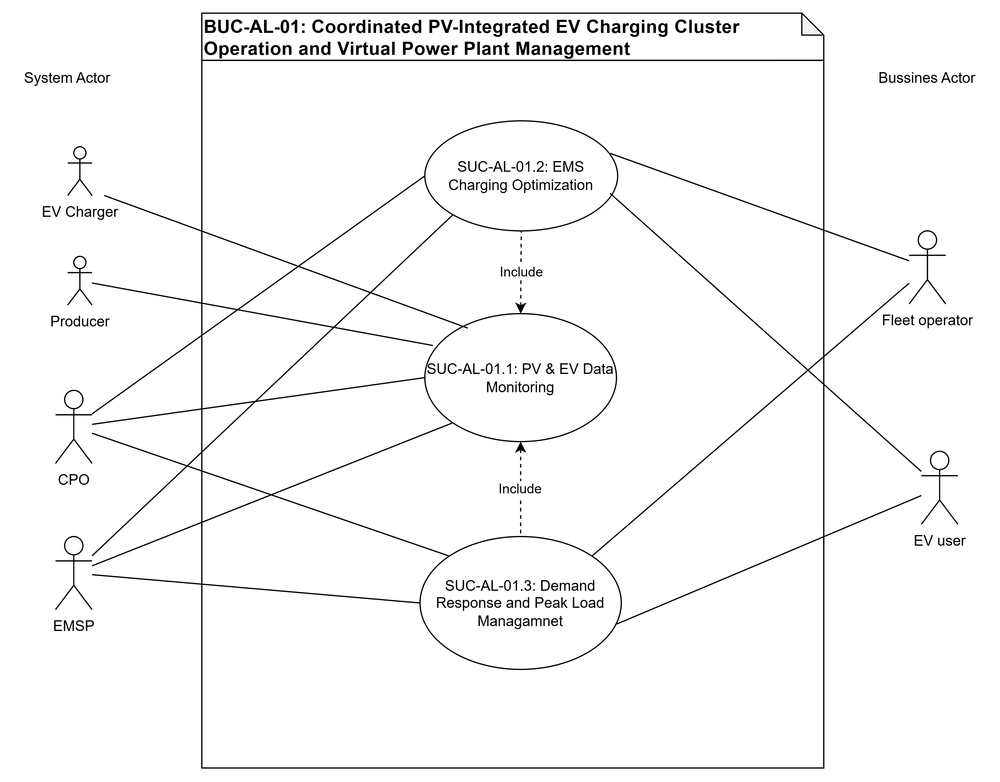
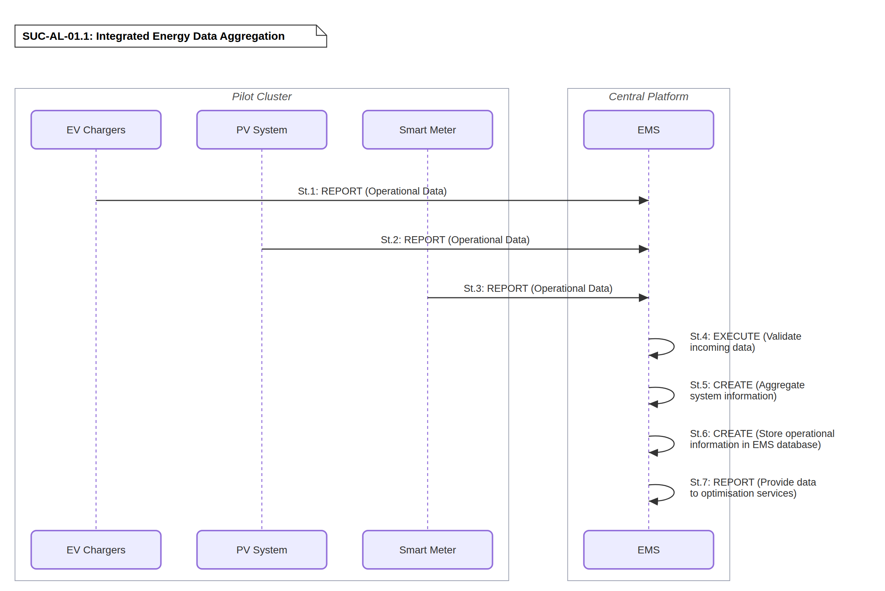
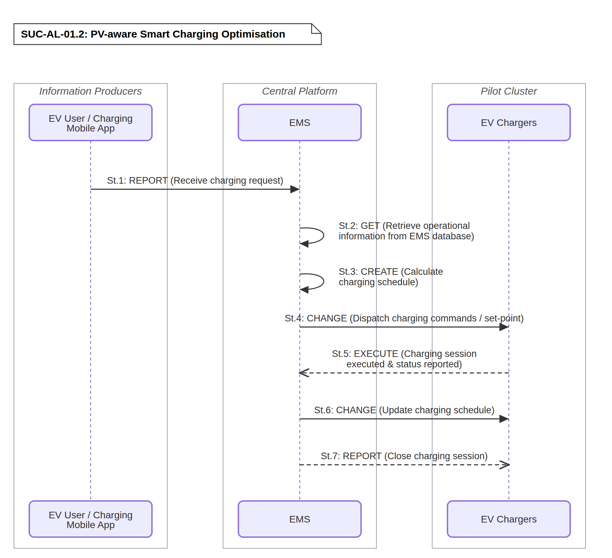
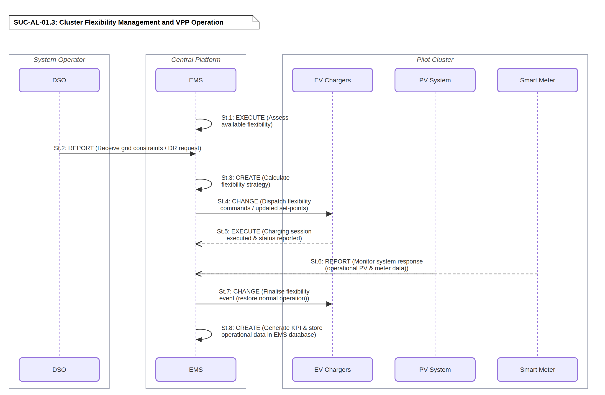

# BUC-AL-01 — Coordinated PV-Integrated EV Charging Cluster Operation and Virtual Power Plant Management

> **SOLAR-MOVE — Albanian Demonstrator** 
> Business Use Case following the IEC 62559-2 template.

| | |
|---|---|
| **Use Case ID** | BUC-AL-01 |
| **Document** | SOLARMOVE_BUC-AL-01.v1.0 |
| **Version** | v1.0 |
| **Area** | Energy System |
| **Domains** | Distribution System, DER, Customer Premises |
| **Zones** | Operation, Enterprise, Market |
| **Work Package / Task** | WP1 — T1.3 |

**Files in this folder:** [`SOLARMOVE_BUC-AL-01.v1.0.xlsx`](SOLARMOVE_BUC-AL-01.v1.0.xlsx) (IEC 62559-2 tables) · [`SOLARMOVE_BUC-AL-01.v1.0.xml`](SOLARMOVE_BUC-AL-01.v1.0.xml) (IEC 62559-3-style serialization, draft) · [`images/`](images/) (diagrams)

---

## Table of contents

1. [Description of the use case](#1-description-of-the-use-case)
2. [Diagrams of the use case](#2-diagrams-of-the-use-case)
3. [Technical details](#3-technical-details)
4. [Step-by-step analysis of the use case](#4-step-by-step-analysis-of-the-use-case)
5. [Information exchanged](#5-information-exchanged)
6. [Requirements](#6-requirements)
7. [Common terms and definitions](#7-common-terms-and-definitions)

---

## 1. Description of the use case

### 1.1 Name of the use case

| ID | Area / Domain(s) / Zone(s) | Name of Use Case |
|----|----------------------------|------------------|
| BUC-AL-01 | **Area:** Energy System **Domains:** Distribution System, DER, Customer Premises **Zones:** Operation, Enterprise, Market | Coordinated PV-Integrated EV Charging Cluster Operation and Virtual Power Plant Management |

### 1.2 Version management

| Version | Date | Author(s) | Changes |
|---------|------|-----------|---------|
| 1.0 | 20.10.2026 | UPT Team, Klajdi Kamberi | First public version |

### 1.3 Scope and objectives of the use case

#### Scope

This BUC-AL-01 focuses on the coordinated operation and intelligent management of distributed Electric Vehicle (EV) charging clusters integrated with Photovoltaic (PV) generation through a centralized Energy Management System (EMS). The pilot is implemented within the SOLAR-MOVE project through the collaboration of the Municipality of Tirana, OSHEE Group, the Polytechnic University of Tirana (UPT), and SUSALB Center.

The demonstration comprises three geographically distributed charging clusters representing different ownership structures, user profiles, and operational environments, including public, semi-public, and private charging infrastructure. These clusters are located at Tirana municipal facilities, the headquarters of OSHEE Group, and the Faculty of Electrical Engineering of UPT.

A centralized Energy Management System (EMS) will coordinate the operation of all charging clusters by collecting real-time charging and energy production data, optimizing charging schedules according to PV generation availability, and aggregating the flexibility of all clusters into a Virtual Power Plant (VPP). The pilot aims to maximize local renewable energy utilization, increase the hosting capacity of EV charging infrastructure, reduce peak demand, and investigate flexibility services that can support both the Distribution System Operator (DSO) and the Transmission System Operator (TSO).

Beyond the technical validation, the pilot also investigates a scalable operational model for intelligent EV charging infrastructure that can support future commercial deployment of EMS-based charging services, smart charging, and VPP operation under the evolving Albanian electricity market.

The following System Use Cases (SUCs) define the technical realization of this Business Use Case:

- **SUC-AL-01.1:** Integrated Energy Data Aggregation – Collection and synchronization of charging session data, PV generation measurements, and operational information from all charging clusters through the centralized EMS.
- **SUC-AL-01.2**: PV-Aware Smart Charging Optimization – Optimization of EV charging schedules using PV generation forecasts, charging demand forecasts, and predefined operational constraints in order to maximize renewable energy self-consumption.
- **SUC-AL-01.3:** Cluster Flexibility Management and Virtual Power Plant Operation – Aggregation of charging flexibility from all charging clusters to support coordinated load management, peak shaving, and future grid-support services.

#### Objectives

- **OBJ-1:** Demonstrate the coordinated operation of distributed EV charging clusters under a centralized Energy Management System.
- **OBJ-2:** Maximize the utilization of locally generated photovoltaic energy for EV charging.
- **OBJ-3:** Improve the operational efficiency of public, semi-public and private charging infrastructure through intelligent charging management.
- **OBJ-4:** Demonstrate coordinated charging strategies capable of operating under constrained grid connection capacities without requiring immediate network reinforcement.
- **OBJ-5:** Evaluate the technical and commercial potential of aggregated charging flexibility to support future Demand Response, ancillary services, and electricity market participation.
- **OBJ-6:** Demonstrate the operation of a Virtual Power Plant capable of aggregating geographically distributed charging clusters into a controllable flexibility resource.
- **OBJ-7:** Assess the impact of coordinated charging on grid performance, renewable energy integration, and future large-scale EV deployment in Albania.

#### Related business case(s)

This Business Use Case is developed within the SOLAR-MOVE project, which aims to accelerate the deployment of photovoltaic-integrated EV charging infrastructure and intelligent energy management systems. The pilot establishes the technical and business foundation for the future commercialization of EMS-supported charging services. During the project, SUSALB is responsible for supplying, installing, operating, and maintaining the EV charging infrastructure, while jointly developing the EMS and VPP software platform together with project partners. After project completion, the charging infrastructure will be transferred to the respective site owners (Municipality of Tirana, OSHEE Group, and UPT), whereas the EMS platform will remain a commercial software solution operated and further developed by SUSALB through future service agreements.

### 1.4 Narrative of the use case

#### Short description

The Albanian pilot demonstrates the coordinated operation of distributed EV charging clusters integrated with PV generation through a centralized EMS. The pilot comprises three charging clusters located at the Municipality of Tirana, OSHEE Group headquarters, and the Faculty of Electrical Engineering of the UPT. These clusters include public, semi-public, and private charging stations serving municipal fleets, utility vehicles, university users, and public EV users.

The EMS continuously collects operational data from EV chargers, PV systems, and smart meters to optimize charging schedules according to renewable energy availability, electricity prices, user charging preferences, and network operational constraints. By aggregating the flexibility of all charging clusters into a VPP, the pilot demonstrates how coordinated charging can maximize renewable energy utilization, reduce peak demand, improve the operational efficiency of charging infrastructure, and establish a scalable framework for future flexibility services and intelligent EV charging deployment.

#### Complete description

Uncoordinated EV charging may coincide with periods of high electricity demand while renewable generation is low, creating local network congestion, increasing peak demand, reducing renewable energy self-consumption, and potentially requiring costly grid reinforcement. These challenges become more significant when charging infrastructure is deployed across geographically distributed municipal, university, and utility sites that operate independently and cannot exploit their collective flexibility.

The Albanian pilot addresses these challenges through a centralized Energy Management System (EMS) that coordinates three geographically distributed EV charging clusters located at the Municipal Fleet Operator & Site Owner (Municipality of Tirana - Cluster 1), DSO headquarters (OSHEE Group - Cluster 2), and the Campus Prosumer (Faculty of Electrical Engineering of UPT - Cluster 3). The EMS continuously acquires operational data from EV chargers, PV systems, and smart meters, combining real-time measurements with PV generation forecasts, electricity prices, charging requests, expected departure times, and network operational constraints to optimize charging schedules. By aggregating the flexibility available across all charging clusters into a VPP, the pilot establishes a controllable flexibility resource capable of reducing peak demand, increasing renewable energy utilization, and supporting future demand response.

The implementation of coordinated charging provides different operational and economic incentives for the participating stakeholders.

**Municipal Fleet Operator & Site Owner (Municipality of Tirana - Cluster 1)** benefits from optimized charging of its municipal EV fleet, improved utilization of locally generated renewable energy, lower electricity procurement costs through intelligent charging scheduling, and more efficient use of the existing distribution infrastructure without immediate network reinforcement.

**DSO (OSHEE Group - Cluster 2)** is dedicated exclusively to the charging of OSHEE corporate and operational fleet vehicles and does not provide commercial public charging services. The charging infrastructure therefore operates as a closed internal fleet network in accordance with Directive (EU) 2019/944 and does not compete with commercial Charging Point Operators. Coordinated charging enables OSHEE to evaluate transformer and feeder loading, reduce local peak demand, defer potential network reinforcement, and assess future flexibility services under realistic operating conditions.

**Campus Prosumer & PV Producer (UPT – Cluster 3)** integrates rooftop photovoltaic generation with EV charging infrastructure, increasing local PV self-consumption and reducing electricity procurement costs while simultaneously providing a research and demonstration platform for advanced charging control algorithms. The pilot also evaluates how locally generated flexibility may create future value as Albanian flexibility markets evolve.

**Charging Point Operator (CPO) and EMSP – SUSALB and project partners.** The centralized EMS reduces operational complexity by coordinating geographically distributed charging stations through a single management platform. During the project, the EMS and charging platform are validated as scalable solutions for future commercial deployment, while future revenue streams from charging services and distributed energy resources remain subject to the applicable Albanian regulatory framework.

**EV Users.** The EMS supports multiple charging strategies, including photovoltaic-priority charging, time-of-use tariffs, and electricity price optimization based on hourly market prices. Charging costs and available charging windows are communicated through the charging application, enabling users to select charging periods according to both operational needs and economic preferences.

Two different user profiles are considered within the pilot:

Profile A – Managed fleet users include municipal fleet vehicles (Cluster 1) and OSHEE operational vehicles (Cluster 2). These vehicles operate under predefined operational schedules and organizational charging policies; therefore, charging optimization can be implemented without requiring additional economic incentives from individual drivers.

Profile G – Public and university users include public users of the municipal charging infrastructure together with university staff, students, and visitors using the UPT charging facilities. Since these users have greater flexibility in selecting charging priorities, future large-scale deployment will require commercial mechanisms that encourage participation in optimized charging, including dynamic tariffs, transparent charging costs, and other user-oriented incentive schemes.

The EMS constitutes the core intelligence of the pilot by continuously monitoring charging infrastructure, photovoltaic generation, and electrical measurements across all charging clusters. Based on real-time operational data and forecasting information, the EMS dynamically updates charging schedules to maximize renewable energy utilization while respecting user charging requirements and distribution network constraints. Simultaneously, the EMS aggregates the available charging flexibility into a Virtual Power Plant capable of coordinated load management, peak shaving, and future participation in flexibility services.

**SUC-AL-01.1** – Integrated Energy Data Aggregation establishes the common operational data platform by continuously collecting, validating, and synchronizing measurements from EV charging stations, photovoltaic systems, and smart metering devices deployed across all charging clusters. The aggregated dataset provides the operational visibility required for optimization and directly supports OBJ-1, OBJ-2, and OBJ-7.

**SUC-AL-01.2** – PV-Aware Smart Charging Optimization performs intelligent charging scheduling by combining photovoltaic generation forecasts, electricity prices, charging demand forecasts, user charging priorities, and network operational constraints. This functionality maximizes renewable energy utilization while reducing peak demand and improving charging efficiency, directly contributing to OBJ-2, OBJ-3, OBJ-4, and OBJ-7.

**SUC-AL-01.3** – Cluster Flexibility Management and Virtual Power Plant Operation aggregates the charging flexibility available across all pilot sites to perform coordinated load management and Virtual Power Plant operation. The EMS evaluates available flexibility, coordinates charging power among clusters, and prepares the infrastructure for future flexibility and ancillary service participation, thereby supporting OBJ-4, OBJ-5, OBJ-6, and OBJ-7.

The coordinated operation of the charging clusters creates measurable value for all participating stakeholders. It increases renewable energy self-consumption, reduces peak electricity demand, improves utilization of existing distribution infrastructure, and enhances the operational efficiency of EV charging systems. For distribution system operators, the approach contributes to reduced grid stress and may defer conventional network reinforcement. For EV users, it enables transparent and economically optimized charging. For infrastructure owners, it improves the utilization of photovoltaic generation and establishes the technical foundation for future flexibility services and Virtual Power Plant operation. The modular architecture demonstrated by the pilot also provides a scalable framework that can be replicated in municipalities, universities, business parks, and other multi-site charging environments.

The demonstrated architecture therefore establishes not only a technical validation platform but also a foundation for future commercial deployment of coordinated EV charging services.

### 1.5 Key performance indicators (KPI)

| ID | Name | Description | Reference to objectives |
|----|------|-------------|--------------------------|
| U04 | Operation Cost (ePIPV) | ≥25% reduction compared to non-optimised operation. Performance will be evaluated against a baseline scenario representing unmanaged EV charging using operational data collected through the EMS during the demonstration period. In the Albanian pilot, it demonstrates the business value of the EMS and VPP by reducing energy procurement costs and improving the economic performance of the ePIPV infrastructure. | OBJ-3, OBJ-5 |
| U06 | Flexibility Potential | ≥25% increase compared to the baseline operation without coordinated flexibility management. The KPI will be calculated using EMS operational records throughout the pilot demonstration. | OBJ-5, OBJ-6 |
| U07 | Constraints Violation Occurrence | 15% reduction in the number of recorded constraint-violation events compared with the baseline operation. Constraint-violation events include exceedances of predefined network or site operational limits, such as voltage limits or connection/loading constraints, recorded during equivalent evaluation periods. | OBJ-4 |
| U08 | Willingness to Participate (Flex.) | ≥40%. Measures the willingness of users or asset owners to participate in flexibility services. In the Albanian pilot, it reflects stakeholder engagement in the VPP and demand response framework. | OBJ-5, OBJ-6, OBJ-7 |
| U10 | Collective Self-Consumption | ≥75% of locally generated PV energy consumed on-site. The KPI will be calculated by comparing photovoltaic generation with locally consumed PV energy measured through smart metering during the pilot operation. PV generation and EV charging/load consumption are measured separately, using PV inverter data and dedicated metering data respectively | OBJ-2 |
| U11 | Renewables Curtailment Avoidance | ≥25% at pilot level ≥50% (ER2); ≥25% (ER4, ER5) Measures the amount of renewable energy that can be utilized instead of being curtailed. In the Albanian pilot, coordinated EMS and VPP operation maximise PV utilisation, improving renewable energy integration and increasing the return on renewable energy investments. | OBJ-2 |
| U12 | Peak Consumption Reduction (DR) | ≥25% reduction in peak consumption by participating in DR programmes, compared to the peak without intelligent management. Peak demand will be determined using smart meter measurements collected before and during EMS-controlled operation. It demonstrates how coordinated DER operation reduces network stress, lowers operational costs and improves the efficiency of the local electricity system. | OBJ-4, OBJ-5 |
| U13 | Increase in revenue created from DERs; | ≥ 25% increase compared with the reference operation. Revenue estimates will be derived from EMS operational data and evaluated within the pilot demonstration framework. It evaluates the business opportunities created through energy optimisation, self-consumption and future participation in flexibility and ancillary service markets. | OBJ-5, OBJ-6 |
| U14 | Use of DERs in Parking Lots | ≥50% increase compared with the baseline operation without coordinated EMS optimisation. Measures the increase in local PV energy utilisation within the pilot EV charging infrastructure relative to an uncoordinated baseline. It captures how effectively the EMS coordinates EV charging demand with available PV generation, increasing the use of locally generated renewable energy and reducing dependence on grid-imported electricity. | OBJ-3, OBJ-6 |

The KPIs will be evaluated by comparing the coordinated EMS operation against a baseline scenario representing unmanaged EV charging. Unless otherwise specified, KPI values will be calculated over equivalent operational periods using data collected through the centralized EMS, smart meters, EV chargers, and photovoltaic monitoring systems. Performance assessment will be performed throughout the demonstration period in accordance with the SOLAR-MOVE evaluation methodology.

### 1.6 Use case conditions

#### Assumptions

1. The Albanian pilot consists of three distributed EV charging clusters located at the Municipality of Tirana, OSHEE Group headquarters, and the Faculty of Electrical Engineering of the Polytechnic University of Tirana (UPT).
2. All charging stations included in the pilot are connected to a centralized Energy Management System (EMS), enabling the collection, monitoring and management of charging sessions.
3. Photovoltaic (PV) generation systems are available or planned within the pilot sites, allowing the implementation and evaluation of PV-aware charging strategies.
4. The EMS is capable of collecting operational data from charging stations, PV systems and other monitoring devices through secure communication interfaces.
5. The participating EV fleets (municipal vehicles, OSHEE vehicles and other authorised users) follow predefined operational schedules that can be considered during charging optimization.
6. The charging clusters can operate independently while also being coordinated through a centralized Virtual Power Plant (VPP) platform for aggregated flexibility management.
7. Communication infrastructure between field devices and the EMS is available throughout the demonstration period.
8. The pilot is implemented in compliance with the existing Albanian regulatory framework governing EV charging infrastructure, distributed renewable energy integration, and electricity market operation. The demonstration validates the technical capability of coordinated EV charging and Virtual Power Plant operation under current regulatory conditions. Where participation in flexibility services or ancillary service markets is not yet fully enabled by the existing regulatory framework, such functionalities will be demonstrated through pilot validation, simulation, or controlled testing scenarios. The pilot will also contribute to identifying regulatory gaps and future requirements necessary for the large-scale deployment of flexibility services and market participation in Albania.
9. Where flexibility services or electricity market participation are evaluated, the required operational procedures, simulation environments, and regulatory assumptions shall be defined before the execution of the corresponding pilot activities.

#### Prerequisites

1. All charging stations, PV systems and monitoring devices must be installed, commissioned and fully operational before the start of the demonstration activities.
2. Reliable communication channels shall be established between charging stations, PV systems and the centralized EMS.
3. The EMS shall be configured to collect, store and process operational data from all participating charging clusters.
4. The operational characteristics of the participating EV fleets, including vehicle availability, charging priorities and energy requirements, shall be defined before implementing smart charging strategies.
5. PV generation measurements and, where available, PV production forecasts shall be accessible to the EMS for charging optimization.
6. Cybersecurity, interoperability and data exchange mechanisms between all participating systems shall comply with the technical specifications defined within the SOLAR-MOVE project.
7. The participating organizations (Municipality of Tirana, OSHEE Group, UPT and Qendra SUSALB) shall provide the necessary operational support and access to the pilot infrastructure during the demonstration period.
8. Performance monitoring mechanisms shall be available to evaluate the Key Performance Indicators (KPIs) defined for this Business Use Case.

### 1.7 Further information for classification/mapping

**Relation to other use cases.**

This Business Use Case is directly supported by the following System Use Cases:

- SUC-AL-01.1 – Integrated Energy Data Aggregation
- SUC-AL-01.2 – PV-Aware Smart Charging Optimization
- SUC-AL-01.3 – Cluster Flexibility Management and VPP Operation

Together, these System Use Cases provide the technical implementation necessary to achieve the business objectives defined in BUC-AL-01.

**Level of depth.** Detailed Business Use Case supported by three complementary System Use Cases covering data acquisition, intelligent charging optimization, and coordinated flexibility management.

**Prioritisation.** The use case represents one of the core pilot demonstrations within the Albanian activities of the SOLAR-MOVE project and forms the basis for evaluating intelligent EV charging, renewable energy integration, and VPP operation.

**Generic, regional or national relation.**

This Business Use Case demonstrates a scalable and technology-neutral architecture for coordinated EV charging and photovoltaic integration that can be replicated beyond the Albanian pilot. The proposed three-layer engineering architecture—Integrated Energy Data Aggregation, PV-Aware Smart Charging Optimization, and Cluster Flexibility Management through a VPP—is independent of the specific pilot sites and can be implemented in different geographical regions.

The proposed solution is particularly applicable to universities, public campuses, municipal buildings, utility facilities, business parks, industrial sites, hospitals, airports, logistics centres, and private or semi-private parking facilities equipped with photovoltaic generation and EV charging infrastructure.

Successful replication requires interoperable charging infrastructure, distributed energy resources, reliable communication networks, smart metering, and an EMS capable of coordinating distributed charging assets. The implementation also depends on the local regulatory framework supporting intelligent charging, data exchange, dynamic electricity tariffs, and future flexibility market participation.

Some implementation aspects remain country-specific and may influence replication, including electricity market regulations, tariff and billing structures, EV charging legislation, flexibility market maturity, climatic conditions affecting photovoltaic generation, fleet characteristics, and user charging behaviour. Consequently, while the technical architecture is directly transferable, the business processes and regulatory arrangements should be adapted to national and regional conditions.

**Nature of the use case.** Business Use Case with strong technical implementation aspects, demonstrating coordinated EV charging, distributed renewable energy integration, EMS operation, and VPP functionality.

**Further keywords for classification.** Smart Grid, Electric Vehicles, Smart Charging, Energy Management System, Virtual Power Plant, Distributed Energy Resources, Photovoltaic Integration, Demand Response, Flexibility Services, Renewable Energy, EV Charging Infrastructure, Distribution System Operator, Campus Energy Management, Municipal Charging Infrastructure.

### 1.8 General remarks

Further comments which are not considered elsewhere.

---

## 2. Diagrams of the use case

The diagram below illustrates the overall structure of the Business Use Case, showing the actors and the 3 System Use Cases (SUC-AL-01.1, SUC-AL-01.2, SUC-AL-01.3) that realise it.

  

<em><b>Figure 1.</b> BUC-AL-01 — Coordinated PV-Integrated EV Charging Cluster Operation and Virtual Power Plant Management (use case diagram).</em>

---

## 3. Technical details

### 3.1 Actors

| Actor Name | Actor Type | Actor Description | Further information specific to this use case |
|------------|------------|-------------------|-----------------------------------------------|
| **CPO** | Business | Charging Point Operator: Entity responsible for operating and maintaining the EV charging infrastructure deployed across the pilot charging clusters. | SUSALB acts as or coordinates the CPO function for the charging infrastructure deployed across the Municipality of Tirana, OSHEE Group and UPT pilot sites. |
| **EMSP** | Business | Electric Mobility Service Provider: Provides mobility services to EV users, including access to charging stations, user account management, billing, and tariff communication. | SUSALB manages service interface and dynamic pricing distribution. |
| **DSO** | Business | Distribution System Operator (DSO) means a natural or legal entity responsible for operating, ensuring the maintenance of and, if necessary, developing the distribution system in a given area and, where applicable, its interconnections with other systems and for ensuring the long-term ability of the system to meet reasonable demands for the distribution of electricity. | OSHEE – Albanian Distribution System Operator. |
| **EV User** | Business | End-user of EV charging services. | Includes university staff, employees, students and authorised visitors. |
| **UPT Facility Managers** | Business | Responsible for the operation and supervision of the campus energy infrastructure, including PV installations, EV charging facilities and energy management activities. | Represents the campus operator and facility management personnel. |
| **Market operator** | Business | Entity responsible for organising and operating the electricity market where electricity trading takes place. | ALPEX |
| **PV Producer** | Business | Legal or business entity that owns, operates, and maintains physical solar generation assets. | Represents the owners of the photovoltaic generation assets participating in the pilot. |
| **PV System** | System | Photovoltaic installations in the FIE building for the production of electricity with the main aim of covering the electricity consumption of building | UPT – Polytechnic University of Tirana provides the premises for installation |
| **EV Chargers** | System | EV charging equipment | SUSALB deployed across the Municipality of Tirana, OSHEE Group and UPT pilot sites. |
| **EMS (Hardware)** | System | Physical equipment installed for monitoring, scheduling, operation and control of power flows and feedback | SUSALB |
| **Smart Meter** | System | A device that measures the energy fed into and consumed from the grid, they can provide real-time information on energy-usage to consumers and suppliers. Installed at the PCC and/or selected campus loads to provide real-time electrical measurements. | SUSALB will install smart meters at the pilot charging clusters to provide real-time electrical measurements. |
| **Charging Mobile App** | System | User-facing digital interface enabling EV charger discovery, reservation, and tariff visibility. | Acts as the front-end interface between EMSP and EV users. |

### 3.2 References

_References (standards, reports, mandates and regulatory constraints) associated with the use case._

| No. | Reference Type | Reference | Status | Impact on use case | Originator / organisation | Link |
|-----|----------------|-----------|--------|--------------------|---------------------------|------|
| 1 | Directive | Directive (EU) 2019/944 of the European Parliament and of the Council of 5 June 2019 on common rules for the internal market for electricity and amending Directive 2012/27/EU (recast) | In force | Defines the roles and responsibilities of electricity market participants, DSO responsibilities, active customers and demand response. | EUR-Lex | [link](https://eur-lex.europa.eu/eli/dir/2019/944/oj/eng) |
| 2 | Regulation | Regulation (EU) 2019/943 on the internal market for electricity | In force | Supports flexibility services, market participation and efficient operation of electricity markets. | European Parliament / Council | [https://eur-lex.europa.eu/eli/reg/2019/943/oj/eng](https://eur-lex.europa.eu/eli/reg/2019/943/oj/eng) |
| 3 | National Law | Law No. 59/2026 "On the Power Sector" | In force | Defines the Albanian electricity market structure, DSO responsibilities and customer connection rules. | Ministry of Infrastructure and Energy |  |
| 4 | Regulatory act | ERE Decision No. 100/2008 | In force | Defines the functioning of the electricity network, the connection of consumers to the network, the roles and responsibilities of system operators, and the integration of new generation capacities. | ERE- Albania | [https://www.ere.gov.al/images/archive/Kodi_Shperndarjes_Vendimi_nr.100,_date_26.8.2008.pdf](https://www.ere.gov.al/images/archive/Kodi_Shperndarjes_Vendimi_nr.100,_date_26.8.2008.pdf) |
| 5 | Regulatory act | ERE Board Decision No. 255, dated 15 October 2025 | In force | Determines the electricity tariff for charging electric vehicles at stations with installed power capacity above 11 kW | ERE- Albania | [https://www.ere.gov.al/media/files/2025/10/15/Vendim_Nr_255_2025.pdf](https://www.ere.gov.al/media/files/2025/10/15/Vendim_Nr_255_2025.pdf) |
| 6 | Regulatory act | ERE Board Decision No. 294, dated 13 November 2025 | In force | Provides guidelines for reflecting electricity consumption in consumers’ monthly bills. | ERE- Albania | [https://www.ere.gov.al/media/files/2026/02/06/Vendim_Nr_294_2025_udhezimi.pdf](https://www.ere.gov.al/media/files/2026/02/06/Vendim_Nr_294_2025_udhezimi.pdf) |
| 7 | Regulatory act | ERE Decision No. 128/2018 | In force | Specifies the permissible technical parameter limits | ERE- Albania | [https://www.ere.gov.al/doc/VENDIM_NR.128_2018.pdf](https://www.ere.gov.al/doc/VENDIM_NR.128_2018.pdf) |

---

## 4. Step-by-step analysis of the use case

### 4.1 Overview of scenarios

| No. | Scenario name | Scenario description | Primary actor | Triggering event | Pre-condition | Post-condition |
|-----|---------------|----------------------|---------------|------------------|---------------|----------------|
| 1 | Integrated Energy Data Aggregation (SUC-AL-01.1) | Continuous collection, validation and synchronization of operational data from EV charging stations, PV systems and monitoring devices deployed across all pilot clusters. | EMS | New operational measurements become available from any charging cluster. | Communication infrastructure established; charging stations, PV systems and monitoring devices operational. | A unified and validated operational dataset is available for optimisation and flexibility management. |
| 2 | PV-Aware Smart Charging Optimization (SUC-AL-01.2) | The EMS optimises EV charging schedules by combining charging requests, PV generation forecasts, electricity prices and grid constraints across the three charging clusters. | EMS | A new charging request is received or updated operational data become available. | Aggregated system data available; EV connected; optimisation engine operational. | Optimised charging schedules are dispatched to the corresponding charging stations, maximising renewable energy utilisation while satisfying user requirements. |
| 3 | Cluster Flexibility Management and Virtual Power Plant Operation (SUC-AL-01.3) | The EMS aggregates the available flexibility of all charging clusters and coordinates charging operation to reduce peak demand, improve renewable energy self-consumption and enable future participation in flexibility markets. | EMS | Flexibility request received, operational threshold exceeded or optimisation cycle initiated. | EMS has access to operational data from all clusters and controllable charging infrastructure. | Cluster flexibility is coordinated, peak demand is reduced, and system performance indicators are generated for pilot evaluation. |

### 4.2 Steps – Scenarios

#### 4.2.1 Integrated Energy Data Aggregation (SUC-AL-01.1)

| Step No. | Event | Name of process / activity | Description of process / activity | Service | Information producer | Information receiver | Information exchanged (IDs) | Requirement, R-IDs |
|----------|-------|----------------------------|-----------------------------------|---------|----------------------|----------------------|-----------------------------|--------------------|
| St.1 | Operational data available | Report operational data (EV chargers) | EV chargers collect and transmit real-time charger status and session measurements to the EMS. | REPORT | EV Chargers | EMS | IE-02 | R-AIC-04, R-AIC-05, R-COM-01, R-DAT-01, R-INT-02, R-MVR-03 |
| St.2 | Operational data available | Report operational data (PV systems) | PV systems collect and transmit real-time PV generation measurements to the EMS. | REPORT | PV System | EMS | IE-03 | R-AIC-04, R-AIC-05, R-COM-01, R-DAT-01, R-INT-04, R-MVR-02 |
| St.3 | Operational data available | Report operational data (smart meters) | Smart meters collect and transmit real-time site-load and metering measurements to the EMS. | REPORT | Smart Meter | EMS | IE-04 | R-AIC-04, R-AIC-05, R-COM-01, R-DAT-01, R-MVR-02, R-MVR-03 |
| St.4 | Data received | Validate incoming data | The EMS validates data integrity, communication status and measurement consistency. | EXECUTE | EMS | EMS | IE-02, IE-03, IE-04 | R-COM-02, R-DAT-03, R-DAT-04 |
| St.5 | Validated dataset | Aggregate system information | Operational data from all charging clusters are aggregated into a unified dataset. | CREATE | EMS | EMS | IE-05 | R-EMS-01, R-DAT-08 |
| St.6 | Dataset available | Store operational information | Aggregated operational data are stored in the EMS database for optimisation and monitoring purposes. | CREATE | EMS | EMS | IE-05 | R-DAT-05, R-DAT-07 |
| St.7 | Data updated | Provide data to optimisation services | The validated dataset is made available to optimisation, monitoring and flexibility management modules. | REPORT | EMS | EMS Optimisation Module | IE-05 | R-DAT-04, R-EMS-01 |

  

<em><b>Figure 2.</b> SUC-AL-01.1 — Integrated Energy Data Aggregation (sequence diagram).</em>

#### 4.2.2 PV-Aware Smart Charging Optimisation (SUC-AL-01.2)

| Step No. | Event | Name of process / activity | Description of process / activity | Service | Information producer | Information receiver | Information exchanged (IDs) | Requirement, R-IDs |
|----------|-------|----------------------------|-----------------------------------|---------|----------------------|----------------------|-----------------------------|--------------------|
| St.1 | Charging request | Receive charging request | The EMS receives a charging request including user preferences, requested energy and expected departure time. | REPORT | EV User / Charging Mobile App | EMS | IE-01 | R-SC-01, R-SC-02, R-UI-02, R-CYB-06 |
| St.2 | Operational data available | Retrieve operational information | The EMS retrieves the aggregated operational dataset (measurements, PV forecasts, electricity prices and charging station availability) from the EMS database. | GET | EMS | EMS | IE-03, IE-04, IE-05, IE-11 | R-DAT-01, R-FOR-01, R-FOR-02, R-EMS-01 |
| St.3 | Optimisation initiated | Calculate charging schedule | The EMS calculates the optimal charging schedule considering PV production, grid constraints and charging priorities. | CREATE | EMS | EMS | IE-06, IE-07 | R-EMS-03, R-EMS-04, R-FOR-05, R-FOR-08, R-SC-04, R-SC-05 |
| St.4 | Charging schedule generated | Dispatch charging commands | The charging schedule and charging set-points are transmitted to the selected charging station. | CHANGE | EMS | EV Chargers | IE-07 | R-EMS-03, R-SC-03, R-COM-03, R-RTC-01, R-CYB-04 |
| St.5 | Charging session active | Execute charging session | The charging station executes the charging schedule and continuously reports operational status. | EXECUTE | EV Chargers | EMS | IE-02 | R-SC-01, R-RTC-06, R-MVR-03 |
| St.6 | System conditions change | Update charging schedule | The EMS recalculates and updates charging schedules whenever PV generation, demand or user requirements change. | CHANGE | EMS | EV Chargers | IE-07 | R-EMS-05, R-FOR-07, R-RTC-04 |
| St.7 | Charging completed | Close charging session | Charging session data are stored and made available for monitoring and reporting. | REPORT | EV Chargers | EMS | IE-02 | R-DAT-05, R-MVR-03, R-MVR-06 |

  

<em><b>Figure 3.</b> SUC-AL-01.2 — PV-Aware Smart Charging Optimisation (sequence diagram).</em>

#### 4.2.3 Cluster Flexibility Management and Virtual Power Plant Operation (SUC-AL-01.3)

| Step No. | Event | Name of process / activity | Description of process / activity | Service | Information producer | Information receiver | Information exchanged (IDs) | Requirement, R-IDs |
|----------|-------|----------------------------|-----------------------------------|---------|----------------------|----------------------|-----------------------------|--------------------|
| St.1 | Operational status updated | Assess available flexibility | The EMS evaluates the available charging flexibility across all charging clusters based on current operating conditions. | EXECUTE | EMS | EMS | IE-06, IE-09 | R-EMS-06 , R-GFR-02 |
| St.2 | Grid event detected | Receive grid constraints | Grid constraints, operational limits or demand response requests are received from the DSO. | REPORT | DSO | EMS | IE-08 | R-COM-07, R-GFR-01 |
| St.3 | Flexibility required | Calculate flexibility strategy | The EMS determines the optimal flexibility strategy considering user requirements and system constraints. | CREATE | EMS | EMS | IE-09 | R-EMS-04, R-FOR-05, R-RTC-07, R-GFR-02 |
| St.4 | Flexibility strategy available | Dispatch flexibility commands | Updated charging power limits and charging schedules are transmitted to the corresponding charging stations. | CHANGE | EMS | EV Chargers | IE-07 | R-EMS-03, R-SC-03, R-COM-03, R-CYB-04 |
| St.5 | Control activated | Execute coordinated charging control | During the controlled test, charging stations adjust charging power according to EMS instructions. | EXECUTE | EV Chargers | EMS | IE-02 | R-RTC-05, R-RTC-06, R-SAF-01 |
| St.6 | Monitoring active | Monitor system response | The EMS continuously monitors system response, PV utilisation, and site-level and aggregated cluster demand after flexibility activation. | REPORT | EV Chargers / PV System / Smart Meter | EMS | IE-03, IE-04, IE-05 | R-DAT-01, R-RTC-02, R-RTC-06, R-GFR-08 |
| St.7 | Event completed | Finalise flexibility event | The EMS restores normal charging operation when the flexibility event ends. | CHANGE | EMS | EV Chargers | IE-07 | R-GFR-07, R-SAF-04 |
| St.8 | Operation completed | Generate KPI report | Operational data and flexibility performance indicators are stored for reporting and pilot evaluation. | CREATE | EMS | EMS | IE-10 | R-DAT-07, R-MVR-06, R-MVR-07, R-MVR-08 |

  

<em><b>Figure 4.</b> SUC-AL-01.3 — Cluster Flexibility Management and Virtual Power Plant Operation (sequence diagram).</em>

---

## 5. Information exchanged

| Information exchanged (ID) | Name of information | Description of information exchanged | Requirement, R-IDs |
|----------------------------|---------------------|--------------------------------------|--------------------|
| IE-01 | EV Charging Request Information | Charging request generated when an EV user initiates a charging session, containing EV identifier, EV charger identifier, current state of charge (SoC), requested energy, charging priority, and expected departure time. | R-SC-02, R-UI-02, R-CYB-01, R-CYB-06, R-DAT-02 |
| IE-02 | EV Charger Status & Session Information | Operational information exchanged between EV chargers and the EMS, including charger availability, connection status, charging progress, energy delivered and fault notifications. | R-SC-01, R-DAT-01, R-COM-02, R-MVR-03, R-SAF-02 |
| IE-03 | PV Generation & Forecast Data | Real-time PV generation measurements and forecasted PV production profiles used by the EMS for charging optimisation and energy management. | R-DAT-01, R-DAT-02, R-DAT-04, R-FOR-01 |
| IE-04 | Site Load & Smart Meter Measurements | Real-time and forecasted electricity demand of the buildings, including building-level load and aggregated consumption | R-DAT-01, R-FOR-02, R-MVR-01, R-MVR-02 |
| IE-05 | Aggregated Energy System Data | Aggregated operational dataset combining EV charging data, PV generation, campus demand and grid status information used by the EMS optimisation engine. | R-EMS-01, R-DAT-03, R-DAT-04, R-DAT-08 |
| IE-06 | EMS Optimisation Results | Optimisation decisions generated by the EMS, including charging priorities, energy allocation, flexibility assessment and operational control decisions. | R-EMS-03, R-EMS-04, R-EMS-06, R-FOR-05, R-RTC-07 |
| IE-07 | Charging Schedule & Control Set-Points | Charging schedules, charging power limits and real-time control commands transmitted by the EMS to the EV charging stations. | R-EMS-03, R-SC-03, R-COM-03, R-CYB-04 |
| IE-08 | Demand Response & Grid Constraint Signals | Demand response requests, grid operating constraints, network alerts and operational signals exchanged between the DSO and the EMS. | R-COM-07, R-GFR-01, R-RTC-05 |
| IE-09 | Cluster Flexibility Information | Information describing the available charging flexibility across the three pilot clusters, including flexibility availability, activation status and coordinated charging capability for future VPP implementation. | R-EMS-06, R-GFR-02, R-GFR-08 |
| IE-10 | Performance Monitoring & KPI Reports | Aggregated operational data and calculated KPIs including self-consumption, peak reduction, PV utilisation, charging efficiency, and periodic reports. | R-DAT-05, R-DAT-07, R-MVR-06, R-MVR-07, R-MVR-08 |
| IE-11 | Dynamic Tariff and Green Window Pricing Information | Dynamic tariff schedules and Green Window pricing information generated or processed by the EMS and communicated through the EMSP to the Charging Mobile App, enabling EV users to identify preferred charging periods based on electricity prices and expected renewable energy availability. | R-UI-02 |

**Cross-cutting notes**

- These information objects are corresponding to the “Name of Information” of the “Information Exchanged” column referenced in the scenario steps in template section 4 “Step by Step Analysis”. If appropriate, further requirements to the information objects can be added.

---

## 6. Requirements

### CAT-01 — Asset integration and commissioning
_All physical assets must be installed, commissioned, operational and addressable before pilot operation_

| R-ID | Name | Description |
|------|------|-------------|
| R-AIC-01 | Asset commissioning status | Each EVSE, PV inverter, smart meter, communication gateway and EMS component actually deployed at the Municipality of Tirana, OSHEE Group or UPT pilot site shall have a recorded commissioning status before operational testing. |
| R-AIC-04 | Connectivity verification | Commissioning shall verify that each monitored asset can transmit the required telemetry to the centralized EMS and that each controllable EVSE can receive charging schedules or power limits and return acknowledgement and status information. |
| R-AIC-05 | Time and configuration setup | All integrated devices shall be configured with a common time source, agreed sampling intervals (15-minute minimum) and the correct site association before pilot operation. |

### CAT-02 — Energy Management System capabilities
_Contains requirements related to EMS functionalities and capabilities_

| R-ID | Name | Description |
|------|------|-------------|
| R-EMS-01 | Unified site and cluster model | The centralized EMS shall maintain a unified operational model of the three charging clusters at the Municipality of Tirana, OSHEE Group and UPT, while preserving the status, constraints and asset relationships of each individual site. |
| R-EMS-03 | Schedule and setpoint generation | The EMS shall translate the optimisation results of SUC-AL-01.2 and the coordinated flexibility decisions of SUC-AL-01.3 into EVSE-level charging schedules, power limits and control set-points. |
| R-EMS-04 | Constraint enforcement | The EMS shall prevent charging dispatch that exceeds the configured site connection limits or EVSE ratings or conflicts with fleet schedules, declared user energy needs, departure times or other site-specific operating constraints. |
| R-EMS-05 | Execution monitoring and rescheduling | The EMS shall compare measured PV generation, site demand and charging-session behaviour with the active plan and shall update the charging schedule when deviations exceed configurable thresholds. |
| R-EMS-06 | Flexibility estimation | For technical validation of SUC-AL-01.3, the EMS shall estimate the upward and downward charging flexibility available from each cluster and from the aggregated portfolio, including power, energy, duration and limiting constraints. The estimate does not constitute a commercial market commitment. |

### CAT-03 — Smart charging, V2G and mobility-service constraints
_The charging infrastructure functionalities and capabilities_

| R-ID | Name | Description |
|------|------|-------------|
| R-SC-01 | Charging-session detection | The charging backend and EMS shall detect and report EV connection, authorisation where used, session start, active charging, suspension, completion, disconnection and charger-availability events for the EVSEs included in the Albanian pilot. |
| R-SC-02 | Charging requirement capture | For managed sessions, the system shall capture the available charging requirement information, including requested energy or target state of charge where available, expected departure time, vehicle or user profile and priority class. Fleet schedules shall be used for Municipality of Tirana and OSHEE vehicles, while declared preferences may be used for public and university users. |
| R-SC-03 | Dynamic charging control | Each controllable pilot EVSE shall accept remote charging schedules or dynamic power limits issued by the centralized EMS through the charging backend. Controllability shall be verified during commissioning. |
| R-SC-04 | Mobility requirement guarantee | PV-aware scheduling and coordinated flexibility control shall preserve the confirmed energy requirement and departure-time constraint of managed fleet and user sessions, subject always to equipment and electrical safety limits. |
| R-SC-05 | Priority-based allocation | The EMS shall allocate available charging capacity according to configurable site-specific priorities, distinguishing the operational schedules of Municipality of Tirana and OSHEE fleet vehicles from the more flexible charging preferences of public and university users. |

### CAT-04 — Communications and connectivity
_Collection of requirements to enable reliable communication_

| R-ID | Name | Description |
|------|------|-------------|
| R-COM-01 | Bidirectional communications | Bidirectional communication shall support telemetry, charging-command dispatch and acknowledgements between the EVSEs, charging backend and centralized EMS. PV systems and smart meters shall provide the measurements required by the applicable pilot scenarios. |
| R-COM-02 | Communication health monitoring | The EMS shall monitor connection status and last-message time for the charging backend and the PV and metering interfaces of each cluster and shall flag unavailable or stale data. |
| R-COM-03 | Message acknowledgement | Charging schedules and power-limit commands sent to pilot EVSEs shall return acceptance, rejection or failure status and, where supported, execution feedback. Messages exchanged in a controlled external-platform test shall follow the same acknowledgement principle. |
| R-COM-07 | External platform connectivity | Where flexibility-service or electricity-market participation is evaluated through simulation or controlled testing, the EMS shall provide a documented and reliable interface for exchanging activation requests, grid constraints, operational signals and response information with the relevant DSO, TSO or external flexibility/market platform. This interface is not required for normal PV-aware smart charging or internal VPP aggregation. |

### CAT-05 — Data acquisition, quality and storage
_Requirements for common data management mechanisms_

| R-ID | Name | Description |
|------|------|-------------|
| R-DAT-01 | Operational telemetry acquisition | The EMS shall acquire the EVSE session and status data, PV generation measurements, smart-meter readings and available site-demand and mobility information required by SUC-AL-01.1, SUC-AL-01.2 and SUC-AL-01.3. |
| R-DAT-02 | Common timestamping | Measurements, charging-session events, forecasts, EMS decisions and command responses from all three clusters shall be timestamped using a common time base with timezone or UTC information. |
| R-DAT-03 | Data validation | Incoming EVSE, PV and smart-meter data shall be checked for missing values, staleness, invalid ranges, inconsistent units and implausible changes before being used for optimisation or KPI calculation. |
| R-DAT-04 | Data-quality status | The EMS shall associate a validity or data-quality status with the measurements and forecasts used for PV-aware scheduling, flexibility estimation and pilot reporting, distinguishing valid live data from missing or stale inputs. (see SUC-AL-01.2) |
| R-DAT-05 | Historical data retention | Session data, PV generation readings, EMS schedules, tariff signals and EVSE responses shall be retained for the duration required for KPI computation, pilot reporting and post-hoc analysis. |
| R-DAT-07 | Data lineage | Calculated flexibility, baselines and KPI results shall be traceable to the source measurements, algorithms, configuration parameters and software versions used in the Albanian pilot. |
| R-DAT-08 | Distributed-cluster synchronisation | Data received from the Municipality of Tirana, OSHEE Group and UPT clusters shall be time-synchronised and associated with the correct site, EVSE and electrical connection point. |

### CAT-06 — Semantic and protocol interoperability
_Requirements for enabling interoperable communications_

| R-ID | Name | Description |
|------|------|-------------|
| R-INT-02 | EV charging protocol support | EVSE-to-backend communication shall use OCPP or an equivalent supported standard providing the metering, charger-status and smart-charging functions required by the Albanian pilot scenarios. |
| R-INT-04 | DER interface abstraction | Vendor-specific PV inverter and smart-meter interfaces used at the pilot sites shall be implemented through adapters or documented mappings that expose a consistent EMS-facing information model. |

### CAT-07 — Forecasting and optimisation
_Contains requirements enabling reliable predictive capabilities_

| R-ID | Name | Description |
|------|------|-------------|
| R-FOR-01 | PV forecasting | The EMS or an integrated forecasting service shall provide PV generation forecasts for pilot sites with available or planned PV generation, at a resolution and horizon suitable for PV-aware charging optimisation. |
| R-FOR-02 | Load forecasting | The EMS shall estimate the relevant site demand and available charging capacity for each cluster using smart-meter measurements, available historical data and known operating schedules. |
| R-FOR-05 | Constraint-aware optimisation | Charging optimisation shall incorporate EVSE power limits, configured site connection constraints, PV availability, fleet and user charging requirements, departure times and the verified controllability of participating assets. |
| R-FOR-07 | Forecast-error handling | The EMS shall detect material deviations between forecast and measured PV generation or charging demand and shall update schedules or flexibility estimates using the latest validated measurements. |
| R-FOR-08 | Objective configurability | Optimisation objectives shall be configurable for PV self-consumption maximisation, peak grid import reduction and fleet service reliability, reflecting the hierarchy of OBJ-1 through OBJ-7. |

### CAT-08 — Real-time control and performance
_Group of requirements enabling near-real-time control to maintain grid compliance and track market or operational commitments_

| R-ID | Name | Description |
|------|------|-------------|
| R-RTC-01 | Defined control cycle | The real-time load modulation function (SUC-AL-01.2) shall operate at a 15-minute control cycle; calculation and dispatch of updated power limits (IE-07) shall complete within this interval. |
| R-RTC-02 | Real-time grid-limit supervision | For each cluster of SUC-AL with an available connection-point measurement or configured limit, the EMS shall supervise aggregate demand and charging power against the applicable site constraint. |
| R-RTC-04 | Deviation-triggered re-optimisation | The EMS shall trigger re-optimisation when PV or load forecast error, charging-session change, asset unavailability or schedule deviation exceeds a configurable threshold. |
| R-RTC-05 | Activation response timing | This requirement is conditional and applies only to a defined DSO or flexibility-service simulation or controlled test. Any activation instruction used in such a test shall have a documented response target; no live market-product response obligation applies to normal Albanian pilot operation. |
| R-RTC-06 | Setpoint execution verification | After dispatching a charging schedule or power limit, the EMS shall use EVSE/backend feedback and metering data to identify successful, partial, late or failed execution. |
| R-RTC-07 | Control conflict resolution | Where optimisation objectives conflict, the EMS shall apply a documented precedence order that protects equipment safety, site connection constraints and confirmed mobility requirements before PV utilisation, peak reduction or experimental flexibility objectives. |

### CAT-09 — Grid constraints, flexibility and resilience
_Group of requirements ensuring safe operation under constrained grid conditions while providing external grid services_

| R-ID | Name | Description |
|------|------|-------------|
| R-GFR-01 | Connection-capacity enforcement | The EMS shall keep charging operation within the configured connection capacity or operational limit of each participating cluster using the available connection-point and asset measurements. |
| R-GFR-02 | Upward and downward flexibility calculation | The EMS shall calculate available upward flexibility (additional charging absorbable from PV surplus) and downward flexibility (sheddable public user load) by 15-minute interval, as the basis for KPI U06 measurement. |
| R-GFR-07 | Controlled restoration | After a controlled flexibility event or temporary constrained-grid charging action, the EMS shall return affected charging sessions progressively to their standard PV-aware schedules so that rebound peaks and renewed site-limit violations are avoided. This requirement does not define a separate emergency/recovery operating mode. |
| R-GFR-08 | Flexibility delivery verification | The EMS shall compare requested load adjustment against measured EVSE response and calculate delivered power reduction or absorption for each control event, as input to KPI U06 and U12 computation. |

### CAT-11 — Metering, verification, settlement and KPI reporting
_Group of requirements providing grounds for operational control and project and market outcomes validation_

| R-ID | Name | Description |
|------|------|-------------|
| R-MVR-01 | Connection-point metering | Net import and export at each relevant pilot connection point shall be measured, where the required metering is available, at an accuracy and interval suitable for EMS supervision and KPI assessment. |
| R-MVR-02 | Asset-level sub-metering | Energy flows from the PV inverters, each EVSE and the DC charging station shall be measurable separately to support self-consumption, curtailment and peak reduction KPI computation. |
| R-MVR-03 | Session metering | Each pilot charging session shall record its identifier, start and end timestamps, start and end meter values and energy transferred, subject to the capabilities of the installed EVSE and charging backend. |
| R-MVR-06 | KPI computation | The platform shall calculate the KPIs applicable to the Albanian pilot, including operating-cost reduction, flexibility potential, constraint-violation reduction, collective PV self-consumption, curtailment avoidance, peak-demand reduction and use of distributed energy resources in parking facilities. |
| R-MVR-07 | Delivery report | The system shall generate pilot reports comparing scheduled and measured charging demand, PV generation, self-consumption and the requested and delivered response of any controlled flexibility test. |
| R-MVR-08 | Exportable evidence package | Raw measurements, charging-session records, forecasts, EMS decisions, configuration assumptions, algorithm versions and KPI outputs shall be exportable for SOLAR-MOVE pilot validation, reporting and audit. |

### CAT-12 — Cybersecurity, privacy and access control
_Group of requirements ensuring secure and privacy-preserving access to services and provide resilient operation of infrastructure_

| R-ID | Name | Description |
|------|------|-------------|
| R-CYB-01 | Strong authentication | Human users (, EMS operators fleet managers), devices (EVSEs, inverters) and external systems (EMSP, PV Data Provider) shall authenticate before accessing EMS or CSMS functions. |
| R-CYB-03 | Encryption in transit | Communications crossing device, pilot-site, cloud or organisational boundaries, including links between the three clusters and the centralized EMS, shall use appropriate encryption in transit. |
| R-CYB-04 | Command integrity and anti-replay | EMS charging schedules and power-limit commands shall be protected against unauthorised modification, duplication and replay. The same protection shall apply to external activation messages if controlled testing is performed. |
| R-CYB-06 | Personal-data minimisation | The platform shall collect and retain only the personal and session data necessary for charging service operation and pilot KPI assessment, with appropriate access and retention controls applied to public user data. |

### CAT-13 — Safety, fault handling and recovery
_Group of requirements ensuring control platform never overrides asset or mobility safety constraints_

| R-ID | Name | Description |
|------|------|-------------|
| R-SAF-01 | Asset safety-envelope enforcement | No EMS or CSMS command shall exceed the rated power limits of any EVSE or the maximum output of the PV inverters at each cluster. |
| R-SAF-02 | Fault-state reporting | EVSEs and PV inverters shall report faults and communication failures with severity and timestamp; the EMS shall raise operator alerts accordingly. |
| R-SAF-03 | Automatic isolation of failed assets | A failed or unsafe asset shall be excluded from optimisation and dispatch until it returns to an authorised available state, based on the fault status reported in IE-02. |
| R-SAF-04 | Safe loss-of-control behaviour | On loss of EMS or communication connectivity, each controllable EVSE shall follow a predefined safe local fallback behaviour, such as retaining its last valid permitted limit or reverting to a validated local setting. This safety fallback does not constitute an EMS emergency/recovery operating mode. |
| R-SAF-05 | Manual override | Authorised operators shall be able to stop, curtail or isolate charging or other controllable assets during abnormal conditions, including during the constrained-supply and restoration phases BUC AL. |
| R-SAF-06 | Recovery validation | Following a fault or outage, communications, status, limits and metering shall be verified before an asset is returned to automatic control, supporting the controlled restoration sequence of BUC AL. |

### CAT-14 — User interfaces, pricing and participation management
_Group of requirements to ensure intuitive user interfaces, transparent pricing and participation management_

| R-ID | Name | Description |
|------|------|-------------|
| R-UI-02 | Charging-user interface | Managed-fleet operators and, where supported, public and university EV users shall be able to view charging-session status, dynamic tariff and Green Window pricing information and provide or confirm the energy need, expected departure time and participation preference required for smart charging. |

---

## 7. Common terms and definitions

_Relevant terms belonging to this use case are listed here; these should ultimately be consolidated in a common glossary shared across all SOLAR-MOVE use cases._

| Term | Definition |
|------|------------|
| | |

---

Based on `SOLARMOVE_BUC-AL-01.docx`, following the IEC 62559-2 use case template. UML use case and sequence diagrams are included as Figures 1–4 (see `images/`).

Licensed under [CC BY 4.0](../LICENSE). Funded by the European Union under Grant Agreement No. 101235635 (SOLAR-MOVE). Views and opinions expressed are however those of the author(s) only and do not necessarily reflect those of the European Union or CINEA. Neither the European Union nor the granting authority can be held responsible for them.
