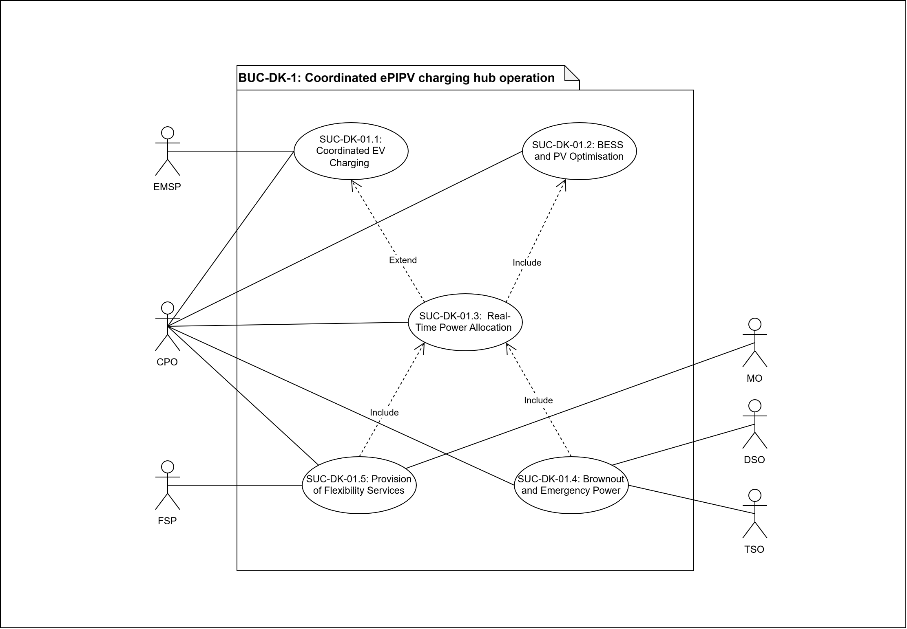
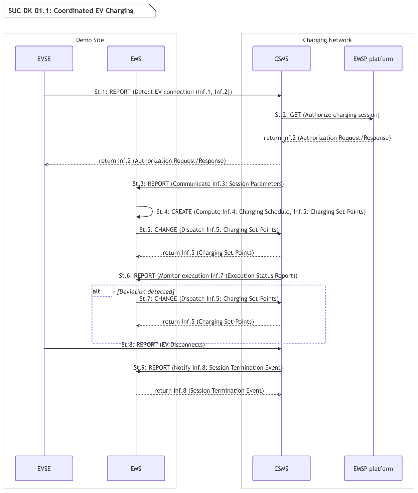
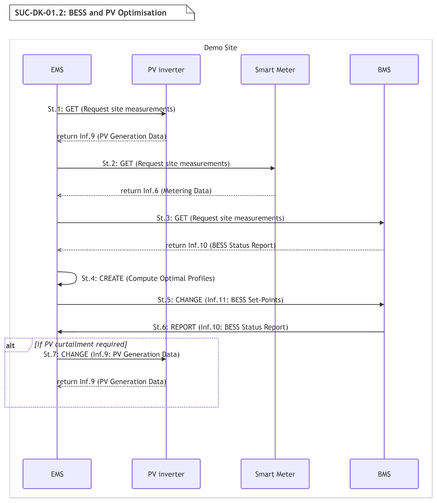
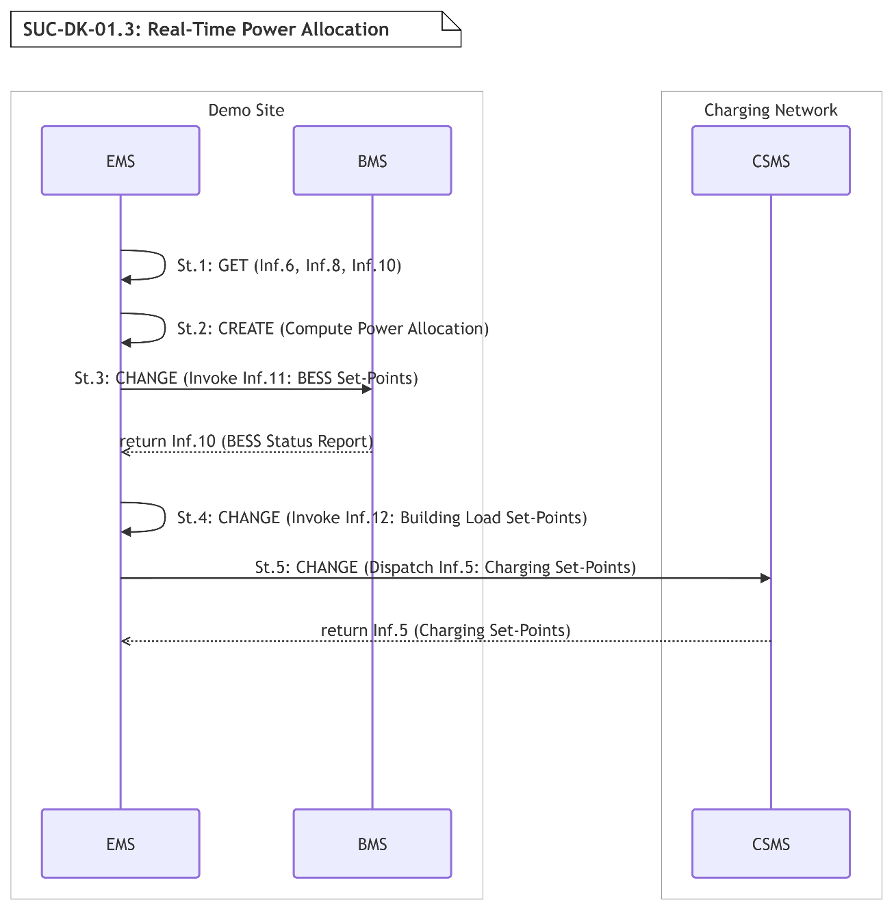
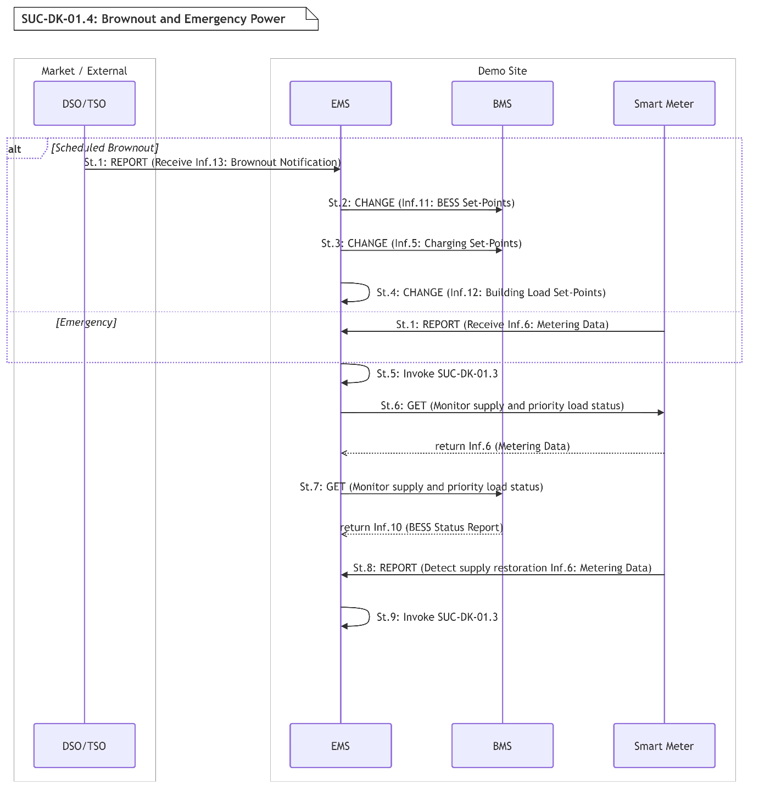
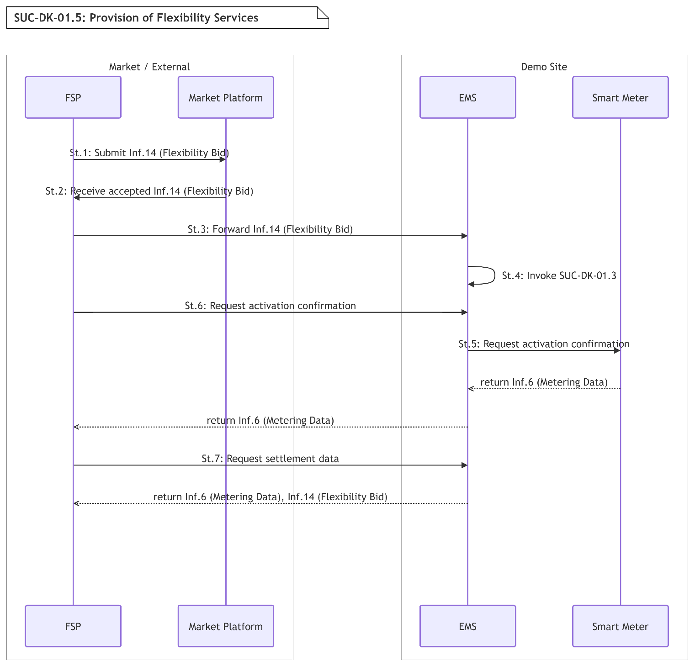

# BUC-DK-01 — Coordinated ePIPV Charging Hub Operation

> **SOLAR-MOVE — Danish Demonstrator** 
> Business Use Case following the IEC 62559-2 template.

| | |
|---|---|
| **Use Case ID** | BUC-DK-01 |
| **Document** | SOLARMOVE_BUC-DK-01.v1.0 |
| **Version** | v1.0 |
| **Area** | Energy System |
| **Domains** | Distribution System, DER, Customer Premises |
| **Zones** | Operation, Enterprise, Market |
| **Work Package / Task** | WP1 — T1.3 |

**Files in this folder:** [`SOLARMOVE_BUC-DK-01.v1.0.xlsx`](SOLARMOVE_BUC-DK-01.v1.0.xlsx) (IEC 62559-2 tables) · [`SOLARMOVE_BUC-DK-01.v1.0.xml`](SOLARMOVE_BUC-DK-01.v1.0.xml) (IEC 62559-3-style serialization, draft) · [`images/`](images/) (diagrams)

---

## Table of contents

1. [Description of the use case](#1-description-of-the-use-case)
2. [Diagrams of the use case](#2-diagrams-of-the-use-case)
3. [Technical details](#3-technical-details)
4. [Step-by-step analysis of the use case](#4-step-by-step-analysis-of-the-use-case)
5. [Information exchanged](#5-information-exchanged)
6. [Requirements](#6-requirements)
7. [Common terms and definitions](#7-common-terms-and-definitions)

---

## 1. Description of the use case

### 1.1 Name of the use case

| ID | Area / Domain(s) / Zone(s) | Name of Use Case |
|----|----------------------------|------------------|
| BUC-DK-01 | **Area:** Energy System **Domains:** Distribution System, DER, Customer Premises **Zones:** Operation, Enterprise, Market | Coordinated ePIPV Charging Hub Operation |

### 1.2 Version management

| Version | Date | Author(s) | Changes |
|---------|------|-----------|---------|
| 1.0 | 20.10.2026 | Nikos Vourgidis (NTUA), Irisa Sevdari (DTU) | First public version |

### 1.3 Scope and objectives of the use case

#### Scope

This use case focuses on the coordinated operation of an ePIPV charging hub serving heavy-duty and light-duty electric vehicles under limited grid connection capacity. It includes the management of charging demand, on-site PV generation, and battery storage to ensure reliable operation and maximise local energy utilisation. The use case also considers interaction with the distribution grid and the potential participation in flexibility services and electricity markets, while excluding detailed control strategies and component-level behaviour.

Beyond the technical coordination challenge, the underlying business problem is how to operate a high-demand EV charging hub despite limited grid capacity, avoiding the prohibitive capital cost and lead time of grid reinforcement while preventing fleet operational downtime caused by uncoordinated charging. The business value created by coordinated hub operation includes: maximising PV self-consumption; avoiding or deferring grid reinforcement costs by enabling heavy-duty vehicle (HDV) charging without proportional grid upgrades; ensuring reliable charging of HDVs according to fleet schedules, thereby reducing the risk of logistics disruption; lowering operational energy costs and exposure to grid electricity prices; unlocking potential flexibility revenues from the BESS and controllable charging; and improving resilience of buildings and site loads during constrained-supply events. The coordinated hub model also has strong replication potential for logistics depots, highway charging hubs, and commercial fleet charging sites facing similar grid constraints.

Five system use cases (SUCs) will be derived by this BUC:

**SUC-DK-01.1:*Coordinated EV Charging*** - Schedule and prioritise EV charging, particularly for HDVs, to ensure charging requirements are met within grid constraints.

**SUC-DK-01.2:*BESS and PV Optimisation*** - Control battery charging and discharging in coordination with PV generation to maximise self-consumption and support site operation.

**SUC-DK-01.3:*Real-Time Power Allocation*** - Distribute available power in real time across EV charging infrastructure and building loads to maintain grid-compliant operation.

**SUC-DK-01.4:*Brownout and Emergency Power Management*** - Prepare for and respond to constrained power availability in two scenarios: scheduled, through brownouts; and unscheduled emergency events.

**SUC-DK-01.5:*Provision of Flexibility services*** - Evaluate the site’s ability to provide flexibility and enable interaction with grid operators and potential market mechanisms.

Each SUC contributes to the high-level business objectives: SUC-DK-01.1 underpins reliable fleet operations and infrastructure utilisation; SUC-DK-01.2 drives PV self-consumption and reduced energy costs; SUC-DK-01.3 enables high charging capacity without grid reinforcement; SUC-DK-01.4 provides operational resilience and protection of critical loads; and SUC-DK-01.5 opens potential new revenue streams from grid services.

The use case also creates value for its different stakeholders: the site operator benefits from lower energy costs, better asset utilisation, predictable HDV charging, reduced operational disruption and potential new flexibility revenue; the DSO benefits from reduced peak load and better management of grid constraints; the TSO and FSP gain access to flexible distributed assets such as the BESS and controllable EV charging; and passenger EV users benefit from more reliable charging availability and improved service quality.

#### Objectives

- Maximise the utilisation of locally available energy resources, increasing PV self-consumption and overall use of DERs within the charging hub. Reduce peak power at the grid connection point through coordinated operation and participation in DR programmes. Minimise curtailment of renewable energy by optimising the interaction between PV, battery storage, and site loads. Increase the flexibility potential of the site by enabling coordinated control of charging demand and DERs. Enhance the economic performance of the hub by increasing revenues generated from DER utilisation and flexibility services.

#### Related business case(s)

_—_

### 1.4 Narrative of the use case

#### Short description

This use case describes the coordinated operation of an ePIPV charging hub serving both heavy- and light-duty EVs under limited grid connection capacity. The system manages charging demand together with on-site PV generation and battery storage to ensure reliable operation while maximising local energy utilisation. The site operator ensures that the hub operates within grid constraints and adapts to external signals. The BUC also considers the potential for providing flexibility services and participating in electricity markets. The implementation of this use case is demonstrated in the Danish pilot.

#### Complete description

The BUC considers a grid-connected ePIPV charging hub designed to serve both heavy- and light-duty EVs. The site is connected to the distribution grid with a capacity of 3250 A, connected through a 10kV/400V transformer, which powers also four buildings with office and warehouse functions, contributing additional electricity demand through heating and cooling systems. The energy system is further composed of approximately 2 MWp of PV generation, battery energy storage systems with a total capacity of 4 MWh (connected through a 750 kW converter), 20 high-power charging points for heavy-duty vehicles (16 DC chargers at 400kW and 4 DC chargers at 200kW), 4 DC chargers (at 200kW) and 20 AC chargers (at 11kW) for light-duty vehicles. The fleet includes 7 electric trucks, including a VIPV- vehicle.

Due to the limited grid connection capacity relative to the combined demand from EV charging, buildings, and other site loads, uncoordinated operation would lead to peak demand violations and insufficient charging of heavy-duty vehicles within required timeframes. Ensuring that trucks are charged according to operational schedules while maximising the use of locally generated PV energy therefore requires coordinated management of all energy resources at the site.

The Charging Point Operator (CPO) will be responsible for the overall operation of the site through a fully centralised energy management approach. All major energy assets, including EV charging infrastructure, PV generation, battery storage, and building loads, will be coordinated through a central control system to ensure reliable and grid-compliant operation. This includes adapting operation to grid constraints and external signals from the DSO and assessing opportunities for participation in flexibility services and electricity markets and preparing the site to be able to continue normal operation during grid outages.

To achieve this, the use case encompasses several key operational functions: coordinated scheduling of EV charging, including prioritisation of heavy-duty vehicles; optimisation of battery charging and discharging to support peak load management and PV utilisation; real-time allocation of available power across charging infrastructure and building loads; managed operation during loss of grid supply; and evaluation of the site’s capability to provide flexibility to the grid. These functions are further detailed across five SUCs, each addressing a specific operational layer of the hub.

**SUC-DK-01.1: Coordinated EV Charging.** The Charging Station Management System (CSMS) collects EV connection events and charging requirements from individual EVSEs and communicates them to the EMS. The EMS computes an optimised charging schedule based on vehicle departure times, state of charge, grid connection limits, and available PV generation. Charging priorities are assigned dynamically, with heavy-duty vehicles receiving precedence to meet fleet schedules. The resulting set-points are dispatched by the EMS to each EVSE, and the CSMS monitors execution in real time, reporting deviations back to the EMS for re-scheduling as needed.

**SUC-DK-01.2: BESS and PV Optimisation.** The EMS continuously receives generation forecasts and real-time output measurements from the PV inverter/controller and state-of-charge data from the BMS. Based on site load forecasts and grid capacity limits, the EMS determines optimal charge and discharge profiles for the BESS and communicates the corresponding set-points to the BMS, which executes them locally. Smart meters provide interval metering data at the grid connection point to inform and validate the optimisation. The EMS updates BESS set-points via the BMS, adapting to deviations in PV output or site demand in real time.

**SUC-DK-01.3: Real-Time Power Allocation.** The EMS continuously monitors total site power consumption from smart meter readings and individual EVSE measurements reported via the CSMS. When the aggregate demand approaches the grid connection limit, the EMS applies a dynamic power allocation algorithm to redistribute available capacity across active EVSEs and controllable building loads in real time. Allocation decisions account for EV charging priorities established in SUC-DK-01.1 and current BESS operation as communicated by the BMS. Updated power limits are communicated to each EVSE through the CSMS within a defined control cycle, ensuring continuous grid-compliant operation without manual intervention.

**SUC-DK-01.4: Brownout and Emergency Power.** This SUC addresses two distinct scenarios of constrained power availability. In the first, the DSO or TSO provides advance notification of a brownout, giving the BMS and EMS time to prepare: the BESS is pre-charged, non-essential EV charging sessions are rescheduled, and the site transitions to a planned low-consumption mode before the supply reduction takes effect. In the second scenario, power is reduced or lost without prior warning, requiring the EMS to respond immediately. In both cases, the EMS applies the same predefined priority hierarchy: available power is allocated first to warehouse cooling systems, which are critical for preserving temperature-sensitive goods, and second to heavy-duty vehicle charging where state of charge and departure schedules permit. All other loads, including light-duty EV charging and non-essential building systems, are curtailed. The BESS supports priority loads during the constrained period and the system initiates a controlled restoration sequence once normal supply is confirmed, gradually returning non-priority loads to operation.

**SUC-DK-01.5: Provision of Flexibility Services.** The EMS periodically calculates the site’s available upward and downward flexibility based on current BESS state of charge, EVSE headroom, and building load controllability. The primary focus of the flexibility assessment is on frequency containment and restoration services, given the fast-response capability of the BESS and the site's controllable load portfolio. Other flexibility products and market mechanisms are not excluded and may be assessed as the pilot progresses. Flexibility estimates are formatted and communicated to the DSO or TSO upon request or in response to market signals. When a flexibility activation signal is received, the EMS adjusts site operation, accordingly, modifying EV charging schedules and issuing updated set-points to the BMS within the bounds established by SUC-DK-01.1 and SUC-DK-01.2. Smart meters record the resulting energy flows for settlement and reporting purposes, enabling verification of the delivered flexibility service.

Within the Danish pilot, the provision of flexibility services is primarily assessed as a future opportunity rather than fully commercially activated, with the technical capability demonstrated and the revenue potential evaluated as the pilot progresses. The party capturing any resulting flexibility revenue would typically be the FSP or the site operator, depending on the contractual arrangement in place; the definition of ownership and revenue allocation is left to later business-model work.

The prioritisation of HDVs is one of the strongest business drivers of this use case. By ensuring that HDVs are charged according to their departure schedules, coordinated operation directly reduces the risk of delivery disruption and vehicle downtime, protecting the continuity of the fleet and logistics operations that depend on the site. Fleet charging reliability is therefore treated as a core value driver rather than a purely technical constraint.

### 1.5 Key performance indicators (KPI)

| ID | Name | Description | Reference to objectives |
|----|------|-------------|--------------------------|
| U06 | Flexibility Potential | _Measures the increase in upward and downward power adjustment the site can make available, derived from BESS state of charge, EVSE headroom, and controllable building loads. In this pilot it reflects the capacity the EMS can offer for frequency services (FCR/aFRR) relative to a site operating without coordinated control._ _Target: Increase potential by 25%_ | OBJ-4 |
| U10 | Collective Self-Consumption | _Measures the share of energy generated by the on-site PV array that is consumed locally rather than exported. It directly tracks how effectively the EMS aligns EV charging sessions and BESS charging with periods of high solar output._ Target: Increase collective self-consumption by 75% at pilot level. | OBJ-1 |
| U11 | Renewables Curtailment Avoidance | _Measures the reduction in PV energy that would otherwise be curtailed when generation exceeds site demand and grid injection limits. The EMS addresses this by absorbing surplus into the BESS or by raising power limits at active EVSEs._ Target: Increase avoidance curtailment of renewables by 25% at pilot level. | OBJ-3 |
| U12 | Peak Consumption Reduction (DR) | _Measures the reduction in peak power drawn at the grid connection point compared with uncoordinated operation. This is achieved through real-time reallocation of available capacity across chargers and controllable building loads, supported by BESS discharge during peak intervals._ Target: Increase peak consumption reduction by 25%. | OBJ-2 |
| U13 | Increase in revenue created from DERs; | _Measures the additional income generated by the site’s DERs, specifically remuneration earned from flexibility and frequency service provision by the BESS and controllable charging capacity, together with any revenue from exported PV generation._ _Target: Increase revenues by 25%._ | OBJ-5 |
| U14 | Use of DERs in Parking Lots / ePIPVs | _Measures the increase in utilisation of local energy resources relative to an uncoordinated baseline. It captures how effectively the EMS coordinates charging demand against locally available energy across both heavy- and light-duty sessions._ _Target: Increase utilization of DERs in the ePIPV site by 30%._ | OBJ-1 |
| U07 | Constraints Violation Occurrence | _Measures the reduction in operational constraint violations during site operation, including exceedances of the grid connection limit, charger power boundaries, and HDV departure deadlines. This tracks the EMS's ability to maintain grid-compliant operation while dynamically reallocating power across chargers, building loads, and the BESS._ _Target: Decrease occurrences of constraints violation by 15%._ | OBJ-4 |
| U19 | Flexibility Participation Tests | _Measures the number of flexibility service activations executed at the site during the pilot, covering bid submission, activation signal reception, and delivery verification._ _Target: Run 2 participation tests._ | OBJ-4 |
| U04 | Operation Cost (ePIPV) | _Measures the reduction in the site’s total operational energy expenditure, covering all cost-side savings: lower grid imports through direct use of on-site PV, reduced exposure to high-price intervals through schedule shifting, and lower capacity and peak-related tariff charges resulting from coordinated power allocation._ _Target: Reduction of operation cost of the ePIPV site by 25% compared to the non-optimised operation._ | OBJ-5 |

### 1.6 Use case conditions

#### Assumptions

1. The charging hub infrastructure is already installed and operational, including multiple heavy-duty and light-duty chargers, on-site PV generation, BESS, and a connection to the distribution grid.
2. The site operates under a limited grid connection capacity, which constrains the simultaneous operation of charging infrastructure and other local energy resources. An increase in grid capacity may occur in the future but is not considered within the scope of this use case.
3. No EMS or coordinated control strategy is currently implemented to manage the interaction between EV charging, PV generation, and battery storage.
4. A single responsible entity operates the site, acting as the Party Connected to the Grid, including the charging infrastructure, managing electricity exchange at the connection point.

#### Prerequisites

1. The charging hub is connected to the distribution grid, with an agreed and defined grid connection capacity established with the Grid Access Provider (DSO).
2. On-site PV generation and BESS systems are available and operational.
3. Charging infrastructure is available and operational, and EV users have access to the charging services through an EMSP (including authentication and authorisation).
4. EVs are connected or expected to connect to the charging hub with defined charging needs.
5. The CPO is able to monitor and control the charging infrastructure.

### 1.7 Further information for classification/mapping

**Generic, regional or national relation.**

While the use case is demonstrated in a specific Danish pilot, its underlying logic is highly generic and replicable. Elements specific to this pilot include the particular site configuration, the fleet composition including the VIPV vehicle, and the Danish market and regulatory context.

The core concept, the coordinated operation of EV charging, PV, BESS, and building loads through a centralised EMS to overcome a limited grid connection, is broadly transferable. It can be replicated at logistics depots, highway charging hubs, commercial fleet charging sites, and distribution centres in other countries and regions facing similar grid bottlenecks, provided the enabling conditions are present: on-site PV and/or BESS, controllable charging infrastructure, predictable fleet schedules, EMS/CSMS integration, and market access for flexibility services. The market and regulatory specifics (grid tariffs, flexibility market rules, DSO/TSO roles) would need to be adapted to the local context in each replication case.

### 1.8 General remarks

_Further comments which are not considered elsewhere._

---

## 2. Diagrams of the use case

The diagram below illustrates the overall structure of the Business Use Case, showing the actors and the 5 System Use Cases (SUC-DK-01.1, SUC-DK-01.2, SUC-DK-01.3, SUC-DK-01.4, SUC-DK-01.5) that realise it.

  

<em><b>Figure 1.</b> BUC-DK-01 — Coordinated ePIPV Charging Hub Operation (use case diagram).</em>

---

## 3. Technical details

### 3.1 Actors

| Actor Name | Actor Type | Actor Description | Further information specific to this use case |
|------------|------------|-------------------|-----------------------------------------------|
| **CPO** | Business | Charging Point Operator: Mobility partner who operates the charging infrastructure. They are sometimes called CSOs (Charging Station Operators) [1]. | In the context of this pilot, the CPO is responsible for the overall operation and management of the ePIPV energy management system. |
| **DSO** | Business | Distribution System Operator (DSO) means a natural or legal entity responsible for operating, ensuring the maintenance of and, if necessary, developing the distribution system in a given area and, where applicable, its interconnections with other systems and for ensuring the long-term ability of the system to meet reasonable demands for the distribution of electricity [2]. | The local DSO is responsible for the distribution grid to which the ePIPV hub is connected and sets the site's maximum grid connection capacity. In the context of this pilot, this role is fulfilled by Energi Fyn. |
| **EMSP** | Business | Electric Mobility (eMobility) Service Provider or Mobility Service provider: Mobility partner who provides eMobility services to customers [1]. | Handles authentication and authorisation of EV users or vehicles accessing the charging infrastructure. |
| **FSP** | Business | Flexibility Service Provider (FSP) means a party that offers flexibility services based on acquired (aggregated) Resources [3]. | Acts as the intermediary between the site and the flexibility or frequency markets, submitting bids on behalf of the CPO. In the Danish pilot, the CPO may act as their own FSP or contract a third party for this role. |
| **MO** | Business | Market Operator (MO) means a party that provides a service whereby the offers to sell energy are matched with bids to buy energy [3]. | This role can be fulfilled by the Transmission System Operator, Distribution System Operator or another entity based on the country. |
| **TSO** | Business | Transmission System Operator (TSO) means a natural or legal person responsible for operating, ensuring the maintenance of and, if necessary, developing the transmission system in a given area and, where applicable, its interconnections with other systems, and for ensuring the long–term ability of the system to meet reasonable demands for the transmission of electricity [2]. | In Denmark, this role is fulfilled by Energinet, which is responsible for the transmission grid and operates the frequency regulation markets (FCR and aFRR) relevant to this pilot. |
| **BMS** | System | Battery Management System (BMS) means an electronic system associated with a battery which has functions to control current in case of overcharge, overcurrent, overdischarge, and overheating and which monitors and/or manages the battery's state, calculates secondary data, reports that data and/or controls its environment to influence the battery's safety, performance and/or service life [4]. | Manages the BESS. Communicates with the EMS via CAN bus, receiving charge/discharge set-points and reporting state of charge, available power, and fault status in real time. |
| **CSMS** | System | Charging Station Management System (CSMS) manages Charging Stations and has the information for authorizing Users for using its Charging Stations [5]. | Manages communication between the EMS and the site's chargers using the OCPP protocol. |
| **EMS** | System | Energy Management System (EMS) means a device that manages the local loads (consumption and production) based on local and/or contractual constraints and/or contractual incentives. It has additional inputs, such as sensors and controls from e.g. PV, battery storage [5]. | Central control system of the ePIPV hub, coordinating all on-site energy assets. PV inverter and EVSEs connect directly to the EMS; the BESS is managed via the BMS. |
| **EVSE** | System | Electric Vehicle Supply Equipment (EVSE) means an independently operated and managed part of the Charging Station that can deliver energy to one EV at a time [5]. | The site includes 24 high-power DC chargers (up to 400 kW) for heavy-duty vehicles and 20 AC chargers for light-duty vehicles. Executes power set-points received via the CSMS. |
| **Market Platform** | System | Digital platform maintained by the MO through which flexibility bids are submitted, matched, and settled between market participants and the system operator | In the Danish context, this includes platforms operated by Energinet as well as shared European balancing platforms (FCR Cooperation, PICASSO) in which Energinet participates as a TSO. |
| **PV inverter** | System | Power electronics device converting the DC electricity into AC electricity [6]. | Reports real-time generation measurements directly to the EMS and can receive curtailment commands in cases of excess grid injection. |
| **Smart Meter** | System | A device that measures the energy fed into and consumed from the grid, they can provide real-time information on energy-usage to consumers and suppliers [7]. | Installed at the grid connection point and at sub-metering locations across the site. |

### 3.2 References

_References (standards, reports, mandates and regulatory constraints) associated with the use case._

| No. | Reference Type | Reference | Status | Impact on use case | Originator / organisation | Link |
|-----|----------------|-----------|--------|--------------------|---------------------------|------|
| 1 |  | EV Charging Glossary |  |  | saascharge | [EV Charging Glossary](https://saascharge.com/glossary/) |
| 2 |  | European Union, Directive 2009/72/EC of the European Parliament of the Council of 13 July 2009 concerning common rules for the internal market in electricity and repealing Directive 2003/54/EC , 2009 |  |  | EUR-Lex | [EU Directive 2009/72/EC](https://eur-lex.europa.eu/legal-content/EN/TXT/PDF/?uri=CELEX:32009L0072&from=EN) |
| 3 |  | THE HARMONISED ELECTRICITY MARKET ROLE MODEL |  |  | ENTSO-E | [HEMRM](https://www.entsoe.eu/data/cim/role-models/) |
| 4 |  | IEC 62619:2022 Secondary cells and batteries containing alkaline or other non-acid electrolytes - Safety requirements for secondary lithium cells and batteries, for use in industrial applications |  |  | IEC | [IEC 62619:2022](https://webstore.iec.ch/en/publication/64073) |
| 5 |  | IEC 63584:2024 Open Charge Point Protocol (OCPP) |  |  | IEC | [IEC 63584](https://webstore.iec.ch/en/publication/95734) |
| 6 |  | IEC 61727:2004 Photovoltaic (PV) systems - Characteristics of the utility interface |  |  | IEC | [IEC 61727](https://webstore.iec.ch/en/publication/5736) |
| 7 |  | Smart grids and meters |  |  | European Commission | [EC Smart grids and meters](https://energy.ec.europa.eu/topics/markets-and-consumers/smart-grids-and-meters_en) |

---

## 4. Step-by-step analysis of the use case

### 4.1 Overview of scenarios

| No. | Scenario name | Scenario description | Primary actor | Triggering event | Pre-condition | Post-condition |
|-----|---------------|----------------------|---------------|------------------|---------------|----------------|
| 1. | SUC-DK-01.1: Coordinated EV Charging | The EMS computes an optimised charging schedule based on vehicle departure times, state of charge, grid connection limits, and available PV generation. | EVSE | An EV (heavy- or light-duty) connects to an EVSE, and a charging session request is received by the CSMS. | At least one EVSE is energized and connected to the CSMS. The EMS is operational and has access to the current grid capacity limits, PV generation data, and vehicle departure schedules. | An optimised charging schedule has been computed and dispatched to all active EVSEs via the CSMS. HDV charging priorities are reflected in the active set-points. |
| 2. | SUC-DK-01.2: BESS and PV Optimisation | The EMS determines optimal charge and discharge profiles for the BESS and communicates the corresponding set-points to the BMS, which executes them locally. | EMS | A new PV generation forecast is received, or a real-time deviation in PV output or site demand is detected by the EMS. | The BMS and PV inverter are operational and communicating with the EMS. A valid sire load forecast is available and the BESS is withing normal operating parameters. | Updated BESS charge/discharge set-points have been issued by the BMS. PV self-consumption is maximised and site demand remains withing grid connection constraints. |
| 3. | SUC-DK-01.3: Real-Time Power Allocation | The EMS applies a dynamic power allocation algorithm to redistribute available capacity across active EVSEs and controllable building loads in real time. | EMS | Aggregate site demand approaches or exceeds the grid connection limit, as detected by the EMS via smart meter readings or EVSE measurement reported through the CSMS. | SUC-DK.01.2 and (if necessary) SUC-DK.01.1 are active and a valid charging schedule and BESS set-points are in place. Smart meters and CSMS are delivering real-time measurement to the EMS. The EMS power allocation algorithm is configured. | Available power has been distributed across the controllable building loads and if active, across EVSEs. Site operation is within the grid connection limit and no manual intervention has been required. |
| 4. | SUC-DK-01.4: Brownout and Emergency Power | The EMS allocates power to site loads during times of constrained power availability. | DSO/TSO or Smart Meter | Either (a) the DSO or TSO issues and advance notification of a scheduled brownout, or (b) the EMS detects an unscheduled loss or reduction of grid supply via smart meter alarms. | SUC-DK.01.1, SUC-DK.01.2, and SUC-DK.01.3 are active. A predefined load priority hierarchy is configured in the EMS. The BESS is within normal operating parameters. | The site is operating under constrained power mode with priority loads sustained. A controlled restoration sequence has been initiated once normal grid supply is confirmed and non-priority loads are being gradually energized. |
| 5. | SUC-DK-01.5: Provision of Flexibility Services | The FSP periodically calculates the site’s available upward and downward flexibility and when a flexibility activation signal is received, it adjusts site operation accordingly. | FSP | The FSP submits a bid into a flexibility or frequency market and an activation signal is subsequently received from the DSO or TSO. | SUC-DK.01.1 and SUC-DK.01.2 are active. The BMS is reporting the current SoC to the EMS. A communication channel to the DSO or TSO is established and the site flexibility parameters are configured in the EMS. | Available flexibility has been calculated and communicated to the system operator. If an activation signal was received, the EMS has adjusted EV charging schedules and BESS set-points accordingly. Smart meters have recorded the resulting energy flows for settlement and verification. |

### 4.2 Steps – Scenarios

#### 4.2.1 Coordinated EV Charging (SUC-DK-01.1)

| Step No. | Event | Name of process / activity | Description of process / activity | Service | Information producer | Information receiver | Information exchanged (IDs) | Requirement, R-IDs |
|----------|-------|----------------------------|-----------------------------------|---------|----------------------|----------------------|-----------------------------|--------------------|
| St.1 | EV connects to EVSE | Detect EV connection | EVSE detects plug-in event and notifies CSMS of new session request. | REPORT | EVSE | CSMS | Inf.1: EV Connection Event; Inf.2: Authorisation Request / Response | R-CYB-01, R-CYB-03, R-CYB-06, R-CYB-09, R-DAT-01, R-DAT-02, R-INT-02, R-INT-03, R-SC-01, R-SC-02 |
| St.2 | Session request received | Authorise charging session | CSMS authenticates EV user via EMSP platform and authorises the session | GET | CSMS | EMSP platform | Inf.2: Authorisation Request / Response | R-CYB-01, R-CYB-03, R-CYB-06, R-CYB-09, R-SC-01 |
| St.3 | Session authorised | Communicate session data to EMS | CSMS forwards session parameters to EMS. | REPORT | CSMS | EMS | Inf.3: Session Parameters | R-AIC-02, R-AIC-06, R-CYB-06, R-FOR-03, R-SC-02, R-UI-02 |
| St.4 | Session data received | Compute charging schedule | EMS computes optimised charging schedule based on departure times, SoC, grid limits, and PV forecast, assigning priority to HDVs | CREATE | EMS | EMS | Inf.4: Charging Schedule | R-EMS-03, R-FOR-03, R-FOR-05, R-GFR-03, R-SAF-08, R-SC-04, R-SC-05, R-UI-06 |
| St.5 | Schedule computed | Dispatch charging set-points | EMS sends power set-points and charging schedule to each active EVSE via CSMS | CHANGE | EMS | CSMS | Inf.5: Charging Set-Points | R-CYB-04, R-EMS-03, R-EMS-04, R-INT-02, R-RTC-03, R-SAF-01, R-SC-03, R-SC-05 |
| St.6 | Charging in progress | Monitor execution | CSMS collects real-time metering data from EVSEs and reports deviations from scheduled set-points back to EMS | REPORT | CSMS | EMS | Inf.7: Execution Status Report | R-COM-03, R-EMS-05, R-MVR-02, R-RTC-04, R-RTC-06, R-SAF-02, R-UI-05 |
| St.7 | Deviation detected | Re-schedule charging | EMS recomputes and reissues updated set-points in response to deviations | CHANGE | EMS | CSMS | Inf.5: Charging Set-Points | R-CYB-04, R-EMS-03, R-EMS-04, R-INT-02, R-RTC-03, R-SAF-01, R-SC-03, R-SC-05 |
| St.8 | EV disconnects | Close charging session | EVSE reports session end to CSMS. | REPORT | EVSE | CSMS | x | - |
| St.9 | Session end received | Notify EMS of session closure | CSMS notifies EMS that the session has ended and provides final energy consumption data | REPORT | CSMS | EMS | Inf.8: Session Termination Event | R-DAT-05, R-MVR-03, R-SC-01 |

  

<em><b>Figure 2.</b> SUC-DK-01.1 — Coordinated EV Charging (sequence diagram).</em>

#### 4.2.2 BESS and PV Optimisation (SUC-DK-01.2)

| Step No. | Event | Name of process / activity | Description of process / activity | Service | Information producer | Information receiver | Information exchanged (IDs) | Requirement, R-IDs |
|----------|-------|----------------------------|-----------------------------------|---------|----------------------|----------------------|-----------------------------|--------------------|
| St.1 | PV deviation detected | Request site measurements | EMS collects real-time PV generation output from the PV inverter. | GET | PV Inverter | EMS | Inf.9: PV Generation Data | R-DAT-01, R-DAT-03, R-DAT-04, R-FOR-01, R-FOR-05, R-INT-04, R-MVR-02 |
| St.2 | Scheduled demand deviation detected | Request site measurements | EMS collects real-time interval metering data from smart meters. | GET | Smart Meter | EMS | Inf.6: Metering Data | R-DAT-01, R-DAT-02, R-DAT-03, R-DAT-06, R-GFR-01, R-GFR-08, R-MVR-01, R-MVR-02, R-MVR-04, R-RTC-02 |
| St.3 | Measurements received | Request BESS status | BMS reports current state of charge, available power, operational mode, and fault status to EMS. | GET | BMS | EMS | Inf.10: BESS Status Report | R-AIC-03, R-DAT-01, R-INT-04, R-INT-05, R-SAF-02, R-SAF-03, R-SAF-07 |
| St.4 | BESS status received | Compute optimal profiles | EMS computes optimal BESS charge and discharge profile based on PV forecast, site load forecast, grid capacity limits, and current SoC. | CREATE | EMS | EMS | Inf.9: PV Generation Data; Inf.11: BESS Set-Points | R-CYB-04, R-DAT-01, R-DAT-03, R-DAT-04, R-EMS-03, R-FOR-01, R-FOR-05, R-GFR-03, R-INT-04, R-INT-05, R-MVR-02, R-RTC-03, R-SAF-01, R-SAF-07 |
| St.5 | Profile computed | Dispatch BESS set-points to BMS | EMS sends charge or discharge power set-points to BMS. | CHANGE | EMS | BMS | Inf.11: BESS Set-Points | R-CYB-04, R-EMS-03, R-GFR-03, R-INT-05, R-RTC-03, R-SAF-01, R-SAF-07 |
| St.6 | Set-points received | Execute BESS set-points | BMS executes the received set-points and confirms operational status to EMS. | REPORT | BMS | EMS | Inf.10: BESS Status Report | R-AIC-03, R-DAT-01, R-INT-04, R-INT-05, R-SAF-02, R-SAF-03, R-SAF-07 |
| St.7 | Profile computed | Dispatch PV set-points to PV inverter | EMS sends power set-points to PV inverter in case of curtailment need. | CHANGE | EMS | PV inverter | Inf.9: PV Generation Data | R-DAT-01, R-DAT-03, R-DAT-04, R-FOR-01, R-FOR-05, R-INT-04, R-MVR-02 |

  

<em><b>Figure 3.</b> SUC-DK-01.2 — BESS and PV Optimisation (sequence diagram).</em>

#### 4.2.3 Real-Time Power Allocation (SUC-DK-01.3)

| Step No. | Event | Name of process / activity | Description of process / activity | Service | Information producer | Information receiver | Information exchanged (IDs) | Requirement, R-IDs |
|----------|-------|----------------------------|-----------------------------------|---------|----------------------|----------------------|-----------------------------|--------------------|
| St.1 | Continuous monitoring cycle | Invoke SUC-DK-01.2 steps 1-3 | EMS collects PV generation data, site metering data, and BESS status as part of the ongoing optimisation cycle — refer to SUC-DK-01.2 steps 1-3 for the full data collection flow. | GET | EMS | EMS | Inf.6: Metering Data; Inf.9: PV Generation Data; Inf.10: BESS Status Report | R-AIC-03, R-DAT-01, R-DAT-02, R-DAT-03, R-DAT-04, R-DAT-06, R-FOR-01, R-FOR-05, R-GFR-01, R-GFR-08, R-INT-04, R-INT-05, R-MVR-01, R-MVR-02, R-MVR-04, R-RTC-02, R-SAF-02, R-SAF-03, R-SAF-07 |
| St.2 | Aggregate site demand approaches grid connection limit | Compute power allocation | EMS detects that aggregate site demand is approaching the grid connection limit and applies the dynamic power allocation algorithm to redistribute available capacity across active EVSEs, controllable building loads, and the BESS. In cases of excess PV generation leading to grid over-injection, the EMS may also issue a curtailment command to the PV inverter. | CREATE | EMS | EMS | Inf.5: Charging Set-Points; Inf.11: BESS Set-Points; Inf.12: Building Load Set-Points | R-AIC-02, R-CYB-04, R-EMS-02, R-EMS-03, R-EMS-04, R-GFR-03, R-GFR-05, R-GFR-06, R-INT-02, R-INT-04, R-INT-05, R-RTC-03, R-SAF-01, R-SAF-07, R-SC-03, R-SC-05 |
| St.3 | Allocation computed | Invoke BESS set-point update | As part of the allocation, EMS triggers an update of BESS charge/discharge set-points to account for the revised site power balance — refer to SUC-DK-01.2 steps 4-6 for the full BESS dispatch flow. | CHANGE | EMS | BMS | Inf.11: BESS Set-Points | R-CYB-04, R-EMS-03, R-GFR-03, R-INT-05, R-RTC-03, R-SAF-01, R-SAF-07 |
| St.4 | Allocation computed | Dispatch building load set-points | EMS sends updated set-points directly to controllable building loads, such as HVAC and warehouse cooling systems, adjusting their consumption in line with the computed allocation. | CHANGE | EMS | EMS | Inf.12: Building Load Set-Points | R-AIC-02, R-CYB-04, R-EMS-02, R-GFR-05, R-GFR-06, R-INT-04, R-RTC-03 |
| St.5 | Allocation computed | Dispatch updated charging set-points | EMS sends revised power limits for active EVSEs to CSMS — refer to SUC-DK-01.1 steps 6-9 for the full dispatch flow. | CHANGE | EMS | CSMS | Inf.5: Charging Set-Points | R-CYB-04, R-EMS-03, R-EMS-04, R-INT-02, R-RTC-03, R-SAF-01, R-SC-03, R-SC-05 |

  

<em><b>Figure 4.</b> SUC-DK-01.3 — Real-Time Power Allocation (sequence diagram).</em>

#### 4.2.4 Brownout and Emergency Power (SUC-DK-01.4)

| Step No. | Event | Name of process / activity | Description of process / activity | Service | Information producer | Information receiver | Information exchanged (IDs) | Requirement, R-IDs |
|----------|-------|----------------------------|-----------------------------------|---------|----------------------|----------------------|-----------------------------|--------------------|
| St.1 | [Branch A: Scheduled brownout] DSO or TSO issues advance brownout notification. | Receive constrained supply signal | Branch A: DSO or TSO sends an advance notification of a scheduled brownout to the EMS, providing expected start time and duration. | REPORT | DSO/TSO | EMS | Inf.13: Brownout Notification | R-AIC-02, R-COM-02, R-GFR-05, R-GFR-06, R-INT-05, R-UI-05 |
| St.2 | [Branch A only] Brownout notification received | Pre-charge BESS | EMS instructs BMS to bring the BESS to its target state of charge before the brownout takes effect, maximising available stored energy for the constrained period. | CHANGE | EMS | BMS | Inf.11: BESS Set-Points | R-CYB-04, R-EMS-03, R-GFR-03, R-INT-05, R-RTC-03, R-SAF-01, R-SAF-07 |
| St.3 | [Branch A only] BESS pre-charging initiated | Reschedule non-essential EV charging | EMS recomputes the charging schedule, deferring non-essential light-duty vehicle sessions to after the brownout window and retaining only HDV charging where energy reserves allow. | CHANGE | EMS | CSMS | Inf.5: Charging Set-Points | R-CYB-04, R-EMS-03, R-EMS-04, R-INT-02, R-RTC-03, R-SAF-01, R-SC-03, R-SC-05 |
| St.4 | [Branch A only] Rescheduling complete | Transition site to low-consumption mode | EMS dispatches reduced set-points to controllable building loads, shifting the site to a planned low-consumption mode before the supply reduction takes effect. | CHANGE | EMS | EMS | Inf.12: Building Load Set-Points | R-AIC-02, R-CYB-04, R-EMS-02, R-GFR-05, R-GFR-06, R-INT-04, R-RTC-03 |
| St.5 | [Both Branches)] Constrained supply is active | Invoke SUC-DK-01.3 | EMS activates the predefined priority hierarchy — warehouse cooling first, then HDV charging — and triggers real-time power reallocation across all controllable assets — refer to SUC-DK-01.3 for the full power allocation flow. | - | EMS | EMS | x | - |
| St.6 | Priority loads sustained | Monitor supply and priority load status | Smart meter continuously reports grid supply measurements to EMS. | GET | Smart Meter | EMS | Inf.6: Metering Data | R-DAT-01, R-DAT-02, R-DAT-03, R-DAT-06, R-GFR-01, R-GFR-08, R-MVR-01, R-MVR-02, R-MVR-04, R-RTC-02 |
| St.7 | Priority loads sustained | Monitor supply and priority load status | BMS reports BESS state of charge and discharge status. | GET | BMS | EMS | Inf.10: BESS Status Report | R-AIC-03, R-DAT-01, R-INT-04, R-INT-05, R-SAF-02, R-SAF-03, R-SAF-07 |
| St.8 | Normal grid supply restored | Detect supply restoration | Smart meter reports return to normal supply voltage and frequency at the grid connection point. | REPORT | Smart Meter | EMS | Inf.6: Metering Data | R-DAT-01, R-DAT-02, R-DAT-03, R-DAT-06, R-GFR-01, R-GFR-08, R-MVR-01, R-MVR-02, R-MVR-04, R-RTC-02 |
| St.9 | Restoration confirmed | Invoke SUC-DK-01.3 | EMS initiates a controlled restoration sequence, progressively returning non-priority building loads and light-duty EV charging to operation, and signalling BMS to resume standard BESS operation. | CHANGE | EMS | EMS | x | - |

  

<em><b>Figure 5.</b> SUC-DK-01.4 — Brownout and Emergency Power (sequence diagram).</em>

#### 4.2.5 Provision of Flexibility Services (SUC-DK-01.5)

| Step No. | Event | Name of process / activity | Description of process / activity | Service | Information producer | Information receiver | Information exchanged (IDs) | Requirement, R-IDs |
|----------|-------|----------------------------|-----------------------------------|---------|----------------------|----------------------|-----------------------------|--------------------|
| St.1 | FSP decides to participate in flexibility market | Submit flexibility bid to market | FSP submits a commercial flexibility bid to the MO specifying the offered volume, direction, product type (primarily FCR or aFRR), delivery window, and price. | REPORT | FSP | Market Platform | Inf.14: Flexibility Bid | R-AIC-07, R-COM-07, R-EMS-06, R-FOR-04, R-GFR-02, R-GFR-03, R-INT-07, R-MKT-03, R-MKT-04, R-MKT-05, R-MKT-08 |
| St.2 | Bid accepted — activation signal received | Receive flexibility activation signal | MO sends a flexibility activation signal to the EMS specifying the requested power adjustment in kW, direction, activation start time, duration, and a unique activation reference ID for settlement. | REPORT | Market Platform | FSP | Inf.14: Flexibility Bid | R-AIC-07, R-COM-07, R-EMS-06, R-FOR-04, R-GFR-02, R-GFR-03, R-INT-07, R-MKT-03, R-MKT-04, R-MKT-05, R-MKT-08 |
| St.3 | Activation signal received | Forward activation signal to EMS | FSP forwards the activation instruction to the EMS, triggering the site-level response. | REPORT | FSP | EMS | Inf.14: Flexibility Bid | R-AIC-07, R-COM-07, R-EMS-06, R-FOR-04, R-GFR-02, R-GFR-03, R-INT-07, R-MKT-03, R-MKT-04, R-MKT-05, R-MKT-08 |
| St.4 | Activation signal received by EMS | Invoke SUC-DK-01.3 | EMS triggers real-time power reallocation in response to the flexibility activation — refer to SUC-DK-01.3 for the full power allocation flow across EVSEs, BESS, and building loads. | - | EMS | EMS | x | - |
| St.5 | Activation executed | Request activation confirmation | Smart meters record and report resulting energy flows at the grid connection point to the EMS for internal monitoring and verification of the delivered flexibility. | REPORT | Smart Meter | EMS | Inf.6: Metering Data | R-DAT-01, R-DAT-02, R-DAT-03, R-DAT-06, R-GFR-01, R-GFR-08, R-MVR-01, R-MVR-02, R-MVR-04, R-RTC-02 |
| St.6 | Energy flows verified | Request activation confirmation | EMS forwards the verified energy flow data to the FSP. | REPORT | EMS | FSP | Inf.6: Metering Data; Inf.14: Flexibility Bid | R-AIC-07, R-COM-07, R-DAT-01, R-DAT-02, R-DAT-03, R-DAT-06, R-EMS-06, R-FOR-04, R-GFR-01, R-GFR-02, R-GFR-03, R-GFR-08, R-INT-07, R-MKT-03, R-MKT-04, R-MKT-05, R-MKT-08, R-MVR-01, R-MVR-02, R-MVR-04, R-RTC-02 |
| St.7 | Settlement data received | Forward settlement data to MO | FSP forwards the settlement data to the MO for confirmation of the delivered flexibility service. | REPORT | FSP | Market Platform | Inf.6: Metering Data; Inf.14: Flexibility Bid | R-AIC-07, R-COM-07, R-DAT-01, R-DAT-02, R-DAT-03, R-DAT-06, R-EMS-06, R-FOR-04, R-GFR-01, R-GFR-02, R-GFR-03, R-GFR-08, R-INT-07, R-MKT-03, R-MKT-04, R-MKT-05, R-MKT-08, R-MVR-01, R-MVR-02, R-MVR-04, R-RTC-02 |

  

<em><b>Figure 6.</b> SUC-DK-01.5 — Provision of Flexibility Services (sequence diagram).</em>

---

## 5. Information exchanged

| Information exchanged (ID) | Name of information | Description of information exchanged | Requirement, R-IDs |
|----------------------------|---------------------|--------------------------------------|--------------------|
| Inf.1 | EV Connection Event | Notification generated when an EV plugs into an EVSE, containing identification data and initial state of charge, used to trigger the charging session workflow | R-SC-01, R-SC-02, R-INT-02, R-INT-03, R-DAT-01, R-DAT-02 |
| Inf.2 | Authorisation Request/Response | Exchange between CSMS and EMSP to verify the identity of the EV user or vehicle and confirm or deny access to charging services | R-SC-01, R-CYB-01, R-CYB-03, R-CYB-06, R-CYB-09 |
| Inf.3 | Session Parameters | Data package communicated from CSMS to EMS at session start, including vehicle identity, EVSE ID, initial SoC, requested energy, and expected departure time | R-SC-02, R-AIC-02, R-AIC-06, R-FOR-03, R-UI-02, R-CYB-06 |
| Inf.4 | Charging Schedule | Time-phased plan produced by the EMS specifying, for each active EVSE, the assigned power level per time slot, target SoC, departure deadline, and priority ranking, used to coordinate charging across the site within grid and operational constraints | R-EMS-03, R-SC-04, R-SC-05, R-FOR-03, R-FOR-05, R-GFR-03, R-SAF-08, R-UI-06 |
| Inf.5 | Charging Set-Points | Power limit instructions dispatched to EVSEs, either as initial values from a computed schedule or as updated values following re-optimisation or real-time reallocation | R-EMS-03, R-EMS-04, R-SC-03, R-SC-05, R-RTC-03, R-INT-02, R-SAF-01, R-CYB-04 |
| Inf.6 | Metering Data | Measurements collected every 1 min from smart meters, including active power draw, cumulative energy delivered, current, voltage, and net import/export at the grid connection point, timestamped and used by the EMS for real-time monitoring, optimisation, and grid compliance verification | R-DAT-01, R-DAT-02, R-DAT-03, R-DAT-06, R-RTC-02, R-GFR-01, R-GFR-08, R-MVR-01, R-MVR-02, R-MVR-04 |
| Inf.7 | Execution Status Report | Feedback from CSMS to EMS summarising actual charging performance against scheduled set-points, including any deviations or faults detected during execution | R-EMS-05, R-RTC-04, R-RTC-06, R-COM-03, R-MVR-02, R-SAF-02, R-UI-05 |
| Inf.8 | Session Termination Event | Notification generated when an EV disconnects, containing final SoC and total energy delivered, used to update the active schedule and close the session record | R-SC-01, R-MVR-03, R-DAT-05 |
| Inf.9 | PV Generation Data | Real-time output measurements and forecasts provided by the PV inverter to the EMS, used for optimisation and schedule computation | R-DAT-01, R-DAT-03, R-DAT-04, R-FOR-01, R-FOR-05, R-INT-04, R-MVR-02 |
| Inf.10 | BESS Status Report | Real-time data reported by the BMS to the EMS, including state of charge, available power, operational mode, and fault status | R-AIC-03, R-DAT-01, R-INT-04, R-INT-05, R-SAF-02, R-SAF-03, R-SAF-07 |
| Inf.11 | BESS Set-Points | Charge or discharge power instructions issued by the EMS to the BMS, defining the operational mode and power level of the battery system. | R-EMS-03, R-INT-05, R-RTC-03, R-GFR-03, R-SAF-01, R-SAF-07, R-CYB-04 |
| Inf.12 | Building Load Set-Points | Instructions dispatched by the EMS to controllable building loads containing the target system identifier (e.g. HVAC zone, warehouse cooling unit), the allowed power consumption level in kW, the operational mode (normal, reduced, or off), and the validity period for the set-point. | R-AIC-02, R-EMS-02, R-RTC-03, R-INT-04, R-GFR-05, R-GFR-06, R-CYB-04 |
| Inf.13 | Brownout Notification | Notification issued by the DSO or TSO to the EMS containing the type of event, expected start time and duration (where known), the anticipated supply reduction level expressed as a percentage of normal capacity or an absolute power limit, and the affected grid connection point identifier. | R-AIC-02, R-GFR-05, R-GFR-06, R-INT-05, R-COM-02, R-UI-05 |
| Inf.14 | Flexibility Bid | Commercial offer submitted by the FSP to the DSO or TSO containing the offered flexibility volume in MW, direction (upward or downward), flexibility product type (e.g. FCR or aFRR), delivery window, and price. This item is also used by the MOs to communicate accepted bids to be activated. | R-AIC-07, R-EMS-06, R-GFR-02, R-GFR-03, R-MKT-03, R-MKT-04, R-INT-07, R-COM-07, R-FOR-04 |

---

## 6. Requirements

### CAT-01 — Asset integration and commissioning
_All physical assets must be installed, commissioned, operational and addressable before pilot operation_

| R-ID | Name | Description |
|------|------|-------------|
| R-AIC-01 | Asset commissioning status | Each of the 24 high-power DC chargers, the 20 AC chargers, the PV inverter, the BESS and its BMS, the smart meters and the controllable building loads shall have a recorded commissioning status before operational testing begins. |
| R-AIC-02 | Unique asset identification | Every integrated asset shall have a persistent unique identifier used consistently by the EMS, the CSMS, the BMS and reporting functions. The identifier appears in the EVSE ID of Inf.3, the target system identifier of Inf.12 and the connection point identifier of Inf.13. |
| R-AIC-03 | Asset capability registration | The EMS shall maintain the technical capabilities and operating limits of each asset, including EVSE rated power (up to 400 kW for HDV chargers), the 4 MWh BESS energy capacity and 750 kW converter rating, SoC limits, ramp limits and availability, as used when computing schedules in SUC-DK-01.1 and BESS profiles in SUC-DK-01.2. |
| R-AIC-04 | Connectivity verification | Commissioning shall verify that each EVSE can exchange session and metering data with the CSMS over OCPP, that the BMS can exchange set-points and status with the EMS over the CAN bus, and that the PV inverter and smart meters can deliver data to the EMS, before pilot operation commences. |
| R-AIC-05 | Time and configuration setup | All integrated devices shall be configured with a common time source, agreed engineering units and the 1-minute sampling interval used for Inf.6 before pilot operation, so that the timestamps carried by Inf.1, Inf.6 and Inf.8 are mutually consistent. |
| R-AIC-06 | Pilot-specific mobility configuration | Fleet departure schedules, energy requirements, charging windows and vehicle priority classes for the electric trucks, including the VIPV vehicle, shall be configured in the EMS before coordinated charging (SUC-DK-01.1) is enabled. |
| R-AIC-07 | Market asset registration | The BESS and the controllable charging capacity intended for flexibility participation shall be registered and prequalified with Energinet, including the required technical, metering and connection-point attributes, before any bid is submitted in SUC-DK-01.5. |

### CAT-02 — Energy Management System capabilities
_Contains requirements related to EMS functionalities and capabilities_

| R-ID | Name | Description |
|------|------|-------------|
| R-EMS-01 | Unified site and cluster model | The EMS shall maintain a unified operational model of the ePIPV hub, covering the EV charging infrastructure, the PV array, the BESS via the BMS, the building loads and the grid connection point, including current status, constraints and relationships. |
| R-EMS-02 | Multi-asset orchestration | The EMS shall coordinate EV charging, PV generation, BESS operation, controllable building loads and grid exchange within the 630 kW connection limit, as exercised in SUC-DK-01.2 and SUC-DK-01.3. |
| R-EMS-03 | Schedule and setpoint generation | The EMS shall translate optimisation results into asset-level instructions: the charging schedule (Inf.4) and charging set-points (Inf.5) in SUC-DK-01.1, the BESS set-points (Inf.11) in SUC-DK-01.2, and the building load set-points (Inf.12) in SUC-DK-01.3. |
| R-EMS-04 | Constraint enforcement | The EMS shall prevent dispatch that violates the 630 kW grid connection limit, individual asset limits, HDV departure requirements or committed flexibility obligations. Performance against this requirement is measured by KPI U07. |
| R-EMS-05 | Execution monitoring and rescheduling | The EMS shall compare actual charging performance reported in Inf.7 against the active schedule and trigger rescheduling when deviations exceed configurable thresholds, as described in SUC-DK-01.1 steps 6 and 7. |
| R-EMS-06 | Flexibility estimation | The EMS shall calculate available upward and downward flexibility from BESS state of charge, EVSE headroom and controllable building load capacity, providing the technical basis for the FSP bid in SUC-DK-01.5. Measured by KPI U06. |
| R-EMS-08 | Operating-mode management | The EMS shall support normal operation, constrained-grid operation, market activation, emergency operation and controlled restoration, with explicit transition rules. The mode transitions are exercised in SUC-DK-01.4 and SUC-DK-01.5. |

### CAT-03 — Smart charging, V2G and mobility-service constraints
_The charging infrastructure functionalities and capabilities_

| R-ID | Name | Description |
|------|------|-------------|
| R-SC-01 | Charging-session detection | The CSMS shall detect and report EV connection, authorisation, session start, active charging, suspension, completion and disconnection for all 44 charge points on site, as captured by Inf.1, Inf.2 and Inf.8 in SUC-DK-01.1. |
| R-SC-02 | Charging requirement capture | The system shall capture initial SoC, requested energy, expected departure time and vehicle priority class for each managed session, communicated to the EMS as Inf.3. |
| R-SC-03 | Dynamic charging control | Each EVSE shall accept remote time-based charging profiles or dynamic power limits issued as Inf.5, whether as an initial schedule (SUC-DK-01.1), a real-time reallocation (SUC-DK-01.3) or a brownout curtailment (SUC-DK-01.4). |
| R-SC-04 | Mobility requirement guarantee | Coordinated charging shall preserve the declared energy requirement of each heavy-duty vehicle by its declared departure time, except where the emergency priority hierarchy of SUC-DK-01.4 applies as the authorised exception. |
| R-SC-05 | Priority-based allocation | The EMS shall allocate charging power according to configurable priorities. In this pilot heavy-duty vehicles take precedence over light-duty vehicles during normal operation, and under constrained supply the order is warehouse cooling first, then HDV charging, then all other loads. |

### CAT-04 — Communications and connectivity
_Collection of requirements to enable reliable communication_

| R-ID | Name | Description |
|------|------|-------------|
| R-COM-01 | Bidirectional communications | Bidirectional communication shall be available on the EMS-CSMS, CSMS-EVSE (OCPP), EMS-BMS (CAN bus), EMS-PV inverter and FSP-Market Platform interfaces, since all of them carry both telemetry and control. |
| R-COM-02 | Communication health monitoring | Each critical interface shall expose connection status, last-message time and communication-failure alarms. This is the mechanism by which the smart meter alarm of SUC-DK-01.4 branch B reaches the EMS. |
| R-COM-03 | Message acknowledgement | Control commands and market activations shall be acknowledged with acceptance, rejection or failure status, as in the BMS confirmation of SUC-DK-01.2 step 6 and the activation acknowledgement of SUC-DK-01.5 step 2. |
| R-COM-04 | Store-and-forward capability | Where connectivity may be temporarily lost, systems shall buffer non-real-time telemetry and forward it after reconnection without duplication. This applies in particular to Inf.6 during the constrained-supply period of SUC-DK-01.4. |
| R-COM-05 | Communication recovery | Systems shall automatically attempt reconnection and restore synchronised operation after an outage, supporting the controlled restoration sequence of SUC-DK-01.4 steps 8 and 9. |
| R-COM-06 | Defined service levels | Critical interfaces shall have documented availability, latency, update frequency and maximum tolerated data age. The EMS-CSMS interface shall meet the control cycle of SUC-DK-01.3 and the EMS-BMS interface shall meet the FCR and aFRR response times required in SUC-DK-01.5. |
| R-COM-07 | External platform connectivity | The FSP shall provide reliable interfaces to the flexibility platforms used in the Danish market, covering bid submission, activation reception and settlement exchange as described in SUC-DK-01.5 steps 1, 2 and 7. |

### CAT-05 — Data acquisition, quality and storage
_Requirements for common data management mechanisms_

| R-ID | Name | Description |
|------|------|-------------|
| R-DAT-01 | Operational telemetry acquisition | The EMS shall acquire EVSE, PV, BESS, smart meter and building-load data required by the use case, corresponding to Inf.6, Inf.9 and Inf.10 collected in SUC-DK-01.2 steps 1 to 3. |
| R-DAT-02 | Common timestamping | All operational records shall carry timestamps referenced to a common time base with timezone or UTC information, including the 1-minute metering records of Inf.6 and the session events of Inf.1 and Inf.8. |
| R-DAT-03 | Data validation | Incoming PV, metering and BESS data shall be checked for missing values, staleness, invalid ranges and implausible changes before being used for optimisation in SUC-DK-01.2 or for real-time allocation in SUC-DK-01.3. |
| R-DAT-04 | Data-quality status | The EMS shall attach a quality or validity status to the measurements and forecasts used in optimisation, baseline calculation and KPI reporting, so that degraded inputs do not silently propagate into dispatch decisions. |
| R-DAT-05 | Historical data retention | Measurements, schedules, commands, forecasts and market messages shall be retained for the period required for KPI assessment, audit and flexibility settlement, covering all KPIs in Section 1.5 and the settlement chain of SUC-DK-01.5. |
| R-DAT-06 | Interval aggregation | The platform shall aggregate and resample the 1-minute metering data of Inf.6 to the intervals required for optimisation and for flexibility settlement in the Danish market. |
| R-DAT-07 | Data lineage | Flexibility estimates, baselines, KPI values and settlement results shall be traceable to the source measurements, algorithms, parameters and versions used to produce them, supporting the verification chain in SUC-DK-01.5. |

### CAT-06 — Semantic and protocol interoperability
_Requirements for enabling interoperable communications_

| R-ID | Name | Description |
|------|------|-------------|
| R-INT-01 | Documented interface specification | Every interface listed in Section 3.1 shall have a documented protocol, endpoint, data model, units, timing and error-handling specification. |
| R-INT-02 | EV charging protocol support | The CSMS-EVSE integration shall use OCPP (reference [5]) with the functions required for metering, status reporting and smart charging, as exercised throughout SUC-DK-01.1 and in SUC-DK-01.3 step 5. |
| R-INT-03 | EV-to-EVSE interoperability | The EV-EVSE interface shall support the applicable IEC 61851 or ISO 15118 capability needed to obtain vehicle state of charge for Inf.1 and Inf.3. Bidirectional charging is outside the scope of this use case. |
| R-INT-04 | DER interface abstraction | The vendor-specific PV inverter, BMS, smart meter and building-system interfaces shall be isolated behind adapters exposing a common EMS-facing information model, so that Inf.9, Inf.10, Inf.11 and Inf.12 remain independent of supplier implementation. |
| R-INT-05 | Common semantic definitions | All parties shall use agreed definitions for power direction, flexibility direction, state of charge, availability, activation state, connection point and settlement interval, as carried in Inf.10, Inf.11, Inf.13 and Inf.14. |
| R-INT-06 | API versioning | Interfaces shall be versioned and incompatible changes managed without uncontrolled interruption of pilot operation. |
| R-INT-07 | Market message interoperability | Bid, activation and settlement exchanges between the FSP and the Market Platform shall map to the formats and role definitions required by Energinet and the relevant European balancing platforms. |
| R-INT-08 | Interoperability conformance test | Interface conformance testing covering normal exchange, invalid messages, timeout, reconnect and command rejection shall be completed before live operation, as noted in the prerequisites of Section 1.6. |

### CAT-07 — Forecasting and optimisation
_Contains requirements enabling reliable predictive capabilities_

| R-ID | Name | Description |
|------|------|-------------|
| R-FOR-01 | PV forecasting | The EMS shall produce PV generation forecasts for the approximately 2 MWp array at the resolution and horizon required for charging and BESS optimisation. The PV inverter supplies real-time measurements only (Inf.9); the forecast is generated by the EMS. |
| R-FOR-02 | Load forecasting | The EMS shall forecast non-flexible and controllable demand from the four office and warehouse buildings, including heating and cooling loads, for the relevant planning horizon. |
| R-FOR-03 | EV demand forecasting | The EMS shall forecast EV arrival, departure, energy need and availability from declared fleet schedules and historical session data, feeding the schedule computation in SUC-DK-01.1 step 4. |
| R-FOR-04 | Price forecasting | Where economic dispatch or market bidding is required, price information shall be acquired or forecast to support the bid price in Inf.14 and the cost reduction targeted by KPI U04 (Operation Cost). |
| R-FOR-05 | Constraint-aware optimisation | Optimisation shall include asset power and energy limits, the 630 kW grid limit, HDV charging deadlines, reserve commitments, building load constraints and permissible PV curtailment, as applied in SUC-DK-01.1, SUC-DK-01.2 and SUC-DK-01.3. |
| R-FOR-06 | Multi-horizon optimisation | The platform shall support rolling-horizon planning for BESS and charging schedules together with real-time adjustment when demand approaches the connection limit. |
| R-FOR-07 | Forecast-error handling | The EMS shall detect deviations in PV output or site demand and update schedules using the latest validated measurements, as triggered in SUC-DK-01.2 steps 1 and 2 and SUC-DK-01.1 steps 6 and 7. |
| R-FOR-08 | Objective configurability | Optimisation objectives and weights shall be configurable for PV self-consumption, cost, peak reduction, service reliability, curtailment and flexibility revenue, supporting objectives OBJ-1 to OBJ-5 in Section 1.3. |

### CAT-08 — Real-time control and performance
_Group of requirements enabling near-real-time control to maintain grid compliance and track market or operational commitments_

| R-ID | Name | Description |
|------|------|-------------|
| R-RTC-01 | Defined control cycle | The real-time power allocation function of SUC-DK-01.3 shall operate at a documented cycle time and complete calculation and dispatch within that cycle. |
| R-RTC-02 | Real-time grid-limit supervision | The EMS shall continuously supervise aggregate import and export at the connection point against the 630 kW limit using the smart meter data of Inf.6. |
| R-RTC-03 | Dynamic power redistribution | When available power changes, the EMS shall redistribute capacity among active EVSEs, the BESS and controllable building loads according to current constraints and priorities, as performed in SUC-DK-01.3 and invoked by SUC-DK-01.4 and SUC-DK-01.5. |
| R-RTC-04 | Deviation-triggered re-optimisation | Re-optimisation shall be triggered when schedule deviation, asset unavailability or forecast error exceeds a configurable threshold, based on the execution status reported in Inf.7. |
| R-RTC-05 | Activation response timing | Flexibility activation instructions shall be executed within the response time of the contracted product. For this pilot the binding cases are the FCR and aFRR response times applicable in the Danish market. |
| R-RTC-06 | Setpoint execution verification | The platform shall verify actual response after dispatch and identify partial, late or failed execution, using Inf.7 for charging, Inf.10 for the BESS and Inf.6 for the site as a whole. |
| R-RTC-07 | Control conflict resolution | Where objectives conflict, a documented precedence order shall apply. The principal conflicts in this pilot are the emergency priority hierarchy of SUC-DK-01.4 and a flexibility activation in SUC-DK-01.5 competing with HDV departure deadlines set in SUC-DK-01.1. |
| R-RTC-08 | Performance logging | Control-cycle start, decision, dispatch, acknowledgement and measured response shall be logged for performance assessment, providing the evidence base for KPI U20. |

### CAT-09 — Grid constraints, flexibility and resilience
_Group of requirements ensuring safe operation under constrained grid conditions while providing external grid services_

| R-ID | Name | Description |
|------|------|-------------|
| R-GFR-01 | Connection-capacity enforcement | The EMS shall maintain net import and export within the 630 kW connection capacity except where an emergency protection action supersedes normal control. Compliance is measured by KPI U07. |
| R-GFR-02 | Upward and downward flexibility calculation | The EMS shall calculate feasible upward and downward power and energy flexibility with duration, availability window and recovery requirement, as the technical input to the FSP bid in SUC-DK-01.5. Measured by KPI U06. |
| R-GFR-03 | Flexibility reservation | Once a bid is accepted, the corresponding BESS and charging headroom shall be reserved in the active schedules so that it remains activatable throughout the committed service window. |
| R-GFR-04 | No double commitment | The same BESS or EVSE headroom shall not be committed simultaneously to a flexibility service and to a conflicting charging or self-consumption schedule. |
| R-GFR-05 | Brownout preparation | On advance notification of a scheduled brownout from the DSO or TSO (Inf.13), the EMS shall pre-charge the BESS, reschedule non-essential light-duty charging and reduce non-essential building demand before the supply reduction takes effect, as described in SUC-DK-01.4 steps 2 to 4. |
| R-GFR-06 | Emergency priority operation | During unplanned supply loss or reduction, available energy shall be allocated according to the preconfigured hierarchy: warehouse cooling first, then heavy-duty vehicle charging where state of charge and departure schedules permit, with all other loads curtailed. |
| R-GFR-07 | Controlled restoration | After a constrained or emergency state, loads and charging shall be restored progressively to avoid rebound peaks and renewed limit violations, as described in SUC-DK-01.4 steps 8 and 9. |
| R-GFR-08 | Flexibility delivery verification | Requested and measured response shall be compared and the delivered power, energy, duration and accuracy calculated, using the metering evidence collected in SUC-DK-01.5 steps 5 to 7. |

### CAT-10 — Market, aggregator and external platform integration
_Group of requirements ensuring integration into electricity and flexibility markets_

| R-ID | Name | Description |
|------|------|-------------|
| R-MKT-03 | Awarded schedule reception | The FSP interface shall receive and validate accepted bids, prices and delivery periods from the Market Platform and make them available to the EMS, as in SUC-DK-01.5 steps 2 and 3. |
| R-MKT-04 | Reserve capacity bidding | The platform shall provide upward and downward availability profiles and capacity bids for the applicable settlement intervals. In this pilot the requirement applies to FCR and aFRR bids rather than to the mFRR product named in the catalogue. |

### CAT-11 — Metering, verification, settlement and KPI reporting
_Group of requirements providing grounds for operational control and project and market outcomes validation_

| R-ID | Name | Description |
|------|------|-------------|
| R-MVR-01 | Connection-point metering | Net import and export at the grid connection point shall be measured at 1-minute resolution with accuracy suitable for control and, where applicable, for flexibility settlement (Inf.6). |
| R-MVR-02 | Asset-level sub-metering | Energy flows of the EVSEs, the PV array, the BESS and the key controllable building loads shall be measurable separately, as required for optimisation, verification and for KPIs U10, U11 and U14. |
| R-MVR-03 | Session metering | Each charging session shall record start and end meter values, energy transferred, timestamps and a session identifier, reported as Inf.8 at session closure. |
| R-MVR-04 | Baseline calculation | The platform shall calculate and retain the adjusted reference values used to assess delivered flexibility and to evaluate the KPIs in Section 1.5 against an uncoordinated operation baseline. |
| R-MVR-05 | Settlement-grade audit trail | Measurements used for flexibility settlement shall be immutable or tamper-evident, timestamped and traceable through all processing steps, supporting the evidence passed from the EMS to the FSP and on to the Market Platform. |
| R-MVR-06 | KPI computation | The platform shall calculate the project KPIs defined in Section 1.5, namely U04, U06, U07, U10, U11, U12, U13, U14 and U20. |
| R-MVR-07 | Delivery report | The system shall generate reports comparing requested, scheduled and actual power and energy for each flexibility activation, as exchanged in SUC-DK-01.5. |
| R-MVR-08 | Exportable evidence package | Raw data, derived results, assumptions, algorithm versions and report outputs shall be exportable for pilot validation and audit. |

### CAT-12 — Cybersecurity, privacy and access control
_Group of requirements ensuring secure and privacy-preserving access to services and provide resilient operation of infrastructure_

| R-ID | Name | Description |
|------|------|-------------|
| R-CYB-01 | Strong authentication | Users, devices and external systems shall authenticate before accessing telemetry, configuration, commands or bids. This covers the EMSP authorisation exchange in SUC-DK-01.1 and the FSP access to the Market Platform in SUC-DK-01.5. |
| R-CYB-02 | Role-based authorisation | Access rights shall be restricted by role, organisation, site, asset and permitted action across the EMS, CSMS, BMS and FSP interfaces. |
| R-CYB-03 | Encryption in transit | Communications crossing device, site, cloud or organisational trust boundaries shall be encrypted, including the EMS-CSMS link and all FSP exchanges with the Market Platform. |
| R-CYB-04 | Command integrity and anti-replay | Set-point commands (Inf.5, Inf.11, Inf.12) and market activations (Inf.14) shall be protected against unauthorised modification, duplication and replay. |
| R-CYB-05 | Security logging and monitoring | Authentication events, commands, configuration changes, software updates and security-relevant failures shall be logged and monitored across all system actors. |
| R-CYB-06 | Personal-data minimisation | Only the personal and mobility data necessary for the declared service shall be collected and retained. The scope is limited in this pilot because the fleet vehicles are company-owned and charging is not individually billed. |
| R-CYB-07 | Secure software update | The EMS, CSMS, BMS, EVSEs, PV inverter and smart meters shall support authenticated, integrity-checked software or firmware updates with rollback or recovery procedures. |
| R-CYB-08 | Cyber-safe fallback | Loss of authentication service, detected compromise or a security-policy violation shall trigger a defined safe operating mode without uncontrolled charging or BESS discharging, consistent with the emergency behaviour of SUC-DK-01.4. |
| R-CYB-09 | Credential and certificate management | Credentials, API tokens and certificates used on the OCPP, EMSP and market interfaces shall have controlled issuance, storage, renewal, revocation and expiry handling. |

### CAT-13 — Safety, fault handling and recovery
_Group of requirements ensuring control platform never overrides asset or mobility safety constraints_

| R-ID | Name | Description |
|------|------|-------------|
| R-SAF-01 | Asset safety-envelope enforcement | No EMS, CSMS or market command shall exceed the validated electrical, thermal, SoC or ramp-rate limits of an EVSE, the PV inverter or the BESS, including during real-time reallocation in SUC-DK-01.3. |
| R-SAF-02 | Fault-state reporting | EVSEs, the PV inverter, the BMS, the smart meters and the building controllers shall report faults and alarms with severity and timestamp, carried in Inf.7, Inf.10 and the smart meter alarm of SUC-DK-01.4 branch B. |
| R-SAF-03 | Automatic isolation of failed assets | A failed or unsafe asset shall be excluded from optimisation and dispatch until it returns to an authorised available state, based on the fault status reported in Inf.10 and Inf.7. |
| R-SAF-04 | Safe loss-of-control behaviour | On loss of EMS communication, each asset shall transition to a predefined local fallback state that preserves safety and essential service. This is the behaviour relied upon in the unscheduled branch of SUC-DK-01.4. |
| R-SAF-05 | Manual override | Authorised operators shall be able to stop, curtail or isolate charging, the BESS or other controllable assets during abnormal conditions, including during the constrained-supply and restoration phases of SUC-DK-01.4. |
| R-SAF-06 | Recovery validation | Following a fault or outage, communications, status, limits and metering shall be verified before an asset is returned to automatic control, supporting the controlled restoration sequence of SUC-DK-01.4. |
| R-SAF-07 | Battery protection | BESS charging and discharging shall respect the SoC, state of health, temperature and fault limits reported by the BMS at all times, including during the pre-charge action of SUC-DK-01.4. |
| R-SAF-08 | Mobility-service fail-safe | Fallback operation shall preserve minimum heavy-duty vehicle readiness or trigger an operator alert before a scheduled departure is put at risk, protecting the fleet reliability identified as a core value driver in Section 1.4. |

### CAT-14 — User interfaces, pricing and participation management
_Group of requirements to ensure intuitive user interfaces, transparent pricing and participation management_

| R-ID | Name | Description |
|------|------|-------------|
| R-UI-01 | Operator dashboard | Authorised operators shall be able to view current asset status, site power against the 630 kW limit, alarms, active schedules, available flexibility and active constraints. |
| R-UI-02 | Charging-user interface | Session status shall be viewable, and the energy need and departure time shall be enterable or confirmable for each managed session. In this pilot these values are declared by the fleet operator rather than by an individual EV user, and are communicated to the EMS as Inf.3. |
| R-UI-05 | Operator alarm notification | Operators shall receive timely notification of failed charging, missed schedules, communication loss, market activation failure and safety alarms, including the brownout notification of Inf.13. |
| R-UI-06 | Manual schedule adjustment | Authorised operators shall be able to change vehicle priorities, departure deadlines and operating constraints, with validation and audit logging. |

---

## 7. Common terms and definitions

_Relevant terms belonging to this use case are listed here; these should ultimately be consolidated in a common glossary shared across all SOLAR-MOVE use cases._

| Term | Definition |
|------|------------|
| | |

---

Based on `SOLARMOVE_BUC-DK-01.docx`, following the IEC 62559-2 use case template. UML use case and sequence diagrams are included as Figures 1–6 (see `images/`).

Licensed under [CC BY 4.0](../LICENSE). Funded by the European Union under Grant Agreement No. 101235635 (SOLAR-MOVE). Views and opinions expressed are however those of the author(s) only and do not necessarily reflect those of the European Union or CINEA. Neither the European Union nor the granting authority can be held responsible for them.
