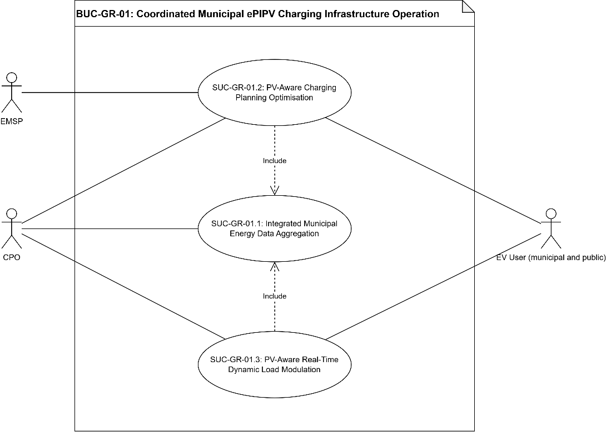
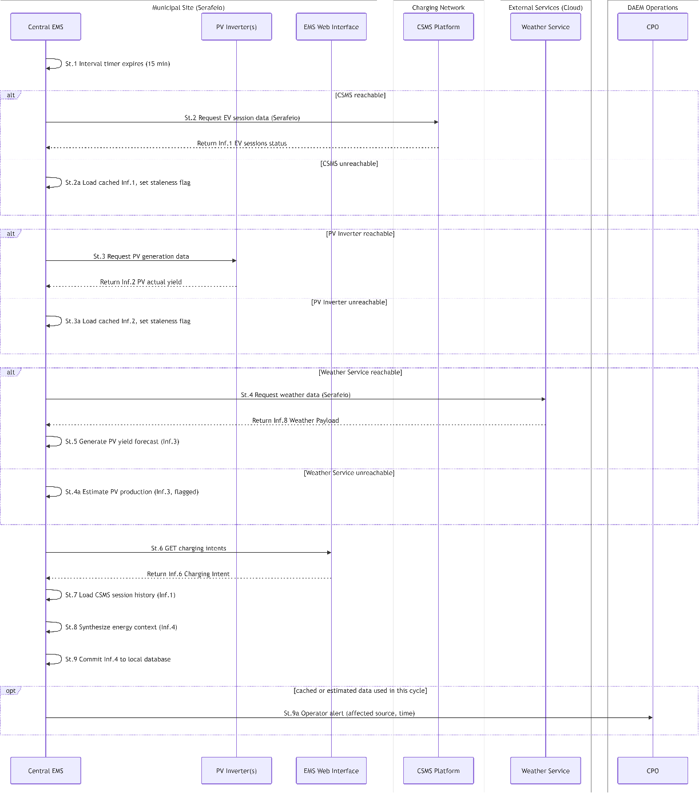
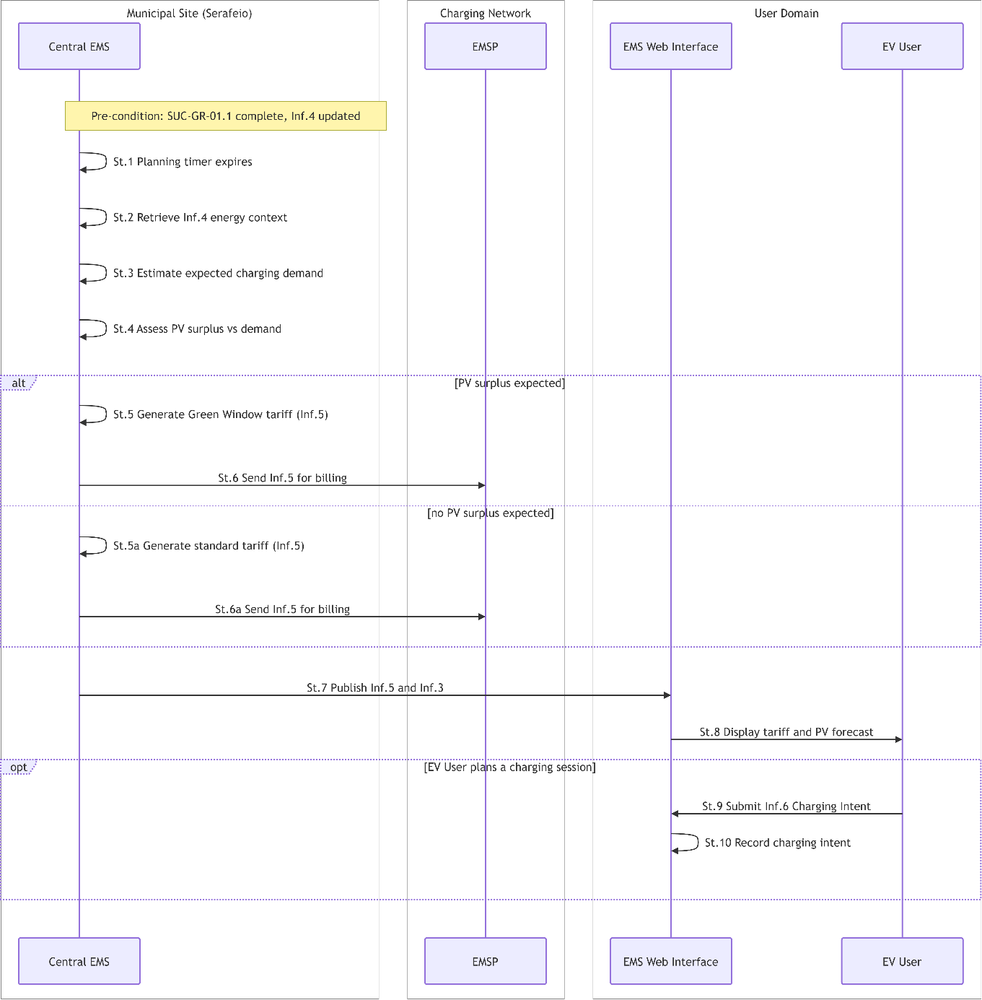
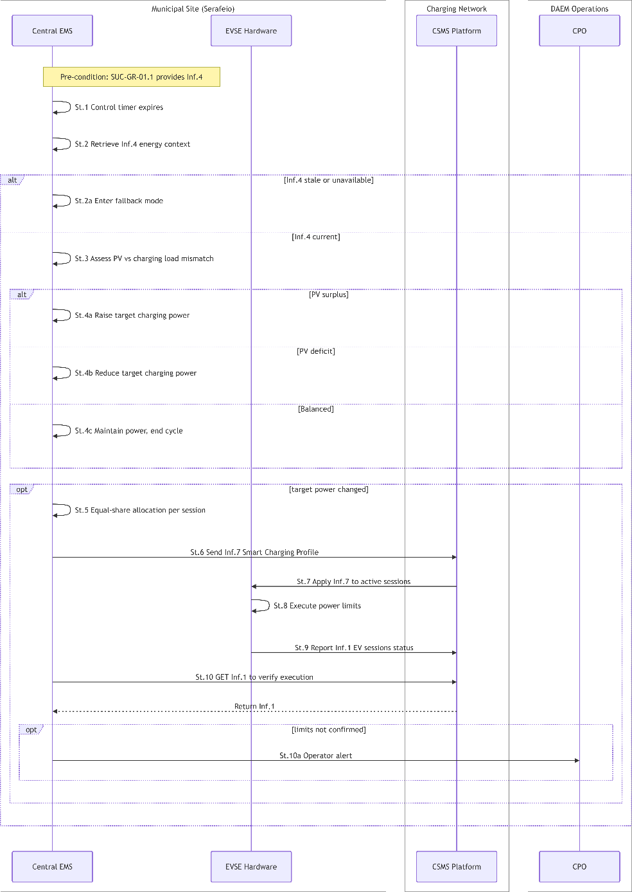

# BUC-GR-01 — Coordinated Municipal ePIPV Charging Infrastructure Operation

> **SOLAR-MOVE — Greek Demonstrator (Athens / DAEM — Serafeio Complex)** 
> Business Use Case following the IEC 62559-2 template.

| | |
|---|---|
| **Use Case ID** | BUC-GR-01 |
| **Document** | SOLARMOVE_BUC-GR-01.v1.0 |
| **Version** | v1.0 |
| **Area** | Energy System |
| **Domains** | Distribution System, DER, Customer Premises |
| **Zones** | Operation, Enterprise, Market |
| **Work Package / Task** | WP1 — T1.3 |

**Files in this folder:** [`SOLARMOVE_BUC-GR-01.v1.0.xlsx`](SOLARMOVE_BUC-GR-01.v1.0.xlsx) (IEC 62559-2 tables) · [`SOLARMOVE_BUC-GR-01.v1.0.xml`](SOLARMOVE_BUC-GR-01.v1.0.xml) (IEC 62559-3-style serialization, draft) · [`images/`](images/) (diagrams)

---

## Table of contents

1. [Description of the use case](#1-description-of-the-use-case)
2. [Diagrams of the use case](#2-diagrams-of-the-use-case)
3. [Technical details](#3-technical-details)
4. [Step-by-step analysis of the use case](#4-step-by-step-analysis-of-the-use-case)
5. [Information exchanged](#5-information-exchanged)
6. [Requirements](#6-requirements)
7. [Common terms and definitions](#7-common-terms-and-definitions)

---

## 1. Description of the use case

### 1.1 Name of the use case

| ID | Area / Domain(s) / Zone(s) | Name of Use Case |
|----|----------------------------|------------------|
| BUC_GR_01 | **Area:** Energy System **Domains:** Distribution System, DER, Customer Premises **Zones:** Operation, Enterprise, Market | Coordinated Municipal ePIPV Charging Infrastructure Operation |

### 1.2 Version management

| Version | Date | Author(s) | Changes |
|---------|------|-----------|---------|
| 1.0 | 20.10.2026 | Nikos Vourgidis (NTUA), Panos Skaloumpakas (NTUA), Vasilis Kalavrouziotis (NTUA) | First public version |

### 1.3 Scope and objectives of the use case

#### Scope

The Municipality of Athens / DAEM operates a growing portfolio of EV charging points while facing rising electricity costs, underused local solar generation and limited visibility over distributed chargers. Charging is not coordinated with PV generation, causing avoidable grid imports, and EV users have no incentive to charge when solar energy is available.

This use case addresses these challenges by establishing a coordinated municipal charging management framework for EV infrastructure operated or coordinated by DAEM. The scope of this use case follows a staged model with three distinct layers:

**Immediate pilot scope (Serafeio Complex):** The primary operational boundary of this BUC. Serafeio hosts 5 AC charging points (22 kW each), one DC charging station (30 kW), and a total of 30 kW of PV capacity (10 kW at the parking lot and 20 kW on the rooftop).

**Parallel visibility scope (DAEM city network):** More than 25 AC charging points operated by DAEM / Municipality of Athens across the city are integrated for monitoring and session data collection through a Charging Station Management System (CSMS). These points are included for operational visibility and data aggregation but are not subject to PV-associated EMS control functions during the pilot phase.

**Future scalability scope:** The coordinated ePIPV management framework developed at Serafeio can be extended to additional municipal charging sites where integrated PV capacity is investigated alongside the municipal EV charging infrastructure.

The use case includes the implementation of a centralised Energy Management System (EMS) to coordinate municipal charging in three layers:

- **SUC-GR-01.1: Integrated Municipal Energy Data Aggregation.** The EMS collects and synchronises data from the CSMS, PV inverters and forecast providers.
- **SUC-GR-01.2: PV-Aware Charging Planning Optimisation.** Using PV forecasts and expected demand, the EMS identifies intervals of PV surplus relative to the EV charging load and offers reduced tariffs (Green Window) to EV users (implicit demand response).
- **SUC-GR-01.3: PV-Aware Real-Time Dynamic Load Modulation.** The EMS modulates charging power in 15-minute intervals, based on near-real-time PV production and charging demand, to maximise PV self-consumption and minimise grid import.

CSMS monitoring and session data collection are already operational. SUC-GR-01.2 depends on PV data availability and SUC-GR-01.3 on charger controllability; both are validated during the pilot. No flexibility or balancing market participation is assumed; the BUC quantifies flexibility potential as a readiness assessment.

#### Objectives

- **OBJ-1:** Establish a coordinated municipal charging management framework for EV charging infrastructure operated or coordinated by the Municipality of Athens / DAEM**,** supporting the reduction of municipal electricity costs and the operational efficiency of DAEM's charging network management.
- **OBJ-2:** Improve operational visibility of municipal charging infrastructure through platform-based monitoring and data collection, reducing manual coordination effort and providing the data foundation required for informed investment and network expansion decisions.
- **OBJ-3:** Support charging services for municipal and public EV users through economically incentivised, solar-aligned charging windows.
- **OBJ-4:** Assess the readiness of the municipal charging infrastructure for PV-aware charging operation, where PV generation or PV-related data are available, quantifying the cost-reduction potential of local solar self-consumption relative to grid-imported electricity.
- **OBJ-5:** Assess the flexibility potential of municipal charging infrastructure through coordinated operation, establishing a measurable baseline for future flexibility market participation and potential demand-side service revenues.

#### Related business case(s)

This use case supports the ePIPV Municipal Charging Management Business Case of the Municipality of Athens / DAEM, which is committed to fleet electrification and operates charging infrastructure across the city. Public-sector electrification mandates, Greek RES integration targets and regulatory pressure to manage EV charging intelligently act as market drivers.

The value is primarily operational and cost-saving (less grid electricity for EV charging through local solar self-consumption), with secondary value in risk mitigation (lower exposure to tariff increases), service quality (incentives for EV users) and climate compliance.

**Municipality / DAEM (asset owner and CPO):** reduces electricity costs using local solar power; CSMS monitoring replaces fragmented manual coordination. **EV users (public and municipal):** incentivised through the Green Window, communicated via the EMS Web Interface, to charge during high-solar intervals and save on energy costs. **EMSP and platform providers:** gain a real-world ePIPV environment to validate smart-charging software, dynamic-pricing integration and demand-responsive tariffs.

### 1.4 Narrative of the use case

#### Short description

This use case describes the coordinated operation of municipal EV charging infrastructure in Athens, structured as a staged model with Serafeio Complex as the immediate pilot site, the wider DAEM city charging network as a parallel visibility scope, and future scalability to additional municipal locations as a third layer. The use case supports improved charging service management, operational visibility, municipal fleet charging, and future PV-aware, flexibility-ready charging operations. It also lays the foundation for System Use Cases related to charger monitoring, fleet charging management, PV-aware planning and dynamic load management.

#### Complete description

The BUC considers a municipal EV charging environment operated by the Municipality of Athens / DAEM, acting as CPO. Serafeio is the reference site, with 5 AC charging points (3x22 kW parking lot, 2x22kW underground parking lot), one DC charging station (30 kW parking lot) and PV of 10 kW (parking lot) and 20 kW (rooftop). DAEM also operates 25 AC charging points across the city. A CSMS supports all municipal chargers and provides an administrator interface and a driver charging app. The pilot adds an EMS Web Interface for EV users, distinct from the CSMS administrator interface and running in parallel to the CPO’s production app so that general operation is not affected. Serafeio operates under net metering, but its contracted capacity (about 1 MW) far exceeds the PV capacity, so PV is almost entirely consumed on site, and grid export is not a value driver.

Two EV user categories use the infrastructure: municipal users (municipal employees working at Serafeio, charging private cars) and public users. Both are billed normally and can benefit from the Green Window. Municipal users are a known, stable group that the municipality can engage directly and that follows regular working-day patterns, so they are expected to respond more readily and be more predictable; public users are less predictable and respond mainly to price signals. No category has priority: in real-time operation, the available power is shared equally among active sessions.

The use case helps DAEM manage its charging infrastructure by monitoring charger availability and session data, planning charging to increase the use of renewable electricity where PV data are available, and adjusting charging power where chargers are controllable, to match PV production and EV charging load, reduce peaks and increase flexibility. The CPO operates the charging services, the CSMS supports monitoring and management of sessions, and the EMS supports PV-aware scheduling and flexibility assessment, depending on available data and confirmed control capabilities.

**Integrated Municipal Energy Data Aggregation (SUC-GR-01.1):** A core challenge for DAEM is that EV session data and PV generation data exist in separate systems, with no unified view of how charging demand and solar production relate. SUC-GR-01.1 establishes the EMS as the central data layer: it synchronises session data from the CSMS with generation readings from the PV inverters and day-ahead forecasts, producing one integrated energy context of current demand, available solar output and anticipated generation. This context is the basis for all planning and control decisions.

**PV-Aware Charging Planning Optimisation (SUC-GR-01.2):** The EMS uses weather-based PV forecasts and expected EV charging demand (from past sessions and the charging intents users declare) to identify intervals where PV is expected to exceed the EV charging load. It translates them into a discounted time-of-use tariff, the Green Window, which is published to the EMSP, applied to billing and shown to users through the EMS Web Interface. Users are not instructed to shift; they are incentivised by transparent price signals, while the municipality increases PV self-consumption and reduces grid import costs. The web interface is available to a selected group of public and municipal users, who time their plug-in manually; no automated smart charging (delayed start or remote vehicle control) is assumed in this pilot phase.

**PV-Aware Real-Time Dynamic Load Modulation (SUC-GR-01.3):** The EMS compares actual PV generation with live charging demand every 15 minutes and dispatches updated power limits to the CSMS, which translates them into connector-level profiles executed by the EVSE. When PV surplus is detected, charging power is increased to absorb it; when PV falls below charging demand, power is reduced. The available power is shared equally among active sessions; users do not declare priorities, SoC targets or departure times in this pilot phase (collecting them through the web interface is a possible extension). This keeps charging aligned with PV production and limits unplanned grid imports. charging power is reduced

### 1.5 Key performance indicators (KPI)

| ID | Name | Description | Reference to objectives |
|----|------|-------------|--------------------------|
| U06 | Flexibility Potential | Measures how much more charging power the EMS can shift upward or downward at Serafeio compared with unmanaged operation. It is assessed on the Serafeio operation and, by simulation, for the wider DAEM charging network as if it were equipped with PV (ePIPV). Target: +25%. | OBJ-5 |
| U10 | Collective Self-Consumption | Measures the share of the PV energy generated at the site that is consumed locally by EV charging, showing how well the EMS aligns charging with solar production. Target: 75% (pilot level). | OBJ-4 |
| U11 | Renewables Curtailment Avoidance | Measures the reduction in PV energy that would otherwise be curtailed in scenarios where local PV generation exceeds available site demand or export capability. For the current Serafeio configuration, actual curtailment is expected to be limited, so the KPI is mainly assessed through scaled ePIPV scenarios. Target: 25% reduction (pilot level). | OBJ-4 |
| U12 | Peak Consumption Reduction (DR) | Measures the reduction in the peak grid demand of the EV charging load. It is driven by the Green Window tariff, which shifts charging into periods of solar surplus relative to the EV charging load, and by the EMS’s real-time control of charging power. Recommendations reach users through the EMS Web Interface. Target: 25% reduction vs the peak without intelligent management. | OBJ-5 |
| U13 | Increase in revenue created from DERs | Estimates the economic value that the PV creates for the site owner when the EMS steers its output towards EV charging. Because the PV at Serafeio is small relative to the site load and the pilot has no grid export or market participation, U13 is evaluated by simulation, using scenarios with grid export that vary the PV size and the scale of the DAEM charging network. Target: +25% (simulated scenarios). | OBJ-1, OBJ-4, OBJ-5 |
| U14 | Use of DERs in ePIPVs | Measures the share of the EV charging energy that is covered by local PV generation, and its increase compared with unmanaged operation, reflecting lower grid imports. Target: +50% relative improvement. | OBJ-4, OBJ-5 |
| U15 | Energy Invoice Reduction | Measures the reduction in the energy cost of the demonstration users who charge during the Green Window, compared with the standard tariff. It is calculated from charging-session data and the applicable tariff. Target: ≥ 20%. | OBJ-1, OBJ-4 |

### 1.6 Use case conditions

#### Assumptions

1. Serafeio is the operational pilot boundary; the 25 DAEM AC charging points are monitored only; extension of the full ePIPV control framework depends on PV availability at other sites.
2. A CSMS is already operational across the municipal infrastructure, providing session data, charger status and basic management; it is the baseline monitoring capability on which EMS integration is built.
3. Controllability and data communication of individual charging points vary; not all chargers support live API integration. Controllability, required for real-time load modulation, must be validated per unit.
4. Serafeio has a confirmed PV installation of 30 kW (10 kW parking lot, 20 kW rooftop), the sole source of PV data for the solar-aware functions. It is small relative to the site load (about 1 MW), so no energy is exported. The 25 DAEM AC charging points have no PV and are excluded from PV-aware control.
5. Serafeio serves municipal users (municipal employees charging private EVs) and public users, billed in the same way. Both can take part in the Green Window; municipal users are expected to be more predictable and easier to engage. No category has priority in the allocation of charging power.
6. Real-time load modulation is an optimisation that matches charging power to PV production and charging demand, sharing the available power equally among active sessions. It is an on-site balancing function within the Serafeio boundary, not participation in a regulated flexibility or balancing market.
7. Users access the pilot services through the EMS Web Interface, which runs in parallel to the CPO’s production app and is available to a selected group of public and municipal users. Users plug in manually; no automated smart charging is assumed, and participation in the Green Window is voluntary.
8. The Green Window discount is applied to billing through the EMSP.

#### Prerequisites

1. API-based CSMS–EMS integration must be confirmed for the Serafeio chargers (SUC-GR-01.1); where chargers only provide periodic exports, the data latency and its effect on optimisation accuracy must be assessed.
2. The EMS Web Interface must be deployed, and the selected public and municipal users enrolled (so that municipal sessions can be distinguished), before the Green Window and charging-intent functions are activated.
3. Near-real-time PV data from the Serafeio inverters must be accessible to the EMS via a confirmed interface before SUC-GR-01.2 and SUC-GR-01.3 are activated.
4. The equal-sharing rule for real-time modulation and its operating limits must be agreed between DAEM and the CPO before SUC-GR-01.3 is operationalised, including responsibilities in the event of a system fault.
5. The operational authority and contractual arrangements enabling DAEM to manage sessions and apply dynamic tariffs (billed via the EMSP) must be established before smart charging services are activated.
6. Participants must be informed through the EMS Web Interface of the data collected and its purpose, in line with data protection requirements (R-UI-08, to be extended to municipal users).

### 1.7 Further information for classification/mapping

**Relation to other use cases.** BUC-GR-01 is supported by SUC-GR-01.1 to SUC-GR-01.3 (data aggregation, PV-aware charging planning, real-time load modulation). Within SOLAR-MOVE, it is closest to BUC-AL-01 (PV-aware charging with data aggregation and optimisation) and BUC-DK-01 (coordinated ePIPV charging hub) and shares the Green Window tariff-incentive concept with the Happy Hour offer of BUC-PT-01. Unlike the PT market-oriented BUCs (PT-01/02/03) and the flexibility/VPP elements of AL-01 and DK-01, it involves no market participation. It is also complementary to BUC-TR-01 (PV-aware opportunity charging of a campus e-bus) and to BUC-PT-04 (local P2P charging), which are likewise local PV-aware charging cases.

**Level of depth.** Business use case, detailed down to system use cases (SUC-GR-01.1–01.3) and their step-by-step sequences.

**Prioritisation.** High (core pilot demonstration). SUC-GR-01.1 (data aggregation) is the enabling prerequisite, SUC-GR-01.2 (PV-aware planning) is the main demonstrated function, and SUC-GR-01.3 (real-time load modulation) is contingent on charger controllability and the agreements listed in the assumptions.

**Generic, regional or national relation.**

While demonstrated at a specific Greek municipal pilot, the underlying logic is generic and replicable. Pilot-specific elements are the site configuration, the role of the municipality as CPO, the city charging network and the Greek regulatory and tariff context.

The core concept, coordinated management of municipal EV charging against local PV generation through a centralised EMS with a Green Window tariff incentive, can be replicated at any municipality or public body operating EV charging alongside PV (e.g. depots, campuses, public parking), provided the enabling conditions exist: PV data from on-site inverters, a CSMS with API-based session data, controllable chargers and authority to apply dynamic tariffs. Market and regulatory specifics (dynamic tariff basis, DSO notification, flexibility market eligibility) must be assessed for each replication case.

**Nature of the use case.** Business use case with a technical/system focus: coordinated, PV-aware management of municipal EV charging (pilot demonstration; no market process).

**Further keywords for classification.** Smart charging, electric vehicles, ePIPV, photovoltaics, PV self-consumption, energy management system (EMS), CSMS, dynamic tariff, Green Window, demand response, load modulation, workplace charging, public charging, municipality.

### 1.8 General remarks

1. **Demonstration approach.** The Serafeio functions are demonstrated through the EMS web interface, which collects site data, provides day-ahead charging recommendations to the municipal fleet and public users (including the Green Window signal), and adjusts the charging power of the Serafeio chargers based on PV and demand mismatch. The AthensCharge application operated by DAEM is at a commercial stage and is not part of the demonstration.
2. **Scale of the pilot.** The PV installation at Serafeio (30 kW) is small relative to the site load (about 1 MW), and no energy is exported to the grid. The KPIs are therefore assessed at the EV-charging interface (see §1.5), and U06 and U13 are additionally evaluated by simulation for scaled-up scenarios, including the wider DAEM charging network under an ePIPV assumption. These simulations are not demonstrations and do not involve EMS control of the 25 DAEM charging points, which remain monitoring-only.
3. **Market participation.** The pilot does not involve energy or flexibility market participation. Any such extension would require a prior assessment of regulatory eligibility, as noted in the use case conditions.

---

## 2. Diagrams of the use case

The diagram below illustrates the overall structure of the Business Use Case, showing the actors and the 3 System Use Cases (SUC-GR-01.1, SUC-GR-01.2, SUC-GR-01.3) that realise it.

  

<em><b>Figure 1.</b> BUC-GR-01 — Coordinated Municipal ePIPV Charging Infrastructure Operation (use case diagram).</em>

---

## 3. Technical details

### 3.1 Actors

| Actor Name | Actor Type | Actor Description | Further information specific to this use case |
|------------|------------|-------------------|-----------------------------------------------|
| **CPO** | Business | Charge Point Operator: actor responsible for operating charging infrastructure and providing charging services to EV users. | The Municipality of Athens / DAEM acts as or coordinates the CPO function, operating 25 municipal AC charging points in the city. |
| **EMSP** | Business | Electric Mobility Service Provider: actor providing e-mobility services to users, including access to charging points and related service interface. | Manages user accounts, billing, and the distribution of dynamic tariff schedules to EV users. |
| **EV User** | Business | Owner or user of an electric vehicle requiring charging services. | Includes public users and municipal users (municipal employees working at Serafeio, charging private EVs). Both are billed normally and use the EMS Web Interface to view pricing and charger availability and to declare charging intents. Municipal users are expected to be more predictable and easier to engage. |
| **CSMS** | System | System used to monitor and manage charging stations, charging sessions and user interaction. | Supports platform-based monitoring, provides real-time session logs, and executes smart charging profiles sent by the EMS. |
| **EVSE** | System | Physical charging points providing AC/DC electrical charging services to EVs | Consists of 5 AC charging points (22kW) and one DC charging station (30kW) at Serafeio, alongside 25 municipal AC chargers across Athens. |
| **EMS** | System | Centralised system supporting charging planning, telemetry aggregation and optimisation of charging operations. | Acts as the core platform that processes declared charging intents, session data, inverter yields and weather data to execute smart charging logic and publishes pricing and availability through the EMS Web Interface. |
| **PV Inverter** | System | Physical power electronics hardware that converts DC solar generation to AC and records real-time generation metrics. | Pushes instantaneous AC active power output (kW) and cumulative daily yield data to the EMS. |
| **EMS Web Interface** | System | Web-based interface of the EMS through which all EV users (public and municipal fleet) view pricing, Green Window intervals and charger availability, and submit charging intents. | Pilot front-end running in parallel to the CPO’s production charging app, which is not part of the demonstration. |
| **Weather Service** | System | External meteorological data service providing location-specific weather forecasts. | Supplies, on request from the EMS, the weather forecast for the Serafeio site (solar irradiance, cloud cover and ambient temperature) for at least the next 24 hours. |

### 3.2 References

_References (standards, reports, mandates and regulatory constraints) associated with the use case._

| No. | Reference Type | Reference | Status | Impact on use case | Originator / organisation | Link |
|-----|----------------|-----------|--------|--------------------|---------------------------|------|
| | | | | | | |

---

## 4. Step-by-step analysis of the use case

### 4.1 Overview of scenarios

| No. | Scenario name | Scenario description | Primary actor | Triggering event | Pre-condition | Post-condition |
|-----|---------------|----------------------|---------------|------------------|---------------|----------------|
| 1 | Integrated Municipal Energy Data Aggregation (SUC-GR-01.1) | The EMS synchronises session data from the CSMS, generation data from the PV inverters and PV forecasts into an integrated energy context. | EMS | Time Interval (e.g., every 15 min) | Communication links with CSMS and PV inverters are active. | An integrated energy context is available to SUC-GR-01.2 and SUC-GR-01.3. |
| 2 | PV-Aware Charging Planning Optimisation (SUC-GR-01.2) | The EMS uses PV forecasts and expected EV charging demand to identify intervals of PV surplus relative to the EV charging load and publishes the Green Window tariff to the EMSP, which makes it available to EV users through the EMS Web Interface. | EMS | Day-Ahead Planning Window (e.g., 16:00 CET) | SUC-GR-01.1 successful implementation; an integrated energy context is available. | A Green Window tariff schedule (or the standard tariff if no surplus is expected) is published and visible to EV users in the EMS Web Interface. |
| 3 | PV-Aware Real-Time Dynamic Load Modulation (SUC-GR-01.3) | Every 15 minutes, the EMS compares actual PV generation with live EV charging demand and dispatches updated charging power limits to the CSMS to maximise PV self-consumption for the charging load. | EMS | Real-time control interval timer expires (e.g., every 15 minutes). | SUC-GR-01.1 successful synchronisation and active controllable EVSE connections. | EVSE charging power is modulated to match PV production and charging demand, and the CSMS confirms the new power levels. |

### 4.2 Steps – Scenarios

#### 4.2.1 Integrated Municipal Energy Data Aggregation (SUC-GR-01.1)

| Step No. | Event | Name of process / activity | Description of process / activity | Service | Information producer | Information receiver | Information exchanged (IDs) | Requirement, R-IDs |
|----------|-------|----------------------------|-----------------------------------|---------|----------------------|----------------------|-----------------------------|--------------------|
| St.1 | Interval timer expires | Sync loop initiation | EMS triggers the periodic data collection routine after a 15-minute waiting period. | TIMER | EMS | EMS | - | R-RTC-01, R-DAT-06 |
| St.2 | CSMS reachable | Request EV session data | EMS requests status and metering data of the active charging sessions at the Serafeio EVSEs from the CSMS API gateway. | GET | CSMS | EMS | Inf.1 | R-SC-01, R-COM-01, R-INT-02, R-DAT-01, R-MVR-03, R-CYB-01, R-CYB-03 |
| St.2a | CSMS unreachable | Load cached session data | EMS retrieves the last valid Inf.1 from the local database and sets a data staleness flag. | GET | EMS | EMS | Inf.1 | R-COM-02, R-COM-04, R-COM-05, R-DAT-04, R-SAF-03, R-SAF-04, R-CYB-08 |
| St.3 | PV Inverter reachable | Request PV generation data | EMS queries the PV inverters for real-time yield. | GET | PV Inverter | EMS | Inf.2 | R-COM-01, R-INT-04, R-DAT-01, R-MVR-02, R-CYB-01, R-CYB-03 |
| St.3a | PV Inverter unreachable | Load cached PV yield | EMS retrieves the last valid Inf.2 from the local database and sets a data staleness flag. | GET | EMS | EMS | Inf.2 | R-COM-02, R-COM-04, R-COM-05, R-DAT-04, R-SAF-02, R-SAF-03, R-CYB-08 |
| St.4 | Real-time telemetry compiled | Request weather data | EMS requests the weather forecast for the Serafeio site (e.g. irradiance, cloud cover, temperature) from the Weather Service. | GET | Weather Service | EMS | Inf.8 | R-DAT-01, R-INT-01, R-CYB-01, R-CYB-03 |
| St.4a | Weather Service unreachable | Estimate PV production | EMS estimates the expected PV production profile for the next 24 hours from stored Serafeio inverter data and flags it as an estimate. | CREATE | EMS | EMS | Inf.3 | R-COM-02, R-COM-05, R-DAT-04, R-FOR-01 |
| St.5 | Weather data received | Generate PV yield forecast | EMS generates the PV yield forecast at 15-minute resolution for the next 24 hours from the weather data and the Serafeio PV characteristics. | CREATE | EMS | EMS | Inf.3 | R-FOR-01, R-DAT-02, R-DAT-06 |
| St.6 | PV forecast or estimate available | Load charging intents | EMS retrieves the charging intents (time slot and optional energy) submitted by municipal and public users and recorded by the EMS Web Interface. | GET | EMS Web Interface | EMS | Inf.6 | R-SC-02, R-FOR-02, R-FOR-03, R-DAT-01 |
| St.7 | Charging intents loaded | Load historical session patterns | EMS retrieves the stored CSMS session history of Serafeio (start and end times, energy) by user category (municipal and public). | GET | EMS | EMS | Inf.1 | R-AIC-06, R-FOR-02, R-FOR-03, R-DAT-05 |
| St.8 | All source data compiled | Synthesise energy context | EMS validates and aligns session data, PV yield, PV forecast (or estimate) and demand inputs on a 15-minute time base, tagging each with a data-quality flag, to form the integrated data object. | CREATE | EMS | EMS | Inf.4 | R-EMS-01, R-EMS-06, R-DAT-02, R-DAT-03, R-DAT-04, R-DAT-06, R-DAT-07, R-FOR-05 |
| St.9 | Data synthesis complete | Commit context to storage | EMS writes the finalised Integrated Energy Context object to the local database to notify downstream optimisation. | CREATE | EMS | EMS | Inf.4 | R-DAT-05, R-DAT-07, R-MVR-08 |
| St.9a | Cached or estimated data used in this cycle | Operator alert | EMS notifies DAEM operators that cached or estimated data were used in this cycle, indicating the affected source and time. | REPORT | EMS | CPO | - | R-UI-05, R-COM-02, R-SAF-02 |

  

<em><b>Figure 2.</b> SUC-GR-01.1 — Integrated Municipal Energy Data Aggregation (sequence diagram).</em>

#### 4.2.2 PV-Aware Charging Planning Optimisation (SUC-GR-01.2)

| Step No. | Event | Name of process / activity | Description of process / activity | Service | Information producer | Information receiver | Information exchanged (IDs) | Requirement, R-IDs |
|----------|-------|----------------------------|-----------------------------------|---------|----------------------|----------------------|-----------------------------|--------------------|
| St.1 | Day-ahead planning window opens | Planning loop initiation | EMS triggers the day-ahead charging planning routine at the designated time (e.g. 16:00 CET). | TIMER | EMS | EMS | - | R-FOR-06 |
| St.2 | Planning loop initiated | Energy context retrieval | EMS retrieves the latest integrated energy context (Inf.4), containing PV forecast, session history, charging intents and data-quality flags. | GET | EMS | EMS | Inf.4 | R-EMS-01, R-DAT-04, R-DAT-07 |
| St.3 | Integrated dataset retrieved | Expected demand estimation | EMS estimates the EV charging load at Serafeio for the next day in 15-minute intervals, by user category (municipal and public), from historical sessions and declared charging intents. | CREATE | EMS | EMS | Inf.4 | R-FOR-02, R-FOR-03 |
| St.4 | Expected demand available | PV surplus assessment | EMS compares forecast PV generation with the expected EV charging load and identifies the intervals in which PV is expected to exceed the charging load, within the grid connection and EVSE limits. | CREATE | EMS | EMS | Inf.4 | R-EMS-04, R-EMS-06, R-FOR-05, R-GFR-02 |
| St.5 | PV surplus expected | Green Window tariff calculation | EMS maps the discounted rates to the identified surplus intervals to form the Green Window tariff schedule. | CREATE | EMS | EMS | Inf.5 | R-EMS-03, R-FOR-08, R-DAT-07 |
| St.5a | No PV surplus expected | Standard tariff generation | EMS generates the standard tariff schedule; no Green Window is defined. | CREATE | EMS | EMS | Inf.5 | R-EMS-03, R-FOR-08 |
| St.6 | Tariff schedule finalised (surplus path) | Tariff schedule transmission | EMS transmits the Green Window tariff schedule to the EMSP, which applies it to billing. | REPORT | EMS | EMSP | Inf.5 | R-COM-07, R-INT-01, R-CYB-03, R-CYB-04 |
| St.6a | Tariff schedule finalised (no-surplus path) | Standard tariff transmission | EMS transmits the standard tariff schedule to the EMSP. | REPORT | EMS | EMSP | Inf.5 | R-COM-07, R-INT-01, R-CYB-03 |
| St.7 | Tariff schedule transmitted | Pricing publication | EMS publishes the tariff schedule (Green Window intervals or standard) and the charger availability to the EMS Web Interface. | CHANGE | EMS | EMS Web Interface | Inf.5 | R-COM-07, R-COM-08, R-UI-02, R-INT-01 |
| St.8 | Pricing published | Pricing display | The EMS Web Interface shows municipal and public users the Green Window intervals, applicable prices, conditions and charger availability. | REPORT | EMS Web Interface | EV User | Inf.5 | R-UI-02, R-UI-03, R-UI-08 |
| St.9 | User responds to Green Window (optional) | Charging intent submission | The EV User submits a charging intent (time slot and optional energy) through the EMS Web Interface. Participation is voluntary. | REPORT | EV User | EMS Web Interface | Inf.6 | R-SC-02, R-SC-08, R-UI-02, R-CYB-01, R-CYB-02, R-CYB-06, R-UI-08 |
| St.10 | Intent received (if St.9 occurred) | Intent recording | The EMS Web Interface records the intent with the user and session identifier and the timestamp, and keeps it available for retrieval by the EMS (SUC-GR-01.1 St.6). | CREATE | EMS Web Interface | EMS Web Interface | Inf.6 | R-COM-08, R-DAT-02, R-DAT-05, R-CYB-03, R-UI-04 |

  

<em><b>Figure 3.</b> SUC-GR-01.2 — PV-Aware Charging Planning Optimisation (sequence diagram).</em>

#### 4.2.3 PV-Aware Real-Time Dynamic Load Modulation (SUC-GR-01.3)

| Step No. | Event | Name of process / activity | Description of process / activity | Service | Information producer | Information receiver | Information exchanged (IDs) | Requirement, R-IDs |
|----------|-------|----------------------------|-----------------------------------|---------|----------------------|----------------------|-----------------------------|--------------------|
| St.1 | Real-time control interval timer expires | Control loop initiation | EMS triggers the real-time modulation function after a 15-minute waiting period. | TIMER | EMS | EMS | - | R-RTC-01, R-FOR-06 |
| St.2 | Real-time loop initiated | Energy context retrieval | EMS retrieves the latest integrated energy context (Inf.4) with the current charging session power and the actual PV generation at Serafeio. | GET | EMS | EMS | Inf.4 | R-EMS-01, R-DAT-04, R-DAT-07 |
| St.2a | Energy context stale or unavailable | Fallback mode | EMS enters fallback mode, keeps the last confirmed power limits and dispatches no new setpoints in this cycle; the scenario ends. | CREATE | EMS | EMS | - | R-EMS-08, R-DAT-04, R-SAF-04 |
| St.3 | Dataset retrieved | Instantaneous mismatch calculation | EMS compares the actual PV generation with the live charging demand of the controllable Serafeio EVSEs and checks the net grid import against the connection limit. | CREATE | EMS | EMS | Inf.4 | R-RTC-02, R-GFR-01, R-GFR-02, R-FOR-07, R-EMS-05 |
| St.4a | PV surplus detected — generation exceeds demand | Raise target charging power | EMS increases the target total charging power to absorb the available PV surplus. | CREATE | EMS | EMS | Inf.7 | R-EMS-02, R-SC-05, R-GFR-07, R-FOR-08, R-SAF-01 |
| St.4b | PV deficit detected — demand exceeds generation | Reduce target charging power | EMS reduces the target total charging power to limit grid import and restore the balance with PV generation. | CREATE | EMS | EMS | Inf.7 | R-EMS-04, R-SC-05, R-RTC-07, R-GFR-06, R-SAF-01 |
| St.4c | Generation and demand balanced — within tolerance | Maintain current profile | EMS determines that no adjustment is required and keeps the active charging profile; no setpoints are dispatched, and the cycle ends. | CREATE | EMS | EMS | - | R-RTC-04, R-EMS-05 |
| St.5 | Target charging power determined (St.4a or St.4b) | Equal-share allocation | EMS divides the target total power equally among the active sessions at the controlled EVSEs, within each connector's rated power and without distinguishing user categories, producing per-connector limits. | CREATE | EMS | EMS | Inf.7 | R-SC-04, R-RTC-03, R-EMS-03, R-FOR-05, R-SAF-01 |
| St.6 | Control profiles finalised | Setpoint transmission | EMS dispatches the per-connector power limits (Inf.7) to the CSMS. | REPORT | EMS | CSMS | Inf.7 | R-EMS-03, R-COM-01, R-COM-03, R-INT-02, R-CYB-03, R-CYB-04 |
| St.7 | Command received by CSMS | Hardware profile dispatch | CSMS translates the power limits into connector-specific smart charging profiles and sends them to the EVSEs. | REPORT | CSMS | EVSE | Inf.7 | R-SC-03, R-COM-03, R-INT-02, R-CYB-04 |
| St.8 | Charging profile received by hardware | Real-time power modulation | The EVSE adjusts the charging power of the active session within the received limit. | EXECUTE | EVSE | EVSE | Inf.7 | R-SC-03, R-SAF-01, R-SAF-05 |
| St.9 | Physical charging power modified | Feedback status reporting | The EVSE reports its new power draw and the execution status to the CSMS. | REPORT | EVSE | CSMS | Inf.1 | R-COM-03, R-SAF-02 |
| St.10 | Execution status received by CSMS | Execution verification | EMS retrieves the execution status and measured power from the CSMS, compares them with the dispatched limits, calculates the delivered power adjustment and logs the cycle performance. | GET | CSMS | EMS | Inf.1 | R-RTC-06, R-RTC-08, R-GFR-08, R-MVR-07, R-EMS-05, R-SAF-06 |
| St.10a | Partial, late or failed execution detected | Operator alert | EMS notifies DAEM operators of the affected EVSE and the deviation from the dispatched limit. | REPORT | EMS | CPO | - | R-UI-05, R-SAF-02, R-SAF-03 |

  

<em><b>Figure 4.</b> SUC-GR-01.3 — PV-Aware Real-Time Dynamic Load Modulation (sequence diagram).</em>

---

## 5. Information exchanged

| Information exchanged (ID) | Name of information | Description of information exchanged | Requirement, R-IDs |
|----------------------------|---------------------|--------------------------------------|--------------------|
| Inf.1 | EV sessions status | Status and metering data of the charging sessions at the Serafeio EVSEs via OCPP (active chargers, power in kW, session energy in kWh, connector status and execution status of power limits), plus stored session history (start and end times, energy) by user category. Session data of the DAEM city network points are collected for monitoring only. | R-AIC-06, R-EMS-05, R-EMS-07, R-SC-01, R-COM-01, R-COM-02, R-COM-03, R-COM-04, R-COM-05, R-DAT-01, R-DAT-02, R-DAT-04, R-DAT-05, R-DAT-08, R-INT-02, R-FOR-02, R-FOR-03, R-RTC-06, R-RTC-08, R-GFR-08, R-MVR-01, R-MVR-02, R-MVR-03, R-MVR-07, R-CYB-01, R-CYB-03, R-CYB-08, R-SAF-02, R-SAF-03, R-SAF-04, R-SAF-06 |
| Inf.2 | PV actual yield | Instantaneous AC output (kW) and cumulative daily yield from the PV inverters. | R-COM-01, R-COM-02, R-COM-04, R-COM-05, R-DAT-01, R-DAT-02, R-DAT-04, R-INT-04, R-MVR-02, R-CYB-01, R-CYB-03, R-CYB-08, R-SAF-02, R-SAF-03 |
| Inf.3 | PV yield forecast | PV production forecast generated by the EMS in 15-minute intervals for at least the next 24-48 hours from weather data, or an estimate from stored inverter data (flagged as an estimate) when weather data are unavailable. | R-COM-02, R-COM-05, R-DAT-02, R-DAT-04, R-DAT-06, R-FOR-01 |
| Inf.4 | Integrated energy context | Combined dataset representing current demand, available RES surplus, expected charging demand, data-quality flags and forecasted flexibility headroom. | R-EMS-01, R-EMS-04, R-EMS-05, R-EMS-06, R-DAT-02, R-DAT-03, R-DAT-04, R-DAT-05, R-DAT-06, R-DAT-07, R-FOR-02, R-FOR-03, R-FOR-05, R-FOR-06, R-FOR-07, R-RTC-02, R-GFR-01, R-GFR-02, R-MVR-04, R-MVR-06, R-MVR-08 |
| Inf.5 | Green Window Tariff Schedule | Forward-looking time-of-use price schedule for the next day, with reduced tariffs for the Green Window intervals of expected PV surplus (or the standard tariff when none is expected), transmitted to the EMSP for billing and published on the EMS Web Interface. | R-EMS-03, R-COM-07, R-COM-08, R-DAT-07, R-INT-01, R-INT-06, R-FOR-08, R-CYB-03, R-CYB-04, R-UI-02, R-UI-03, R-UI-08 |
| Inf.6 | Charging Intent | Planned charging time slot and optional requested energy submitted by municipal and public users through the EMS Web Interface, recorded with user/session identifier, acceptance of the Green Window offer and timestamp. | R-SC-02, R-SC-08, R-COM-08, R-DAT-01, R-DAT-02, R-DAT-05, R-INT-01, R-FOR-02, R-FOR-03, R-CYB-01, R-CYB-02, R-CYB-03, R-CYB-06, R-UI-02, R-UI-04, R-UI-08 |
| Inf.7 | Smart Charging Profile | Near-real-time power limits (kW per connector), shared equally among the active sessions, derived by the EMS and pushed down to modulate charging hardware. | R-EMS-02, R-EMS-03, R-EMS-04, R-SC-03, R-SC-04, R-SC-05, R-COM-01, R-COM-03, R-DAT-07, R-INT-02, R-FOR-05, R-FOR-08, R-RTC-03, R-RTC-06, R-RTC-07, R-GFR-01, R-GFR-06, R-GFR-07, R-CYB-03, R-CYB-04, R-SAF-01, R-SAF-05 |
| Inf.8 | Weather Payload | Weather forecast data for the Serafeio site (irradiance, cloud cover, temperature) for at least the next 24 hours, provided by the Weather Service. | R-DAT-01, R-INT-01, R-CYB-01, R-CYB-03 |

**Cross-cutting notes**

- R-AIC-01, R-AIC-02, R-AIC-03, R-AIC-04, R-AIC-05, R-INT-08 apply as preconditions across all scenarios — they govern the commissioning and conformance testing phase before any step executes, not individual steps.
- R-CYB-05, R-CYB-07, R-CYB-09, R-COM-06, R-INT-05, R-DAT-05 are platform-level requirements not tied to a specific step — they apply to the system as a whole and are best captured at the information exchange level (all Inf objects) rather than per step.
- R-MVR-04, R-MVR-06, R-MVR-08 apply post-pilot for baseline, KPI computation and evidence packaging — reference against Inf.4 and Inf.1.
- R-UI-01 (operator dashboard) applies to the CSMS operator interface across all scenarios; R-UI-05 covers operator alerts within the scenarios.

---

## 6. Requirements

### CAT-01 — Asset Integration and Commissioning
_All physical assets must be installed, commissioned, operational and addressable before pilot operation._

| R-ID | Name | Description |
|------|------|-------------|
| R-AIC-01 | Asset commissioning status | Each EVSE, PV inverter, smart meter and EMS device used in the Greek pilot shall have a recorded commissioning status before operational testing begins. |
| R-AIC-02 | Unique asset identification | Every integrated asset — including each of the 5 AC EVSEs, the DC charging station, the two PV inverters, and the EMS platform — shall have a persistent unique identifier used consistently across field systems, the CSMS and reporting functions. |
| R-AIC-03 | Asset capability registration | The CSMS/EMS platform shall maintain the technical capabilities and operating limits of each EVSE and PV inverter, including rated power, control modes, and communication interface specifications. |
| R-AIC-04 | Connectivity verification | Commissioning shall verify that each EVSE can exchange session data with the CSMS (via OCPP), and that the PV inverters can provide generation data to the EMS, before pilot operation commences. |
| R-AIC-05 | Time and configuration setup | All integrated devices shall be configured with a common time source, agreed sampling intervals (15-minute minimum) and the correct site association before pilot operation. |
| R-AIC-06 | Pilot-specific mobility configuration | The Serafeio grid connection limit, the set of controllable EVSEs, the user categories (municipal and public) and the Green Window tariff parameters shall be configured in the EMS before PV-aware scheduling is enabled. |

### CAT-02 — Energy Management System Capabilities
_Contains requirements related to EMS functionalities and capabilities._

| R-ID | Name | Description |
|------|------|-------------|
| R-EMS-01 | Unified site and cluster model | The EMS shall maintain a unified operational model of the Serafeio site, including all connected EVSEs, PV inverters and their current status, constraints and relationships, as well as visibility of the DAEM city network charging points through the CSMS. |
| R-EMS-02 | Multi-asset orchestration | The EMS shall coordinate EV charging demand against PV generation at the Serafeio site, managing the combined AC and DC charging load within applicable site and grid connection limits. |
| R-EMS-03 | Schedule and setpoint generation | The EMS shall translate optimisation results from SUC-GR-01.2 into day-ahead Green Window tariff schedules and from SUC-GR-01.3 into real-time per-connector power limits dispatched to the CSMS. |
| R-EMS-04 | Constraint enforcement | The EMS shall prevent dispatch decisions that violate grid connection limits, EVSE rated power limits or the confirmed controllability status of individual charging points. |
| R-EMS-05 | Execution monitoring and rescheduling | The EMS shall compare actual PV generation and charging demand against the active plan and trigger re-optimisation when deviations — such as forecast error or unexpected session behaviour — exceed configurable thresholds. |
| R-EMS-06 | Flexibility estimation | The EMS shall calculate available upward and downward flexibility at Serafeio at 15-minute intervals, as input to the assessment of KPI U06 (Flexibility Potential), which is extended to the wider DAEM charging network by simulation. |
| R-EMS-07 | Distributed-site aggregation | The EMS or CSMS shall aggregate session data from the DAEM city network charging points alongside Serafeio data, maintaining site-level distinction between the ePIPV control boundary and the monitoring-only city network. |
| R-EMS-08 | Operating-mode management | The EMS shall support at minimum a normal operation mode (PV-aware scheduling and real-time modulation active), a monitoring-only mode (CSMS data collection without EMS control), and a fallback mode triggered by communication loss or data staleness. |

### CAT-03 — Smart Charging and Mobility-Service Constraints
_The charging infrastructure functionalities and capabilities._

| R-ID | Name | Description |
|------|------|-------------|
| R-SC-01 | Charging-session detection | The CSMS shall detect and report EV connection, session start, active charging, suspension, completion and disconnection events for all EVSEs at Serafeio and across the DAEM city network charging points. |
| R-SC-02 | Charging requirement capture | The system shall capture the charging intents submitted by municipal and public users through the EMS Web Interface — a planned charging time slot and, optionally, the requested energy — and make them available to the EMS for demand forecasting and planning. |
| R-SC-03 | Dynamic charging control | The Serafeio EVSEs shall accept remote dynamic power limits dispatched by the EMS via the CSMS, as required by SUC-GR-01.3. Controllability shall be confirmed on a per-unit basis during commissioning. |
| R-SC-04 | Mobility requirement guarantee | When available charging capacity is limited, the EMS shall share it equally among all active sessions at the controlled Serafeio EVSEs, within the rated power of each connector, without differentiating between municipal and public users. |
| R-SC-05 | Priority-based allocation | Real-time load modulation shall optimise charging power against PV availability. It shall be applied on a best-effort basis, and no guaranteed energy amount or completion time shall be assumed for any user category in this pilot phase. |
| R-SC-08 | Opt-in and opt-out enforcement | Participation in the Green Window incentive mechanism (SUC-GR-01.2) shall be voluntary for municipal and public users; the system shall not apply discounted tariffs or expect a charging-time response from users who have not accepted the offer through the EMS Web Interface. |

### CAT-04 — Communications and Connectivity
_Requirements to enable reliable communication._

| R-ID | Name | Description |
|------|------|-------------|
| R-COM-01 | Bidirectional communications | Bidirectional communication shall be available on the EMS-CSMS interface (session data retrieval and charging profile dispatch) and on the EMS-PV inverter interface (generation data retrieval). |
| R-COM-02 | Communication health monitoring | The EMS shall monitor the connection status and last-message time for the CSMS, PV inverter and Weather Service interfaces, and raise a data staleness flag when any of them becomes unreachable, as defined in the fallback steps of SUC-GR-01.1. |
| R-COM-03 | Message acknowledgement | Charging profile commands dispatched by the EMS to the CSMS (Inf.7) shall be acknowledged with acceptance or failure status; EVSE execution confirmation shall be reported back to the CSMS and logged (SUC-GR-01.3 St.8). |
| R-COM-04 | Store-and-forward capability | The EMS shall buffer the last valid session data (Inf.1), PV generation data (Inf.2), and use cached values during temporary communication outages, as specified in the fallback steps of SUC-GR-01.1. |
| R-COM-05 | Communication recovery | The EMS shall automatically attempt reconnection to the CSMS, PV inverter and Weather Service interfaces after a communication outage and restore synchronised data collection without operator intervention. |
| R-COM-06 | Defined service levels | The EMS-CSMS and EMS-inverter interfaces shall have documented requirements for update frequency, maximum tolerated data age, and latency appropriate to the 15-minute control cycle of SUC-GR-01.3. |
| R-COM-07 | External platform connectivity | The EMS shall provide a reliable interface to the EMSP for transmission of the Green Window tariff schedule (Inf.5); the EMSP shall apply it to billing, and the same schedule shall be made available to the EMS Web Interface for presentation to users. |
| R-COM-08 | User-channel connectivity | The EMS Web Interface shall support reliable exchange of Green Window pricing and charger availability information (Inf.5) and charging intents (Inf.6) between municipal and public users and the EMS. |

### CAT-05 — Data Acquisition, Quality and Storage
_Requirements for common data management mechanisms._

| R-ID | Name | Description |
|------|------|-------------|
| R-DAT-01 | Operational telemetry acquisition | The EMS shall acquire EVSE session data (Inf.1), PV actual yield (Inf.2), weather data (Inf.8) and user charging intents (Inf.6) at the 15-minute resolution required by the SUC-GR-01 scenarios. |
| R-DAT-02 | Common timestamping | All operational records — session data, PV readings, EMS decisions and EVSE responses — shall contain timestamps referenced to a common time base. |
| R-DAT-03 | Data validation | Incoming CSMS session data, PV inverter readings and weather data shall be checked for missing values, staleness, invalid ranges and implausible changes before use in optimisation or KPI calculation. |
| R-DAT-04 | Data-quality status | The EMS shall attach a quality or staleness flag to measurements and forecasts used in optimisation, distinguishing live data from cached fallback values (see the fallback steps of SUC-GR-01.1). |
| R-DAT-05 | Historical data retention | Session data, charging intents, PV generation readings, EMS schedules, tariff signals and EVSE responses shall be retained for the duration required for KPI computation, demand forecasting, pilot reporting and post-hoc analysis. |
| R-DAT-06 | Interval aggregation | The data platform shall support aggregation at 15-minute intervals as the primary operational and KPI measurement resolution throughout the pilot. |
| R-DAT-07 | Data lineage | Derived values — including the integrated energy context (Inf.4), Green Window tariff schedules (Inf.5), and KPI results — shall be traceable to their source measurements, algorithms and parameters. |
| R-DAT-08 | Distributed-cluster synchronisation | Session and status data from the DAEM city network charging points shall be synchronised alongside Serafeio data and clearly associated with their respective site and connection point. |

### CAT-06 — Semantic and Protocol Interoperability
_Requirements for enabling interoperable communications._

| R-ID | Name | Description |
|------|------|-------------|
| R-INT-01 | Documented interface specification | The EMS-CSMS, EMS-PV inverter, EMS-Weather Service, EMS-EMSP and EMS-EMS Web Interface interfaces shall each have a documented protocol, endpoint, data model and error-handling specification. |
| R-INT-02 | EV charging protocol support | EVSE-to-CSMS integration shall use OCPP (1.6 or newer version with the functions required for session metering, charger status reporting and smart charging profile dispatch. |
| R-INT-04 | DER interface abstraction | Vendor-specific PV inverter interfaces (Modbus, API or equivalent) shall be isolated behind an adapter exposing a common EMS-facing data model for generation readings. |
| R-INT-05 | Common semantic definitions | All parties shall use agreed definitions for power direction, availability state, session energy, forecast interval and data staleness, consistent across EMS, CSMS, EMSP and reporting functions. |
| R-INT-06 | API versioning | EMS-CSMS and EMS-EMSP APIs shall be versioned; incompatible changes shall be managed without disruption to pilot operation. |
| R-INT-08 | Interoperability conformance test | Each pilot interface shall be validated through conformance testing covering normal data exchange, invalid messages, timeout handling and recovery before live operation. |

### CAT-07 — Forecasting and Optimisation
_Contains requirements enabling reliable predictive capabilities._

| R-ID | Name | Description |
|------|------|-------------|
| R-FOR-01 | PV forecasting | The EMS shall generate PV production forecasts at 15-minute resolution for a minimum 24-hour horizon from weather data (Inf.8) and the characteristics of the Serafeio PV installation, as required by the day-ahead planning cycle of SUC-GR-01.2 (Inf.3). When weather data are unavailable, the EMS shall estimate PV production from stored inverter data and flag it as an estimate. |
| R-FOR-02 | Load forecasting | The EMS shall estimate the expected charging load at Serafeio from historical session data held in the CSMS, supplemented by the charging intents declared by municipal and public users. |
| R-FOR-03 | EV demand forecasting | The EMS shall forecast EV charging demand by user category (municipal and public) from historical session patterns and declared charging intents, and shall update the forecast when new intents are submitted. Municipal user demand is expected to be the more regular and predictable component. |
| R-FOR-05 | Constraint-aware optimisation | Day-ahead and real-time optimisation shall incorporate EVSE rated power limits, grid connection limits and the confirmed controllability status of individual charging points. |
| R-FOR-06 | Multi-horizon optimisation | The EMS shall support day-ahead charging planning (SUC-GR-01.2, 24-hour horizon) and real-time load adjustment (SUC-GR-01.3, 15-minute cycle), with the real-time function operating on the integrated energy context (Inf.4) produced by SUC-GR-01.1. |
| R-FOR-07 | Forecast-error handling | The EMS shall detect deviations between forecast PV generation and actual inverter output and update real-time power limits accordingly via the SUC-GR-01.3 control loop. |
| R-FOR-08 | Objective configurability | Optimisation objectives shall be configurable for PV self-consumption maximisation, peak grid import reduction and user energy cost reduction through the Green Window, reflecting the hierarchy of OBJ-1 through OBJ-5. |

### CAT-08 — Real-Time Control and Performance
_Requirements enabling near-real-time control to maintain grid compliance and track operational commitments._

| R-ID | Name | Description |
|------|------|-------------|
| R-RTC-01 | Defined control cycle | The real-time load modulation function (SUC-GR-01.3) shall operate at a 15-minute control cycle; calculation and dispatch of updated power limits (Inf.7) shall complete within this interval. |
| R-RTC-02 | Real-time grid-limit supervision | The EMS shall continuously compare aggregate charging demand against the Serafeio site grid connection capacity and trigger load reduction when the limit is approached. |
| R-RTC-03 | Dynamic power redistribution | When PV generation changes, the EMS shall redistribute available charging power equally among the active EVSE sessions, within the rated power of each connector, dispatching updated per-connector limits to the CSMS. |
| R-RTC-04 | Deviation-triggered re-optimisation | The EMS shall trigger re-optimisation of charging profiles when PV generation deviation, session state change, or forecast error exceeds a configurable threshold. |
| R-RTC-06 | Setpoint execution verification | Following dispatch of smart charging profiles (Inf.7), the EMS shall verify EVSE response via CSMS feedback (SUC-GR-01.3 St.8) and identify partial, late or failed execution. |
| R-RTC-07 | Control conflict resolution | When PV surplus absorption conflicts with the grid connection limit or EVSE rated power limits, the EMS shall give precedence to those limits and reduce charging power equally across the active sessions. |
| R-RTC-08 | Performance logging | EMS decision time, dispatch time, CSMS acknowledgement and measured EVSE response shall be logged for each control cycle to support performance assessment and KPI calculation. |

### CAT-09 — Grid Constraints, Flexibility and Resilience
_Requirements ensuring safe operation under constrained grid conditions._

| R-ID | Name | Description |
|------|------|-------------|
| R-GFR-01 | Connection-capacity enforcement | The EMS shall maintain net grid import at the Serafeio site within the confirmed connection-point capacity at all times, adjusting charging profiles before the limit is reached. |
| R-GFR-02 | Upward and downward flexibility calculation | The EMS shall calculate available upward flexibility (additional charging absorbable from PV surplus) and downward flexibility (charging load that can be reduced) by 15-minute intervals, as the basis for KPI U06 measurement. |
| R-GFR-06 | Emergency priority operation | During unplanned PV generation loss or grid supply reduction, the EMS shall reduce charging power equally across the active sessions to keep net grid import within the connection-point capacity. |
| R-GFR-07 | Controlled restoration | After a constrained or load-shed event, the EMS shall restore charging power progressively to avoid rebound peaks and renewed grid limit violations. |
| R-GFR-08 | Flexibility delivery verification | The EMS shall compare requested load adjustment against measured EVSE response and calculate delivered power reduction or absorption for each control event, as input to KPI U06 and U12 computation. |

### CAT-11 — Metering, Verification and KPI Reporting
_Requirements providing grounds for operational and project outcome validation._

| R-ID | Name | Description |
|------|------|-------------|
| R-MVR-01 | Connection-point metering | Net import/export at the Serafeio grid connection point shall be measured at a resolution suitable for KPI calculation and pilot performance reporting. |
| R-MVR-02 | Asset-level sub-metering | Energy flows from the PV inverters, each EVSE and the DC charging station shall be measurable separately to support the assessment of PV energy delivered to EV charging, self-consumption and peak reduction KPIs. |
| R-MVR-03 | Session metering | Each charging session shall record start and end meter values, energy transferred, timestamps and session identifier, as captured in Inf.1 via the CSMS. |
| R-MVR-04 | Baseline calculation | A baseline for grid import, peak EV charging demand and PV energy not delivered to EV charging shall be established, as specified in the KPI methodology deliverables (D3.1, D5.1), to enable percentage-change KPI assessment (KPIs U06, U10, U11, U12, U13, U14, U15). |
| R-MVR-06 | KPI computation | The platform shall calculate all applicable GR pilot KPIs (U06, U10, U11, U12, U13, U14, U15) from measured operational data at the agreed assessment intervals. |
| R-MVR-07 | Delivery report | The system shall generate periodic reports comparing planned and actual charging demand, PV generation, self-consumption and load modulation events for pilot monitoring and WP reporting. |
| R-MVR-08 | Exportable evidence package | Raw session data, PV generation records, EMS decisions, KPI results and algorithm parameters shall be exportable for pilot validation, project auditing and deliverable preparation. |

### CAT-12 — Cybersecurity, Privacy and Access Control
_Requirements ensuring secure and privacy-preserving access to services._

| R-ID | Name | Description |
|------|------|-------------|
| R-CYB-01 | Strong authentication | Human users (DAEM operators and registered EMS Web Interface users), devices (EVSEs, inverters) and external systems (EMSP, Weather Service) shall authenticate before accessing EMS or CSMS functions. |
| R-CYB-02 | Role-based authorisation | Access rights shall be differentiated by role: DAEM/CPO administrator (full management access), DAEM operator (monitoring and manual override), municipal and public users (own charging intents, sessions and tariff view only), and read-only monitoring access for the DAEM city network. |
| R-CYB-03 | Encryption in transit | All communications crossing site, cloud or organisational boundaries — including EMS-CSMS, EMS-EMSP and the user connections to the EMS Web Interface — shall use appropriate encryption. |
| R-CYB-04 | Command integrity and anti-replay | Smart charging profiles (Inf.7) dispatched by the EMS to the CSMS shall be protected against unauthorised modification and replay. |
| R-CYB-05 | Security logging | Authentication events, EMS commands, configuration changes and security-relevant failures shall be logged and available for audit review. |
| R-CYB-06 | Personal-data minimisation | The platform shall collect and retain only the personal and session data necessary for charging service operation and pilot KPI assessment, with appropriate access and retention controls applied to municipal and public user data. |
| R-CYB-07 | Secure software update | EMS platform components, CSMS and connected EVSE firmware shall support authenticated and integrity-checked updates. |
| R-CYB-08 | Cyber-safe fallback | Loss of authentication service or detected security violation shall trigger a defined safe operating mode — reverting to monitoring-only operation — without uncontrolled continuation of smart charging commands. |
| R-CYB-09 | Credential and certificate management | API credentials, tokens and certificates used for EMS-CSMS, EMS-EMSP and EMS-inverter interfaces shall have controlled issuance, renewal and revocation procedures. |

### CAT-13 — Safety, Fault Handling and Recovery
_Requirements ensuring the control platform never overrides asset safety constraints._

| R-ID | Name | Description |
|------|------|-------------|
| R-SAF-01 | Asset safety-envelope enforcement | No EMS or CSMS command shall exceed the rated power limits of any EVSE or the maximum output of the PV inverters at Serafeio. |
| R-SAF-02 | Fault-state reporting | EVSEs and PV inverters shall report faults and communication failures with severity and timestamp; the EMS shall raise operator alerts accordingly. |
| R-SAF-03 | Automatic isolation of failed assets | A failed or unreachable EVSE or PV inverter shall be excluded from EMS optimisation and dispatch until it is confirmed as available and its data validated. |
| R-SAF-04 | Safe loss-of-control behaviour | On loss of EMS or CSMS connectivity, each EVSE shall transition to a defined local fallback state — either continuing at its last confirmed power limit or stopping safely — without waiting for EMS commands. |
| R-SAF-05 | Manual override | Authorised DAEM operators shall be able to stop, curtail or override EMS-controlled charging sessions during abnormal conditions via the CSMS operator interface. |
| R-SAF-06 | Recovery validation | Following a communication outage or asset fault, the EMS shall verify current session data, EVSE status and PV inverter output before resuming optimised control. |

### CAT-14 — User Interfaces, Pricing and Participation Management
_Requirements to ensure intuitive user interfaces, transparent pricing and participation management._

| R-ID | Name | Description |
|------|------|-------------|
| R-UI-01 | Operator dashboard | The CSMS platform shall provide DAEM/CPO operators with current EVSE status, active session data and alarms across both Serafeio and the DAEM city network charging points, together with the active charging intents and Green Window schedule for Serafeio. |
| R-UI-02 | Charging-user interface | The EMS Web Interface shall allow municipal and public users to view charger availability, current pricing, active Green Window intervals and their session status, and to submit charging intents. |
| R-UI-03 | Transparent price presentation | Green Window discounted tariffs (Inf.5) shall be displayed to municipal and public users through the EMS Web Interface before session start, with applicable conditions and validity window clearly stated. |
| R-UI-04 | Participation consent record | The system shall record user acceptance or non-acceptance of Green Window pricing offers with user/session identifier and timestamp (see Inf.6, SUC-GR-01.2). |
| R-UI-05 | Operator alarm notification | DAEM operators shall receive timely notifications of EVSE faults, communication loss with the EMS or PV inverters, failed or late setpoint execution, and data staleness events. |
| R-UI-08 | User privacy notice | The EMS Web Interface and EMSP platform shall communicate to municipal and public users what charging and participation data are collected and for what purpose, in compliance with applicable data protection requirements. |

---

## 7. Common terms and definitions

_Relevant terms belonging to this use case are listed here; these should ultimately be consolidated in a common glossary shared across all SOLAR-MOVE use cases._

| Term | Definition |
|------|------------|
| | |

---

Based on `SOLARMOVE_BUC-GR-01.docx`, following the IEC 62559-2 use case template. UML use case and sequence diagrams are included as Figures 1–4 (see `images/`).

Licensed under [CC BY 4.0](../LICENSE). Funded by the European Union under Grant Agreement No. 101235635 (SOLAR-MOVE). Views and opinions expressed are however those of the author(s) only and do not necessarily reflect those of the European Union or CINEA. Neither the European Union nor the granting authority can be held responsible for them.
