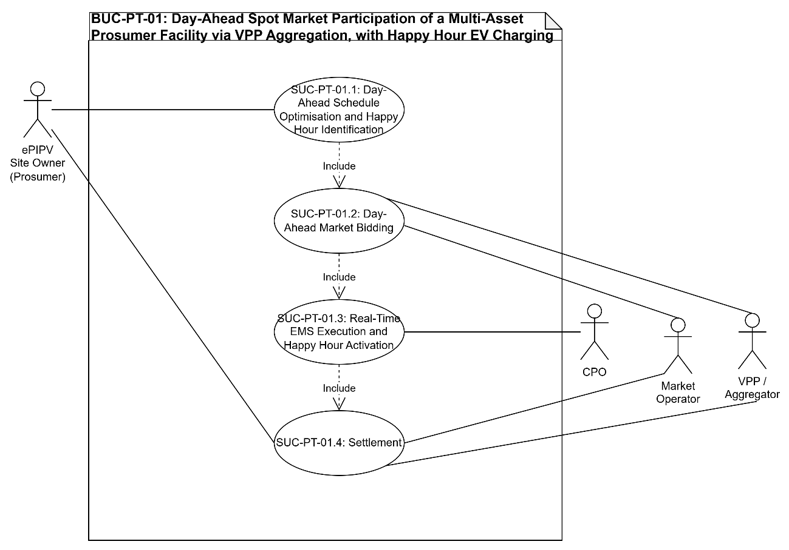
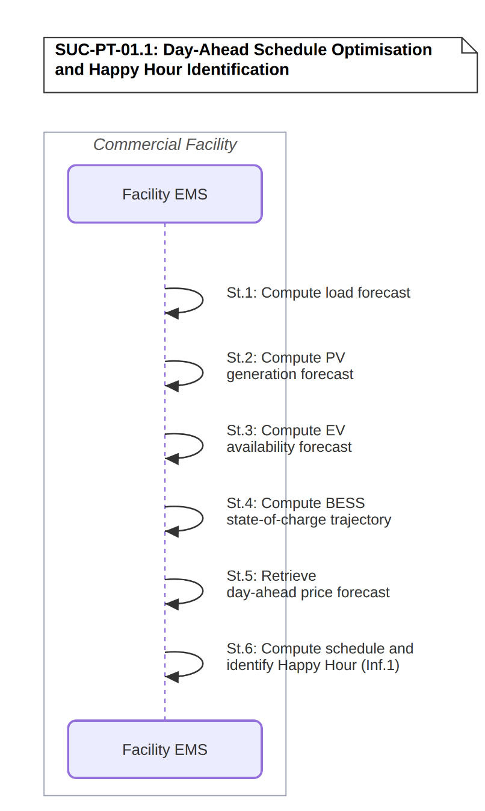
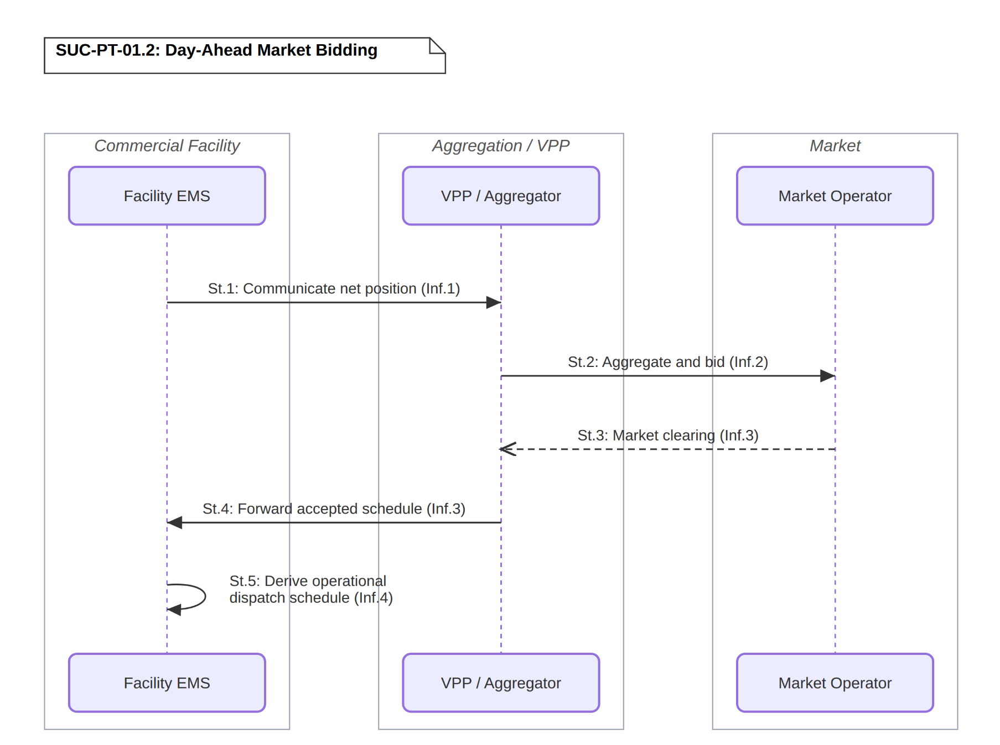
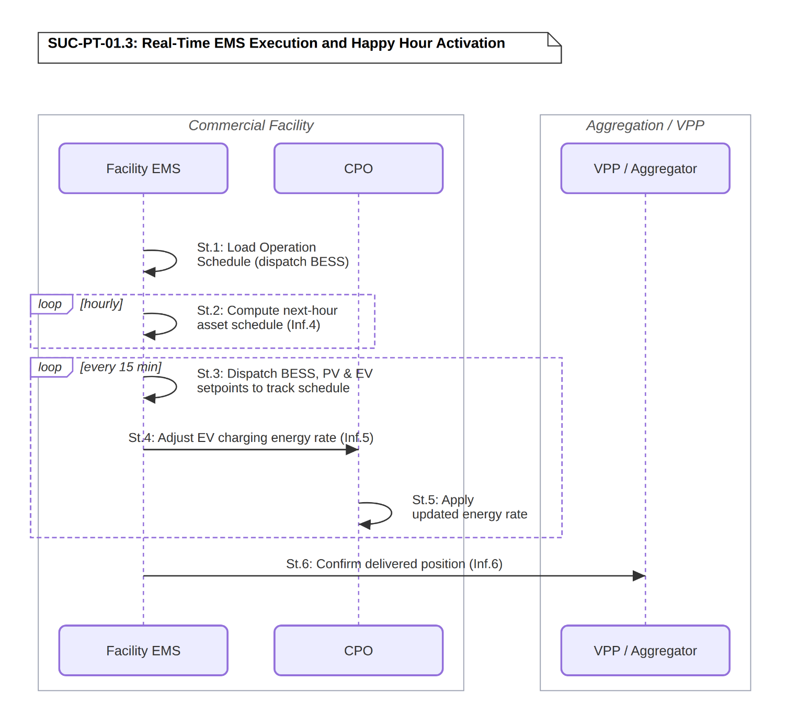
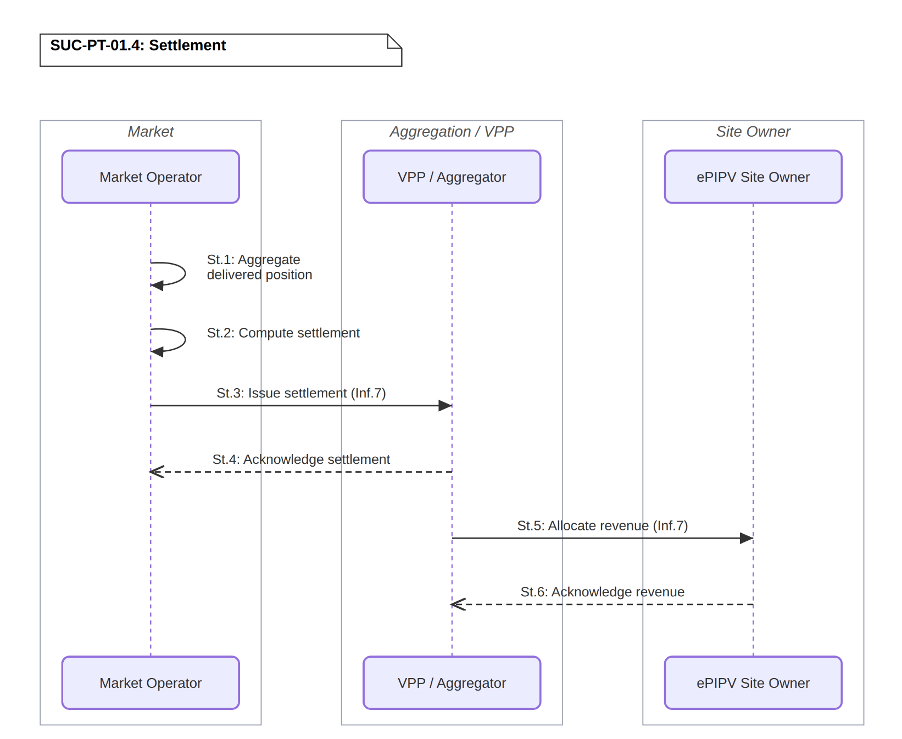

# BUC-PT-01 — Day-Ahead Spot Market Participation of a Multi-Asset Prosumer Facility via VPP Aggregation, with Happy Hour EV Charging

> **SOLAR-MOVE — Portuguese Demonstrator** 
> Business Use Case following the IEC 62559-2 template.

| | |
|---|---|
| **Use Case ID** | BUC-PT-01 |
| **Document** | SOLARMOVE_BUC-PT-01.v1.0 |
| **Version** | v1.0 |
| **Area** | Energy System |
| **Domains** | Customer Premises |
| **Zones** | Process, Field, Station, Operation, Enterprise, Market |
| **Work Package / Task** | WP1 — T1.3 |

**Files in this folder:** [`SOLARMOVE_BUC-PT-01.v1.0.xlsx`](SOLARMOVE_BUC-PT-01.v1.0.xlsx) (IEC 62559-2 tables) · [`SOLARMOVE_BUC-PT-01.v1.0.xml`](SOLARMOVE_BUC-PT-01.v1.0.xml) (IEC 62559-3-style serialization, draft) · [`images/`](images/) (diagrams)

---

## Table of contents

1. [Description of the use case](#1-description-of-the-use-case)
2. [Diagrams of the use case](#2-diagrams-of-the-use-case)
3. [Technical details](#3-technical-details)
4. [Step-by-step analysis of the use case](#4-step-by-step-analysis-of-the-use-case)
5. [Information exchanged](#5-information-exchanged)
6. [Requirements](#6-requirements)
7. [Common terms and definitions](#7-common-terms-and-definitions)

---

## 1. Description of the use case

### 1.1 Name of the use case

| ID | Area / Domain(s) / Zone(s) | Name of Use Case |
|----|----------------------------|------------------|
| BUC_PT_01 | **Area:** Energy System **Domains:** Customer Premises **Zones:** Process, Field, Station, Operation, Enterprise, Market | Day-Ahead Spot Market Participation of a Multi-Asset Prosumer Facility via VPP Aggregation, with Happy Hour EV Charging |

### 1.2 Version management

| Version | Date | Author(s) | Changes |
|---------|------|-----------|---------|
| 1.0 | 20.10.2026 | Alexandre Bento (INESC-ID) | First public version |

### 1.3 Scope and objectives of the use case

#### Scope

This use case covers the participation of an ePIPV facility (comprising BESS, EV charging infrastructure, PV generation, and non-flexible commercial facility loads) in the day-ahead electricity wholesale market through a VPP / Aggregator. The Facility EMS computes an optimal day-ahead schedule based on forecasts of PV production, commercial facility load, day-ahead market prices, and EV availability, and identifies Happy Hour windows: periods where PV surplus and low or negative day-ahead prices coincide with available BESS headroom and charging-point occupancy, during which EV users are offered a discounted charging rate to shift demand into that window. The use case is supported by four System Use Cases: SUC-PT-01.1 (Day-Ahead Schedule Optimisation and Happy Hour Identification), SUC-PT-01.2 (Day-Ahead Market Bidding), SUC-PT-01.3 (Real-Time EMS Execution and Happy Hour Activation), and SUC-PT-01.4 (Settlement).

#### Objectives

- Minimise the facility's energy procurement costs and maximise revenue from surplus PV generation through optimal day-ahead market participation via the VPP / Aggregator. Demonstrate a Happy Hour mechanism that shifts EV charging demand into PV-surplus, low-price windows through a discounted rate, increasing on-site PV self-consumption and reducing net grid import. Demonstrate reliable day-ahead schedule execution by the Facility EMS across BESS dispatch, EV charging incentives, and PV generation management.

#### Related business case(s)

_—_

### 1.4 Narrative of the use case

#### Short description

An ePIPV facility operated by the ePIPV Site Owner participates in the day-ahead wholesale electricity market through a VPP / Aggregator. The Facility EMS computes an optimal day-ahead schedule based on forecasts of PV production, commercial facility load, day-ahead market prices, and EV availability, and identifies Happy Hour windows, periods where PV surplus and low day-ahead prices align with available BESS headroom and charging-point occupancy, during which EV users are offered a discounted charging rate. The VPP / Aggregator submits the facility's net position to the Day-Ahead Market Operator and communicates the accepted schedule back to the Facility EMS, which executes it in real time, activating the Happy Hour offer through the CPO during the identified windows, after informing registered EV owners by SMS and in-app notification.

#### Complete description

The ePIPV Site Owner operates a commercial facility equipped with rooftop PV generation, a battery energy storage system (BESS), commercial facility loads, and EV charging stations serving both employees and retail customers. These assets are managed by a Facility EMS, comprising a cloud-hosted optimisation and forecasting layer and a local real-time control and execution layer. The facility is represented in the wholesale electricity market by a VPP / Aggregator, which aggregates the facility's position within a broader portfolio.

On the day before delivery (D-1), the Facility EMS collects 24-hour-ahead forecasts for PV generation, commercial facility load, day-ahead market prices, and EV arrival/departure probability distributions derived from historical CPO session data. Running an optimisation algorithm, the Facility EMS determines the optimal BESS charge/discharge schedule and the facility's net energy position for each 15-minute slot. As part of the same optimisation, the EMS identifies Happy Hour windows: slots where PV generation is forecast to exceed commercial facility and BESS charging needs, day-ahead price is favourable, and charging-point occupancy indicates EV demand is available to absorb the surplus, such that offering a discounted EV charging rate during that window increases on-site PV self-consumption and facility revenue rather than exporting or curtailing the surplus.

The net energy position is communicated to the VPP / Aggregator, which aggregates it with the rest of its portfolio and submits coordinated offers to the Day-Ahead Market Operator before gate closure. After market clearing, the Day-Ahead Market Operator returns the awarded schedule and marginal clearing price, which the VPP / Aggregator communicates back to the Facility EMS. The cloud-hosted layer of the Facility EMS derives an operational dispatch schedule from the awarded position: per-slot BESS, PV, and EV setpoints together with the confirmed Happy Hour window(s) and discount level, ready for real-time execution. EV owners registered in the commercial facility app are informed in advance of the Happy Hour windows and the applicable discount through an SMS and an in-app notification.

The on-site Facility EMS loads the operational dispatch schedule and begins dispatching the BESS accordingly. Once per hour, the cloud-hosted layer re-fetches near-term forecasts and computes a refined operational schedule for the upcoming hour. Every 15 minutes, the on-site EMS dispatches BESS, EV charging, and PV curtailment to track that schedule, compensating in real time for any deviation between actual and forecast conditions, and uses that tracking deviation, together with the current spot market price, to compute an EV charging energy rate that it signals to the CPO. The CPO applies this rate to active and connecting EV sessions; other components of the session price (the CPO service fee, parking, and any other charges) are unaffected. The facility manages forecast deviations through this continuous rate adjustment rather than through intraday market participation, since capturing the value of a deviation locally is typically more profitable to the ePIPV Site Owner than the equivalent corrective position on the intraday market.

At the end of the delivery day, the Day-Ahead Market Operator settles the facility's delivered position against its awarded schedule. The VPP / Aggregator receives the settlement, comprising the market value of the delivered position at the cleared price, and allocates it to the ePIPV Site Owner according to the aggregation agreement. The economic benefit to the ePIPV Site Owner is realised through reduced energy procurement costs, revenue from surplus PV energy exported or consumed at favourable prices, and increased EV charging revenue captured through the Happy Hour mechanism rather than lost to curtailment or low-value export.

### 1.5 Key performance indicators (KPI)

| ID | Name | Description | Reference to objectives |
|----|------|-------------|--------------------------|
| U04 | Operation Cost (ePIPV) | Reduction of the facility operating cost through optimal day-ahead scheduling, BESS dispatch and Happy Hour EV charging revenue. Target: reduce ≥25% | Objective 1 |
| U11 | Renewables Curtailment Avoidance | Reduction of the amount of PV generation curtailed, by consuming it on site, enabled by the Happy Hour demand shifting. Target: >=25% at pilot level | Objectives 1 and 2 |
| U15 | Energy Invoice Reduction (ePIPV) | Reduction of the facility’s energy invoice from day-ahead optimisation and increased PV self-consumption. Target: >=20% reduction | Objective 1 |
| U13 | Revenue Created by DERs | Additional revenue from PV, BESS and EV charging assets through day-ahead market participation and Happy Hour. Target: increase >=25% | Objectives 1 and 2 |
| U10 | Collective Self-Consumption | Share of on-site PV generation consumed locally by the facility’s loads and EV charging. Target: >=75% at pilot level | Objective 2 |

### 1.6 Use case conditions

#### Assumptions

1. The ePIPV facility comprises PV generation, BESS, non-flexible commercial facility loads, and EV charging infrastructure, all monitored and controlled by a Facility EMS capable of adjusting the operation of each asset in real time.
2. The ePIPV facility has access to a VPP / Aggregator that aggregates the facility's energy position within a broader portfolio for wholesale market participation.
3. The EV charging energy rate signalled to the CPO is applied automatically to active sessions without requiring active enrolment.
4. The capacity offered to the day-ahead market is determined jointly with the facility's other market commitments (mFRR via BUC-PT-02, DSO flexibility market via BUC-PT-03) within a single EMS optimisation run that maximises overall facility revenue across all available market channels.

#### Prerequisites

1. The Facility EMS receives real-time data from all facility assets (PV generation, BESS state-of-charge, EV charging sessions, non-flexible commercial facility load measurements).
2. Reliable bi-directional communication exists between the local Facility EMS, the cloud-hosted optimisation modules, the VPP / Aggregator platform, and the CPO.
3. A contractual aggregation agreement exists between the ePIPV Site Owner and the VPP / Aggregator.
4. The EV charging infrastructure supports dynamic rate application via the CPO's charging management system, allowing the EV charging energy rate to be applied to active sessions in real time.

### 1.7 Further information for classification/mapping

**Relation to other use cases.** This BUC's day-ahead schedule (SUC-PT-01.1) shares a single EMS optimisation run with BUC-PT-02 (mFRR provision) and BUC-PT-03 (DSO flexibility market), which jointly determine how facility flexibility is allocated across market channels to maximise total revenue.

**Level of depth.** Business use case, detailed down to system use cases (SUC-PT-01.1 to SUC-PT-01.4) and their step-by-step sequences.

**Prioritisation.** High. This BUC is demonstrated on live infrastructure at three retail sites and provides the market-participation baseline that BUC-PT-02 and BUC-PT-03 build upon.

**Generic, regional or national relation.** The Portuguese pilot executes this BUC on live AC infrastructure at three retail sites (Continente Matosinhos, Continente Amadora, Continente Évora), operated by SONAE MC with EMS/CPO support from Elergone. No DC infrastructure counterpart is deployed for this BUC in the current demonstrator.

**Nature of the use case.** Business use case (market process).

**Further keywords for classification.** day-ahead market, VPP, aggregation, BESS, EV charging, Happy Hour, PV self-consumption.

### 1.8 General remarks

This BUC is demonstrated on live infrastructure at three Continente retail sites in Portugal (Matosinhos, Amadora and Évora), operated by SONAE MC with EMS and CPO support from Elergone. Each site’s ePIPV facility, comprising rooftop PV, BESS, EV charging and non-flexible commercial loads, is managed by a Facility EMS that schedules the assets day-ahead. A VPP / Aggregator submits the facility’s net position to the day-ahead market operated by OMIE. The features tested are day-ahead schedule optimisation and bidding, real-time schedule execution, and the Happy Hour mechanism, which shifts EV charging into PV-surplus, low-price periods. The actors involved are the ePIPV Site Owner, the CPO, the VPP / Aggregator, the Market Operator and the Facility EMS. Settlement is computed by the Market Operator and allocated to the ePIPV Site Owner by the VPP / Aggregator.

---

## 2. Diagrams of the use case

The diagram below illustrates the overall structure of the Business Use Case, showing the actors and the 4 System Use Cases (SUC-PT-01.1, SUC-PT-01.2, SUC-PT-01.3, SUC-PT-01.4) that realise it.

  

<em><b>Figure 1.</b> BUC-PT-01 — Day-Ahead Spot Market Participation of a Multi-Asset Prosumer Facility via VPP Aggregation, with Happy Hour EV Charging (use case diagram).</em>

---

## 3. Technical details

### 3.1 Actors

| Actor Name | Actor Type | Actor Description | Further information specific to this use case |
|------------|------------|-------------------|-----------------------------------------------|
| **ePIPV Site Owner (prosumer)** | Business | Entity that owns and operates the ePIPV facility and its distributed energy resources, and contractually delegates wholesale market participation to the VPP / Aggregator | SONAE MC |
| **CPO** | Business | Party operating the EV charging infrastructure and providing real-time session data to the Facility EMS | Elergone |
| **VPP / Aggregator** | Business | Party that aggregates the facility's net energy position within a broader portfolio, submits bids to the wholesale market, and manages settlement | Elergone |
| **Market Operator** | Business | Party that operates the day-ahead and intraday electricity market sessions, clears submitted bids, and returns awarded schedules and marginal prices | OMIE |
| **Facility EMS** | System | System that monitors and controls all facility assets, runs optimisation and forecasting algorithms, and executes the accepted market schedule in real time | Elergone and INESC-ID |

### 3.2 References

_References (standards, reports, mandates and regulatory constraints) associated with the use case._

| No. | Reference Type | Reference | Status | Impact on use case | Originator / organisation | Link |
|-----|----------------|-----------|--------|--------------------|---------------------------|------|
| 1 | Regulation | Day-Ahead and Intraday Electricity Market Rules (Governing Rules of the Market), under Law 24/2013 and the MIBEL agreement | Current | Defines the day-ahead auction mechanics (marginal pricing, bid submission, gate closure, settlement) modelled in SUC-PT-01.2 and SUC-PT-01.4 | OMIE / ERSE / CNMC | [omie.es](https://www.omie.es/sites/default/files/2025-03/r_28022025_en.pdf) |

---

## 4. Step-by-step analysis of the use case

### 4.1 Overview of scenarios

| No. | Scenario name | Scenario description | Primary actor | Triggering event | Pre-condition | Post-condition |
|-----|---------------|----------------------|---------------|------------------|---------------|----------------|
| 1 | Day-Ahead Schedule Optimisation and Happy Hour Identification (SUC-PT-01.1) | Facility EMS backend computes load, PV, EV, and market price forecasts, computes the optimal day-ahead schedule, identifies Happy Hour window(s), and derives the operational dispatch schedule. | Facility EMS | D-1 daily optimisation cycle | Facility EMS has access to historical and real-time data required for forecasting | A day-ahead schedule, Happy Hour window(s), and (pending award) an operational dispatch schedule are ready |
| 2 | Day-Ahead Market Bidding (SUC-PT-01.2) | VPP / Aggregator aggregates and bids the facility's net position into the day-ahead market; awarded schedule is confirmed back. | VPP / Aggregator | Day-ahead market gate closure | Day-ahead schedule is available | Accepted schedule confirmed at the Facility EMS |
| 3 | Real-Time EMS Execution and Happy Hour Activation (SUC-PT-01.3) | Facility EMS computes an hourly rolling schedule, dispatches assets every 15 minutes to track it, and adjusts the EV charging energy rate accordingly. | Facility EMS | Start of delivery day / Happy Hour window start | Operational dispatch schedule derived (SUC-PT-01.1/.2) | Schedule executed; Happy Hour delivered and re-evaluated as needed; actual position logged |
| 4 | Settlement (SUC-PT-01.4) | Market Operator settles the delivered position against the awarded schedule; VPP / Aggregator allocates revenue to the ePIPV Site Owner. | VPP / Aggregator | Periodic settlement cycle | Delivered position for the settlement period is recorded | Revenue allocated to the ePIPV Site Owner |

### 4.2 Steps – Scenarios

#### 4.2.1 Day-Ahead Schedule Optimisation and Happy Hour Identification (SUC-PT-01.1)

| Step No. | Event | Name of process / activity | Description of process / activity | Service | Information producer | Information receiver | Information exchanged (IDs) | Requirement, R-IDs |
|----------|-------|----------------------------|-----------------------------------|---------|----------------------|----------------------|-----------------------------|--------------------|
| 1.1 | D-1 optimisation cycle starts | Compute load forecast | Facility EMS backend computes commercial facility load forecast for the next 24h. | CREATE | Facility EMS | Facility EMS | – | R-FOR-02, R-DAT-01, R-DAT-05 |
| 1.2 | Load forecast ready | Compute PV generation forecast | Facility EMS backend computes PV generation forecast for the next 24h. | CREATE | Facility EMS | Facility EMS | – | R-FOR-01, R-DAT-01, R-DAT-05 |
| 1.3 | PV forecast ready | Compute EV availability forecast | Facility EMS backend computes EV arrival/departure probability distributions from historical CPO session data. | CREATE | Facility EMS | Facility EMS | – | R-FOR-03, R-DAT-01, R-DAT-05 |
| 1.4 | EV forecast ready | Compute BESS state-of-charge trajectory | Facility EMS backend projects BESS state-of-charge trajectory from current SoC and expected operating profile. | CREATE | Facility EMS | Facility EMS | – | R-EMS-06, R-AIC-03 |
| 1.5 | SoC trajectory ready | Retrieve day-ahead price forecast | Facility EMS backend retrieves the day-ahead market price forecast for the next 24h. | GET | Facility EMS | Facility EMS | – | R-FOR-04, R-COM-07 |
| 1.6 | All forecasts compiled | Compute schedule and identify Happy Hour | Facility EMS computes the optimal day-ahead schedule and identifies Happy Hour window(s) from PV surplus, day-ahead price, BESS headroom, and expected charging-point occupancy. | CREATE | Facility EMS | Facility EMS | Inf.1 | R-EMS-03, R-EMS-06, R-FOR-05, R-FOR-06, R-FOR-08, R-GFR-02, R-GFR-04 |

  

<em><b>Figure 2.</b> SUC-PT-01.1 — Day-Ahead Schedule Optimisation and Happy Hour Identification (sequence diagram).</em>

#### 4.2.2 Day-Ahead Market Bidding (SUC-PT-01.2)

| Step No. | Event | Name of process / activity | Description of process / activity | Service | Information producer | Information receiver | Information exchanged (IDs) | Requirement, R-IDs |
|----------|-------|----------------------------|-----------------------------------|---------|----------------------|----------------------|-----------------------------|--------------------|
| 2.1 | Day-ahead schedule available | Communicate net position | Facility EMS communicates net energy position and Happy Hour window(s). | REPORT | Facility EMS | VPP / Aggregator | Inf.1 | R-COM-01, R-COM-07, R-CYB-01, R-CYB-03, R-INT-07, R-AIC-07 |
| 2.2 | Net position received | Aggregate and bid | VPP / Aggregator aggregates facility position with portfolio; submits coordinated offer before gate closure. | CREATE | VPP / Aggregator | Market Operator | Inf.2 | R-MKT-01, R-EMS-07, R-COM-07, R-INT-07, R-CYB-01 |
| 2.3 | Gate closure reached | Market clearing | Market Operator clears the market; returns awarded schedule and marginal clearing price. | REPORT | Market Operator | VPP / Aggregator | Inf.3 | R-MKT-03, R-COM-01, R-CYB-04 |
| 2.4 | Market cleared | Forward accepted schedule | VPP / Aggregator forwards the accepted schedule and clearing price. | REPORT | VPP / Aggregator | Facility EMS | Inf.3 | R-MKT-03, R-COM-01, R-COM-03 |
| 2.5 | Accepted schedule received | Derive Operational Dispatch Schedule | Facility EMS (cloud) derives per-slot BESS/PV/EV setpoints and the confirmed Happy Hour window(s)/discount level from the day-ahead award. | CREATE | Facility EMS | Facility EMS | Inf.4 | R-EMS-03, R-RTC-01 |

  

<em><b>Figure 3.</b> SUC-PT-01.2 — Day-Ahead Market Bidding (sequence diagram).</em>

#### 4.2.3 Real-Time EMS Execution and Happy Hour Activation (SUC-PT-01.3)

| Step No. | Event | Name of process / activity | Description of process / activity | Service | Information producer | Information receiver | Information exchanged (IDs) | Requirement, R-IDs |
|----------|-------|----------------------------|-----------------------------------|---------|----------------------|----------------------|-----------------------------|--------------------|
| 3.1 | Delivery day starts | Load operational schedule and dispatch BESS | On-site Facility EMS loads the operational dispatch schedule and begins BESS dispatch accordingly. | EXECUTE | Facility EMS | Facility EMS | – | R-EMS-03, R-RTC-01, R-RTC-06, R-SAF-01 |
| 3.2 | Hour boundary reached | Compute next-hour asset schedule | Cloud Facility EMS re-fetches near-term forecasts and computes a refined operational schedule for the upcoming hour (e.g. computed at 16:00 for the 17:00–18:00 period). Repeated hourly, at each hour boundary. | CREATE | Facility EMS | Facility EMS | Inf.4 | R-EMS-05, R-FOR-05, R-FOR-07, R-RTC-04 |
| 3.3 | 15-min interval elapsed | Dispatch ePIPV assets to track scheduled setpoints | On-site Facility EMS dispatches BESS, EV charging, and PV curtailment to track the current operational schedule, compensating in real time for deviation between actual and forecast conditions. Repeated every 15 minutes. | CHANGE | Facility EMS | Facility EMS | – | R-EMS-02, R-EMS-04, R-RTC-01, R-RTC-03, R-RTC-06, R-SAF-01 |
| 3.4 | Tracking deviation computed | Adjust EV charging energy rate | On-site Facility EMS uses the tracking deviation from step 3.3, together with the current spot market price, to compute the EV charging energy rate to signal to the CPO. Repeated every 15 minutes. | CHANGE | Facility EMS | CPO | Inf.5 | R-SC-03, R-EMS-03, R-UI-03 |
| 3.5 | New energy rate received | Apply updated energy rate | CPO applies the updated per-kWh EV charging energy rate to active and connecting EV sessions; other session price components (CPO service fee, parking, and any other charges) are unaffected by this mechanism. | EXECUTE | CPO | CPO | – | R-SC-03, R-UI-02, R-UI-03, R-COM-08 |
| 3.6 | End of delivery day reached | Confirm delivered position | On-site Facility EMS reports the actual delivered position at end of day. | REPORT | Facility EMS | VPP / Aggregator | Inf.6 | R-RTC-08, R-MVR-01, R-DAT-02, R-COM-03 |

  

<em><b>Figure 4.</b> SUC-PT-01.3 — Real-Time EMS Execution and Happy Hour Activation (sequence diagram).</em>

#### 4.2.4 Settlement (SUC-PT-01.4)

| Step No. | Event | Name of process / activity | Description of process / activity | Service | Information producer | Information receiver | Information exchanged (IDs) | Requirement, R-IDs |
|----------|-------|----------------------------|-----------------------------------|---------|----------------------|----------------------|-----------------------------|--------------------|
| 4.1 | Settlement cycle starts | Aggregate delivered position | Market Operator aggregates the facility's delivered position for the settlement period. | CREATE | Market Operator | Market Operator | – | R-MVR-01, R-MVR-06, R-DAT-06 |
| 4.2 | Delivered position aggregated | Compute settlement | Market Operator computes settlement value from the delivered position at the cleared price. | CREATE | Market Operator | Market Operator | – | R-MVR-04, R-MVR-05, R-MKT-08 |
| 4.3 | Settlement computed | Issue settlement | Market Operator issues settlement to the VPP / Aggregator. | REPORT | Market Operator | VPP / Aggregator | Inf.7 | R-MKT-08, R-COM-01, R-CYB-03 |
| 4.4 | Settlement received | Acknowledge settlement | VPP / Aggregator acknowledges settlement receipt. | REPORT | VPP / Aggregator | Market Operator | – | R-COM-03 |
| 4.5 | Settlement acknowledged | Allocate revenue | VPP / Aggregator allocates revenue to the ePIPV Site Owner per the aggregation agreement. | REPORT | VPP / Aggregator | ePIPV Site Owner | Inf.7 | R-MKT-08, R-MVR-07 |
| 4.6 | Revenue allocated | Acknowledge revenue | ePIPV Site Owner acknowledges receipt. | REPORT | ePIPV Site Owner | VPP / Aggregator | – | R-COM-03 |

  

<em><b>Figure 5.</b> SUC-PT-01.4 — Settlement (sequence diagram).</em>

---

## 5. Information exchanged

| Information exchanged (ID) | Name of information | Description of information exchanged | Requirement, R-IDs |
|----------------------------|---------------------|--------------------------------------|--------------------|
| Inf.1 | Day-ahead schedule and Happy Hour window | Net position per 15-min slot (MW), proposed Happy Hour window(s) (start/end, discounted rate) | R-EMS-03, R-DAT-03, R-INT-05 |
| Inf.2 | Day-ahead bid | Bid ID, net position per slot (MW), price | R-MKT-01, R-INT-07, R-CYB-01 |
| Inf.3 | Day-ahead award | Contract/award ID, awarded schedule per slot, marginal clearing price (EUR/MWh) | R-MKT-03, R-CYB-04, R-DAT-03 |
| Inf.4 | Operational dispatch schedule | Per-slot BESS/PV/EV setpoints for the upcoming hour, derived from the day-ahead award and refined hourly using near-term forecasts. | R-EMS-03, R-RTC-01 |
| Inf.5 | EV charging energy rate signal | EV charging energy rate (€/kWh), timestamp; reflects current tracking deviation and spot market price, ranging from full discount to no discount. | R-SC-03, R-UI-03, R-INT-05 |
| Inf.6 | Delivered position report | Actual net position per slot (MW), deviation from schedule | R-MVR-01, R-DAT-02, R-RTC-08 |
| Inf.7 | Day-ahead settlement result | Settlement period, delivered position value (EUR), any imbalance charge | R-MVR-04, R-MKT-08, R-MVR-05 |

---

## 6. Requirements

### CAT-01 — Asset integration and commissioning
_All physical assets must be installed, commissioned, operational and addressable before pilot operation_

| R-ID | Name | Description |
|------|------|-------------|
| R-AIC-03 | Asset capability registration | The platform shall maintain the technical capabilities and operating limits of each asset, including rated power, energy capacity, control modes, ramp limits, SoC limits and availability. |
| R-AIC-07 | Market asset registration | Assets intended for market or flexibility participation shall be registered with the required technical, metering, connection-point and geographic attributes before qualification or bidding. |

### CAT-02 — Energy Management System capabilities
_Contains requirements related to EMS functionalities and capabilities_

| R-ID | Name | Description |
|------|------|-------------|
| R-EMS-02 | Multi-asset orchestration | The EMS shall coordinate EV charging, PV generation, BESS operation, controllable loads and grid exchange within the applicable pilot boundary. |
| R-EMS-03 | Schedule and setpoint generation | The EMS shall translate optimisation results and external commitments into asset-level schedules, limits and setpoints. |
| R-EMS-04 | Constraint enforcement | The EMS shall prevent dispatch that violates grid connection limits, asset limits, user requirements, mobility-service constraints or contracted reserve obligations. |
| R-EMS-05 | Execution monitoring and rescheduling | The EMS shall compare actual operation with the active plan and trigger rescheduling when deviations exceed configurable thresholds. |
| R-EMS-06 | Flexibility estimation | The EMS shall calculate available upward and downward flexibility by time interval, including power, energy, duration and limiting constraints. |
| R-EMS-07 | Distributed-site aggregation | The EMS or VPP layer shall aggregate multiple charging clusters or facilities into a single controllable and reportable portfolio without losing site-level constraints. |

### CAT-03 — Smart charging, V2G and mobility-service constraints
_The charging infrastructure functionalities and capabilities_

| R-ID | Name | Description |
|------|------|-------------|
| R-SC-03 | Dynamic charging control | The charging infrastructure shall accept remote time-based charging profiles or dynamic power limits for individual EVSEs or sessions. |

### CAT-04 — Communications and connectivity
_Collection of requirements to enable reliable communication_

| R-ID | Name | Description |
|------|------|-------------|
| R-COM-01 | Bidirectional communications | Bidirectional communication shall be available wherever both telemetry and remote control are required between assets, EMS, CSMS, BMS, VPP and external platforms. |
| R-COM-03 | Message acknowledgement | Control commands and market activations shall be acknowledged by the receiving system with acceptance, rejection or failure status. |
| R-COM-07 | External platform connectivity | The VPP/aggregator or EMS shall provide reliable interfaces to day-ahead, intraday, balancing and DSO flexibility platforms as applicable. |
| R-COM-08 | User-channel connectivity | Web and mobile interfaces shall support reliable exchange of authentication, charging preferences, prices, offers and participation decisions. |

### CAT-05 — Data acquisition, quality and storage
_Requirements for common data management mechanisms_

| R-ID | Name | Description |
|------|------|-------------|
| R-DAT-01 | Operational telemetry acquisition | The platform shall acquire EVSE, PV, BESS, meter, site-load, weather and mobility data required by the applicable use case. |
| R-DAT-02 | Common timestamping | All operational records shall contain timestamps referenced to a common time base and include timezone or UTC information. |
| R-DAT-03 | Data validation | Incoming data shall be checked for missing values, staleness, invalid ranges, inconsistent units and implausible changes before use in control or settlement. |
| R-DAT-05 | Historical data retention | Historical measurements, schedules, commands, forecasts, user declarations and market messages shall be retained for the period required for KPI assessment, audit and settlement. |
| R-DAT-06 | Interval aggregation | The data platform shall support aggregation and resampling to the operational and market intervals required by each pilot, including 1-minute and 15-minute periods where applicable. |

### CAT-06 — Semantic and protocol interoperability
_Requirements for enabling interoperable communications_

| R-ID | Name | Description |
|------|------|-------------|
| R-INT-05 | Common semantic definitions | All parties shall use agreed definitions for power direction, flexibility direction, SoC, availability, activation state, connection point and settlement interval. |
| R-INT-07 | Market message interoperability | Market and grid-service exchanges shall map to the formats and role definitions required by the relevant market operator, DSO, TSO or aggregator. |

### CAT-07 — Forecasting and optimisation
_Contains requirements enabling reliable predictive capabilities_

| R-ID | Name | Description |
|------|------|-------------|
| R-FOR-01 | PV forecasting | The platform shall produce PV generation forecasts at the time resolution and horizon required for charging, BESS and market optimisation. |
| R-FOR-02 | Load forecasting | The platform shall forecast non-flexible and controllable site demand for the relevant planning horizon. |
| R-FOR-03 | EV demand forecasting | The platform shall forecast EV arrival, departure, energy need and charging availability using historical or declared session information. |
| R-FOR-04 | Price forecasting | Where economic dispatch or market bidding is required, the platform shall acquire or forecast day-ahead, intraday and retail/grid prices. |
| R-FOR-05 | Constraint-aware optimisation | Optimisation shall include asset power and energy limits, grid limits, charging deadlines, reserve commitments, load constraints and permissible PV curtailment. |
| R-FOR-06 | Multi-horizon optimisation | The platform shall support day-ahead planning, intraday correction and real-time adjustment where required by the use case. |
| R-FOR-07 | Forecast-error handling | The platform shall detect forecast deviations and update schedules or flexibility estimates using the latest validated measurements. |
| R-FOR-08 | Objective configurability | Optimisation objectives and weights shall be configurable for PV self-consumption, cost, peak reduction, service reliability, curtailment, flexibility revenue and battery use. |

### CAT-08 — Real-time control and performance
_Group of requirements enabling near-real-time control to maintain grid compliance and track market or operational commitments_

| R-ID | Name | Description |
|------|------|-------------|
| R-RTC-01 | Defined control cycle | Each real-time control function shall operate at a documented cycle time appropriate to its use case and shall complete calculation and dispatch within that cycle. |
| R-RTC-03 | Dynamic power redistribution | When available power changes, the EMS shall redistribute power among active chargers, BESS and controllable loads according to current constraints and priorities. |
| R-RTC-04 | Deviation-triggered re-optimisation | The EMS shall trigger re-optimisation when schedule deviation, asset unavailability or forecast error exceeds a configurable threshold. |
| R-RTC-06 | Setpoint execution verification | The platform shall verify actual response after dispatch and identify partial, late or failed execution. |
| R-RTC-08 | Performance logging | Control-cycle start time, decision time, dispatch time, acknowledgement and measured response shall be logged for performance assessment. |

### CAT-09 — Grid constraints, flexibility and resilience
_Group of requirements ensuring safe operation under constrained grid conditions while providing external grid services_

| R-ID | Name | Description |
|------|------|-------------|
| R-GFR-02 | Upward and downward flexibility calculation | The platform shall calculate feasible upward and downward power and energy flexibility with duration, availability window and recovery requirement. |
| R-GFR-04 | No double commitment | The system shall prevent the same asset headroom from being committed simultaneously to incompatible services or schedules. |

### CAT-10 — Market, aggregator and external platform integration
_Group of requirements ensuring integration into electricity and flexibility markets_

| R-ID | Name | Description |
|------|------|-------------|
| R-MKT-01 | Day-ahead bid preparation | The facility EMS shall produce a time-indexed net energy position and supporting asset schedule for submission through the VPP/aggregator. |
| R-MKT-03 | Awarded schedule reception | The VPP/aggregator interface shall receive and validate accepted schedules, prices and delivery periods and make them available to the EMS. |
| R-MKT-08 | Settlement result exchange | The external-platform interface shall exchange delivered quantities, prices, penalties, imbalance results and remuneration components with the responsible party. |

### CAT-11 — Metering, verification, settlement and KPI reporting
_Group of requirements providing grounds for operational control and project and market outcomes validation_

| R-ID | Name | Description |
|------|------|-------------|
| R-MVR-01 | Connection-point metering | The system shall measure net import/export at the relevant connection point with accuracy and interval resolution suitable for control and, where applicable, settlement. |
| R-MVR-04 | Baseline calculation | Where service delivery is assessed against a baseline, the platform shall calculate and retain the applicable adjusted reference value and its input data. |
| R-MVR-05 | Settlement-grade audit trail | Measurements used for financial settlement shall be immutable or tamper-evident, timestamped and traceable through all processing steps. |
| R-MVR-06 | KPI computation | The platform shall calculate the applicable project KPIs, including PV self-consumption, peak reduction, curtailment avoidance, operating cost, flexibility potential and charging-service performance. |
| R-MVR-07 | Delivery report | The system shall generate reports comparing requested, scheduled and actual power/energy for each flexibility or market event. |

### CAT-12 — Cybersecurity, privacy and access control
_Group of requirements ensuring secure and privacy-preserving access to services and provide resilient operation of infrastructure_

| R-ID | Name | Description |
|------|------|-------------|
| R-CYB-01 | Strong authentication | Human users, devices and external systems shall authenticate before accessing telemetry, configuration, commands, bids or personal data. |
| R-CYB-03 | Encryption in transit | All communications crossing device, site, cloud or organisational trust boundaries shall use appropriate encryption in transit. |
| R-CYB-04 | Command integrity and anti-replay | Control commands and market activations shall be protected against unauthorised modification, duplication and replay. |

### CAT-13 — Safety, fault handling and recovery
_Group of requirements ensuring control platform never overrides asset or mobility safety constraints_

| R-ID | Name | Description |
|------|------|-------------|
| R-SAF-01 | Asset safety-envelope enforcement | No EMS, CSMS or market command shall exceed the validated electrical, thermal, SoC, ramp-rate or manufacturer limits of an asset. |

### CAT-14 — User interfaces, pricing and participation management
_Group of requirements to ensure intuitive user interfaces, transparent pricing and participation management_

| R-ID | Name | Description |
|------|------|-------------|
| R-UI-02 | Charging-user interface | EV users shall be able to view session status and enter or confirm energy need, departure time and participation preference where required. |
| R-UI-03 | Transparent price presentation | Any dynamic tariff, preferential rate, voucher value or flexibility incentive shall be presented before user acceptance with applicable conditions. |

---

## 7. Common terms and definitions

_Relevant terms belonging to this use case are listed here; these should ultimately be consolidated in a common glossary shared across all SOLAR-MOVE use cases._

| Term | Definition |
|------|------------|
| Happy Hour | Time window in which PV surplus and low or negative day-ahead prices coincide with available BESS headroom and charging-point occupancy, during which a discounted EV charging energy rate is applied to shift demand into the window. |

---

Based on `SOLARMOVE_BUC-PT-01.docx`, following the IEC 62559-2 use case template. UML use case and sequence diagrams are included as Figures 1–5 (see `images/`).

Licensed under [CC BY 4.0](../LICENSE). Funded by the European Union under Grant Agreement No. 101235635 (SOLAR-MOVE). Views and opinions expressed are however those of the author(s) only and do not necessarily reflect those of the European Union or CINEA. Neither the European Union nor the granting authority can be held responsible for them.
