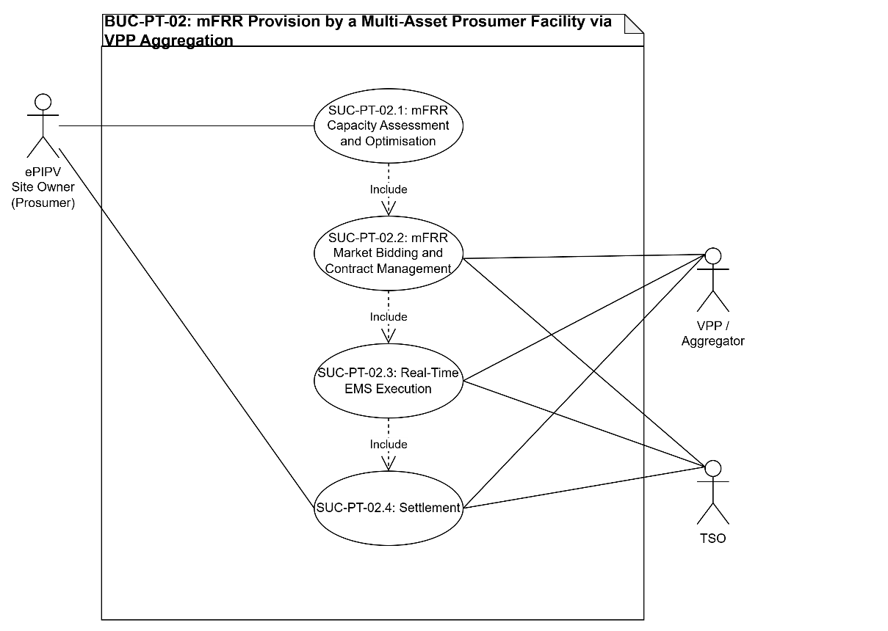
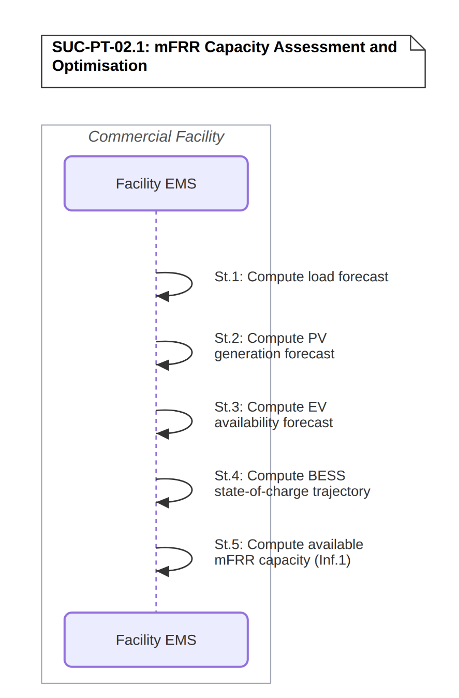
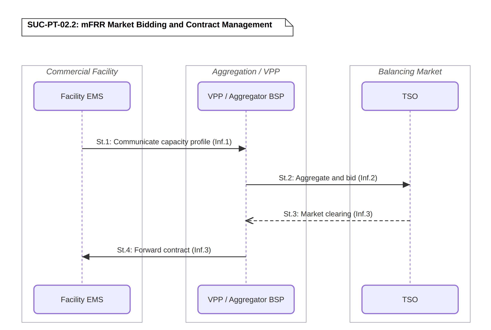
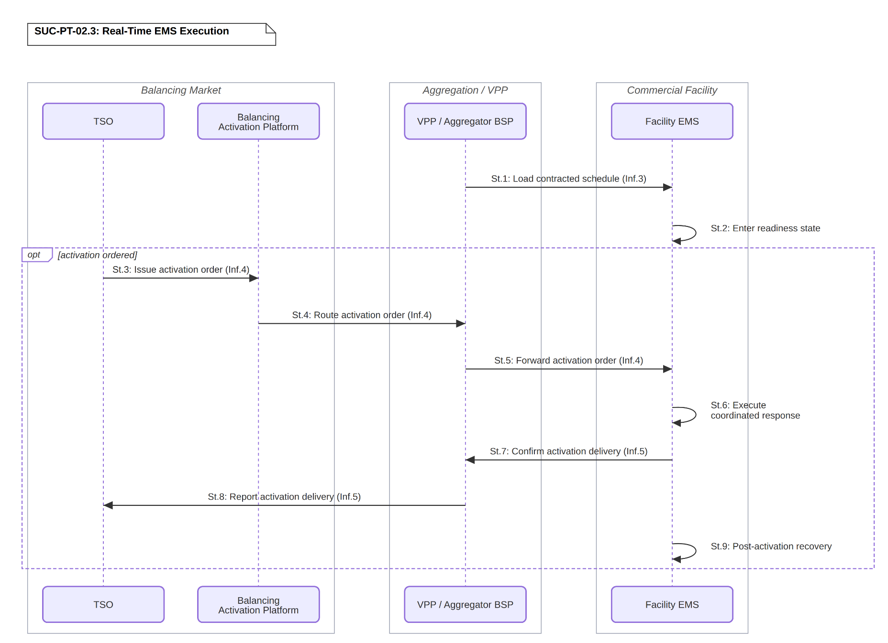
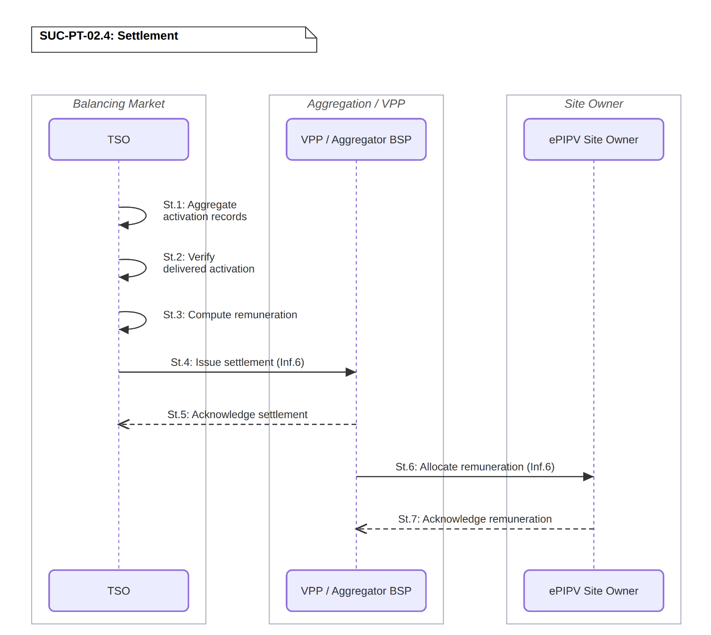

# BUC-PT-02 — Manual Frequency Restoration Reserve (mFRR) Provision by a Multi-Asset Prosumer Facility via VPP Aggregation

> **SOLAR-MOVE — Portuguese Demonstrator** 
> Business Use Case following the IEC 62559-2 template.

| | |
|---|---|
| **Use Case ID** | BUC-PT-02 |
| **Document** | SOLARMOVE_BUC-PT-02.v1.0 |
| **Version** | v1.0 |
| **Area** | Energy System |
| **Domains** | Customer Premises, Transmission |
| **Zones** | Process, Field, Station, Operation, Enterprise, Market |
| **Work Package / Task** | WP1 — T1.3 |

**Files in this folder:** [`SOLARMOVE_BUC-PT-02.v1.0.xlsx`](SOLARMOVE_BUC-PT-02.v1.0.xlsx) (IEC 62559-2 tables) · [`SOLARMOVE_BUC-PT-02.v1.0.xml`](SOLARMOVE_BUC-PT-02.v1.0.xml) (IEC 62559-3-style serialization, draft) · [`images/`](images/) (diagrams)

---

## Table of contents

1. [Description of the use case](#1-description-of-the-use-case)
2. [Diagrams of the use case](#2-diagrams-of-the-use-case)
3. [Technical details](#3-technical-details)
4. [Step-by-step analysis of the use case](#4-step-by-step-analysis-of-the-use-case)
5. [Information exchanged](#5-information-exchanged)
6. [Requirements](#6-requirements)
7. [Common terms and definitions](#7-common-terms-and-definitions)

---

## 1. Description of the use case

### 1.1 Name of the use case

| ID | Area / Domain(s) / Zone(s) | Name of Use Case |
|----|----------------------------|------------------|
| BUC-PT-02 | **Area:** Energy System **Domains:** Customer Premises, Transmission **Zones:** Process, Field, Station, Operation, Enterprise, Market | Manual Frequency Restoration Reserve (mFRR) Provision by a Multi-Asset Prosumer Facility via VPP Aggregation |

### 1.2 Version management

| Version | Date | Author(s) | Changes |
|---------|------|-----------|---------|
| 1.0 | 20.10.2026 | Alexandre Bento (INESC-ID) | First public version |

### 1.3 Scope and objectives of the use case

#### Scope

This use case covers the participation of an ePIPV facility (comprising BESS, EV charging infrastructure, PV generation, and non-flexible facility loads) in the mFRR balancing service market managed by the TSO. The facility offers both upward and downward regulation capacity through a VPP/Aggregator acting as BSP. It covers the day-ahead capacity assessment and procurement process, the real-time activation event triggered by the TSO through the balancing activation platform, and the coordinated multi-asset response executed by the Facility EMS. The use case is supported by four System Use Cases: SUC-PT-02.1 (mFRR Capacity Assessment and Optimisation), SUC-PT-02.2 (mFRR Market Bidding and Contract Management), SUC-PT-02.3 (Real-Time EMS Execution), and SUC-PT-02.4 (Settlement).

#### Objectives

- Generate revenue for the ePIPV Site Owner by offering mFRR capacity to the TSO through the VPP/Aggregator, covering both capacity availability remuneration and energy activation remuneration. Demonstrate the technical capability of a mixed asset portfolio (BESS, EV charging, and PV) to deliver a coordinated frequency restoration response in both upward and downward regulation directions. Demonstrate that a multi-asset prosumer facility can reliably maintain asset readiness during contracted delivery periods and meet mandatory response time requirements upon activation.

#### Related business case(s)

_—_

### 1.4 Narrative of the use case

#### Short description

The ePIPV facility offers mFRR capacity to the TSO through a VPP/Aggregator registered as BSP. Day-ahead, the Facility EMS determines the available regulation capacity that can be committed for each 15-minute slot and communicates it to the VPP/Aggregator, which submits a capacity bid to the TSO's mFRR capacity market. If awarded, the facility stands ready to activate during the contracted delivery period. Upon receiving an activation signal from the TSO, the VPP/Aggregator forwards the order to the Facility EMS, which immediately coordinates the response across all available assets by modulating BESS, EV charging, and PV generation curtailment in the direction and magnitude required within the mandatory response time.

#### Complete description

The ePIPV Site Owner operates a facility with a portfolio of assets capable of delivering power regulation in both directions. For upward regulation, the facility can discharge the BESS, reduce or pause EV charging sessions, and reduce or remove any existing PV generation curtailment, thereby increasing PV output and effectively reducing net consumption or increasing net injection. For downward regulation, the facility can charge the BESS at increased rate, raise EV charging power, and apply or increase PV generation curtailment, thereby decreasing PV output. The facility participates in the mFRR market through a VPP/Aggregator registered as BSP with the TSO, whose Offer Area encompasses the facility's assets aggregated within the VPP/Aggregator's BSP portfolio.

On the day before delivery (D-1), the Facility EMS assesses the available mFRR capacity for each 15-minute slot of the following day. This assessment takes into account forecast building load profiles, expected PV generation, projected BESS state-of-charge trajectory, and the probability distributions of EV availability derived from CPO historical data. For each slot and each regulation direction, the Facility EMS computes the maximum activatable power. This available capacity profile is communicated to the VPP/Aggregator, which aggregates it with capacity from other sites in its portfolio and submits a combined capacity bid to the TSO's mFRR capacity market before the relevant gate closure. The TSO evaluates submitted bids, clears the capacity market, and awards contracts for the delivery day. The VPP/Aggregator communicates the awarded capacity and contracted delivery periods back to the Facility EMS.

The Facility EMS uses the awarded schedule to determine which periods require readiness, and enters a state of readiness for those periods, maintaining the contracted assets within the bounds required to guarantee activatability, ensuring BESS state-of-charge is within the range needed to respond, and that scheduled EV departures do not conflict with the activation window. During the contracted delivery period, the TSO monitors system frequency and balance. If a balancing need arises, the TSO issues an activation order specifying direction, power magnitude, and duration. Activation orders can be of two types: scheduled activations, planned for a specific upcoming 15-minute slot and communicated to the BSP at least 10 minutes before delivery; and direct activations, issued immediately in response to unexpected unavailability of other balancing resources. In both cases, the order is transmitted through the balancing activation platform to the VPP/Aggregator, which immediately forwards it to the Facility EMS.

The Facility EMS executes the activation by coordinating the response across available assets: for upward regulation it prioritises BESS discharge, reduces or pauses EV charging sessions in progress, and removes any existing PV generation curtailment to increase PV output; for downward regulation it charges the BESS at increased rate, raises EV charging setpoints, and applies or increases PV generation curtailment to reduce PV output. The combination and sequencing of assets is determined by the Facility EMS to meet the required power and duration within the mandatory response time (a maximum 12.5-minute preparation period and a maximum 12.5-minute ramping period, per the standardised European mFRR product). The Facility EMS confirms activation to the VPP/Aggregator, which reports delivery to the TSO. Following the activation, the Facility EMS manages the recovery of each asset to its pre-activation or operationally preferred state, subject to any continuation instructions from the TSO.

At the end of the settlement period, the TSO aggregates activation records and delivery data, verifies the delivered activation against the contracted commitment, and computes the settlement, comprising a capacity remuneration for the contracted availability during the delivery period (EUR/MW/h), and an energy remuneration for the power actually delivered during any activation events (EUR/MWh). The VPP/Aggregator receives the settlement, acknowledges it, and allocates both components to the ePIPV Site Owner according to the aggregation agreement, which acknowledges receipt.

### 1.5 Key performance indicators (KPI)

| ID | Name | Description | Reference to objectives |
|----|------|-------------|--------------------------|
| U04 | Operation Cost (ePIPV) | Reduction of the facility operating cost through mFRR capacity and activation remuneration and coordinated multi-asset operation. Target: reduce >=25% vs non-optimal | Objective 1 |
| U05 | Flexibility Participation (Operation) | Increase of the flexibility the facility actually offers and delivers to the market, through contracted mFRR capacity and delivered activations. Target: increase >=100% | Objectives 1 and 2 |
| U06 | Flexibility Potential | Increase of the flexible power and energy capacity the facility can offer, by coordinating BESS, EV charging and PV curtailment. Target: increase >=25% | Objectives 2 and 3 |
| U07 | Constraints Violation Occurrence | Decrease of the occurrences of asset, grid-connection or EV-user constraint violations during mFRR readiness and activation periods. Target: decrease >=15% | Objective 3 |

### 1.6 Use case conditions

#### Assumptions

1. The ePIPV facility comprises PV generation, BESS, non-flexible commercial facility loads, and EV charging infrastructure, all monitored and controlled by a Facility EMS capable of adjusting the operation of each asset in real time.
2. The ePIPV facility has access to a VPP/Aggregator that aggregates the facility's flexibility capacity within a broader portfolio for mFRR market participation as BSP.
3. EV users accept that their charging sessions may be subject to modulation during contracted mFRR delivery periods within bounds that guarantee delivery of their minimum energy requirement by departure time.
4. The capacity offered to this market is determined jointly with the facility's other market commitments (day-ahead spot market participation via BUC-PT-01, DSO flexibility market via BUC-PT-03) within a single EMS optimisation run that maximises overall facility revenue across all available market channels.
5. mFRR Band capacity is contracted in Portugal through two parallel products: a monthly-maturity auction (operational since January 2024) and a newer daily-maturity auction introduced by ERSE in September 2025 specifically to enable storage and renewables participation. This BUC targets the daily mFRR Band product, consistent with the facility's BESS-centric flexibility profile.

#### Prerequisites

1. The Facility EMS receives real-time data from all facility assets (PV generation, BESS state-of-charge, EV charging sessions, non-flexible load measurements).
2. Reliable bi-directional communication exists between the local Facility EMS, the VPP/Aggregator platform, and the TSO balancing activation platform, meeting the minimum availability requirements defined by the TSO.
3. A contractual aggregation agreement exists between the ePIPV Site Owner and the VPP / Aggregator BSP.
4. The VPP / Aggregator BSP holds a valid BSP registration with the TSO and its Offer Area has passed the TSO qualification test.
5. The EV charging infrastructure supports smart charging (dynamic power setpoint modulation via a charging management protocol), allowing the Facility EMS to adjust individual session charging rates in real time.

### 1.7 Further information for classification/mapping

**Relation to other use cases.** This BUC's day-ahead capacity assessment (SUC-PT-02.1) shares a single EMS optimisation run with BUC-PT-01 (day-ahead spot market participation) and BUC-PT-03 (DSO flexibility market), which jointly determine how facility flexibility is allocated across market channels to maximise total revenue.

**Level of depth.** Business use case, detailed down to system use cases (SUC-PT-02.1 to SUC-PT-02.4) and their step-by-step sequences.

**Prioritisation.** High. Demonstrates the provision of an ancillary service (mFRR) by a multi-asset prosumer facility, evaluated on both AC and DC infrastructure at the INESC-ID laboratory.

**Generic, regional or national relation.** The Portuguese pilot executes this BUC as a parallel comparison between AC infrastructure, tested as Hardware-in-the-Loop against a Digital Twin of the Continente facilities, and DC infrastructure, physically emulated as Power-Hardware-in-the-Loop at the INESC-ID laboratory. This comparison produces two infrastructure-level indicators, PT-KPI-01 (AC/DC Infrastructure Energy Efficiency) and PT-KPI-02 (DC vs AC Flexibility Capacity Advantage), which compare the two architectures rather than measure the objectives of this BUC. This methodology is specific to the Portuguese pilot's dual-infrastructure design and does not affect the BUC's applicability to a single-infrastructure deployment elsewhere.

**Nature of the use case.** Business use case (market process).

**Further keywords for classification.** mFRR, balancing services, VPP, aggregation, BESS, EV charging, PV curtailment, TSO.

### 1.8 General remarks

This BUC is evaluated at the INESC-ID laboratory, which has the capability of testing and emulating both AC and DC infrastructures, using a downscaled replica of the commercial facility. The ePIPV facility, comprising PV, BESS, EV charging and non-flexible commercial loads, is managed by a Facility EMS that assesses the available mFRR capacity day-ahead. A VPP / Aggregator BSP bids this capacity to the TSO and forwards activation orders received through the balancing activation platform. The features tested are the day-ahead capacity assessment and bidding, readiness maintenance, the coordinated multi-asset activation response, and settlement. The actors involved are the ePIPV Site Owner, the VPP / Aggregator BSP, the TSO, the Facility EMS and the Balancing Activation Platform.

---

## 2. Diagrams of the use case

The diagram below illustrates the overall structure of the Business Use Case, showing the actors and the 4 System Use Cases (SUC-PT-02.1, SUC-PT-02.2, SUC-PT-02.3, SUC-PT-02.4) that realise it.

  

<em><b>Figure 1.</b> BUC-PT-02 — Manual Frequency Restoration Reserve (mFRR) Provision by a Multi-Asset Prosumer Facility via VPP Aggregation (use case diagram).</em>

---

## 3. Technical details

### 3.1 Actors

| Actor Name | Actor Type | Actor Description | Further information specific to this use case |
|------------|------------|-------------------|-----------------------------------------------|
| **ePIPV Site Owner** | Business | Entity that owns and operates the ePIPV facility and its distributed energy resources, and contractually delegates mFRR market participation to the VPP / Aggregator BSP | SONAE MC |
| **VPP / Aggregator BSP** | Business | Party that aggregates the facility's flexibility capacity within a broader portfolio, submits capacity bids to the TSO, forwards activation orders to the Facility EMS, reports delivery, and manages settlement | Elergone |
| **TSO** | Business | Party that procures mFRR capacity day-ahead, issues activation orders during contracted delivery periods, verifies delivered service, and issues settlement | REN |
| **Facility EMS** | System | System that monitors and controls all facility assets, assesses available mFRR capacity day-ahead, maintains asset readiness during contracted periods, and executes the coordinated multi-asset activation response upon receiving an activation order | INESC-ID |
| **Balancing Activation Platform** | System | Platform through which TSO activation orders are routed to BSPs | MARI |

### 3.2 References

_References (standards, reports, mandates and regulatory constraints) associated with the use case._

| No. | Reference Type | Reference | Status | Impact on use case | Originator / organisation | Link |
|-----|----------------|-----------|--------|--------------------|---------------------------|------|
| 1 | Regulation | Manual de Procedimentos da Gestão Global do Sistema (MPGGS), approved by ERSE Diretiva n.º 9/2025 (11.09.2025), specifically:  • Capítulo XVI (Banda Diária de mFRR, Art. 181.º–193.º) • Capítulo XVII (Energia de mFRR, Art. 194.º–221.º) • Capítulo XX (Produto Específico de Banda de mFRR, Art. 248.º–271.º) • Capítulo XXVII (Procedimentos de Liquidação, Art. 334.º–419.º) | Current | Defines the mFRR Band auction rules (offer submission, contracting algorithm, settlement) modelled in SUC-PT-02.1 to SUC-PT-02.4 | ERSE | [erse.pt](https://www.erse.pt/media/q10chfti/mpggs_articulado-250911.pdf) |

---

## 4. Step-by-step analysis of the use case

### 4.1 Overview of scenarios

| No. | Scenario name | Scenario description | Primary actor | Triggering event | Pre-condition | Post-condition |
|-----|---------------|----------------------|---------------|------------------|---------------|----------------|
| 1 | mFRR Capacity Assessment and Optimisation (SUC-PT-02.1) | The Facility EMS backend computes load, PV, EV availability, and BESS SoC trajectory forecasts and computes available mFRR capacity per 15-min slot and direction. | Facility EMS | D-1 daily optimisation cycle | Facility EMS has access to historical and real-time data required for forecasting | A capacity profile (MW per slot, per direction) is ready for bidding |
| 2 | mFRR Market Bidding and Contract Management (SUC-PT-02.2) | The VPP / Aggregator BSP aggregates the facility's capacity into its portfolio, bids into the day-ahead mFRR capacity market, and the awarded contract is confirmed back to the Facility EMS. | VPP / Aggregator BSP | mFRR capacity market gate closure | Capacity profile from SUC-PT-02.1 is available | Contracted capacity and delivery periods confirmed at the Facility EMS |
| 3 | Real-Time EMS Execution (SUC-PT-02.3) | The Facility EMS loads the contracted schedule, maintains asset readiness through the contracted delivery period, and upon receiving an activation order executes a coordinated multi-asset response and reports delivery. | Facility EMS | Start of contracted delivery period / TSO activation order | Contracted capacity and delivery periods have been confirmed (SUC-PT-02.2) | Activation delivered and confirmed; assets recovered to pre-activation state |
| 4 | Settlement (SUC-PT-02.4) | The TSO verifies delivered activation against the contracted commitment and issues settlement; the VPP / Aggregator BSP allocates remuneration to the ePIPV Site Owner. | VPP / Aggregator BSP | Periodic settlement cycle | Activation deliveries for the settlement period are confirmed and recorded | Remuneration allocated to the ePIPV Site Owner |

### 4.2 Steps – Scenarios

#### 4.2.1 mFRR Capacity Assessment and Optimisation (SUC-PT-02.1)

| Step No. | Event | Name of process / activity | Description of process / activity | Service | Information producer | Information receiver | Information exchanged (IDs) | Requirement, R-IDs |
|----------|-------|----------------------------|-----------------------------------|---------|----------------------|----------------------|-----------------------------|--------------------|
| 1.1 | D-1 optimisation cycle starts | Compute load forecast | Facility EMS backend computes building load forecast for the next 24h in 15-min slots. | CREATE | Facility EMS | Facility EMS | – | R-FOR-02, R-DAT-01, R-DAT-05 |
| 1.2 | Load forecast ready | Compute PV generation forecast | Facility EMS backend computes PV generation forecast for the next 24h in 15-min slots, fed by a solar irradiance/production API. | CREATE | Facility EMS | Facility EMS | – | R-FOR-01, R-DAT-01, R-DAT-05 |
| 1.3 | PV forecast ready | Compute EV availability forecast | Facility EMS backend computes EV arrival/departure probability distributions from historical CPO session data. | CREATE | Facility EMS | Facility EMS | – | R-FOR-03, R-DAT-01, R-DAT-05 |
| 1.4 | EV forecast ready | Compute BESS state-of-charge trajectory | Facility EMS backend projects the BESS state-of-charge trajectory for the next 24h from the current SoC and the day's expected operating profile. | CREATE | Facility EMS | Facility EMS | – | R-EMS-06, R-AIC-03 |
| 1.5 | All forecasts compiled | Compute available capacity | Facility EMS computes available mFRR capacity per 15-min slot, per direction, from the combined inputs. | CREATE | Facility EMS | Facility EMS | Inf.1 | R-EMS-06, R-FOR-05, R-GFR-02, R-GFR-03, R-GFR-04 |

  

<em><b>Figure 2.</b> SUC-PT-02.1 — mFRR Capacity Assessment and Optimisation (sequence diagram).</em>

#### 4.2.2 mFRR Market Bidding and Contract Management (SUC-PT-02.2)

| Step No. | Event | Name of process / activity | Description of process / activity | Service | Information producer | Information receiver | Information exchanged (IDs) | Requirement, R-IDs |
|----------|-------|----------------------------|-----------------------------------|---------|----------------------|----------------------|-----------------------------|--------------------|
| 2.1 | Capacity profile ready | Communicate capacity profile | Facility EMS communicates available capacity profile and activation constraints. | REPORT | Facility EMS | VPP / Aggregator BSP | Inf.1 | R-COM-01, R-COM-07, R-CYB-01, R-CYB-03, R-AIC-07 |
| 2.2 | Capacity profile received | Aggregate and bid | VPP / Aggregator BSP aggregates facility capacity with portfolio; submits combined capacity bid before gate closure. | CREATE | VPP / Aggregator BSP | TSO | Inf.2 | R-MKT-04, R-EMS-07, R-COM-07, R-INT-07 |
| 2.3 | Gate closure reached | Market clearing | TSO clears capacity market; communicates awarded capacity and contracted delivery periods. | REPORT | TSO | VPP / Aggregator BSP | Inf.3 | R-MKT-03, R-COM-01, R-CYB-04 |
| 2.4 | Capacity market cleared | Forward contract | VPP / Aggregator BSP forwards awarded capacity contract and contracted delivery periods. | REPORT | VPP / Aggregator BSP | Facility EMS | Inf.3 | R-MKT-03, R-COM-01, R-COM-03 |

  

<em><b>Figure 3.</b> SUC-PT-02.2 — mFRR Market Bidding and Contract Management (sequence diagram).</em>

#### 4.2.3 Real-Time EMS Execution (SUC-PT-02.3)

| Step No. | Event | Name of process / activity | Description of process / activity | Service | Information producer | Information receiver | Information exchanged (IDs) | Requirement, R-IDs |
|----------|-------|----------------------------|-----------------------------------|---------|----------------------|----------------------|-----------------------------|--------------------|
| 3.1 | Contract confirmed | Load contracted schedule | Facility EMS receives the awarded capacity contract and contracted delivery periods (from SUC-PT-02.2) and determines which periods require readiness. | GET | VPP / Aggregator BSP | Facility EMS | Inf.3 | R-EMS-03, R-COM-01, R-COM-03 |
| 3.2 | Contracted schedule loaded | Enter readiness state | Facility EMS enters readiness state for the identified periods: manages BESS SoC within activation range, monitors EV departure schedules. | EXECUTE | Facility EMS | Facility EMS | – | R-EMS-08, R-GFR-03, R-RTC-01, R-SAF-01 |
| 3.3 | Delivery period active | Issue activation order | During the contracted delivery period, TSO issues an activation order specifying type, direction, power magnitude, and duration. | REPORT | TSO | Balancing Activation Platform | Inf.4 | R-MKT-05, R-COM-01, R-CYB-04 |
| 3.4 | Activation order issued | Route activation order | Balancing Activation Platform routes the activation order to the BSP. | REPORT | Balancing Activation Platform | VPP / Aggregator BSP | Inf.4 | R-MKT-05, R-COM-01, R-COM-04, R-CYB-04 |
| 3.5 | Activation order routed | Forward activation order | VPP / Aggregator BSP forwards the activation order to the Facility EMS. | REPORT | VPP / Aggregator BSP | Facility EMS | Inf.4 | R-MKT-05, R-COM-01, R-COM-03 |
| 3.6 | Activation order received | Execute coordinated response | Facility EMS executes the response within the mandatory response time. Upward regulation: discharges BESS, reduces EV charging, removes PV curtailment. Downward regulation: charges BESS, increases EV charging rate, curtails PV. | EXECUTE | Facility EMS | Facility EMS | – | R-EMS-02, R-EMS-04, R-SC-03, R-RTC-01, R-RTC-02, R-RTC-05, R-RTC-06, R-SAF-01 |
| 3.7 | Response executed | Confirm activation delivery | Facility EMS confirms activation delivery: actual power delivered, assets mobilised, timestamps. | REPORT | Facility EMS | VPP / Aggregator BSP | Inf.5 | R-RTC-06, R-RTC-08, R-GFR-08, R-MVR-01, R-DAT-02 |
| 3.8 | Delivery confirmed | Report activation delivery | VPP / Aggregator BSP reports activation delivery. | REPORT | VPP / Aggregator BSP | TSO | Inf.5 | R-COM-01, R-COM-03, R-MVR-07 |
| 3.9 | Activation completed | Post-activation recovery | Facility EMS manages asset recovery to pre-activation or operationally preferred state. | EXECUTE | Facility EMS | Facility EMS | – | R-SAF-06, R-EMS-08, R-RTC-07 |

  

<em><b>Figure 4.</b> SUC-PT-02.3 — Real-Time EMS Execution (sequence diagram).</em>

#### 4.2.4 Settlement (SUC-PT-02.4)

| Step No. | Event | Name of process / activity | Description of process / activity | Service | Information producer | Information receiver | Information exchanged (IDs) | Requirement, R-IDs |
|----------|-------|----------------------------|-----------------------------------|---------|----------------------|----------------------|-----------------------------|--------------------|
| 4.1 | Settlement cycle starts | Aggregate activation records | TSO aggregates activation records and delivery data for the settlement period. | CREATE | TSO | TSO | – | R-MVR-01, R-MVR-06, R-DAT-06 |
| 4.2 | Activation records aggregated | Verify delivered activation | TSO verifies delivered activation against the contracted commitment. | EXECUTE | TSO | TSO | – | R-MVR-04, R-MVR-05, R-GFR-08 |
| 4.3 | Delivery verified | Compute remuneration | TSO computes capacity remuneration (EUR/MW/h) and energy remuneration (EUR/MWh). | CREATE | TSO | TSO | – | R-MVR-05, R-MKT-08 |
| 4.4 | Remuneration computed | Issue settlement | TSO issues settlement to the VPP / Aggregator BSP. | REPORT | TSO | VPP / Aggregator BSP | Inf.6 | R-MKT-08, R-COM-01, R-CYB-03 |
| 4.5 | Settlement received | Acknowledge settlement | VPP / Aggregator BSP acknowledges settlement receipt. | REPORT | VPP / Aggregator BSP | TSO | – | R-COM-03 |
| 4.6 | Settlement acknowledged | Allocate remuneration | VPP / Aggregator BSP allocates remuneration to the ePIPV Site Owner per the aggregation agreement. | REPORT | VPP / Aggregator BSP | ePIPV Site Owner | Inf.6 | R-MKT-08, R-MVR-07 |
| 4.7 | Remuneration allocated | Acknowledge remuneration | ePIPV Site Owner acknowledges receipt of remuneration. | REPORT | ePIPV Site Owner | VPP / Aggregator BSP | – | R-COM-03 |

  

<em><b>Figure 5.</b> SUC-PT-02.4 — Settlement (sequence diagram).</em>

---

## 5. Information exchanged

| Information exchanged (ID) | Name of information | Description of information exchanged | Requirement, R-IDs |
|----------------------------|---------------------|--------------------------------------|--------------------|
| Inf.1 | Capacity availability profile | Time series per 15-min slot: available upward capacity (MW), available downward capacity (MW), activation constraints | R-EMS-06, R-GFR-02, R-DAT-03 |
| Inf.2 | mFRR capacity bid | Bid ID, direction (up/down), quantity (MW) per slot, price (EUR/MW/h), portfolio composition reference | R-MKT-04, R-INT-07, R-CYB-01 |
| Inf.3 | mFRR capacity contract award | Contract ID, awarded capacity (MW) per slot/direction, contracted delivery periods (start/end timestamps), cleared capacity price (EUR/MW/h) | R-MKT-03, R-CYB-04, R-DAT-03 |
| Inf.4 | Activation order | Order ID, type (scheduled/direct), direction (up/down), power magnitude (MW), duration, mandatory response time | R-MKT-05, R-RTC-05, R-CYB-04 |
| Inf.5 | Activation delivery confirmation | Order ID reference, actual power delivered (MW) per timestep, assets mobilised (BESS/EV/PV), delivery timestamps | R-MVR-01, R-GFR-08, R-DAT-02 |
| Inf.6 | mFRR settlement result | Settlement period, capacity remuneration (EUR/MW/h), energy remuneration (EUR/MWh), total delivered energy (MWh) | R-MVR-04, R-MKT-08, R-MVR-05 |

---

## 6. Requirements

### CAT-01 — Asset integration and commissioning
_All physical assets must be installed, commissioned, operational and addressable before pilot operation_

| R-ID | Name | Description |
|------|------|-------------|
| R-AIC-03 | Asset capability registration | The platform shall maintain the technical capabilities and operating limits of each asset, including rated power, energy capacity, control modes, ramp limits, SoC limits and availability. |
| R-AIC-07 | Market asset registration | Assets intended for market or flexibility participation shall be registered with the required technical, metering, connection-point and geographic attributes before qualification or bidding. |

### CAT-02 — Energy Management System capabilities
_Contains requirements related to EMS functionalities and capabilities_

| R-ID | Name | Description |
|------|------|-------------|
| R-EMS-02 | Multi-asset orchestration | The EMS shall coordinate EV charging, PV generation, BESS operation, controllable loads and grid exchange within the applicable pilot boundary. |
| R-EMS-03 | Schedule and setpoint generation | The EMS shall translate optimisation results and external commitments into asset-level schedules, limits and setpoints. |
| R-EMS-04 | Constraint enforcement | The EMS shall prevent dispatch that violates grid connection limits, asset limits, user requirements, mobility-service constraints or contracted reserve obligations. |
| R-EMS-06 | Flexibility estimation | The EMS shall calculate available upward and downward flexibility by time interval, including power, energy, duration and limiting constraints. |
| R-EMS-07 | Distributed-site aggregation | The EMS or VPP layer shall aggregate multiple charging clusters or facilities into a single controllable and reportable portfolio without losing site-level constraints. |
| R-EMS-08 | Operating-mode management | The EMS shall support normal, constrained-grid, market-activation, emergency and recovery modes with explicit transition rules. |

### CAT-03 — Smart charging, V2G and mobility-service constraints
_The charging infrastructure functionalities and capabilities_

| R-ID | Name | Description |
|------|------|-------------|
| R-SC-03 | Dynamic charging control | The charging infrastructure shall accept remote time-based charging profiles or dynamic power limits for individual EVSEs or sessions. |

### CAT-04 — Communications and connectivity
_Collection of requirements to enable reliable communication_

| R-ID | Name | Description |
|------|------|-------------|
| R-COM-01 | Bidirectional communications | Bidirectional communication shall be available wherever both telemetry and remote control are required between assets, EMS, CSMS, BMS, VPP and external platforms. |
| R-COM-03 | Message acknowledgement | Control commands and market activations shall be acknowledged by the receiving system with acceptance, rejection or failure status. |
| R-COM-04 | Store-and-forward capability | Where temporary loss of connectivity is possible, systems shall buffer non-real-time telemetry and forward it after reconnection without duplication. |
| R-COM-07 | External platform connectivity | The VPP/aggregator or EMS shall provide reliable interfaces to day-ahead, intraday, balancing and DSO flexibility platforms as applicable. |

### CAT-05 — Data acquisition, quality and storage
_Requirements for common data management mechanisms_

| R-ID | Name | Description |
|------|------|-------------|
| R-DAT-01 | Operational telemetry acquisition | The platform shall acquire EVSE, PV, BESS, meter, site-load, weather and mobility data required by the applicable use case. |
| R-DAT-02 | Common timestamping | All operational records shall contain timestamps referenced to a common time base and include timezone or UTC information. |
| R-DAT-03 | Data validation | Incoming data shall be checked for missing values, staleness, invalid ranges, inconsistent units and implausible changes before use in control or settlement. |
| R-DAT-05 | Historical data retention | Historical measurements, schedules, commands, forecasts, user declarations and market messages shall be retained for the period required for KPI assessment, audit and settlement. |
| R-DAT-06 | Interval aggregation | The data platform shall support aggregation and resampling to the operational and market intervals required by each pilot, including 1-minute and 15-minute periods where applicable. |

### CAT-06 — Semantic and protocol interoperability
_Requirements for enabling interoperable communications_

| R-ID | Name | Description |
|------|------|-------------|
| R-INT-07 | Market message interoperability | Market and grid-service exchanges shall map to the formats and role definitions required by the relevant market operator, DSO, TSO or aggregator. |

### CAT-07 — Forecasting and optimisation
_Contains requirements enabling reliable predictive capabilities_

| R-ID | Name | Description |
|------|------|-------------|
| R-FOR-01 | PV forecasting | The platform shall produce PV generation forecasts at the time resolution and horizon required for charging, BESS and market optimisation. |
| R-FOR-02 | Load forecasting | The platform shall forecast non-flexible and controllable site demand for the relevant planning horizon. |
| R-FOR-03 | EV demand forecasting | The platform shall forecast EV arrival, departure, energy need and charging availability using historical or declared session information. |
| R-FOR-05 | Constraint-aware optimisation | Optimisation shall include asset power and energy limits, grid limits, charging deadlines, reserve commitments, load constraints and permissible PV curtailment. |

### CAT-08 — Real-time control and performance
_Group of requirements enabling near-real-time control to maintain grid compliance and track market or operational commitments_

| R-ID | Name | Description |
|------|------|-------------|
| R-RTC-01 | Defined control cycle | Each real-time control function shall operate at a documented cycle time appropriate to its use case and shall complete calculation and dispatch within that cycle. |
| R-RTC-02 | Real-time grid-limit supervision | The EMS shall continuously supervise aggregate import/export against the applicable connection or circuit limit. |
| R-RTC-05 | Activation response timing | The system shall execute DSO/TSO or market activation instructions within the mandatory response time associated with the contracted product. |
| R-RTC-06 | Setpoint execution verification | The platform shall verify actual response after dispatch and identify partial, late or failed execution. |
| R-RTC-07 | Control conflict resolution | When multiple objectives or commitments conflict, the system shall apply a documented precedence order that protects safety and binding obligations. |
| R-RTC-08 | Performance logging | Control-cycle start time, decision time, dispatch time, acknowledgement and measured response shall be logged for performance assessment. |

### CAT-09 — Grid constraints, flexibility and resilience
_Group of requirements ensuring safe operation under constrained grid conditions while providing external grid services_

| R-ID | Name | Description |
|------|------|-------------|
| R-GFR-02 | Upward and downward flexibility calculation | The platform shall calculate feasible upward and downward power and energy flexibility with duration, availability window and recovery requirement. |
| R-GFR-03 | Flexibility reservation | Awarded or contracted flexibility shall be reserved in asset schedules so that it remains activatable during the committed service window. |
| R-GFR-04 | No double commitment | The system shall prevent the same asset headroom from being committed simultaneously to incompatible services or schedules. |
| R-GFR-08 | Flexibility delivery verification | The system shall compare requested and measured response and calculate delivered power, energy, duration and accuracy. |

### CAT-10 — Market, aggregator and external platform integration
_Group of requirements ensuring integration into electricity and flexibility markets_

| R-ID | Name | Description |
|------|------|-------------|
| R-MKT-03 | Awarded schedule reception | The VPP/aggregator interface shall receive and validate accepted schedules, prices and delivery periods and make them available to the EMS. |
| R-MKT-04 | Reserve capacity bidding | The platform shall provide upward and downward mFRR availability profiles and capacity bids for the applicable settlement intervals. |
| R-MKT-05 | Activation-order handling | The system shall receive, authenticate, validate and execute activation orders containing direction, magnitude, start time and duration. |
| R-MKT-08 | Settlement result exchange | The external-platform interface shall exchange delivered quantities, prices, penalties, imbalance results and remuneration components with the responsible party. |

### CAT-11 — Metering, verification, settlement and KPI reporting
_Group of requirements providing grounds for operational control and project and market outcomes validation_

| R-ID | Name | Description |
|------|------|-------------|
| R-MVR-01 | Connection-point metering | The system shall measure net import/export at the relevant connection point with accuracy and interval resolution suitable for control and, where applicable, settlement. |
| R-MVR-04 | Baseline calculation | Where service delivery is assessed against a baseline, the platform shall calculate and retain the applicable adjusted reference value and its input data. |
| R-MVR-05 | Settlement-grade audit trail | Measurements used for financial settlement shall be immutable or tamper-evident, timestamped and traceable through all processing steps. |
| R-MVR-06 | KPI computation | The platform shall calculate the applicable project KPIs, including PV self-consumption, peak reduction, curtailment avoidance, operating cost, flexibility potential and charging-service performance. |
| R-MVR-07 | Delivery report | The system shall generate reports comparing requested, scheduled and actual power/energy for each flexibility or market event. |

### CAT-12 — Cybersecurity, privacy and access control
_Group of requirements ensuring secure and privacy-preserving access to services and provide resilient operation of infrastructure_

| R-ID | Name | Description |
|------|------|-------------|
| R-CYB-01 | Strong authentication | Human users, devices and external systems shall authenticate before accessing telemetry, configuration, commands, bids or personal data. |
| R-CYB-03 | Encryption in transit | All communications crossing device, site, cloud or organisational trust boundaries shall use appropriate encryption in transit. |
| R-CYB-04 | Command integrity and anti-replay | Control commands and market activations shall be protected against unauthorised modification, duplication and replay. |

### CAT-13 — Safety, fault handling and recovery
_Group of requirements ensuring control platform never overrides asset or mobility safety constraints_

| R-ID | Name | Description |
|------|------|-------------|
| R-SAF-01 | Asset safety-envelope enforcement | No EMS, CSMS or market command shall exceed the validated electrical, thermal, SoC, ramp-rate or manufacturer limits of an asset. |
| R-SAF-06 | Recovery validation | Following a fault or outage, the system shall verify communications, status, limits and metering before returning an asset to automatic control. |

---

## 7. Common terms and definitions

_Relevant terms belonging to this use case are listed here; these should ultimately be consolidated in a common glossary shared across all SOLAR-MOVE use cases._

| Term | Definition |
|------|------------|
| | |

---

Based on `SOLARMOVE_BUC-PT-02.docx`, following the IEC 62559-2 use case template. UML use case and sequence diagrams are included as Figures 1–5 (see `images/`).

Licensed under [CC BY 4.0](../LICENSE). Funded by the European Union under Grant Agreement No. 101235635 (SOLAR-MOVE). Views and opinions expressed are however those of the author(s) only and do not necessarily reflect those of the European Union or CINEA. Neither the European Union nor the granting authority can be held responsible for them.
