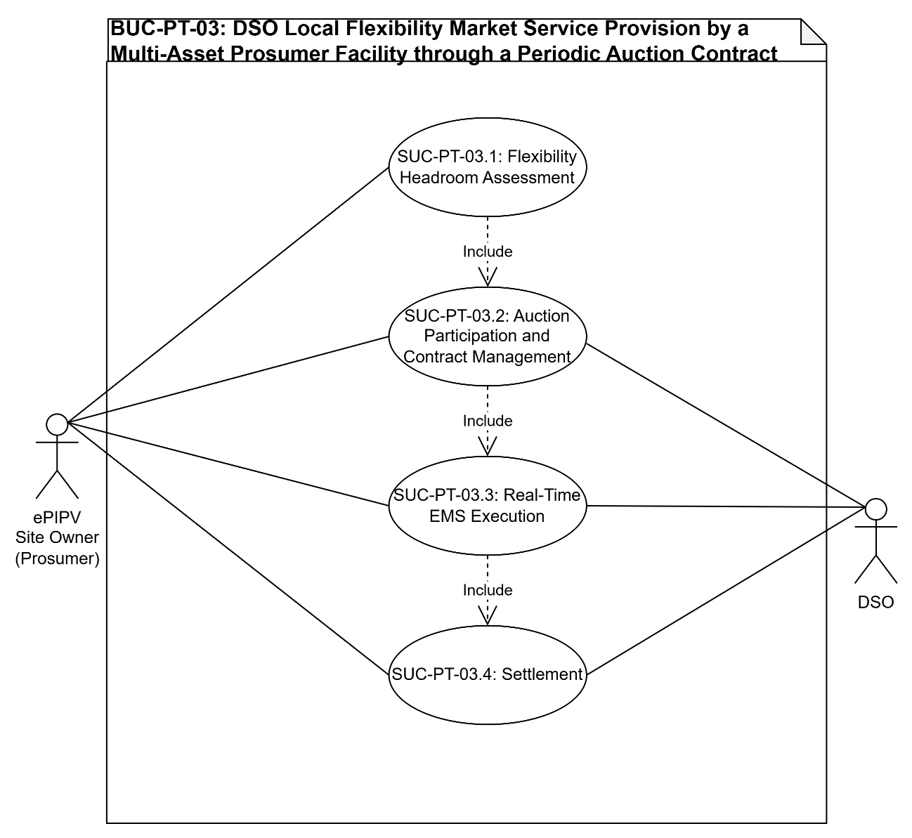
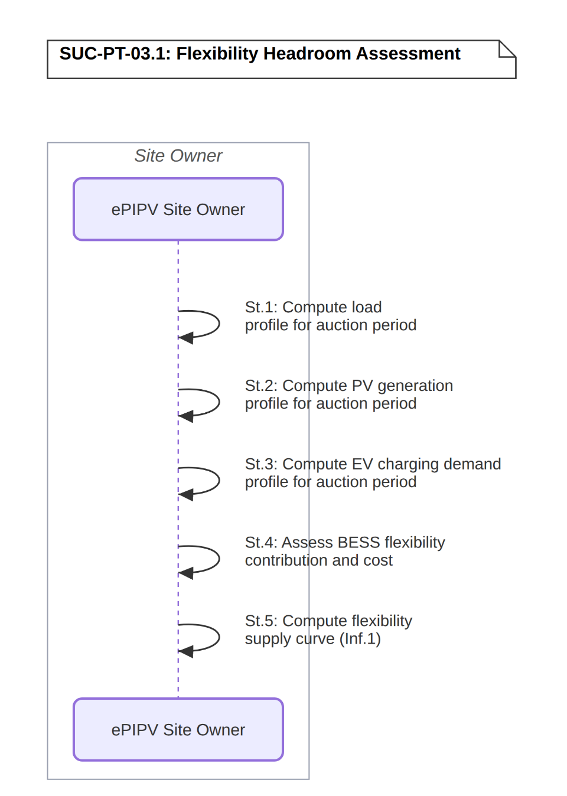
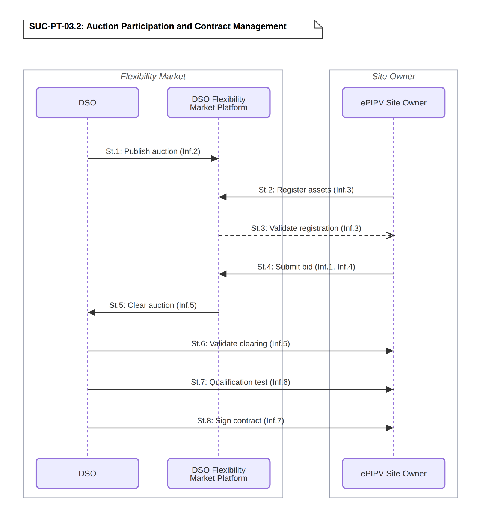
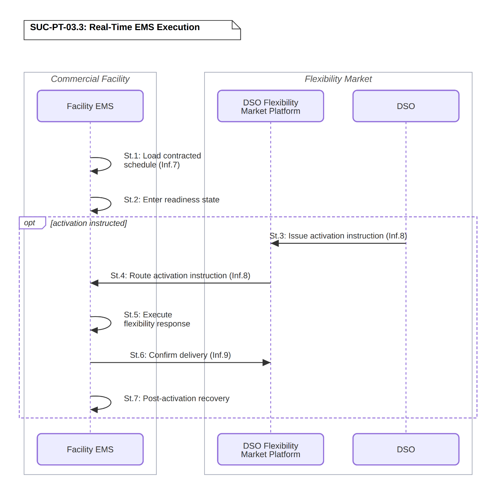
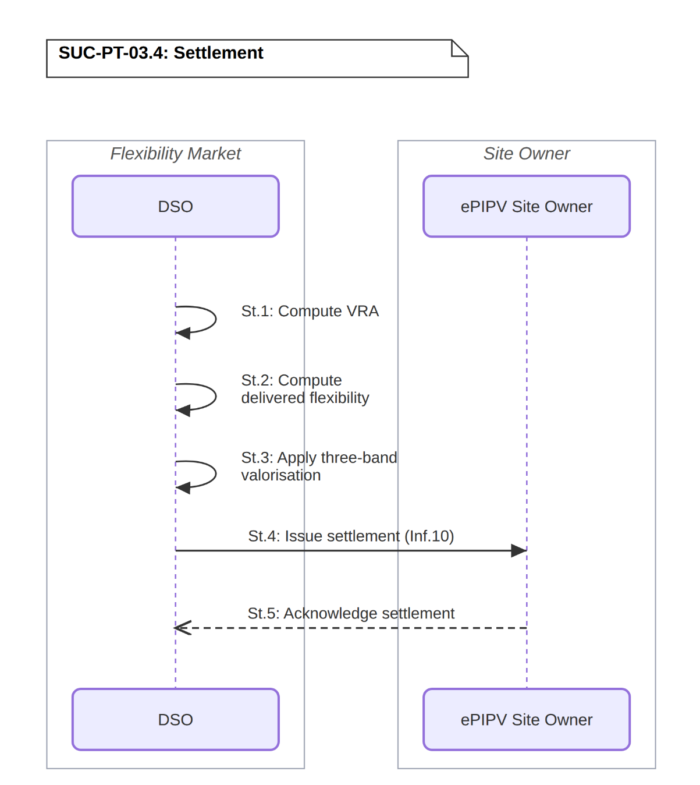

# BUC-PT-03 — DSO Local Flexibility Market Service Provision by a Multi-Asset Prosumer Facility through a Periodic Auction Contract

> **SOLAR-MOVE — Portuguese Demonstrator** 
> Business Use Case following the IEC 62559-2 template.

| | |
|---|---|
| **Use Case ID** | BUC-PT-03 |
| **Document** | SOLARMOVE_BUC-PT-03.v1.0 |
| **Version** | v1.0 |
| **Area** | Energy System |
| **Domains** | Customer Premises, Distribution |
| **Zones** | Process, Field, Station, Operation, Enterprise, Market |
| **Work Package / Task** | WP1 — T1.3 |

**Files in this folder:** [`SOLARMOVE_BUC-PT-03.v1.0.xlsx`](SOLARMOVE_BUC-PT-03.v1.0.xlsx) (IEC 62559-2 tables) · [`SOLARMOVE_BUC-PT-03.v1.0.xml`](SOLARMOVE_BUC-PT-03.v1.0.xml) (IEC 62559-3-style serialization, draft) · [`images/`](images/) (diagrams)

---

## Table of contents

1. [Description of the use case](#1-description-of-the-use-case)
2. [Diagrams of the use case](#2-diagrams-of-the-use-case)
3. [Technical details](#3-technical-details)
4. [Step-by-step analysis of the use case](#4-step-by-step-analysis-of-the-use-case)
5. [Information exchanged](#5-information-exchanged)
6. [Requirements](#6-requirements)
7. [Common terms and definitions](#7-common-terms-and-definitions)

---

## 1. Description of the use case

### 1.1 Name of the use case

| ID | Area / Domain(s) / Zone(s) | Name of Use Case |
|----|----------------------------|------------------|
| BUC-PT-03 | **Area:** Energy System **Domains:** Customer Premises, Distribution **Zones:** Process, Field, Station, Operation, Enterprise, Market | DSO Local Flexibility Market Service Provision by a Multi-Asset Prosumer Facility through a Periodic Auction Contract |

### 1.2 Version management

| Version | Date | Author(s) | Changes |
|---------|------|-----------|---------|
| 1.0 | 20.10.2026 | Alexandre Bento (INESC-ID) | First public version |

### 1.3 Scope and objectives of the use case

#### Scope

This use case covers the participation of an ePIPV facility comprising BESS, EV charging infrastructure, PV generation, and non-flexible facility loads in a DSO-operated local flexibility market. It spans two temporal phases: a contracting phase, in which the ePIPV Site Owner registers assets on the market platform, participates in a periodic auction organised by the DSO, and establishes a multi-year flexibility service contract; and an operational phase, in which the DSO issues activation instructions during contracted service windows and the Facility EMS delivers the requested flexibility response, with settlement based on measured energy against a standardised reference value. The use case is supported by four System Use Cases: SUC-PT-03.1 (Flexibility Headroom Assessment), SUC-PT-03.2 (Auction Participation and Contract Management), SUC-PT-03.3 (Real-Time EMS Execution), and SUC-PT-03.4 (Settlement).

#### Objectives

- Generate revenue for the ePIPV Site Owner, acting as flexibility service provider (FSP), by offering local flexibility services to the DSO in both upward and downward directions, covering both availability and utilisation remuneration components. Demonstrate the capability of a mixed asset portfolio to deliver reliable and measurable flexibility responses under a standardised DSO flexibility market framework. Contribute to local network congestion management and renewable energy integration by providing demand-side flexibility at distribution network level.

#### Related business case(s)

_—_

### 1.4 Narrative of the use case

#### Short description

When the DSO identifies a local network flexibility need, it publishes a competition on the DSO Flexibility Market Platform. The ePIPV site Owner registers its flexible assets on the platform, assesses available flexibility headroom, and submits a bid. If the auction clears successfully and the DSO validates the results, the facility undergoes a qualification test and the ePIPV Becomes an Flexibility Service Provider (FSP) by signing a multi-year flexibility service contract with the DSO. During the contracted service period, when the DSO detects a network need, it issues an activation instruction via the platform with the applicable advance notice. The Facility EMS receives the instruction and makes the required adjustments across available assets to meet the flexibility order. Settlement is computed per 15-minute slot by comparing actual measured power against a standardised adjusted reference value, with payment comprising an availability component for contracted readiness and a utilisation component for energy actually delivered, paid to the ePIPV Site Owner.

#### Complete description

When the DSO identifies a local network flexibility need, it organises local flexibility competitions across different service types, each responding to a distinct network operational need:

The Secure service addresses peak consumption management or overvoltage conditions under normal network operation. Activation instructions are issued with 15 minutes advance notice. The availability payment applies unconditionally for all contracted service windows.

The Dynamic service addresses congestion arising during planned network maintenance periods, when specific network assets are temporarily unavailable. The DSO must notify the FSP of the relevant service window at least 7 days in advance. If this notice period is not met, the DSO cannot invoke the Dynamic service type for that event. The activation instruction itself is still issued with 15 minutes advance notice.

The Restore service addresses network restoration following fault events. It has no predictability; activation instructions are issued with 15 minutes notice at any time during the contracted service window. The availability payment applies unconditionally.

For all service types, the direction of the requested flexibility is specified per competition: upward (consumption reduction or generation increase) or downward (consumption increase or generation reduction). The auction is published on the DSO Flexibility Market Platform specifying the geographic zone, service type, direction, required power, service windows, and minimum qualifying capacity per flexible unit (typically 10 kW).

Once assets are validated, the ePIPV Site Owner derives representative load, PV generation, and EV charging demand profiles for the auction period, the EV profile adjusted for projected adoption growth over the auction horizon, and assesses the BESS's contribution to flexibility headroom under alternative operational scenarios, accounting for network tariff costs, market price conditions, and flexibility remuneration. This produces a flexibility supply curve: available flexible power as a function of the price at which the ePIPV Site Owner is willing to offer it. The ePIPV Site Owner selects a bid point from this curve in accordance with the specific auction's characteristics (zone, service type, direction, required power, service windows) and submits a bid specifying available flexible power (MW), an availability price (€/MW/h), and a utilisation price (€/MWh).

The DSO Flexibility Market Platform evaluates submitted bids by economic merit, ranks and accepts technically compliant bids until the required power for the zone is covered, and the DSO validates the clearing results. Selected bidders undergo a qualification test within 45 days of bid close, verifying dispatch responsiveness, delivery of contracted power within response time, sustained delivery, and measurement accuracy. Upon passing, the ePIPV facility owner signs a multi-year flexibility service contract with the DSO, establishing contracted flexible power, service windows, prices, and performance obligations.

During contracted service windows, the Facility EMS maintains facility assets in a state of readiness. When the DSO detects a network flexibility need within a contracted window, it issues an activation instruction via the platform specifying direction, requested power, and duration, with the advance notice applicable to the contracted service type. The platform routes the instruction to the Facility EMS, which makes the required adjustments across available assets.

Settlement is computed by the DSO for each 15-minute slot of the activation period. The adjusted reference value (VRA) represents the facility's expected power profile absent activation: for consumption assets, derived from the average of the 8 most representative of the last 10 weekdays (or 2 of the last 4 non-working days for weekends/holidays), excluding outliers via modified Z-Score, corrected by an adjustment factor reflecting deviations in the 2 hours preceding activation; for BESS assets, VRA is always zero; for assets with a day-ahead schedule, VRA equals that schedule. Delivered flexibility per slot is the absolute difference between measured power and VRA. The valorised energy per slot follows a three-band rule: below 60% of ordered amount, zero payment; between 60% and 140%, fully paid; above 140%, capped at the ordered amount. Total settled energy (SET) sums valorised energy across the activation period. The utilisation payment is SET multiplied by the contracted utilisation rate; the availability payment is the contracted flexible power multiplied by the availability rate and contracted service hours, subject to notification conditions. Following each activation, the Facility EMS restores assets to their pre-activation or preferred state. The DSO issues a performance report and settlement invoice paying the FSP.

### 1.5 Key performance indicators (KPI)

| ID | Name | Description | Reference to objectives |
|----|------|-------------|--------------------------|
| U04 | Operation Cost (ePIPV) | Reduction of the facility operating cost through flexibility availability and utilisation remuneration and coordinated multi-asset operation. Target: reduce >=25% vs non-optimal | Objective 1 |
| U05 | Flexibility Participation (Operation) | Increase of the flexibility the facility actually offers and delivers to the market, through contracted flexibility service windows and delivered activations. Target: increase >=100% | Objectives 1 and 2 |
| U06 | Flexibility Potential | Increase of the flexible power and energy capacity the facility can offer, by coordinating BESS, EV charging and PV curtailment. Target: increase >=25% | Objectives 2 and 3 |
| U12 | Peak Consumption Reduction (DR) | Reduction of the facility’s peak consumption through its participation in the DSO flexibility service, compared with the peak without intelligent management. Target: >=25% vs without management | Objective 3 |
| U20 | ePIPVs Willing to Engage in Flex/DR | Increase in the willingness of ePIPVs to engage in flexibility services, measured as the widening of the period in which the ePIPV can offer flexibility to the DSO, compared with a baseline ePIPV without the SOLAR-MOVE solutions. Target: Increase >=25% | Objectives 1 and 2 |
| U19 | Flexibility Participation Tests | Number of flexibility participation tests carried out in the pilot, i.e. DSO auction cycles and activation events in which the facility takes part. Target: >=2 tests in pilots | Objectives 1 and 2 |

### 1.6 Use case conditions

#### Assumptions

1. The ePIPV facility comprises PV generation, BESS, non-flexible commercial facility loads, and EV charging infrastructure, all monitored and controlled by a Facility EMS capable of adjusting the operation of each asset in real time.
2. The ePIPV facility's flexible asset capacity is sufficient to meet the minimum qualifying capacity per flexible unit required by the DSO flexibility market (10 kW), without requiring aggregation with other sites.
3. The DSO operates a local flexibility market platform through which competitions are published, bids are submitted, activation instructions are issued, and settlement is managed.
4. EV users accept that their charging sessions may be subject to modulation during contracted flexibility service delivery periods within bounds that guarantee delivery of their minimum energy requirement by departure time.
5. The capacity offered to this market is determined jointly with the facility's other market commitments (day-ahead spot market participation via BUC-PT-01, mFRR via BUC-PT-02) within a single EMS optimisation run that maximises overall facility revenue across all available market channels.

#### Prerequisites

1. The Facility EMS receives real-time data from all facility assets (PV generation, BESS state-of-charge, EV charging sessions, non-flexible load measurements).
2. Reliable bi-directional communication exists between the local Facility EMS and the DSO Flexibility Market Platform, meeting the minimum availability requirements defined by the DSO.
3. The EV charging infrastructure supports smart charging (dynamic power setpoint modulation), allowing the Facility EMS to adjust individual session charging rates in real time.
4. The ePIPV Site Owner has access to historical facility operating data (load, PV generation, EV charging sessions) covering a period sufficient to construct representative profiles for the auction horizon, together with EV adoption growth projections.

### 1.7 Further information for classification/mapping

**Relation to other use cases.** This BUC's flexibility headroom assessment (SUC-PT-03.1) shares a single EMS optimisation run with BUC-PT-01 (day-ahead spot market participation) and BUC-PT-02 (mFRR provision), which jointly determine how facility flexibility is allocated across market channels to maximise total revenue.

**Level of depth.** Business use case, detailed down to system use cases (SUC-PT-03.1 to SUC-PT-03.4) and their step-by-step sequences.

**Prioritisation.** High. Demonstrates the provision of a local flexibility service to the DSO by a multi-asset prosumer facility, evaluated on both AC and DC infrastructure at the INESC-ID laboratory.

**Generic, regional or national relation.** The Portuguese pilot executes this BUC as a parallel comparison between AC infrastructure, tested as Hardware-in-the-Loop against a Digital Twin of the Continente facility, and DC infrastructure, physically emulated as Power-Hardware-in-the-Loop at the INESC-ID laboratory. This comparison produces two infrastructure-level indicators, PT-KPI-01 and PT-KPI-02, which compare the two architectures rather than measure the objectives of this BUC. This methodology is specific to the Portuguese pilot's dual-infrastructure design.

**Nature of the use case.** Business use case (market process).

**Further keywords for classification.** DSO flexibility market, FIRMe (Integrated Flexibility in a Market Regime), FSP (Flexibility Service Provider), congestion management, BESS, EV charging.

### 1.8 General remarks

This BUC is evaluated at the INESC-ID laboratory, which has the capability of testing and emulating both AC and DC infrastructures, using a downscaled replica of the commercial facility. The ePIPV facility, comprising PV, BESS, EV charging and non-flexible commercial loads, is managed by a Facility EMS that assesses the available flexibility headroom and derives a flexibility supply curve. The ePIPV Site Owner, acting as FSP, participates in a periodic auction organised by the DSO on its flexibility market platform and, once qualified, delivers the requested flexibility upon DSO activation instructions. The features tested are the flexibility headroom assessment, auction participation and contract management, readiness maintenance and the coordinated multi-asset activation response, and settlement against a reference value. The actors involved are the ePIPV Site Owner, the DSO, the Facility EMS and the DSO Flexibility Market Platform.

---

## 2. Diagrams of the use case

The diagram below illustrates the overall structure of the Business Use Case, showing the actors and the 4 System Use Cases (SUC-PT-03.1, SUC-PT-03.2, SUC-PT-03.3, SUC-PT-03.4) that realise it.

  

<em><b>Figure 1.</b> BUC-PT-03 — DSO Local Flexibility Market Service Provision by a Multi-Asset Prosumer Facility through a Periodic Auction Contract (use case diagram).</em>

---

## 3. Technical details

### 3.1 Actors

| Actor Name | Actor Type | Actor Description | Further information specific to this use case |
|------------|------------|-------------------|-----------------------------------------------|
| **ePIPV Site Owner** | Business | Entity that owns and operates the ePIPV facility and its distributed energy resources; assesses available flexibility headroom and derives the facility's flexibility supply curve; acting as FSP | SONAE MC |
| **DSO** | Business | Distribution System Operator: party responsible for operating the local distribution network, identifying local network flexibility needs, organising auctions, validating clearing results, conducting qualification tests, issuing activation instructions, computing settlement, and issuing payment | E-REDES |
| **Facility EMS** | System | System that monitors and controls all facility assets, maintains asset readiness during contracted service windows, and makes the required adjustments to meet flexibility orders upon activation. | INESC-ID |
| **DSO Flexibility Market Platform** | System | Platform that hosts the auction process, manages asset registration and qualification, routes activation instructions to FSPs, and provides settlement data and performance reports | Piclo Flex |

### 3.2 References

_References (standards, reports, mandates and regulatory constraints) associated with the use case._

| No. | Reference Type | Reference | Status | Impact on use case | Originator / organisation | Link |
|-----|----------------|-----------|--------|--------------------|---------------------------|------|
| 1 | Regulation | Regulamento dos Concursos para a Prestação de Serviços de Flexibilidade (FIRMe Tender Rules 2025), E-REDES, for the FIRMe pilot | Current (pilot) | Defines the auction mechanics, service types (Secure/Dynamic/Restore), and 10 kW minimum qualifying capacity modelled in SUC-PT-03.1 to SUC-PT-03.4 | ERSE / E-REDES | [link](https://www.e-redes.pt/sites/eredes/files/2025-07/E-REDES_FIRMe_Tender%2BRules_2025.pdf) |

---

## 4. Step-by-step analysis of the use case

### 4.1 Overview of scenarios

| No. | Scenario name | Scenario description | Primary actor | Triggering event | Pre-condition | Post-condition |
|-----|---------------|----------------------|---------------|------------------|---------------|----------------|
| 1 | Flexibility Headroom Assessment (SUC-PT-03.1) | Facility EMS backend computes load, PV, and BESS forecasts and assesses available flexibility headroom for the competition's service windows. | Facility EMS | Auction publication | Facility EMS has access to forecasting data | Flexibility headroom profile ready for bidding |
| 2 | Auction Participation and Contract Management (SUC-PT-03.2) | ePIPV Site Owner registers assets, submits a bid, undergoes qualification, and signs the flexibility service contract. | ePIPV Site Owner | Auction publication / bid close | Headroom profile available (SUC-PT-03.1) | Flexibility service contract signed |
| 3 | Real-Time EMS Execution (SUC-PT-03.3) | Facility EMS maintains readiness and executes the flexibility response upon activation instruction. | Facility EMS | Start of contracted service window / DSO activation instruction | Flexibility service contract active (SUC-PT-03.2) | Flexibility delivered and confirmed; assets recovered |
| 4 | Settlement (SUC-PT-03.4) | DSO computes settlement from measured delivery against the adjusted reference value (VRA); pays the FSP. | DSO | Periodic settlement cycle | Activation deliveries recorded | Revenue allocated to the ePIPV Site Owner |

### 4.2 Steps – Scenarios

#### 4.2.1 Flexibility Headroom Assessment (SUC-PT-03.1)

| Step No. | Event | Name of process / activity | Description of process / activity | Service | Information producer | Information receiver | Information exchanged (IDs) | Requirement, R-IDs |
|----------|-------|----------------------------|-----------------------------------|---------|----------------------|----------------------|-----------------------------|--------------------|
| 1.1 | Auction published | Compute load profile for auction period | ePIPV Site Owner derives a representative load profile for the auction period from historical data. | CREATE | ePIPV Site Owner | ePIPV Site Owner | – | R-FOR-02, R-DAT-05, R-FOR-06 |
| 1.2 | Load profile ready | Compute PV generation profile for auction period | ePIPV Site Owner derives a representative PV generation profile for the auction period from historical data. | CREATE | ePIPV Site Owner | ePIPV Site Owner | – | R-FOR-01, R-DAT-05, R-FOR-06 |
| 1.3 | PV profile ready | Compute EV charging demand profile for auction period | ePIPV Site Owner derives a representative EV charging demand profile for the auction period from historical CPO session data, adjusted for projected EV adoption growth over the auction horizon. | CREATE | ePIPV Site Owner | ePIPV Site Owner | – | R-FOR-03, R-DAT-05, R-FOR-06 |
| 1.4 | EV demand profile ready | Assess BESS flexibility contribution and cost | ePIPV Site Owner uses the load, PV, and EV demand profiles from steps 1.1–1.3, together with the BESS's known technical characteristics, to assess the BESS's contribution to flexibility headroom under alternative operational scenarios accounting for network tariff costs, market price conditions and flexibility remuneration. | CREATE | ePIPV Site Owner | ePIPV Site Owner | – | R-EMS-06, R-AIC-03, R-FOR-05, R-GFR-02 |
| 1.5 | Profiles and BESS assessment ready | Compute flexibility supply curve | ePIPV Site Owner combines the profile and BESS assessment outputs from steps 1.1–1.4 to compute, per service window and direction, a flexibility supply curve: available flexible power (kW) as a function of the availability and utilisation price at which the ePIPV Site Owner is willing to offer it, reflecting the increasing opportunity cost of allocating additional capacity away from other uses (self-consumption, other market participation) as the offered quantity increases. | CREATE | ePIPV Site Owner | ePIPV Site Owner | Inf.1 | R-EMS-06, R-GFR-02, R-GFR-03, R-FOR-08 |

  

<em><b>Figure 2.</b> SUC-PT-03.1 — Flexibility Headroom Assessment (sequence diagram).</em>

#### 4.2.2 Auction Participation and Contract Management (SUC-PT-03.2)

| Step No. | Event | Name of process / activity | Description of process / activity | Service | Information producer | Information receiver | Information exchanged (IDs) | Requirement, R-IDs |
|----------|-------|----------------------------|-----------------------------------|---------|----------------------|----------------------|-----------------------------|--------------------|
| 2.1 | Auction cycle starts | Publish auction | DSO publishes competition details (zone, service type, direction, required power, windows, minimum capacity). | REPORT | DSO | DSO Flexibility Market Platform | Inf.2 | R-MKT-06, R-COM-07, R-INT-07 |
| 2.2 | Auction published | Register assets | ePIPV Site Owner registers facility assets on the platform (technology type, capacity, connection point, location). | CREATE | ePIPV Site Owner | DSO Flexibility Market Platform | Inf.3 | R-AIC-07, R-MKT-06, R-COM-07, R-CYB-01 |
| 2.3 | Assets registered | Validate registration | Platform validates asset eligibility for the competition zone and service type. | REPORT | DSO Flexibility Market Platform | ePIPV Site Owner | Inf.3 | R-AIC-07, R-COM-03, R-DAT-04 |
| 2.4 | Registration validated | Submit bid | ePIPV Site Owner selects a bid point (flexible power, availability price, utilisation price) from the flexibility supply curve (Inf.1), in accordance with this auction's characteristics (zone, service type, direction, required power, service windows), and submits the bid. | CREATE | ePIPV Site Owner | DSO Flexibility Market Platform | Inf.1, Inf.4 | R-MKT-06, R-INT-07, R-CYB-01, R-CYB-03 |
| 2.5 | Bid window closed | Clear auction | Platform evaluates bids by economic merit and clears the auction. | CREATE | DSO Flexibility Market Platform | DSO | Inf.5 | R-MKT-06, R-COM-01 |
| 2.6 | Auction cleared | Validate clearing | DSO validates that cleared power meets the zone requirement; communicates results. | REPORT | DSO | ePIPV Site Owner | Inf.5 | R-MKT-06, R-COM-03, R-DAT-04 |
| 2.7 | Clearing validated | Qualification test | DSO conducts a qualification test verifying dispatch response, delivery, duration, and measurement accuracy. | EXECUTE | DSO | ePIPV Site Owner | Inf.6 | R-AIC-04, R-RTC-06, R-MVR-06 |
| 2.8 | Qualification passed | Sign contract | ePIPV Site Owner signs the multi-year flexibility service contract with the DSO, becoming a FSP. | CREATE | DSO | ePIPV Site Owner | Inf.7 | R-MKT-06, R-CYB-09, R-COM-03 |

  

<em><b>Figure 3.</b> SUC-PT-03.2 — Auction Participation and Contract Management (sequence diagram).</em>

#### 4.2.3 Real-Time EMS Execution (SUC-PT-03.3)

| Step No. | Event | Name of process / activity | Description of process / activity | Service | Information producer | Information receiver | Information exchanged (IDs) | Requirement, R-IDs |
|----------|-------|----------------------------|-----------------------------------|---------|----------------------|----------------------|-----------------------------|--------------------|
| 3.1 | Service window starts | Load contracted schedule | Facility EMS loads contracted service windows and required power from the flexibility contract. | GET | Facility EMS | Facility EMS | Inf.7 | R-EMS-03, R-COM-01 |
| 3.2 | Contracted schedule loaded | Enter readiness state | Facility EMS maintains assets in readiness for contracted service windows. | EXECUTE | Facility EMS | Facility EMS | – | R-EMS-08, R-GFR-03, R-SAF-01 |
| 3.3 | Network need detected | Issue activation instruction | DSO detects a network need and issues an activation instruction (direction, power, activation start time, duration) with applicable notice. | REPORT | DSO | DSO Flexibility Market Platform | Inf.8 | R-MKT-05, R-COM-01, R-CYB-04 |
| 3.4 | Activation instruction issued | Route activation instruction | Platform routes the instruction to the Facility EMS. | REPORT | DSO Flexibility Market Platform | Facility EMS | Inf.8 | R-MKT-05, R-COM-01, R-COM-04 |
| 3.5 | Activation instruction received | Execute flexibility response | Facility EMS makes required adjustments across BESS, EV charging, and PV curtailment to meet the order. | EXECUTE | Facility EMS | Facility EMS | – | R-EMS-02, R-EMS-04, R-RTC-01, R-RTC-02, R-RTC-05, R-SAF-01 |
| 3.6 | Response executed | Confirm delivery | Facility EMS confirms delivered response. | REPORT | Facility EMS | DSO Flexibility Market Platform | Inf.9 | R-RTC-06, R-RTC-08, R-GFR-08, R-MVR-01 |
| 3.7 | Delivery confirmed | Post-activation recovery | Facility EMS restores assets to pre-activation or preferred state. | EXECUTE | Facility EMS | Facility EMS | – | R-SAF-06, R-EMS-08 |

  

<em><b>Figure 4.</b> SUC-PT-03.3 — Real-Time EMS Execution (sequence diagram).</em>

#### 4.2.4 Settlement (SUC-PT-03.4)

| Step No. | Event | Name of process / activity | Description of process / activity | Service | Information producer | Information receiver | Information exchanged (IDs) | Requirement, R-IDs |
|----------|-------|----------------------------|-----------------------------------|---------|----------------------|----------------------|-----------------------------|--------------------|
| 4.1 | Settlement cycle starts | Compute VRA | DSO computes the adjusted reference value for each activation slot. | CREATE | DSO | DSO | – | R-MVR-04, R-MVR-05, R-DAT-03 |
| 4.2 | VRA computed | Compute delivered flexibility | DSO computes delivered flexibility as the difference between measured power and VRA. | CREATE | DSO | DSO | – | R-MVR-04, R-GFR-08, R-MVR-01 |
| 4.3 | Delivered flexibility computed | Apply three-band valorisation | DSO applies the three-band payment rule to compute valorised energy per slot. | CREATE | DSO | DSO | – | R-MVR-04, R-MVR-05, R-MKT-08 |
| 4.4 | Valorisation applied | Issue settlement | DSO issues the availability and utilisation payment to the ePIPV Site Owner. | REPORT | DSO | ePIPV Site Owner | Inf.10 | R-MKT-08, R-COM-01, R-CYB-03 |
| 4.5 | Settlement received | Acknowledge settlement | ePIPV Site Owner acknowledges settlement receipt. | REPORT | ePIPV Site Owner | DSO | – | R-COM-03 |

  

<em><b>Figure 5.</b> SUC-PT-03.4 — Settlement (sequence diagram).</em>

---

## 5. Information exchanged

| Information exchanged (ID) | Name of information | Description of information exchanged | Requirement, R-IDs |
|----------------------------|---------------------|--------------------------------------|--------------------|
| Inf.1 | Flexibility supply curve | Per service window and direction, a set of (available flexible power (kW), availability price (€/MW/h), utilisation price (€/MWh)) points describing how much flexibility the ePIPV Site Owner is willing to offer at increasing price levels. | R-EMS-06, R-GFR-02, R-DAT-03 |
| Inf.2 | Auction publication | Zone, service type, direction, required power, service windows, minimum qualifying capacity | R-MKT-06, R-INT-07 |
| Inf.3 | Asset registration | Technology type, capacity, connection point ID, location | R-AIC-07, R-AIC-02, R-DAT-04 |
| Inf.4 | Flexibility bid | Flexible power (MW), availability price (EUR/MW/h), utilisation price (EUR/MWh) | R-MKT-06, R-INT-07, R-CYB-01 |
| Inf.5 | Auction clearing result | Cleared power, cleared prices, validation status | R-MKT-06, R-DAT-04 |
| Inf.6 | Qualification test result | Response time, delivery duration, measurement accuracy, pass/fail | R-AIC-04, R-RTC-06 |
| Inf.7 | Flexibility service contract | Contracted power, service windows, prices, performance obligations | R-MKT-06, R-CYB-09 |
| Inf.8 | Activation instruction | Direction, requested power (MW), activation start time, duration, advance notice | R-MKT-05, R-RTC-05, R-CYB-04 |
| Inf.9 | Delivery confirmation | Delivered power per slot, timestamps | R-MVR-01, R-GFR-08, R-DAT-02 |
| Inf.10 | Settlement result | Availability payment (EUR), utilisation payment (EUR), settlement period | R-MVR-04, R-MKT-08, R-MVR-05 |

---

## 6. Requirements

### CAT-01 — Asset integration and commissioning
_All physical assets must be installed, commissioned, operational and addressable before pilot operation_

| R-ID | Name | Description |
|------|------|-------------|
| R-AIC-02 | Unique asset identification | Every integrated asset shall have a persistent unique identifier that is used consistently by field systems, the EMS, CSMS, VPP/aggregator and reporting functions. |
| R-AIC-03 | Asset capability registration | The platform shall maintain the technical capabilities and operating limits of each asset, including rated power, energy capacity, control modes, ramp limits, SoC limits and availability. |
| R-AIC-04 | Connectivity verification | Commissioning shall include verification that each controllable or monitored asset can exchange the required telemetry, commands and acknowledgements with its supervising system. |
| R-AIC-07 | Market asset registration | Assets intended for market or flexibility participation shall be registered with the required technical, metering, connection-point and geographic attributes before qualification or bidding. |

### CAT-02 — Energy Management System capabilities
_Contains requirements related to EMS functionalities and capabilities_

| R-ID | Name | Description |
|------|------|-------------|
| R-EMS-02 | Multi-asset orchestration | The EMS shall coordinate EV charging, PV generation, BESS operation, controllable loads and grid exchange within the applicable pilot boundary. |
| R-EMS-03 | Schedule and setpoint generation | The EMS shall translate optimisation results and external commitments into asset-level schedules, limits and setpoints. |
| R-EMS-04 | Constraint enforcement | The EMS shall prevent dispatch that violates grid connection limits, asset limits, user requirements, mobility-service constraints or contracted reserve obligations. |
| R-EMS-06 | Flexibility estimation | The EMS shall calculate available upward and downward flexibility by time interval, including power, energy, duration and limiting constraints. |
| R-EMS-08 | Operating-mode management | The EMS shall support normal, constrained-grid, market-activation, emergency and recovery modes with explicit transition rules. |

### CAT-04 — Communications and connectivity
_Collection of requirements to enable reliable communication_

| R-ID | Name | Description |
|------|------|-------------|
| R-COM-01 | Bidirectional communications | Bidirectional communication shall be available wherever both telemetry and remote control are required between assets, EMS, CSMS, BMS, VPP and external platforms. |
| R-COM-03 | Message acknowledgement | Control commands and market activations shall be acknowledged by the receiving system with acceptance, rejection or failure status. |
| R-COM-04 | Store-and-forward capability | Where temporary loss of connectivity is possible, systems shall buffer non-real-time telemetry and forward it after reconnection without duplication. |
| R-COM-07 | External platform connectivity | The VPP/aggregator or EMS shall provide reliable interfaces to day-ahead, intraday, balancing and DSO flexibility platforms as applicable. |

### CAT-05 — Data acquisition, quality and storage
_Requirements for common data management mechanisms_

| R-ID | Name | Description |
|------|------|-------------|
| R-DAT-02 | Common timestamping | All operational records shall contain timestamps referenced to a common time base and include timezone or UTC information. |
| R-DAT-03 | Data validation | Incoming data shall be checked for missing values, staleness, invalid ranges, inconsistent units and implausible changes before use in control or settlement. |
| R-DAT-04 | Data-quality status | The platform shall attach a quality or validity status to measurements and forecasts used by optimisation, baseline and reporting functions. |
| R-DAT-05 | Historical data retention | Historical measurements, schedules, commands, forecasts, user declarations and market messages shall be retained for the period required for KPI assessment, audit and settlement. |

### CAT-06 — Semantic and protocol interoperability
_Requirements for enabling interoperable communications_

| R-ID | Name | Description |
|------|------|-------------|
| R-INT-07 | Market message interoperability | Market and grid-service exchanges shall map to the formats and role definitions required by the relevant market operator, DSO, TSO or aggregator. |

### CAT-07 — Forecasting and optimisation
_Contains requirements enabling reliable predictive capabilities_

| R-ID | Name | Description |
|------|------|-------------|
| R-FOR-01 | PV forecasting | The platform shall produce PV generation forecasts at the time resolution and horizon required for charging, BESS and market optimisation. |
| R-FOR-02 | Load forecasting | The platform shall forecast non-flexible and controllable site demand for the relevant planning horizon. |
| R-FOR-03 | EV demand forecasting | The platform shall forecast EV arrival, departure, energy need and charging availability using historical or declared session information. |
| R-FOR-05 | Constraint-aware optimisation | Optimisation shall include asset power and energy limits, grid limits, charging deadlines, reserve commitments, load constraints and permissible PV curtailment. |
| R-FOR-06 | Multi-horizon optimisation | The platform shall support day-ahead planning, intraday correction and real-time adjustment where required by the use case. |
| R-FOR-08 | Objective configurability | Optimisation objectives and weights shall be configurable for PV self-consumption, cost, peak reduction, service reliability, curtailment, flexibility revenue and battery use. |

### CAT-08 — Real-time control and performance
_Group of requirements enabling near-real-time control to maintain grid compliance and track market or operational commitments_

| R-ID | Name | Description |
|------|------|-------------|
| R-RTC-01 | Defined control cycle | Each real-time control function shall operate at a documented cycle time appropriate to its use case and shall complete calculation and dispatch within that cycle. |
| R-RTC-02 | Real-time grid-limit supervision | The EMS shall continuously supervise aggregate import/export against the applicable connection or circuit limit. |
| R-RTC-05 | Activation response timing | The system shall execute DSO/TSO or market activation instructions within the mandatory response time associated with the contracted product. |
| R-RTC-06 | Setpoint execution verification | The platform shall verify actual response after dispatch and identify partial, late or failed execution. |
| R-RTC-08 | Performance logging | Control-cycle start time, decision time, dispatch time, acknowledgement and measured response shall be logged for performance assessment. |

### CAT-09 — Grid constraints, flexibility and resilience
_Group of requirements ensuring safe operation under constrained grid conditions while providing external grid services_

| R-ID | Name | Description |
|------|------|-------------|
| R-GFR-02 | Upward and downward flexibility calculation | The platform shall calculate feasible upward and downward power and energy flexibility with duration, availability window and recovery requirement. |
| R-GFR-03 | Flexibility reservation | Awarded or contracted flexibility shall be reserved in asset schedules so that it remains activatable during the committed service window. |
| R-GFR-08 | Flexibility delivery verification | The system shall compare requested and measured response and calculate delivered power, energy, duration and accuracy. |

### CAT-10 — Market, aggregator and external platform integration
_Group of requirements ensuring integration into electricity and flexibility markets_

| R-ID | Name | Description |
|------|------|-------------|
| R-MKT-05 | Activation-order handling | The system shall receive, authenticate, validate and execute activation orders containing direction, magnitude, start time and duration. |
| R-MKT-06 | DSO flexibility competition support | The platform shall support asset registration, competition discovery, qualification data, availability price, utilisation price and service-window submission. |
| R-MKT-08 | Settlement result exchange | The external-platform interface shall exchange delivered quantities, prices, penalties, imbalance results and remuneration components with the responsible party. |

### CAT-11 — Metering, verification, settlement and KPI reporting
_Group of requirements providing grounds for operational control and project and market outcomes validation_

| R-ID | Name | Description |
|------|------|-------------|
| R-MVR-01 | Connection-point metering | The system shall measure net import/export at the relevant connection point with accuracy and interval resolution suitable for control and, where applicable, settlement. |
| R-MVR-04 | Baseline calculation | Where service delivery is assessed against a baseline, the platform shall calculate and retain the applicable adjusted reference value and its input data. |
| R-MVR-05 | Settlement-grade audit trail | Measurements used for financial settlement shall be immutable or tamper-evident, timestamped and traceable through all processing steps. |
| R-MVR-06 | KPI computation | The platform shall calculate the applicable project KPIs, including PV self-consumption, peak reduction, curtailment avoidance, operating cost, flexibility potential and charging-service performance. |

### CAT-12 — Cybersecurity, privacy and access control
_Group of requirements ensuring secure and privacy-preserving access to services and provide resilient operation of infrastructure_

| R-ID | Name | Description |
|------|------|-------------|
| R-CYB-01 | Strong authentication | Human users, devices and external systems shall authenticate before accessing telemetry, configuration, commands, bids or personal data. |
| R-CYB-03 | Encryption in transit | All communications crossing device, site, cloud or organisational trust boundaries shall use appropriate encryption in transit. |
| R-CYB-04 | Command integrity and anti-replay | Control commands and market activations shall be protected against unauthorised modification, duplication and replay. |
| R-CYB-09 | Credential and certificate management | Credentials, API tokens and certificates shall have controlled issuance, storage, renewal, revocation and expiry handling. |

### CAT-13 — Safety, fault handling and recovery
_Group of requirements ensuring control platform never overrides asset or mobility safety constraints_

| R-ID | Name | Description |
|------|------|-------------|
| R-SAF-01 | Asset safety-envelope enforcement | No EMS, CSMS or market command shall exceed the validated electrical, thermal, SoC, ramp-rate or manufacturer limits of an asset. |
| R-SAF-06 | Recovery validation | Following a fault or outage, the system shall verify communications, status, limits and metering before returning an asset to automatic control. |

---

## 7. Common terms and definitions

_Relevant terms belonging to this use case are listed here; these should ultimately be consolidated in a common glossary shared across all SOLAR-MOVE use cases._

| Term | Definition |
|------|------------|
| FIRMe | Integrated Flexibility in a Market Regime: the pilot project of the Portuguese DSO (E-REDES), through which local flexibility services are procured in market-based auctions. |

---

Based on `SOLARMOVE_BUC-PT-03.docx`, following the IEC 62559-2 use case template. UML use case and sequence diagrams are included as Figures 1–5 (see `images/`).

Licensed under [CC BY 4.0](../LICENSE). Funded by the European Union under Grant Agreement No. 101235635 (SOLAR-MOVE). Views and opinions expressed are however those of the author(s) only and do not necessarily reflect those of the European Union or CINEA. Neither the European Union nor the granting authority can be held responsible for them.
