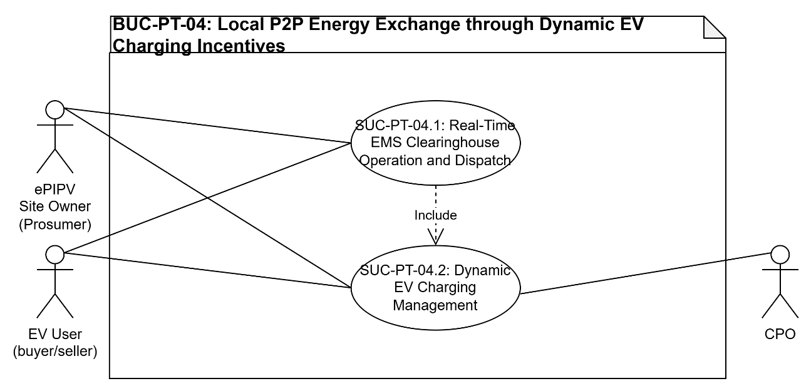
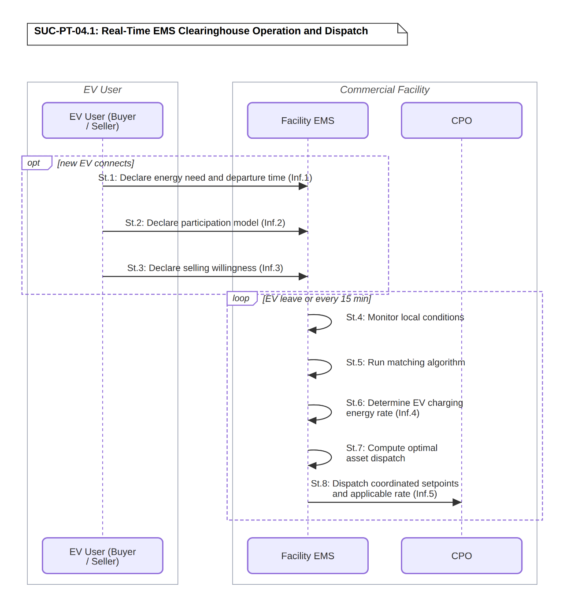
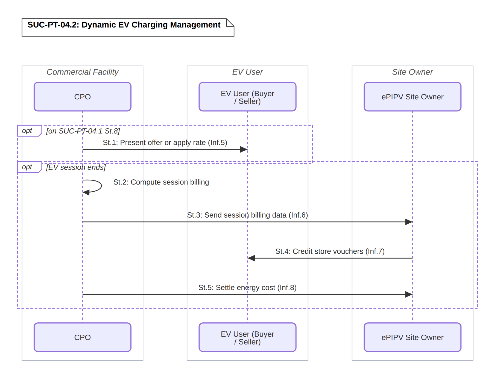

# BUC-PT-04 — Local P2P Energy Exchange through Dynamic EV Charging Incentives

> **SOLAR-MOVE — Portuguese Demonstrator** 
> Business Use Case following the IEC 62559-2 template.

| | |
|---|---|
| **Use Case ID** | BUC-PT-04 |
| **Document** | SOLARMOVE_BUC-PT-04.v1.0 |
| **Version** | v1.0 |
| **Area** | Energy System |
| **Domains** | Customer Premises |
| **Zones** | Process, Field, Station, Operation, Enterprise, Market |
| **Work Package / Task** | WP1 — T1.3 |

**Files in this folder:** [`SOLARMOVE_BUC-PT-04.v1.0.xlsx`](SOLARMOVE_BUC-PT-04.v1.0.xlsx) (IEC 62559-2 tables) · [`SOLARMOVE_BUC-PT-04.v1.0.xml`](SOLARMOVE_BUC-PT-04.v1.0.xml) (IEC 62559-3-style serialization, draft) · [`images/`](images/) (diagrams)

---

## Table of contents

1. [Description of the use case](#1-description-of-the-use-case)
2. [Diagrams of the use case](#2-diagrams-of-the-use-case)
3. [Technical details](#3-technical-details)
4. [Step-by-step analysis of the use case](#4-step-by-step-analysis-of-the-use-case)
5. [Information exchanged](#5-information-exchanged)
6. [Requirements](#6-requirements)
7. [Common terms and definitions](#7-common-terms-and-definitions)

---

## 1. Description of the use case

### 1.1 Name of the use case

| ID | Area / Domain(s) / Zone(s) | Name of Use Case |
|----|----------------------------|------------------|
| BUC-PT-04 | **Area:** Energy System **Domains:** Customer Premises **Zones:** Process, Field, Station, Operation, Enterprise, Market | Local P2P Energy Exchange through Dynamic EV Charging Incentives |

### 1.2 Version management

| Version | Date | Author(s) | Changes |
|---------|------|-----------|---------|
| 1.0 | 20.10.2026 | Alexandre Bento (INESC-ID) | First public version |

### 1.3 Scope and objectives of the use case

#### Scope

This use case covers a local peer-to-peer energy exchange between EV users connected to the charging infrastructure of an ePIPV facility, facilitated by a Facility EMS acting as a local clearinghouse. V2G-capable EV owners who have opted in can offer energy from their vehicle batteries as selling offers, while any EV user can act as a buyer of locally available energy. The facility itself may also participate as a buyer when locally offered energy is cheaper than grid import. The exchange operates in two directions: surplus absorption, in which the facility or V2G-capable EVs offer energy at preferential rates to incentivise EV charging during local surplus or low market price conditions; and demand modulation, in which the facility offers commercial incentives to EV users in exchange for voluntarily accepting reduced charging power during local demand constraint conditions. The Facility EMS matches buyers and sellers and determines dispatch setpoints. Compensation to selling EV owners is provided through commercial store vouchers rather than direct energy payment.

The use case is supported by two System Use Cases: SUC-PT-04.1 (Real-Time EMS Clearinghouse Operation and Dispatch), and SUC-PT-04.2 (Dynamic EV Charging Management).

#### Objectives

- Establish a locally facilitated P2P energy exchange at facility level, where the Facility EMS acts as clearinghouse matching V2G-capable EV sellers with EV buyers, enabling direct bilateral energy transactions without wholesale market intermediation. Demonstrate a V2G-enabled P2P mechanism where EV owners can monetise their vehicle battery flexibility through store voucher compensation, within current regulatory constraints on direct energy sales. Maximise local renewable energy self-consumption and capture value from low or negative market price conditions by directing locally available energy to EV buyers at preferential rates. Manage facility demand constraints through voluntary EV charging modulation, offering commercial incentives to EV users in exchange for flexible charging behaviour.

#### Related business case(s)

_—_

### 1.4 Narrative of the use case

#### Short description

The Facility EMS operates as a local P2P clearinghouse, continuously monitoring local energy conditions (PV generation, commercial facility loads, BESS state-of-charge, market prices, facility connection capacity, and EV session data). Upon connecting to the charging infrastructure, each EV user declares their energy need (expressed in kWh, SOC percentage, or km of range) and departure time. V2G-capable EV owners who have opted in may additionally declare willingness to sell energy from their battery. The Facility EMS continuously matches available selling offers with buying needs, using the grid import price as reference, determines the applicable energy rate, covering matched P2P trades, facility-wide surplus absorption, and demand modulation, and dispatches coordinated charging and discharging setpoints together with that rate to the CPO. The CPO presents or applies the rate to each session; following session end, it computes billing, shares the billing data with the ePIPV Site Owner, who credits store vouchers to V2G sellers, and settles the underlying energy cost with the CPO.

#### Complete description

The ePIPV Site Owner operates a commercial facility equipped with rooftop PV generation, a battery energy storage system (BESS), non-flexible commercial facility loads, and EV charging infrastructure serving both employees and retail customers. The facility hosts a local peer-to-peer energy exchange in which EV users connected to the charging infrastructure act as energy buyers by default, and V2G-capable users who have opted in can additionally act as energy sellers by offering energy from their vehicle batteries. The Facility EMS operates as the local clearinghouse, continuously monitoring energy conditions, matching sellers with buyers, determining the applicable energy rate, and dispatching coordinated charging and discharging setpoints, while ensuring that every EV session meets its declared energy need by the declared departure time. The facility itself may also participate as a buyer when locally offered energy is priced below the current grid import price, making it economically rational to absorb local P2P energy rather than import from the grid. Compensation to selling EV owners is provided through commercial store vouchers rather than direct energy payment.

Participation Models:

Two smart charging participation models coexist at the facility, offering EV users different levels of engagement and corresponding benefits: an opt-out model (on-by-default flexibility), where all EV users who connect participate in smart charging by default, their session subject to power modulation within bounds that guarantee delivery of their declared energy need by departure time, in exchange for a standard rate already reflecting the benefit of optimised local energy use, with unmanaged charging at the standard non-flexible rate available to users who explicitly opt out at session start; and an opt-in model (off-by-default flexibility), where EV users who actively enrol receive dynamic real-time price offers during their session, a preferential rate in surplus or low-price conditions, a commercial incentive in demand-constraint conditions, with participation in each individual offer remaining voluntary, accepted or rejected in real time.

User Declaration and Flexibility Window:

Upon connecting, each EV user declares their energy need and departure time. The energy need may be expressed in kWh, SOC percentage, or km of range depending on the charging interface, and the Facility EMS normalises this to an energy quantity using vehicle data where available. This declaration defines the boundary condition the Facility EMS must respect: the EV must meet its declared energy need by departure time, with all charging and discharging activity within that window flexible and subject to EMS optimisation. V2G-capable EV owners who have opted in may additionally declare the energy volume they are willing to make available for discharge, and the minimum compensation they require, expressed as a voucher value per kWh discharged.

Clearinghouse Matching and Dispatch:

The Facility EMS continuously runs a matching algorithm that pairs available selling offers, from V2G-capable EVs willing to discharge and from the facility itself when it has surplus PV generation or faces low or negative market prices, with buying needs from connected EVs and from the facility itself, which participates as a buyer when locally offered energy is priced below the current grid import price. The applicable energy rate for each transaction is determined within the bounds set by seller minimum compensation and buyer willingness to pay, using the grid import price as the ceiling reference, covering matched P2P trades, facility-wide surplus absorption, and demand modulation as a single unified determination. Once matches and the applicable rate are established, the Facility EMS computes the optimal dispatch and dispatches coordinated setpoints, discharge commands to selling EVs and adjusted charging setpoints to buying EVs, together with the applicable rate, to the CPO, while ensuring all declared departure constraints are respected and redistributing available power across sessions where a demand constraint is active. The Facility EMS continuously re-evaluates matches, rate, and dispatch as new EVs connect, existing sessions end, and energy conditions evolve.

Surplus Absorption Direction:

When local PV generation exceeds commercial facility consumption and BESS headroom is limited, or when wholesale market prices fall to very low or negative levels, the facility's determined energy rate reflects a preferential charging rate, incentivising increased EV charging to absorb the available surplus. V2G-capable EVs that have declared selling willingness contribute additional supply to the local pool. Opt-in users receive a real-time notification of the preferential rate and accept or reject; opt-out users automatically benefit from the adjusted rate. As surplus conditions ease, the continuously re-evaluated rate reverts toward standard levels without requiring a separate action.

Demand Modulation Direction:

When total facility demand approaches the contracted connection capacity limit, when unexpected high EV affluency creates a demand spike, or when unexpectedly low PV generation increases the cost of full EV charging, the Facility EMS's rate determination reflects the required load reduction as a commercial incentive, framed as loyalty programme points, store credit, or an equivalent benefit managed by the ePIPV Site Owner, offered to opt-in users in exchange for voluntarily accepting reduced charging power for the duration of the constraint. Opt-out users have their charging power modulated automatically within the bounds guaranteed by their declared departure constraints, with the Facility EMS redistributing available power across sessions as part of dispatch, distributing reductions across accepting and opt-out users. As the constraint resolves, normal charging power is restored through the same continuous re-evaluation.

Settlement:

Following each session, the CPO computes the session billing, reflecting the applied rate and any dynamic adjustments, and sends the session billing data to the ePIPV Site Owner. Using this data, the ePIPV Site Owner credits selling EV owners with the agreed store voucher compensation to their programme account, proportional to the energy discharged at the matched rate, and, for users who accepted a demand modulation offer, credits the corresponding loyalty incentive. The CPO settles the underlying energy cost with the ePIPV Site Owner through the existing commercial arrangement, reflecting the adjusted energy flows at the facility delivery point.

### 1.5 Key performance indicators (KPI)

| ID | Name | Description | Reference to objectives |
|----|------|-------------|--------------------------|
| U02 | Grid Connection Capacity Needs | Reduction of the grid connection capacity the facility needs to supply its loads and EV charging, through coordinated charging, discharging and modulation of EV sessions. Target: reduce >=25% vs dumb charging | Objective 4 |
| U08 | Willingness to Participate (Flex.) | Share of EV users willing to take part in the local exchange mechanism (selling energy from the vehicle battery, accepting preferential-rate offers and voluntary charging modulation). Target: >=40% | Objectives 1 and 2 |
| U10 | Collective Self-Consumption | Increase of the share of locally generated PV energy that is consumed locally by the facility loads and the EV sessions, including energy exchanged through V2G. Target: >=15% | Objective 3 |
| U11 | Renewables Curtailment Avoidance | Reduction of the PV energy that is curtailed, by directing local surplus to EV charging at preferential rates and to the BESS. Target: >=25% at pilot level | Objective 3 |
| U12 | Peak Consumption Reduction (DR) | Reduction of the facility peak consumption through voluntary EV charging modulation during demand constraint conditions. Target: >=25% vs without management | Objective 4 |
| U14 | Use of DERs in Parking Lots/ePIPVs | Increase in the use of the facility distributed energy resources (PV, BESS and V2G-capable EVs) as flexible assets in the local exchange. Target: increase >=30% | Objective 3 |

### 1.6 Use case conditions

#### Assumptions

1. The ePIPV facility comprises PV generation, BESS, non-flexible facility loads, as well as EV charging infrastructure, all monitored and controlled by a Facility EMS capable of adjusting the operation of each asset in real time.
2. At least a subset of EV users connected to the facility's charging infrastructure own V2G-capable vehicles and are willing to participate as energy sellers in the local P2P exchange.
3. EV users accept that their charging sessions may be subject to smart charging management within bounds that guarantee delivery of their declared energy need by their declared departure time.
4. The store voucher compensation mechanism is sufficiently attractive to incentivise V2G-capable EV owners to participate as sellers and opt-in users to accept demand modulation offers.

#### Prerequisites

1. The Facility EMS receives real-time data from all facility assets (PV generation, BESS state-of-charge, EV charging sessions, non-flexible load measurements).
2. Reliable bi-directional communication exists between the local Facility EMS and the CPO charging management system, allowing real-time exchange of session data, pricing signals, and power setpoints.
3. The EV charging infrastructure supports smart charging (dynamic power setpoint modulation via a charging management protocol) allowing the Facility EMS to adjust individual session charging rates in real time.
4. A loyalty programme and store voucher mechanism are operational and managed by the ePIPV Site Owner.
5. The commercial arrangement between the ePIPV Site Owner and the CPO covers dynamic rate adjustments, V2G session management, and energy cost settlement.

### 1.7 Further information for classification/mapping

**Relation to other use cases.** This BUC operates independently of BUC-PT-01/02/03's day-ahead market optimisation, since it is a local, real-time mechanism that does not participate in wholesale, balancing, or DSO markets.

**Level of depth.** Business use case, detailed down to system use cases (SUC-PT-04.1 and SUC-PT-04.2) and their step-by-step sequences.

**Prioritisation.** High. Demonstrates the local P2P energy exchange with dynamic EV charging incentives, evaluated by Hardware-in-the-Loop on both AC and DC infrastructure at the INESC-ID laboratory.

**Generic, regional or national relation.** The Portuguese pilot analyses this BUC as Hardware-in-the-Loop entirely within the INESC-ID laboratory, using real operational data from the SONAE installation (PV generation, facility loads, BESS state, EV connections) as boundary conditions, with a comparison between AC and DC infrastructure performance. This comparison produces two infrastructure-level indicators, PT-KPI-01 (AC/DC Infrastructure Energy Efficiency) and PT-KPI-02 (DC vs AC Flexibility Capacity Advantage), which compare the two architectures rather than measure the objectives of this BUC. This methodology is specific to the Portuguese pilot's dual-infrastructure design.

**Nature of the use case.** Business use case (local market process).

**Further keywords for classification.** P2P, V2G, local clearinghouse, store vouchers, demand modulation.

### 1.8 General remarks

This BUC is evaluated at the INESC-ID laboratory, which has the capability of testing and emulating both AC and DC infrastructures, using Hardware-in-the-Loop with real operational data from the commercial facility (PV generation, facility loads, BESS state and EV connections) as boundary conditions. The ePIPV facility, comprising PV, BESS, EV charging and non-flexible commercial loads, is managed by a Facility EMS that acts as a local clearinghouse, matching V2G selling offers with buying needs of the connected EVs and determining the applicable energy rate. The CPO applies the rate to each charging session and computes the billing, and the ePIPV Site Owner credits store vouchers to the V2G sellers. The features tested are the declaration of energy need and selling willingness, the clearinghouse matching and rate determination, the coordinated dispatch of charging and discharging setpoints including demand modulation, and the billing, voucher crediting and energy cost settlement. The actors involved are the ePIPV Site Owner, the CPO, the EV Users (buyers and sellers) and the Facility EMS.

---

## 2. Diagrams of the use case

The diagram below illustrates the overall structure of the Business Use Case, showing the actors and the 2 System Use Cases (SUC-PT-04.1, SUC-PT-04.2) that realise it.

  

<em><b>Figure 1.</b> BUC-PT-04 — Local P2P Energy Exchange through Dynamic EV Charging Incentives (use case diagram).</em>

---

## 3. Technical details

### 3.1 Actors

| Actor Name | Actor Type | Actor Description | Further information specific to this use case |
|------------|------------|-------------------|-----------------------------------------------|
| **ePIPV Site Owner** | Business | Entity that owns and operates the ePIPV facility and its distributed energy resources; operates the local P2P clearinghouse programme; manages the loyalty programme; credits store vouchers to V2G sellers and loyalty incentives to demand modulation participants; participates as energy buyer when local P2P price is below grid import price | SONAE MC |
| **CPO** | Business | Charge Point Operator: party that operates the EV charging infrastructure; receives dispatched setpoints and the applicable EV charging energy rate from the Facility EMS; presents or applies the rate to EV users at the charging interface; computes session billing; sends session billing data to the ePIPV Site Owner; settles energy costs with the ePIPV Site Owner | Elergone |
| **EV User (Buyer / Seller)** | Business | EV user who connects to the facility's charging infrastructure; declares energy need and departure time upon connecting, and participates under the opt-out model by default or actively enrols in the opt-in model, receiving and responding to dynamic rate or incentive offers as a buyer. V2G-capable users who have opted in may additionally declare willingness to discharge, acting as a seller and providing energy to the local P2P pool in exchange for store voucher compensation. | SONAE store customer / employee |
| **Facility EMS** | System | System that monitors local energy conditions and market prices; runs the clearinghouse matching algorithm; determines the applicable EV charging energy rate; computes optimal asset dispatch; dispatches coordinated charging and discharging setpoints together with the applicable rate to the CPO | INESC-ID |

### 3.2 References

_References (standards, reports, mandates and regulatory constraints) associated with the use case._

| No. | Reference Type | Reference | Status | Impact on use case | Originator / organisation | Link |
|-----|----------------|-----------|--------|--------------------|---------------------------|------|
| | | | | | | |

---

## 4. Step-by-step analysis of the use case

### 4.1 Overview of scenarios

| No. | Scenario name | Scenario description | Primary actor | Triggering event | Pre-condition | Post-condition |
|-----|---------------|----------------------|---------------|------------------|---------------|----------------|
| 1 | Real-Time EMS Clearinghouse Operation and Dispatch (SUC-PT-04.1) | EV users declare needs and selling willingness on connection; Facility EMS continuously monitors conditions, matches offers with needs, determines the applicable energy rate, computes optimal dispatch, and dispatches coordinated setpoints. | Facility EMS | EV connects / EV disconnects / every 15 minutes | Charging infrastructure available | Coordinated setpoints and applicable rate dispatched to CPO |
| 2 | Dynamic EV Charging Management (SUC-PT-04.2) | CPO presents or applies the dispatched rate to EV sessions; following session end, computes billing, shares billing data with the ePIPV Site Owner, who credits store vouchers to V2G sellers and to users who accepted demand modulation offers, and settles the underlying energy cost with the CPO. | CPO | Triggered by SUC-PT-04.1 step 1.8 / EV session ends | Setpoints and rate dispatched (SUC-PT-04.1) | Session billed; billing data shared; vouchers credited; energy cost settled |

### 4.2 Steps – Scenarios

#### 4.2.1 Real-Time EMS Clearinghouse Operation and Dispatch (SUC-PT-04.1)

| Step No. | Event | Name of process / activity | Description of process / activity | Service | Information producer | Information receiver | Information exchanged (IDs) | Requirement, R-IDs |
|----------|-------|----------------------------|-----------------------------------|---------|----------------------|----------------------|-----------------------------|--------------------|
| 1.1 | New EV connects | Declare energy need and departure time | EV user declares energy need (kWh/SOC/km) and departure time upon connecting. (Trigger: new EV connects) | REPORT | EV User | Facility EMS | Inf.1 | R-SC-01, R-SC-02, R-UI-02, R-UI-04, R-CYB-06 |
| 1.2 | Energy need declared | Declare participation model | EV user is enrolled under opt-out by default, or actively enrols in opt-in. | REPORT | EV User | Facility EMS | Inf.2 | R-SC-08, R-UI-02, R-UI-04 |
| 1.3 | Participation model declared | Declare selling willingness | V2G-capable EV owner (opted in) declares energy volume available for discharge and minimum compensation per kWh. | REPORT | EV User | Facility EMS | Inf.3 | R-SC-06, R-UI-02, R-UI-04, R-CYB-06 |
| 1.4 | EV leaves or 15-min tick | Monitor local conditions | Facility EMS monitors PV, load, BESS SoC, market prices, connection capacity, and EV session data. (Loop: EV leave or every 15 min) | GET | Facility EMS | Facility EMS | – | R-DAT-01, R-DAT-02, R-EMS-01 |
| 1.5 | Local conditions read | Run matching algorithm | Facility EMS matches selling offers (V2G, facility surplus) with buying needs, using grid import price as reference. | EXECUTE | Facility EMS | Facility EMS | – | R-MKT-07, R-EMS-02, R-FOR-05 |
| 1.6 | Offers matched | Determine EV charging energy rate | Facility EMS determines the applicable EV charging energy rate, covering matched P2P trade prices, facility-wide surplus absorption rates, and demand modulation incentives, within seller/buyer bounds and capped at grid import price where applicable. | CREATE | Facility EMS | Facility EMS | Inf.4 | R-EMS-03, R-MKT-07, R-UI-03 |
| 1.7 | Rate determined | Compute optimal asset dispatch | Facility EMS computes optimal BESS, EV charging, and PV dispatch setpoints from the matched trade prices and current facility conditions (PV surplus, grid import price, BESS discharge cost). | CREATE | Facility EMS | Facility EMS | – | R-EMS-03, R-EMS-04, R-FOR-05, R-RTC-01 |
| 1.8 | Dispatch computed | Dispatch coordinated setpoints and applicable rate | Facility EMS dispatches discharge commands to sellers and adjusted charging setpoints to buyers, respecting departure constraints, together with the applicable energy rate; redistributes available power across sessions where a demand constraint is active. | CHANGE | Facility EMS | CPO | Inf.5 | R-EMS-02, R-RTC-01, R-RTC-03, R-RTC-06, R-SC-03, R-SC-06, R-SAF-01, R-SAF-07 |

  

<em><b>Figure 2.</b> SUC-PT-04.1 — Real-Time EMS Clearinghouse Operation and Dispatch (sequence diagram).</em>

#### 4.2.2 Dynamic EV Charging Management (SUC-PT-04.2)

| Step No. | Event | Name of process / activity | Description of process / activity | Service | Information producer | Information receiver | Information exchanged (IDs) | Requirement, R-IDs |
|----------|-------|----------------------------|-----------------------------------|---------|----------------------|----------------------|-----------------------------|--------------------|
| 2.1 | Rate dispatched | Present offer or apply rate | CPO presents or applies the dispatched EV charging energy rate to the session (opt-in: notification/accept-reject; opt-out: automatic). (Triggered by SUC-PT-04.1 step 1.8) | REPORT | CPO | EV User | Inf.5 | R-UI-02, R-UI-03, R-SC-08, R-COM-08 |
| 2.2 | EV session ends | Compute session billing | CPO computes session billing reflecting the applied rate and any dynamic adjustments. (Trigger: EV session ends) | CREATE | CPO | CPO | – | R-MVR-03, R-UI-03 |
| 2.3 | Session billing computed | Send session billing data | CPO sends session billing data to the ePIPV Site Owner. | REPORT | CPO | ePIPV Site Owner | Inf.6 | R-COM-01, R-CYB-03, R-MVR-05 |
| 2.4 | Billing data received | Credit store vouchers | ePIPV Site Owner credits store voucher compensation to V2G sellers' programme accountsand the loyalty incentive to users who accepted a demand modulation offer, based on the received billing data. | REPORT | ePIPV Site Owner | EV User | Inf.7 | R-UI-07, R-MVR-07, R-COM-01 |
| 2.5 | Vouchers credited | Settle energy cost | CPO settles the energy cost with the ePIPV Site Owner through the existing commercial arrangement. | REPORT | CPO | ePIPV Site Owner | Inf.8 | R-MKT-08, R-MVR-05, R-COM-01 |

  

<em><b>Figure 3.</b> SUC-PT-04.2 — Dynamic EV Charging Management (sequence diagram).</em>

---

## 5. Information exchanged

| Information exchanged (ID) | Name of information | Description of information exchanged | Requirement, R-IDs |
|----------------------------|---------------------|--------------------------------------|--------------------|
| Inf.1 | EV declaration | Energy need (kWh/SOC/km), departure time | R-SC-02, R-UI-04, R-CYB-06 |
| Inf.2 | Participation model declaration | Opt-in or opt-out enrolment status | R-SC-08, R-UI-04 |
| Inf.3 | Selling declaration | Available discharge volume (kWh), minimum compensation (€/kWh) | R-SC-06, R-UI-04, R-CYB-06 |
| Inf.4 | Match result | Matched buyer/seller pairs, quantity (kWh), matched price | R-MKT-07, R-DAT-03 |
| Inf.5 | Dispatch setpoints and rate | Charging/discharging power setpoints per session, together with the applicable EV charging energy rate | R-EMS-03, R-RTC-01, R-UI-03 |
| Inf.6 | Session billing data | Session ID, energy charged/discharged (kWh), applicable rate, dynamic rate adjustments applied | R-MVR-03, R-MVR-05, R-DAT-02 |
| Inf.7 | Voucher credit | EV owner account ID, voucher value, energy discharged or modulated | R-UI-07, R-MVR-07 |
| Inf.8 | Energy cost settlement | Net energy flows at delivery point, settlement amount | R-MKT-08, R-MVR-05 |

---

## 6. Requirements

### CAT-02 — Energy Management System capabilities
_Contains requirements related to EMS functionalities and capabilities_

| R-ID | Name | Description |
|------|------|-------------|
| R-EMS-01 | Unified site and cluster model | The EMS shall maintain a unified operational model of all connected sites, clusters and controllable assets, including current status, constraints and relationships. |
| R-EMS-02 | Multi-asset orchestration | The EMS shall coordinate EV charging, PV generation, BESS operation, controllable loads and grid exchange within the applicable pilot boundary. |
| R-EMS-03 | Schedule and setpoint generation | The EMS shall translate optimisation results and external commitments into asset-level schedules, limits and setpoints. |
| R-EMS-04 | Constraint enforcement | The EMS shall prevent dispatch that violates grid connection limits, asset limits, user requirements, mobility-service constraints or contracted reserve obligations. |

### CAT-03 — Smart charging, V2G and mobility-service constraints
_The charging infrastructure functionalities and capabilities_

| R-ID | Name | Description |
|------|------|-------------|
| R-SC-01 | Charging-session detection | The charging system shall detect and report EV connection, authorisation, session start, active charging, suspension, completion and disconnection events. |
| R-SC-02 | Charging requirement capture | The system shall capture, where available, initial SoC, target SoC or energy need, departure time, vehicle type and priority class for each managed session. |
| R-SC-03 | Dynamic charging control | The charging infrastructure shall accept remote time-based charging profiles or dynamic power limits for individual EVSEs or sessions. |
| R-SC-06 | V2G enablement | For V2G-capable sessions, the system shall support controlled discharge subject to user consent, minimum departure SoC, vehicle limits and compensation conditions. |
| R-SC-08 | Opt-in and opt-out enforcement | The charging system shall apply the selected participation model and shall not modulate or discharge a session beyond the permissions granted by the user. |

### CAT-04 — Communications and connectivity
_Collection of requirements to enable reliable communication_

| R-ID | Name | Description |
|------|------|-------------|
| R-COM-01 | Bidirectional communications | Bidirectional communication shall be available wherever both telemetry and remote control are required between assets, EMS, CSMS, BMS, VPP and external platforms. |
| R-COM-08 | User-channel connectivity | Web and mobile interfaces shall support reliable exchange of authentication, charging preferences, prices, offers and participation decisions. |

### CAT-05 — Data acquisition, quality and storage
_Requirements for common data management mechanisms_

| R-ID | Name | Description |
|------|------|-------------|
| R-DAT-01 | Operational telemetry acquisition | The platform shall acquire EVSE, PV, BESS, meter, site-load, weather and mobility data required by the applicable use case. |
| R-DAT-02 | Common timestamping | All operational records shall contain timestamps referenced to a common time base and include timezone or UTC information. |
| R-DAT-03 | Data validation | Incoming data shall be checked for missing values, staleness, invalid ranges, inconsistent units and implausible changes before use in control or settlement. |

### CAT-07 — Forecasting and optimisation
_Contains requirements enabling reliable predictive capabilities_

| R-ID | Name | Description |
|------|------|-------------|
| R-FOR-05 | Constraint-aware optimisation | Optimisation shall include asset power and energy limits, grid limits, charging deadlines, reserve commitments, load constraints and permissible PV curtailment. |

### CAT-08 — Real-time control and performance
_Group of requirements enabling near-real-time control to maintain grid compliance and track market or operational commitments_

| R-ID | Name | Description |
|------|------|-------------|
| R-RTC-01 | Defined control cycle | Each real-time control function shall operate at a documented cycle time appropriate to its use case and shall complete calculation and dispatch within that cycle. |
| R-RTC-03 | Dynamic power redistribution | When available power changes, the EMS shall redistribute power among active chargers, BESS and controllable loads according to current constraints and priorities. |
| R-RTC-06 | Setpoint execution verification | The platform shall verify actual response after dispatch and identify partial, late or failed execution. |

### CAT-10 — Market, aggregator and external platform integration
_Group of requirements ensuring integration into electricity and flexibility markets_

| R-ID | Name | Description |
|------|------|-------------|
| R-MKT-07 | Local P2P matching | The Facility EMS shall match eligible local sellers and buyers subject to seller minimum compensation, buyer willingness to pay, grid-price reference and technical feasibility. |
| R-MKT-08 | Settlement result exchange | The external-platform interface shall exchange delivered quantities, prices, penalties, imbalance results and remuneration components with the responsible party. |

### CAT-11 — Metering, verification, settlement and KPI reporting
_Group of requirements providing grounds for operational control and project and market outcomes validation_

| R-ID | Name | Description |
|------|------|-------------|
| R-MVR-03 | Session metering | Each charging or V2G session shall record start and end meter values, energy transferred, timestamps and session identifier. |
| R-MVR-05 | Settlement-grade audit trail | Measurements used for financial settlement shall be immutable or tamper-evident, timestamped and traceable through all processing steps. |
| R-MVR-07 | Delivery report | The system shall generate reports comparing requested, scheduled and actual power/energy for each flexibility or market event. |

### CAT-12 — Cybersecurity, privacy and access control
_Group of requirements ensuring secure and privacy-preserving access to services and provide resilient operation of infrastructure_

| R-ID | Name | Description |
|------|------|-------------|
| R-CYB-03 | Encryption in transit | All communications crossing device, site, cloud or organisational trust boundaries shall use appropriate encryption in transit. |
| R-CYB-06 | Personal-data minimisation | The platform shall collect and retain only the personal and mobility data necessary for the declared service and shall apply access and retention controls. |

### CAT-13 — Safety, fault handling and recovery
_Group of requirements ensuring control platform never overrides asset or mobility safety constraints_

| R-ID | Name | Description |
|------|------|-------------|
| R-SAF-01 | Asset safety-envelope enforcement | No EMS, CSMS or market command shall exceed the validated electrical, thermal, SoC, ramp-rate or manufacturer limits of an asset. |
| R-SAF-07 | Battery protection | BESS and vehicle charging/discharging shall respect BMS-reported SoC, SoH, temperature and fault limits at all times. |

### CAT-14 — User interfaces, pricing and participation management
_Group of requirements to ensure intuitive user interfaces, transparent pricing and participation management_

| R-ID | Name | Description |
|------|------|-------------|
| R-UI-02 | Charging-user interface | EV users shall be able to view session status and enter or confirm energy need, departure time and participation preference where required. |
| R-UI-03 | Transparent price presentation | Any dynamic tariff, preferential rate, voucher value or flexibility incentive shall be presented before user acceptance with applicable conditions. |
| R-UI-04 | Participation consent record | The system shall record opt-in, opt-out, V2G consent, offer acceptance and withdrawal with user/session identifier and timestamp. |
| R-UI-07 | Voucher and loyalty integration | The platform shall issue and track voucher or loyalty compensation linked to verified V2G delivery or accepted charging modulation. |

---

## 7. Common terms and definitions

_Relevant terms belonging to this use case are listed here; these should ultimately be consolidated in a common glossary shared across all SOLAR-MOVE use cases._

| Term | Definition |
|------|------------|
| Local clearinghouse | Role of the Facility EMS in this BUC: it matches the selling offers of V2G-capable EVs and of the facility with the buying needs of the connected EVs and determines the applicable energy rate, without wholesale market intermediation. |
| Store voucher | Commercial compensation credited by the ePIPV Site Owner to the programme account of EV users, provided instead of a direct energy payment. |
| Demand modulation | Voluntary acceptance by EV users of a reduced charging power during local demand constraint conditions, in exchange for a store voucher. |

---

Based on `SOLARMOVE_BUC-PT-04.docx`, following the IEC 62559-2 use case template. UML use case and sequence diagrams are included as Figures 1–3 (see `images/`).

Licensed under [CC BY 4.0](../LICENSE). Funded by the European Union under Grant Agreement No. 101235635 (SOLAR-MOVE). Views and opinions expressed are however those of the author(s) only and do not necessarily reflect those of the European Union or CINEA. Neither the European Union nor the granting authority can be held responsible for them.
