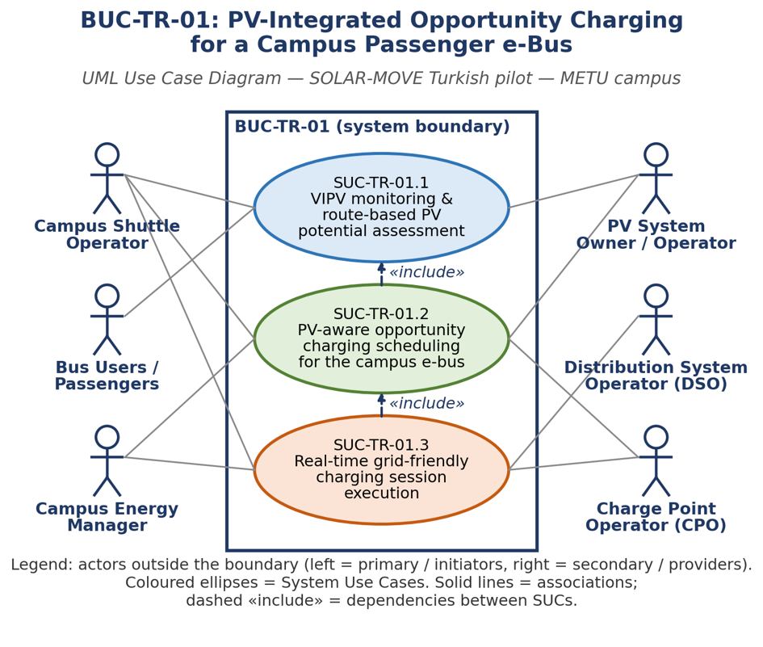
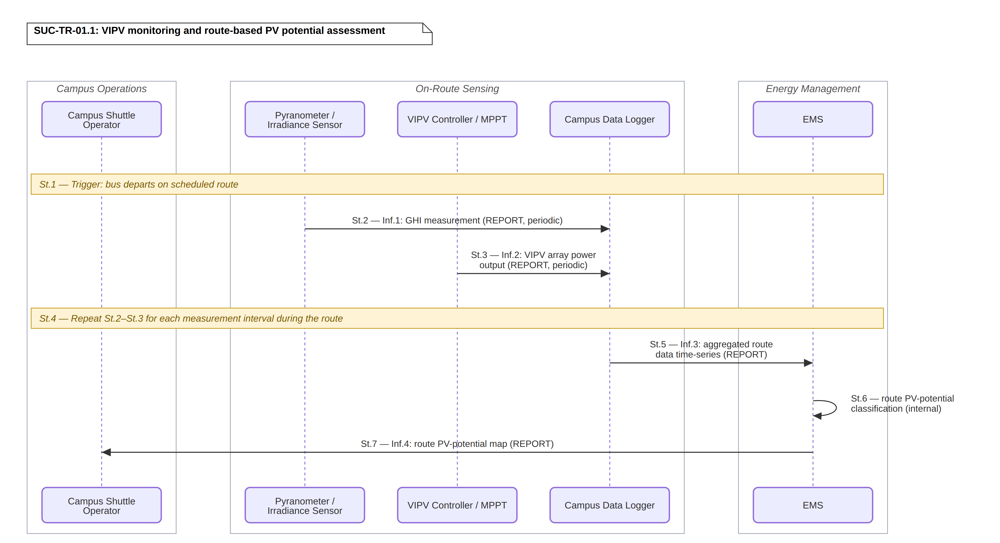
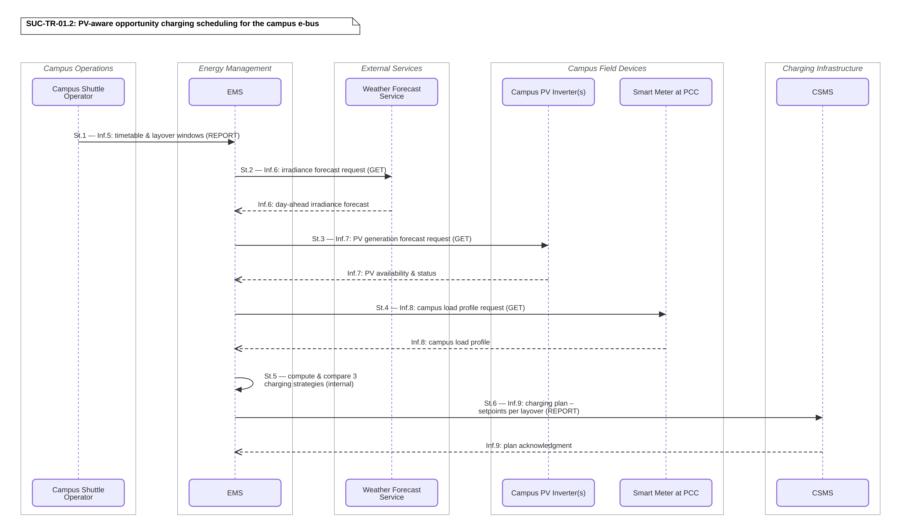
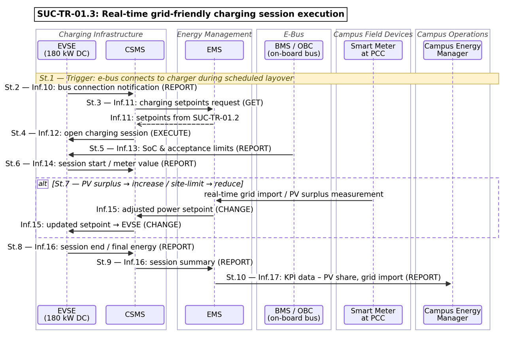

# BUC-TR-01 — PV-Integrated Opportunity Charging for a Campus Passenger e-Bus

> **SOLAR-MOVE — Turkish Demonstrator** 
> Business Use Case following the IEC 62559-2 template.

| | |
|---|---|
| **Use Case ID** | BUC-TR-01 |
| **Document** | SOLARMOVE_BUC-TR-01.v1.0 |
| **Version** | v1.0 |
| **Area** | Energy System |
| **Domains** | Distribution System, DER, Customer Premises |
| **Zones** | Field, Station, Operation, Enterprise |
| **Work Package / Task** | WP1 — T1.3 |

**Files in this folder:** [`SOLARMOVE_BUC-TR-01.v1.0.xlsx`](SOLARMOVE_BUC-TR-01.v1.0.xlsx) (IEC 62559-2 tables) · [`SOLARMOVE_BUC-TR-01.v1.0.xml`](SOLARMOVE_BUC-TR-01.v1.0.xml) (IEC 62559-3-style serialization, draft) · [`images/`](images/) (diagrams)

---

## Table of contents

1. [Description of the use case](#1-description-of-the-use-case)
2. [Diagrams of the use case](#2-diagrams-of-the-use-case)
3. [Technical details](#3-technical-details)
4. [Step-by-step analysis of the use case](#4-step-by-step-analysis-of-the-use-case)
5. [Information exchanged](#5-information-exchanged)
6. [Requirements](#6-requirements)
7. [Common terms and definitions](#7-common-terms-and-definitions)

---

## 1. Description of the use case

### 1.1 Name of the use case

| ID | Area / Domain(s) / Zone(s) | Name of Use Case |
|----|----------------------------|------------------|
| BUC-TR-01 | **Area:** Energy System **Domains:** Distribution System, DER, Customer Premises **Zones:** Field, Station, Operation, Enterprise | PV-Integrated Opportunity Charging for a Campus Passenger e-Bus |

### 1.2 Version management

| Version | Date | Author(s) | Changes |
|---------|------|-----------|---------|
| 1.0 | 20.10.2026 | METU | First public version |

### 1.3 Scope and objectives of the use case

#### Scope

This use case covers the business-level coordination and commercial viability of operating a passenger e-bus on the METU campus using opportunity charging supported by local photovoltaic generation and campus energy management. It includes shuttle operation, charging during short layovers, coordination with campus electrical demand and grid limits, evaluation of VIPV/ePIPV operational value, and assessment of the business case for scaling opportunity charging to further e-buses and to other campus or municipal shuttle fleets. It excludes detailed control algorithms, communication protocols, hardware design details, step-by-step system interactions, and detailed financial/contractual modelling. Concrete pilot parameters: the METU campus ring shuttle service (eight shuttle routes, operating 08:00-20:30), a 180 kW DC fast charger, and local campus PV assets rated at 50 kW, 200 kW, 220 kW and 230 kW located near the served routes.

#### Objectives

- Maintain reliable campus shuttle service while enabling opportunity charging during layovers.
- Increase the use of local PV and reduce grid dependency for bus charging.
- Limit the impact of charging on campus electrical infrastructure by respecting site constraints.
- Generate pilot evidence for scalable VIPV/ePIPV deployment in passenger-bus applications.
- Improve the cost-efficiency of e-bus operation (energy cost per trip/km, reduced dependence on large onboard batteries) and provide evidence to support the scalability and replicability of the opportunity-charging model to additional e-buses, campus routes, and municipal shuttle fleets.

#### Related business case(s)

The underlying commercial rationale is the Business Plan "Passenger VIPV Bus" led by Bozankaya: investing in PV-integrated opportunity charging is expected to reduce onboard-battery size and grid-charging costs while extending range and reducing service disruption, supporting municipalities and public transport operators in the business case for procuring VIPV/opportunity-charging solutions instead of overnight-only depot charging. The BUC therefore also serves as the evidence base to answer, at pilot level, whether this investment mitigates operational/financial risk (grid demand charges, battery degradation, oversized batteries) and creates a replicable, capital-saving alternative for campus and municipal shuttle fleets. For a list of related System/Business Use Cases, see Section 1.7 ("Relation to other use cases").

#### System Use Cases (SUCs) in scope

Three System Use Cases (SUCs) detail this BUC and are within scope (see the BUC-TR-01 use case diagram and the SUC sequence diagrams):

SUC-TR-01.1 – VIPV monitoring and route-based PV potential assessment

SUC-TR-01.2 – PV-aware opportunity charging scheduling for the campus e-bus

SUC-TR-01.3 – Real-time grid-friendly charging session execution

### 1.4 Narrative of the use case

#### Short description

This use case addresses the coordinated opportunity charging of a passenger e-bus operating on the METU campus within the SOLAR-MOVE Turkish pilot. The bus charges during short layovers instead of depending only on overnight charging. Charging is coordinated with local PV availability, campus electrical demand, battery readiness, and timetable needs so that mobility service is maintained while grid dependency is reduced.

#### Complete description

METU operates a campus shuttle service with recurrent short stops between trips. In this use case, a passenger e-bus is charged during those idle windows using a PV-linked charging concept rather than relying only on depot charging. The purpose is to keep the shuttle service reliable and available for students and visitors while making better use of local renewable energy and containing the cost and infrastructure burden of electrifying the fleet.  Problem: relying on overnight-only depot charging requires large, heavy onboard batteries that reduce passenger capacity, increase vehicle wear, and force high peak grid draw at night when local solar is zero. Conversely, uncoordinated daytime opportunity charging can drive high capacity-related grid charges (the EPDK power charge, billed monthly on the contracted connection power at the campus PCC) that exceed campus site limits and accelerate battery degradation through unmanaged, frequent micro-charging. Local PV generation, on its own, cannot guarantee charging availability without intelligent buffer management and predictive scheduling. Solution: this use case coordinates opportunity charging during layovers with PV availability, campus load, and battery readiness. Value: it aims to maintain shuttle reliability, increase renewable electricity use, reduce grid energy consumption and demand charges, extend battery life, and create pilot evidence that is replicable by other closed-loop institutional microgrids (e.g., airports, hospitals, and corporate campuses) operating on predictable timetables..  At business level, the Campus Shuttle Operator, Charge Point Operator, Campus Energy Manager, and EMS coordinate when charging should take place, how local PV should be used, and when grid energy is needed. The use case supports the comparison of charging approaches such as fixed-interval opportunity charging, PV-aligned charging, and overnight charging baselines, each assessed against: service reliability, PV share in charging energy, grid energy imported, peak demand impact, battery readiness, operational cost, and suitability for replication.  Service value: because the primary asset of the Campus Shuttle Operator is passenger mobility, the opportunity-charging strategy is also assessed against timetable adherence, trip completion, waiting time/service disruption, and passenger demand, so that the use case remains service-oriented and not purely energy-oriented.  Link between BUC objectives and the SUCs:  - SUC-TR-01.1 (VIPV monitoring and route-based PV potential assessment) supports the objective of generating pilot evidence for scalable VIPV/ePIPV deployment.  - SUC-TR-01.2 (PV-aware opportunity charging scheduling) supports the objectives of increasing local-PV use / reducing grid dependency and improving cost-efficiency.  - SUC-TR-01.3 (real-time grid-friendly charging session execution) supports the objectives of maintaining reliable shuttle service and limiting the impact of charging on campus electrical infrastructure.  The pilot also supports collection of route-related solar irradiance and passenger-demand information so that routes can be assessed for future VIPV deployment. The expected result is a service-oriented and grid-friendly charging approach that improves renewable self-consumption, reduces charging from the grid, and creates evidence for replication in other campus or municipal shuttle systems.

### 1.5 Key performance indicators (KPI)

| ID | Name | Description | Reference to objectives |
|----|------|-------------|--------------------------|
| KPI-01 | Service continuity / trip completion rate | Share of scheduled shuttle trips completed without energy-related interruption. No direct GA-level KPI equivalent; retained as a pilot-specific KPI (same treatment as KPI-05). Baseline: diesel-shuttle / pre-pilot service-reliability record on the same route and timetable. | Maintain reliable campus shuttle service while enabling opportunity charging during layovers. |
| KPI-02 | Local PV utilization for bus charging | Energy supplied to the bus from local PV, or the share of charging demand covered by PV. GA KPI mapping: U14 - Use of DERs in Parking Lots (target ≥30%, ER ref.) / . Baseline: non-PV-aware fixed-interval opportunity charging and overnight depot charging. | Increase the use of local PV and reduce grid dependency for bus charging. |
| KPI-03 | Grid energy imported for charging | Total grid energy used for bus charging over the operating period. GA KPI mapping: U17 - Self-Consumption (increase ≥25%, inverse framing of grid import). Baseline: overnight depot charging (100% grid-sourced) and non-PV-aware fixed-interval opportunity charging. | Increase the use of local PV and reduce grid dependency for bus charging. |
| KPI-04 | Infrastructure constraint compliance | Number or share of time periods in which charger and site electrical limits are respected. GA KPI mapping: U07 - Constraints Violation Occurrence (decrease ≥15%). Baseline: uncoordinated / fixed-interval charging without site-limit awareness. | Limit the impact of charging on campus electrical infrastructure by respecting site constraints. |
| KPI-05 | Battery readiness for next service window | Ability to meet the required terminal or next-shift battery readiness target. No direct GA-level KPI equivalent; retained as a pilot-specific KPI. Baseline: manufacturer-nominal end-of-day SoC under overnight-only charging. | Maintain reliable campus shuttle service while enabling opportunity charging during layovers; limit the impact on campus electrical infrastructure. |
| KPI-06 | Flexibility potential | Estimated flexibility that the VIPV + opportunity-charging setup can offer to campus/grid energy management (shiftable charging power/energy). GA KPI mapping: U06 - Flexibility Potential (increase ≥25%). Baseline: fixed, non-flexible overnight depot-charging schedule. | Increase the use of local PV and reduce grid dependency for bus charging; support cost-efficiency and scalability. |
| KPI-07 | Peak consumption reduction (demand response) | Reduction of campus peak electrical demand attributable to bus charging, compared to unmanaged charging. GA KPI mapping: U12 - Peak Consumption Reduction (DR) (≥25% vs. without management). Baseline: fixed-interval / uncoordinated opportunity charging without PV or site-limit awareness. | Limit the impact of charging on campus electrical infrastructure by respecting site constraints. |
| KPI-08 | Operation cost (ePIPV / bus charging) | Energy cost of charging the e-bus (per trip / per km / per operating period), reflecting PV-aware scheduling versus non-optimal charging. GA KPI mapping: U04 - Operation Cost (ePIPV) (reduce ≥25% vs. non-optimal). Baseline: non-optimal / fixed-interval charging without PV-aware scheduling. | Improve the cost-efficiency of e-bus operation and provide evidence to support the scalability and replicability of the opportunity-charging model. |

_Note on GA KPI harmonisation: KPI-02, KPI-03 and KPI-04 are remapped to GA-level KPIs U14, U17 and U07 respectively. KPI-06, KPI-07 and KPI-08 are new pilot KPIs added to align with the GA-level KPIs U06 (Flexibility Potential), U12 (Peak Consumption Reduction) and U04 (Operation Cost), consistent with the SOLAR-MOVE Homogenized KPI matrix. KPI-01 (trip completion rate) was reviewed against a possible remapping to U16 (Number of Services for ePIPV Participation); METU confirmed these measure different things - KPI-01 tracks completion of scheduled bus trips, while U16 tracks the number of grid/market services an ePIPV offers - so KPI-01 is retained as a pilot-specific KPI with no GA equivalent, the same treatment applied to KPI-05 (Battery Readiness)._

### 1.6 Use case conditions

#### Assumptions

- The shuttle service follows a predefined timetable with identifiable layovers suitable for opportunity charging. - The e-bus, charger, and campus energy-management systems remain available and reliably operational throughout the operating day (continuous uptime of commissioned assets, not their initial availability). - The data streams from PV, load, and metering systems perform with sufficient accuracy, latency, and completeness to support charging decisions (technical performance of the data stream, not its existence, which is established as a prerequisite). - Solar irradiance and weather-forecast errors remain within thresholds manageable by the EMS. - The external grid connection maintains standard voltage and frequency. - Campus traffic and passenger-load variations do not introduce extreme deviations from the assumed timetable and layover durations.

#### Prerequisites

- Passenger e-bus and opportunity charging point are commissioned for pilot operation. - Route, timetable, charging windows, and battery operating limits are defined by the operator. - Access to campus PV and site electrical measurements is established. - Roles and responsibilities are agreed among the shuttle operator, CPO, campus energy manager, and pilot partners.

### 1.7 Further information for classification/mapping

**Relation to other use cases.** Linked to the SOLAR-MOVE Turkish pilot VIPV passenger-bus demonstration, PV potential estimation for routes (SOL11/SOL12), optimal operation of ePIPV systems (SOL15/SOL16), and to the "Passenger VIPV Bus" business plan led by Bozankaya.

**Level of depth.** BUC (Business Use Case)

**Prioritisation.** High

**Generic, regional or national relation.** Pilot-specific / regional (Turkey - METU campus), with replication potential for Closed-Loop Institutional Microgrids sharing METU's operating profile. Two core replication archetypes are identified: (i) airport terminal-shuttle systems with large hangar/terminal PV, and (ii) corporate or hospital campus shuttle systems with high daytime predictability. Replicability depends on predictable timetables and sufficient layover durations; sites without regular scheduled breaks are not expected to support the opportunity-charging business model.

**Nature of the use case.** Business use case for PV-integrated electric mobility and smart charging.

**Further keywords for classification.**

e-bus, opportunity charging, VIPV, ePIPV, campus microgrid, photovoltaic integration, smart charging, EMS

***Scalability blueprint***

Scalability is defined as extending the opportunity-charging model beyond the single pilot e-bus. Scalability assumptions: additional e-buses on the METU campus; other campus shuttle routes; municipal shuttle systems; sites with PV and layover patterns similar to METU; sites with comparable charger and grid constraints. Scalability conditions: predictable timetables; sufficient layover duration; suitable charger power; adequate PV availability; access to route and passenger-demand data; and campus/site energy-management capability.

### 1.8 General remarks

This first iteration intentionally keeps the use case at business level. Detailed scenarios, information exchanges, and requirements should be completed during the SUC phase.

---

## 2. Diagrams of the use case

The diagram below illustrates the overall structure of the Business Use Case, showing the actors and the 3 System Use Cases (SUC-TR-01.1, SUC-TR-01.2, SUC-TR-01.3) that realise it.

  

<em><b>Figure 1.</b> BUC-TR-01 — PV-Integrated Opportunity Charging for a Campus Passenger e-Bus (use case diagram).</em>

---

## 3. Technical details

### 3.1 Actors

| Actor Name | Actor Type | Actor Description | Further information specific to this use case |
|------------|------------|-------------------|-----------------------------------------------|
| **Campus Shuttle Operator** | Business | Entity responsible for planning and operating the campus passenger-bus service. | Defines timetable, service continuity needs, and vehicle availability. |
| **Charge Point Operator (CPO)** | Business | Entity responsible for operation and availability of the opportunity charging point. | Ensures charger access, status, maintenance, and charging-service provision. |
| **Energy Management System (EMS)** | System | System that coordinates charging decisions using service schedule, PV availability, campus demand, and battery constraints. | Supports PV-aware and grid-friendly charging strategies. |
| **Campus Energy Manager / Facility Operator** | Business | Entity responsible for campus electrical infrastructure, local PV assets, and site-level operational constraints. | Provides site limits, campus-load context, and operational priorities. |
| **PV System Operator / Owner** | Business | Entity responsible for operation and performance of local PV assets used in the pilot. | Provides generation availability, maintenance status, and performance information. |
| **Bus Users / Passengers** | Business | End users of the campus shuttle service whose mobility needs must be met. | Service continuity and timetable adherence are critical from their point of view. |
| **Distribution System Operator (DSO)** | Business | External grid operator supplying the campus distribution connection. | Relevant for grid-impact assessment and future flexibility-service extensions. |
| **Charging Station Management System (CSMS)** | System | Back-end system managing the charging station; mediates between the EMS charging plan and the EVSE and records session data. | Appears in the SUC-TR-01.2 and SUC-TR-01.3 sequence diagrams; receives the charging plan and relays setpoints and session events. |
| **Electric Vehicle Supply Equipment (EVSE)** | System | The 180 kW DC charging station that delivers power to the e-bus and applies power setpoints during a session. | Appears in the SUC-TR-01.3 sequence diagram; opens/closes the charging session and applies adjusted power setpoints. |
| **Weather Forecast Service** | System | External service providing day-ahead irradiance and weather forecasts used for charging scheduling. | Appears in the SUC-TR-01.2 sequence diagram; supplies the irradiance forecast on request from the EMS. |
| **Campus PV Inverter(s)** | System | Inverter(s) of the local campus PV plant reporting generation availability and status. | Appears in the SUC-TR-01.2 sequence diagram; provides PV generation forecast and availability to the EMS. |
| **Smart Meter at PCC** | System | Metering device at the Point of Common Coupling (PCC) measuring campus import/export and load at the grid connection. | Appears in the SUC-TR-01.2 and SUC-TR-01.3 sequence diagrams; provides the campus load profile and real-time grid-import measurements. |
| **BMS / OBC (on-board bus)** | System | Battery Management System / On-Board Charger of the e-bus, reporting state of charge and charge-acceptance limits. | Appears in the SUC-TR-01.3 sequence diagram; reports SoC and acceptance limits during the charging session. |
| **Pyranometer / Irradiance Sensor** | System | Sensor measuring global horizontal irradiance (GHI) along the route and on campus. | Appears in the SUC-TR-01.1 sequence diagram; reports periodic GHI measurements. |
| **VIPV Controller / MPPT** | System | Vehicle-integrated PV controller / maximum-power-point tracker managing the on-bus PV array. | Appears in the SUC-TR-01.1 sequence diagram; reports VIPV array power output. |
| **Campus Data Logger** | System | Logging system that aggregates route and measurement time-series for analysis. | Appears in the SUC-TR-01.1 sequence diagram; aggregates route data and forwards it to the EMS. |

### 3.2 References

_References (standards, reports, mandates and regulatory constraints) associated with the use case._

| No. | Reference Type | Reference | Status | Impact on use case | Originator / organisation | Link |
|-----|----------------|-----------|--------|--------------------|---------------------------|------|
| 1 | Project document | SOLAR-MOVE Part B: Technical Description, V0.7, 04 Feb 2025. | Draft / proposal | Defines overall project goals, Turkish pilot scope, and VIPV/ePIPV context. | SOLAR-MOVE Consortium | Internal doc |
| 2 | Pilot description | Turkish Pilot (VIPV: Passenger Bus; ePIPV: Management of ePIPV Opportunity Charging) in SOLAR-MOVE proposal. | Draft / proposal | Provides pilot narrative, METU campus context, and PV-linked charging concept. | SOLAR-MOVE Consortium / METU | Internal doc |

---

## 4. Step-by-step analysis of the use case

### 4.1 Overview of scenarios

| No. | Scenario name | Scenario description | Primary actor | Triggering event | Pre-condition | Post-condition |
|-----|---------------|----------------------|---------------|------------------|---------------|----------------|
| 1 | VIPV monitoring and route-based PV potential assessment | While the e-bus runs its scheduled route, the pyranometer and VIPV controller report irradiance and on-bus PV output; the campus data logger aggregates the route time-series and the EMS classifies the route PV potential and produces a route PV-potential map. | Campus Shuttle Operator | Bus departs on its scheduled route. | Route, timetable and measurement devices (pyranometer, VIPV controller/MPPT, data logger) are commissioned and reporting. | Route PV-potential map is available to the Campus Shuttle Operator for VIPV deployment assessment. |
| 2 | PV-aware opportunity charging scheduling for the campus e-bus | The EMS collects the timetable/layover windows, day-ahead irradiance forecast, PV generation forecast and campus load profile, compares three charging strategies, and issues a charging plan (setpoints per layover) to the CSMS. | Campus Shuttle Operator (timetable) / EMS (scheduling) | A new service day or updated timetable requires a charging plan. | Timetable and layover windows are defined; weather, PV-inverter and PCC-meter services are reachable. | A PV-aware charging plan with per-layover setpoints is acknowledged by the CSMS and ready for execution. |
| 3 | Real-time grid-friendly charging session execution | When the e-bus connects during a layover, the CSMS opens the session on the EVSE with the planned setpoints; during charging the EMS adjusts power in real time based on PV surplus and PCC grid-import limits; at the end, session and KPI data are reported. | Charge Point Operator (CPO) / CSMS | The e-bus connects to the charger during a scheduled layover. | A valid charging plan exists (from SUC-TR-01.2); EVSE, BMS/OBC, PCC meter and EMS are operational. | Charging session completes within site limits; session summary and KPI data (PV share, grid import) are recorded. |

### 4.2 Steps – Scenarios

#### 4.2.1 SUC-TR-01.1 - VIPV monitoring and route-based PV potential assessment

| Step No. | Event | Name of process / activity | Description of process / activity | Service | Information producer | Information receiver | Information exchanged (IDs) | Requirement, R-IDs |
|----------|-------|----------------------------|-----------------------------------|---------|----------------------|----------------------|-----------------------------|--------------------|
| 1 | Bus departs on scheduled route | Start route monitoring | Trigger: the e-bus begins its scheduled campus route and route monitoring starts. | TRIGGER | Campus Shuttle Operator | — | — | R-AIC-06 |
| 2 | Measurement interval elapses | Report GHI | Pyranometer reports periodic global horizontal irradiance along the route to the data logger. | REPORT | Pyranometer / Irradiance Sensor | Campus Data Logger | Inf.1 | R-DAT-01, R-DAT-02, R-COM-01 |
| 3 | Measurement interval elapses | Report VIPV output | VIPV controller / MPPT reports periodic on-bus PV array power output to the data logger. | REPORT | VIPV Controller / MPPT | Campus Data Logger | Inf.2 | R-DAT-01, R-DAT-02, R-INT-04 |
| 4 | During route | Repeat measurements | REPEAT(2-3) for each measurement interval until the bus completes the route. | REPEAT | — | — | Inf.1, Inf.2 | R-DAT-01 |
| 5 | Bus completes route | Aggregate route data | Data logger sends the aggregated route data time-series to the EMS. | REPORT | Campus Data Logger | EMS | Inf.3 | R-DAT-03, R-DAT-06, R-DAT-07, R-EMS-01 |
| 6 | Route data received | Classify PV potential | EMS classifies the route PV potential from the aggregated time-series (internal processing). | EXECUTE | EMS | EMS | — | R-FOR-01, R-DAT-07 |
| 7 | Classification complete | Provide PV-potential map | EMS reports the route PV-potential map to the Campus Shuttle Operator. | REPORT | EMS | Campus Shuttle Operator | Inf.4 | R-UI-01, R-COM-03 |

  

<em><b>Figure 2.</b> SUC-TR-01.1 — VIPV monitoring and route-based PV potential assessment (sequence diagram).</em>

#### 4.2.2 SUC-TR-01.2 - PV-aware opportunity charging scheduling for the campus e-bus

| Step No. | Event | Name of process / activity | Description of process / activity | Service | Information producer | Information receiver | Information exchanged (IDs) | Requirement, R-IDs |
|----------|-------|----------------------------|-----------------------------------|---------|----------------------|----------------------|-----------------------------|--------------------|
| 1 | Charging plan required | Provide timetable | Campus Shuttle Operator reports the timetable and layover windows to the EMS. | REPORT | Campus Shuttle Operator | EMS | Inf.5 | R-AIC-06, R-SC-07 |
| 2 | Timetable received | Request irradiance forecast | EMS requests the day-ahead irradiance forecast; the Weather Forecast Service returns it. | GET | EMS | Weather Forecast Service | Inf.6 | R-FOR-01, R-COM-01, R-INT-01 |
| 3 | Forecast needed | Request PV generation forecast | EMS requests the PV generation forecast; the campus PV inverters return availability and status. | GET | EMS | Campus PV Inverter(s) | Inf.7 | R-FOR-01, R-INT-04, R-COM-01 |
| 4 | Load context needed | Request campus load profile | EMS requests the campus load profile; the smart meter at the PCC returns it. | GET | EMS | Smart Meter at PCC | Inf.8 | R-FOR-02, R-MVR-01, R-COM-01 |
| 5 | Inputs collected | Compute charging strategies | EMS computes and compares three charging strategies (fixed-interval, PV-aligned, overnight baseline) - internal processing. | EXECUTE | EMS | EMS | — | R-FOR-05, R-FOR-06, R-FOR-08, R-EMS-03, R-SC-04, R-SAF-08 |
| 6 | Strategy selected | Issue charging plan | EMS sends the charging plan (setpoints per layover) to the CSMS, which acknowledges it. | REPORT | EMS | CSMS | Inf.9 | R-EMS-03, R-SC-03, R-COM-03, R-INT-02 |

  

<em><b>Figure 3.</b> SUC-TR-01.2 — PV-aware opportunity charging scheduling for the campus e-bus (sequence diagram).</em>

#### 4.2.3 SUC-TR-01.3 - Real-time grid-friendly charging session execution

| Step No. | Event | Name of process / activity | Description of process / activity | Service | Information producer | Information receiver | Information exchanged (IDs) | Requirement, R-IDs |
|----------|-------|----------------------------|-----------------------------------|---------|----------------------|----------------------|-----------------------------|--------------------|
| 1 | e-bus connects at layover | Detect connection | Trigger: the e-bus connects to the charger during a scheduled layover. | TRIGGER | — | — | — | R-SC-01 |
| 2 | Connection detected | Notify connection | EVSE notifies the CSMS that the bus has connected. | REPORT | EVSE | CSMS | Inf.10 | R-SC-01, R-COM-01, R-INT-02 |
| 3 | Plan lookup | Request setpoints | CSMS requests the charging setpoints for this layover; EMS returns the setpoints from SUC-TR-01.2. | GET | CSMS | EMS | Inf.11 | R-EMS-03, R-COM-03, R-INT-02 |
| 4 | Setpoints received | Open session | CSMS opens the charging session on the EVSE with the planned setpoints. | EXECUTE | CSMS | EVSE | Inf.12 | R-SC-03, R-INT-02, R-COM-03, R-SAF-01 |
| 5 | Session opening | Report SoC & limits | BMS / OBC reports state of charge and charge-acceptance limits to the EVSE. | REPORT | BMS / OBC | EVSE | Inf.13 | R-SC-02, R-SAF-07, R-INT-03 |
| 6 | Session started | Report session start | EVSE reports session start and the initial meter value to the CSMS. | REPORT | EVSE | CSMS | Inf.14 | R-MVR-03, R-DAT-02 |
| 7 | During session (real-time) | Adjust power (grid-friendly) | ALT on PCC real-time grid import / PV surplus: EMS sends an adjusted power setpoint to the CSMS [if PV surplus -> increase; else site limit approached -> reduce]; CSMS relays the updated setpoint to the EVSE. | CHANGE | EMS | CSMS / EVSE | Inf.15 | R-RTC-02, R-RTC-03, R-RTC-04, R-RTC-07, R-GFR-01, R-SC-04, R-SAF-08, R-EMS-04, R-EMS-05 |
| 8 | Layover ends / target reached | Close session | EVSE reports session end and final energy to the CSMS. | REPORT | EVSE | CSMS | Inf.16 | R-MVR-03, R-RTC-06 |
| 9 | Session closed | Summarise session | CSMS reports the session summary to the EMS. | REPORT | CSMS | EMS | Inf.16 | R-MVR-07, R-DAT-05 |
| 10 | Post-session | Report KPI data | EMS reports KPI data (PV share, grid import) to the Campus Energy Manager. | REPORT | EMS | Campus Energy Manager | Inf.17 | R-MVR-06, R-UI-01, R-DAT-05 |

  

<em><b>Figure 4.</b> SUC-TR-01.3 — Real-time grid-friendly charging session execution (sequence diagram).</em>

---

## 5. Information exchanged

| Information exchanged (ID) | Name of information | Description of information exchanged | Requirement, R-IDs |
|----------------------------|---------------------|--------------------------------------|--------------------|
| Inf.1 | GHI measurement | Periodic global horizontal irradiance (W/m2) measured along the route / on campus by the pyranometer. | R-DAT-01, R-DAT-02, R-DAT-03 |
| Inf.2 | VIPV array power output | Periodic electrical power output (W) of the vehicle-integrated PV array, reported by the VIPV controller / MPPT. | R-DAT-01, R-DAT-02, R-INT-04 |
| Inf.3 | Aggregated route data time-series | Combined time-series of route irradiance and VIPV output for one completed route, compiled by the campus data logger. | R-DAT-06, R-DAT-07 |
| Inf.4 | Route PV-potential map | Classification / estimate of solar PV potential per route segment, derived by the EMS for VIPV deployment assessment. | R-FOR-01, R-UI-01 |
| Inf.5 | Timetable & layover windows | Service timetable and the identified layover windows suitable for opportunity charging. | R-AIC-06, R-SC-07 |
| Inf.6 | Day-ahead irradiance forecast | Forecast solar irradiance for the next day (e.g. hourly) provided by the weather forecast service. | R-FOR-01, R-INT-01 |
| Inf.7 | PV generation forecast / availability & status | Expected campus PV generation together with inverter availability and status. | R-FOR-01, R-INT-04 |
| Inf.8 | Campus load profile | Measured / expected campus electrical load at the PCC, used to respect site constraints. | R-FOR-02, R-MVR-01 |
| Inf.9 | Charging plan (setpoints per layover) | Planned charging-power setpoints for each layover window, with plan acknowledgment from the CSMS. | R-EMS-03, R-SC-03, R-COM-03 |
| Inf.10 | Bus connection notification | Notification that the e-bus has physically connected to the EVSE for a session. | R-SC-01, R-INT-02 |
| Inf.11 | Charging setpoints (request / response) | Request for, and delivery of, the planned charging setpoints for the current layover (from SUC-TR-01.2). | R-EMS-03, R-COM-03 |
| Inf.12 | Open charging session command | Command to start a charging session on the EVSE using the planned setpoints. | R-SC-03, R-SAF-01, R-INT-02 |
| Inf.13 | SoC & acceptance limits | Battery state of charge and charge-acceptance limits reported by the bus BMS / OBC. | R-SC-02, R-SAF-07, R-INT-03 |
| Inf.14 | Session start / meter value | Charging-session start confirmation and the initial energy-meter reading. | R-MVR-03, R-DAT-02 |
| Inf.15 | Adjusted power setpoint | Real-time updated charging-power setpoint for grid-friendly / PV-aware operation (increase on PV surplus, reduce near site limits). | R-RTC-02, R-RTC-03, R-GFR-01, R-SC-04 |
| Inf.16 | Session end / final energy & summary | Session-end notification with final delivered energy, and the resulting session summary. | R-MVR-03, R-MVR-07 |
| Inf.17 | KPI data (PV share, grid import) | Post-session KPI data including PV self-consumption share and grid energy imported, for evaluation. | R-MVR-06, R-DAT-05 |

---

## 6. Requirements

### CAT-01 — Asset integration and commissioning
_All physical assets must be installed, commissioned, operational and addressable before pilot operation_

| R-ID | Name | Description |
|------|------|-------------|
| R-AIC-01 | Asset commissioning status | The 180 kW DC opportunity-charging point, the campus PV inverters (50 kW, 200 kW, 220 kW and 230 kW plants), the smart meter at the PCC, the pyranometer / irradiance sensor, the VIPV controller / MPPT on the e-bus, the bus BMS / OBC and the campus data logger shall each have a recorded commissioning status before operational testing on the METU campus begins. |
| R-AIC-02 | Unique asset identification | Every integrated asset — the DC charging point, each campus PV inverter used in the pilot, the PCC smart meter, the route pyranometer, the VIPV controller / MPPT and the pilot e-bus — shall have a persistent unique identifier used consistently by the EMS, the CSMS, the campus data logger and all KPI reporting functions. |
| R-AIC-03 | Asset capability registration | The EMS shall maintain the technical capabilities and operating limits of each pilot asset, including the 180 kW rated power of the DC charging point, the rated capacity of each campus PV plant, the e-bus battery capacity and permitted SoC window, the charge-acceptance limits reported by the BMS / OBC, and the campus grid-connection capacity at the PCC. |
| R-AIC-04 | Connectivity verification | Commissioning shall verify that the EVSE can exchange session data and accept power setpoints from the CSMS, that the campus PV inverters and the PCC smart meter can deliver generation and load data to the EMS (Inf.7, Inf.8), and that the pyranometer and VIPV controller / MPPT report to the campus data logger (Inf.1, Inf.2), before pilot operation begins. |
| R-AIC-05 | Time and configuration setup | All integrated devices shall be configured with a common campus time source, agreed engineering units (W/m² for irradiance, W and kWh for power and energy), the agreed measurement interval for route monitoring in SUC-TR-01.1, and the correct route or campus-site association before pilot operation. |
| R-AIC-06 | Pilot-specific mobility configuration | The eight METU campus ring shuttle routes, the 08:00–20:30 service timetable, the identified layover windows suitable for opportunity charging (Inf.5), the required next-service battery readiness target and the e-bus battery operating limits shall be configured in the EMS before PV-aware opportunity charging (SUC-TR-01.2) is enabled. |

### CAT-02 — Energy Management System capabilities
_Contains requirements related to EMS functionalities and capabilities_

| R-ID | Name | Description |
|------|------|-------------|
| R-EMS-01 | Unified site and cluster model | The EMS shall maintain a unified operational model of the METU campus pilot boundary, covering the DC opportunity-charging point, the campus PV plants used in the pilot, the PCC connection, the pilot e-bus and the shuttle timetable, including current status, constraints and relationships, and shall ingest the aggregated route data time-series from the campus data logger (Inf.3). |
| R-EMS-02 | Multi-asset orchestration | The EMS shall coordinate e-bus opportunity charging against campus PV generation and the prevailing campus electrical load, keeping the combined demand within the METU site grid-connection limits at the PCC. The METU pilot includes no stationary BESS; the e-bus battery, constrained by timetable and readiness requirements, is the only storage available to the scheduling function. |
| R-EMS-03 | Schedule and setpoint generation | The EMS shall translate the outcome of the charging-strategy comparison in SUC-TR-01.2 into a charging plan expressed as charging-power setpoints per layover window (Inf.9), issued to the CSMS, and shall return the applicable setpoints on request at the start of each session (Inf.11, SUC-TR-01.3 St.3). |
| R-EMS-04 | Constraint enforcement | The EMS shall prevent dispatch that would exceed the campus grid-connection limit at the PCC, the rated power of the DC charging point, the charge-acceptance limits reported by the bus BMS / OBC, or the layover duration and next-departure requirement of the shuttle timetable. |
| R-EMS-05 | Execution monitoring and rescheduling | The EMS shall compare actual PV generation, campus load at the PCC and delivered charging energy against the active charging plan, and trigger re-optimisation when deviations — such as irradiance-forecast error, a shortened layover or a delayed bus arrival — exceed configurable thresholds (SUC-TR-01.3 St.7). |

### CAT-03 — Smart charging, V2G and mobility-service constraints
_The charging infrastructure functionalities and capabilities_

| R-ID | Name | Description |
|------|------|-------------|
| R-SC-01 | Charging-session detection | The EVSE and CSMS shall detect and report e-bus connection at a layover (Inf.10), session start with the initial meter value (Inf.14), active charging, suspension, session end with final delivered energy (Inf.16) and disconnection, as set out in SUC-TR-01.3. |
| R-SC-02 | Charging requirement capture | For each layover session the system shall capture the e-bus state of charge and charge-acceptance limits reported by the BMS / OBC (Inf.13), the energy need arising from the next scheduled trips, and the scheduled end of the layover, so that the target SoC for the next service window can be verified (KPI-05). |
| R-SC-03 | Dynamic charging control | The DC charging point shall accept the planned per-layover setpoints relayed by the CSMS at session start (Inf.12) and dynamic power setpoint updates issued in real time by the EMS during an active session (Inf.15, SUC-TR-01.3 St.7). |
| R-SC-04 | Mobility requirement guarantee | PV-aware scheduling and real-time power adjustment shall preserve the battery readiness required for the next scheduled trips by the end of the layover window; service continuity of the campus shuttle takes precedence over PV self-consumption and peak-reduction objectives (KPI-01, KPI-05). |
| R-SC-07 | Opportunity-charging window control | Opportunity charging shall be scheduled and executed only within the layover windows declared by the Campus Shuttle Operator (Inf.5) within the 08:00–20:30 operating day, and shall not delay a scheduled departure or cause a trip on any of the eight campus ring routes to be cancelled. |

### CAT-04 — Communications and connectivity
_Collection of requirements to enable reliable communication_

| R-ID | Name | Description |
|------|------|-------------|
| R-COM-01 | Bidirectional communications | Bidirectional communication shall be available on the EMS–CSMS interface (plan issue and setpoint request/response), the CSMS–EVSE interface (session control and session reporting) and the EMS interfaces to the campus PV inverters and the PCC smart meter. The pyranometer, VIPV controller / MPPT and campus data logger interfaces are report-only and require no remote control. |
| R-COM-02 | Communication health monitoring | The EMS–CSMS, EMS–PV inverter, EMS–PCC meter and EMS–Weather Forecast Service interfaces shall each expose connection status, last-message time and a communication-failure alarm, so that a stale campus load or PV reading is not used as the basis for a real-time power setpoint. |
| R-COM-03 | Message acknowledgement | The charging plan issued by the EMS shall be acknowledged by the CSMS (Inf.9, SUC-TR-01.2 St.6), and adjusted power setpoints relayed to the EVSE during a session shall be acknowledged with acceptance, rejection or failure status (Inf.15). |
| R-COM-05 | Communication recovery | The EMS, CSMS and campus data logger shall automatically attempt reconnection after a communications outage and restore synchronised operation without operator intervention; buffered route measurements shall be forwarded once the campus data logger regains connectivity. |
| R-COM-06 | Defined service levels | The EMS–CSMS and EMS–PCC meter interfaces shall have documented requirements for availability, latency, update frequency and maximum tolerated data age consistent with the real-time power-adjustment loop of SUC-TR-01.3; the Weather Forecast Service and PV-inverter forecast interfaces shall meet the timing needs of the day-ahead planning cycle of SUC-TR-01.2. |

### CAT-05 — Data acquisition, quality and storage
_Requirements for common data management mechanisms_

| R-ID | Name | Description |
|------|------|-------------|
| R-DAT-01 | Operational telemetry acquisition | The platform shall acquire route irradiance (Inf.1), VIPV array output (Inf.2), campus PV generation and inverter status (Inf.7), campus load at the PCC (Inf.8), day-ahead irradiance forecasts (Inf.6), charging-session data (Inf.14, Inf.16) and the shuttle timetable and layover windows (Inf.5). |
| R-DAT-02 | Common timestamping | All operational records — route measurements, PV and PCC readings, EMS decisions, setpoints and session meter values — shall carry timestamps referenced to a common time base with timezone or UTC information, so that route data can be aligned with the timetable and with campus load. |
| R-DAT-03 | Data validation | Route irradiance and VIPV output, PV-inverter readings and PCC measurements shall be checked for missing values, staleness, invalid ranges, inconsistent units and implausible changes before being used for route PV-potential classification, charging scheduling or KPI computation. |
| R-DAT-04 | Data-quality status | The EMS shall attach a quality or staleness status to irradiance forecasts, PV generation forecasts and PCC load measurements, distinguishing live values from cached or interpolated ones, wherever they feed the charging plan or KPI results. |
| R-DAT-05 | Historical data retention | Route time-series, PV and PCC measurements, timetables, charging plans, dispatched setpoints, forecasts and session summaries shall be retained for the full pilot operating period, as required for the KPI-01 to KPI-08 assessment and for the WP6/T6.3 business-case analysis. |
| R-DAT-06 | Interval aggregation | The data platform shall support aggregation and resampling of route and campus measurements to the intervals required by the METU pilot: a short interval suitable for route PV-potential assessment during a trip, and the interval used for campus load and charging-plan evaluation. |
| R-DAT-07 | Data lineage | Derived values — the aggregated route time-series (Inf.3), the route PV-potential map (Inf.4), the charging plan (Inf.9) and the KPI data reported post-session (Inf.17) — shall be traceable to their source measurements, the classification and optimisation algorithms used, and their parameters and versions. |

### CAT-06 — Semantic and protocol interoperability
_Requirements for enabling interoperable communications_

| R-ID | Name | Description |
|------|------|-------------|
| R-INT-01 | Documented interface specification | The EMS–CSMS, CSMS–EVSE, EMS–PV inverter, EMS–PCC meter, EMS–Weather Forecast Service and data-logger–EMS interfaces shall each have a documented protocol, endpoint, data model, units, timing and error-handling specification. |
| R-INT-02 | EV charging protocol support | Integration between the campus DC charging point and the CSMS shall use OCPP with the functions required for session metering, status reporting and smart-charging setpoint dispatch, as relied upon in SUC-TR-01.3 steps St.2, St.4 and St.7. |
| R-INT-03 | EV-to-EVSE interoperability | The e-bus-to-EVSE interface shall support DC fast charging with the reporting of state of charge and charge-acceptance limits by the BMS / OBC (Inf.13), in accordance with IEC 61851-23/-24, DIN SPEC 70121 or ISO 15118 as applicable to the pilot vehicle and charger. Bidirectional (V2G) operation is not in scope for the METU pilot. |
| R-INT-04 | DER interface abstraction | Vendor-specific interfaces to the campus PV inverters, the PCC smart meter and the VIPV controller / MPPT shall be isolated behind adapters exposing a common EMS-facing information model for generation, load and irradiance values. |
| R-INT-05 | Common semantic definitions | The Campus Shuttle Operator, CPO, Campus Energy Manager and PV System Operator shall use agreed definitions for power direction at the PCC, PV surplus, shiftable charging power, state of charge, layover window, battery readiness and site limit, so that KPI results are computed consistently. |
| R-INT-08 | Interoperability conformance test | The METU pilot shall complete conformance testing of the EMS–CSMS, CSMS–EVSE and EMS–measurement interfaces, covering normal exchange, invalid messages, timeout, reconnection and setpoint rejection, before live shuttle operation with opportunity charging begins. |

### CAT-07 — Forecasting and optimisation
_Contains requirements enabling reliable predictive capabilities_

| R-ID | Name | Description |
|------|------|-------------|
| R-FOR-01 | PV forecasting | The EMS shall combine the day-ahead irradiance forecast from the Weather Forecast Service (Inf.6) with campus PV inverter availability and status (Inf.7) to produce a generation forecast covering the 08:00–20:30 operating day, at the resolution required by the layover-level charging plan of SUC-TR-01.2. |
| R-FOR-02 | Load forecasting | The EMS shall forecast campus electrical demand for the planning horizon using the campus load profile measured at the PCC (Inf.8), so that available headroom for opportunity charging within the site limit can be estimated per layover window. |
| R-FOR-05 | Constraint-aware optimisation | Optimisation shall respect the 180 kW rated power of the DC charging point, the e-bus battery and charge-acceptance limits, the campus grid-connection limit at the PCC, the campus load forecast, and the layover start and end times set by the shuttle timetable. |
| R-FOR-06 | Multi-horizon optimisation | The platform shall support day-ahead charging planning for the next service day (SUC-TR-01.2), intraday correction on timetable changes, and real-time power adjustment during an active layover session (SUC-TR-01.3 St.7). |
| R-FOR-08 | Objective configurability | Optimisation objectives and weights shall be configurable across PV self-consumption, charging cost per trip or per km, campus peak reduction, shuttle service reliability and battery preservation, and shall allow the three comparison strategies of SUC-TR-01.2 — fixed-interval opportunity charging, PV-aligned charging and the overnight depot-charging baseline — to be evaluated on a common basis (KPI-02, KPI-03, KPI-07, KPI-08). |

### CAT-08 — Real-time control and performance
_Group of requirements enabling near-real-time control to maintain grid compliance and track market or operational commitments_

| R-ID | Name | Description |
|------|------|-------------|
| R-RTC-01 | Defined control cycle | The real-time power-adjustment function of SUC-TR-01.3 shall operate at a documented cycle time short enough to act meaningfully within a single layover window, and shall complete calculation and dispatch of an adjusted setpoint (Inf.15) within that cycle. |
| R-RTC-02 | Real-time grid-limit supervision | The EMS shall continuously supervise campus grid import measured at the PCC against the applicable site connection limit while an opportunity-charging session is active. |
| R-RTC-03 | Dynamic power redistribution | When campus PV surplus or campus load changes, the EMS shall adjust the charging power of the active session — increasing it on PV surplus and reducing it as the site limit is approached — within the charge-acceptance limits of the bus and the remaining layover time (SUC-TR-01.3 St.7). |
| R-RTC-04 | Deviation-triggered re-optimisation | The EMS shall trigger re-optimisation of the charging plan when irradiance-forecast error, PV-inverter unavailability, campus-load deviation or a change to the shuttle timetable exceeds a configurable threshold. |
| R-RTC-06 | Setpoint execution verification | The EMS shall verify the delivered charging power and energy against the dispatched setpoints, using session-end and summary data reported through the CSMS (Inf.16, SUC-TR-01.3 St.8–St.9), and identify partial, late or failed execution. |
| R-RTC-07 | Control conflict resolution | Where PV self-consumption or peak-reduction objectives conflict with the battery readiness needed for the next scheduled trips, the EMS shall apply a documented precedence order in which vehicle and battery safety ranks first, shuttle service continuity second, and energy and cost objectives thereafter. |
| R-RTC-08 | Performance logging | For each adjustment during a layover session, the EMS decision time, dispatch time, CSMS acknowledgement and measured charging response shall be logged to support KPI-04 and KPI-07 assessment and the pilot performance analysis. |

### CAT-09 — Grid constraints, flexibility and resilience
_Group of requirements ensuring safe operation under constrained grid conditions while providing external grid services_

| R-ID | Name | Description |
|------|------|-------------|
| R-GFR-01 | Connection-capacity enforcement | The EMS shall keep campus net import at the PCC within the configured connection capacity throughout opportunity charging, reducing charging power before the limit is reached; the number and duration of periods in which site and charger limits are respected is the basis for KPI-04 (GA KPI U07). |

### CAT-11 — Metering, verification, settlement and KPI reporting
_Group of requirements providing grounds for operational control and project and market outcomes validation_

| R-ID | Name | Description |
|------|------|-------------|
| R-MVR-01 | Connection-point metering | The smart meter at the PCC shall measure campus net import and export with accuracy and interval resolution suitable both for the real-time control loop of SUC-TR-01.3 and for the peak-reduction and grid-import KPI calculations (KPI-03, KPI-07). |
| R-MVR-02 | Asset-level sub-metering | Charging energy delivered at the DC charging point, generation from the campus PV plants used in the pilot, and VIPV array output on the bus shall be measurable separately, as required to compute the PV share of charging energy and grid energy imported (KPI-02, KPI-03). |
| R-MVR-03 | Session metering | Each layover charging session shall record start and end meter values, energy transferred, timestamps and a session identifier, as exchanged in Inf.14 and Inf.16 and summarised by the CSMS to the EMS. |
| R-MVR-04 | Baseline calculation | The platform shall calculate and retain the baselines declared in Section 1.5 — the pre-pilot shuttle service-reliability record, the overnight depot-charging case and the non-PV-aware fixed-interval opportunity-charging case — together with their input data, so that the percentage-change targets behind KPI-01 to KPI-08 can be assessed. |
| R-MVR-06 | KPI computation | The platform shall calculate the eight METU pilot KPIs — trip completion rate, local PV utilisation, grid energy imported, infrastructure constraint compliance, battery readiness, flexibility potential, peak consumption reduction and charging operation cost — and report them against the GA-level KPIs U04, U06, U07, U12, U14, U17 and. |
| R-MVR-07 | Delivery report | The system shall generate reports comparing planned per-layover setpoints with actual delivered charging power and energy, PV share and campus peak impact, per session and per operating day, and shall report post-session KPI data to the Campus Energy Manager (Inf.17, SUC-TR-01.3 St.10). |

### CAT-12 — Cybersecurity, privacy and access control
_Group of requirements ensuring secure and privacy-preserving access to services and provide resilient operation of infrastructure_

| R-ID | Name | Description |
|------|------|-------------|
| R-CYB-01 | Strong authentication | Campus Shuttle Operator and Campus Energy Manager users, CPO operators, pilot devices (EVSE, PV inverters, PCC meter, data logger) and external services (Weather Forecast Service) shall authenticate before accessing EMS or CSMS telemetry, configuration or commands. |
| R-CYB-03 | Encryption in transit | Communications crossing device, campus-site, cloud or organisational boundaries — in particular EMS–CSMS, EMS–Weather Forecast Service and any off-campus hosted component — shall use appropriate encryption in transit. |
| R-CYB-04 | Command integrity and anti-replay | Charging plans (Inf.9) and real-time power setpoints (Inf.15) issued by the EMS to the CSMS and relayed to the EVSE shall be protected against unauthorised modification, duplication and replay. |
| R-CYB-05 | Security logging and monitoring | Authentication events, EMS and CSMS commands, changes to timetable or site-limit configuration, firmware updates to the charging point and security-relevant failures shall be logged and monitored by the CPO and the Campus Energy Manager. |

### CAT-13 — Safety, fault handling and recovery
_Group of requirements ensuring control platform never overrides asset or mobility safety constraints_

| R-ID | Name | Description |
|------|------|-------------|
| R-SAF-01 | Asset safety-envelope enforcement | No EMS or CSMS command shall exceed the 180 kW rated power of the campus DC charging point or the electrical, thermal, SoC and ramp-rate limits reported by the e-bus BMS / OBC. |
| R-SAF-02 | Fault-state reporting | The charging point, campus PV inverters, the bus BMS / OBC, the PCC meter, the pyranometer and the VIPV controller / MPPT shall report faults and alarms with severity and timestamp to the CSMS or EMS as applicable. |
| R-SAF-04 | Safe loss-of-control behaviour | On loss of EMS connectivity or of the PCC measurement feed, the charging point shall fall back to a predefined conservative local power limit that is safe for the campus connection and still allows the layover session to contribute to battery readiness, rather than continuing at an unverified elevated setpoint. |
| R-SAF-07 | Battery protection | Charging of the e-bus shall respect the SoC, state of health, temperature and fault limits reported by the bus BMS / OBC at all times, including during frequent short opportunity-charging sessions, so that battery degradation from repeated micro-charging is contained. |
| R-SAF-08 | Mobility-service fail-safe | If the EMS cannot confirm that the e-bus will reach the required battery readiness before the end of a layover, an alert shall be raised to the Campus Shuttle Operator in time for manual intervention — extending the layover, rescheduling the vehicle or reverting to depot charging — before a scheduled departure is put at risk. |

### CAT-14 — User interfaces, pricing and participation management
_Group of requirements to ensure intuitive user interfaces, transparent pricing and participation management_

| R-ID | Name | Description |
|------|------|-------------|
| R-UI-01 | Operator dashboard | The EMS shall provide the Campus Energy Manager and the Campus Shuttle Operator with current charging-point and PV status, campus power at the PCC, alarms, the active charging plan, the route PV-potential map (Inf.4) and post-session KPI data (Inf.17). |
| R-UI-05 | Operator alarm notification | The Campus Shuttle Operator, CPO and Campus Energy Manager shall receive timely notification of failed or interrupted charging sessions, missed layover charging windows, communication loss with the CSMS or PCC meter, approach to the campus site limit, and vehicle or charger safety alarms. |

---

## 7. Common terms and definitions

_Relevant terms belonging to this use case are listed here; these should ultimately be consolidated in a common glossary shared across all SOLAR-MOVE use cases._

| Term | Definition |
|------|------------|
| Business Use Case (BUC) | Use case describing the business goals, actors and value of a service, independent of its technical implementation. |
| System Use Case (SUC) | Use case describing how system components interact (scenarios, information exchanged, requirements) to realise part of a BUC. |
| Opportunity charging | Charging an electric bus during short scheduled stops (layovers) during the service day, instead of relying only on overnight depot charging. |
| Layover | Scheduled pause of the bus between two trips at a terminal stop; the time window available for opportunity charging. |
| Overnight (depot) charging | Charging of the bus at the depot outside service hours; used as a baseline in this use case. |
| Fixed-interval opportunity charging | Non-PV-aware opportunity charging at full power during every layover; used as a baseline in this use case. |
| PV-aware (PV-aligned) charging | Opportunity charging scheduled and adjusted by the EMS according to forecast and measured PV generation, campus load and site limits. |
| ePIPV | Charging infrastructure integrated with local photovoltaic generation, as defined in SOLAR-MOVE; here the campus DC charging point together with the campus PV plants. |
| VIPV | Vehicle-Integrated Photovoltaics: PV modules integrated into the bus body that supply on-board energy. |
| EMS | Energy Management System: forecasts PV generation and campus load and plans and controls charging within the site limits. |
| CSMS | Charging Station Management System: back-end that manages charging sessions and power setpoints of the EVSE. |
| EVSE | Electric Vehicle Supply Equipment: the charging point (here a 180 kW DC charger). |
| CPO | Charge Point Operator: the market role that operates and maintains the charging point. |
| PCC | Point of Common Coupling: the campus connection point to the distribution grid, where campus import is metered and limited. |
| SoC | State of Charge: energy content of the bus battery as a percentage of its capacity. |
| PV share of charging | Share of the energy delivered to the bus that is covered by local PV generation (KPI-02). |
| Peak shaving | Limiting the increase of campus peak import caused by bus charging (KPI-07). |
| GHI | Global Horizontal Irradiance: solar irradiance on a horizontal surface, in W/m², measured by the pyranometer. |
| MPPT | Maximum Power Point Tracking: controller that maximises the power output of the VIPV array. |
| BMS / OBC | Battery Management System / On-Board Charger of the e-bus; reports SoC and charge-acceptance limits. |

---

Based on `SOLARMOVE_BUC-TR-01.docx`, following the IEC 62559-2 use case template. UML use case and sequence diagrams are included as Figures 1–4 (see `images/`).

Licensed under [CC BY 4.0](../LICENSE). Funded by the European Union under Grant Agreement No. 101235635 (SOLAR-MOVE). Views and opinions expressed are however those of the author(s) only and do not necessarily reflect those of the European Union or CINEA. Neither the European Union nor the granting authority can be held responsible for them.
